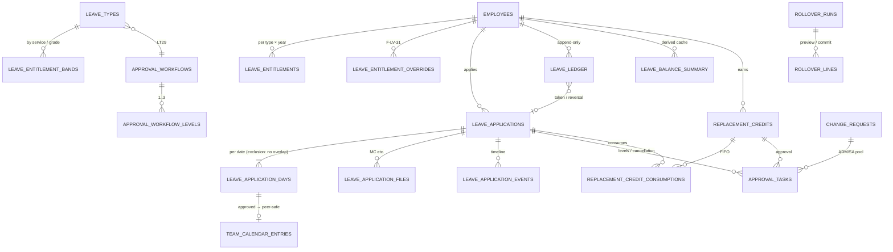
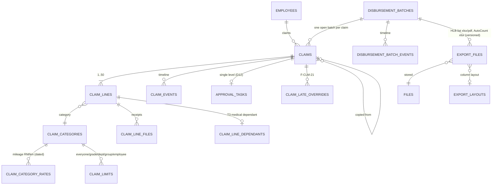
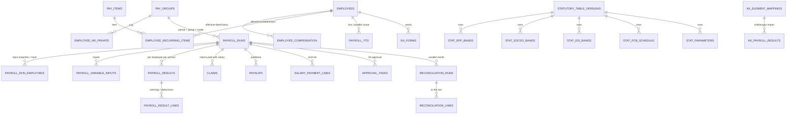

# PRET — Data Model

**Work item:** W1-003 · **Author:** Solution Architect · **Status:** Proposed for GATE 2 (Design)
**Last updated:** 15/11/2026
**Designs for:** `docs/product/PRD.md` (field tables §5–§14, status models, §16 access matrix), `docs/product/user-stories.md`, decisions D1–D17 (`docs/01-decisions.md`)
**Companions:** [`system-design.md`](system-design.md) · [`rls-policies.md`](rls-policies.md) · [`non-functional.md`](non-functional.md) · [`adr/`](adr/README.md)

> This document is the **schema contract** the Backend engineer turns into
> `supabase/migrations/*.sql`. DDL here is normative for table/column names, types,
> nullability, constraints and indexes; the engineer may split it into migrations, add
> FK-covering indexes and tidy syntax, but any change to a column's meaning, type or
> access tier comes back to the Architect. **R1.1** tables are designed now (so R1.0 leaves
> the right seams) but are created by R1.1 migrations. All examples are synthetic.

---

## 1. Conventions

| Topic | Rule | Ref |
|-------|------|-----|
| Schemas | `app` = business tables and RLS helpers · `audit` = audit/access logs (append-only) · `private` = counters, rate limits, internals with **no** `authenticated` grants · `public` = empty. The Supabase Data API (PostgREST/GraphQL) exposes **no** schema — all data access goes through the Next.js server (ADR-0002). | ADR-0002 |
| Keys | `uuid primary key default gen_random_uuid()` for entities; `bigint generated always as identity` for high-volume append-only logs/ledgers. | — |
| Human reference numbers | Allocated in-transaction by `private.next_doc_no(doc_type, year)` — never reused (FR-G-15). Formats: `LV-yyyy-nnnnn`, `CL-yyyy-nnnnn`, `PB-yyyy-nnn`, `CR-yyyy-nnnnn`, `RL-yyyy-nnnnn`, `IM-yyyy-nnn`, `PR-yyyy-mm-nn` (R1.1). | ADR-0015 |
| Time | `timestamptz` for instants (stored UTC, displayed Asia/Kuala_Lumpur). `date` for business dates (leave dates, effective dates) — a Malaysian calendar date, never converted. "Today" = `app.today_myt()`. | ADR-0009, NFR §2 |
| Money | `numeric(14,2)` (MYR, sen-exact). Rates: `numeric(8,3)` (RM/km), `numeric(7,4)` (percent). **Never** `float/real/double`. | ADR-0006 |
| Leave days | `numeric(5,1)` for applied/approved days and stored balances (½-day steps); `numeric(10,6)` only for un-rounded calculation detail kept in `calc_detail`. | ADR-0005 |
| Text | `text` + `check (char_length(x) <= n)` mirroring PRD Text(n). Emails `citext`. | PRD §2.1 |
| Stamps | Every mutable table has `created_at, created_by, updated_at, updated_by` (set by trigger `app.tg_stamp()` from `app.current_app_user_id()`; system jobs record `null` + `audit.audit_log.actor_label`). Shown on every record (FR-G-13). | FR-G-13 |
| Optimistic locking | Mutable workflow rows carry `version int not null default 1`; updates use `where version = $expected` and the trigger increments it. | ADR-0015 |
| Idempotency | Rows created from a user form carry `idempotency_key uuid unique` (client-generated per form instance). | EC-LV-09, NFR-09 |
| Soft delete | No hard delete of employee/leave/claim/payment/audit data (FR-G-08). Deactivate via `is_active`; cancel/withdraw via status. Owner-deletable drafts (`claims` in `new`, open change requests) are the only `DELETE` grants. | FR-G-08 |
| Audit | Every table in `app` except derived caches has the generic audit trigger `audit.tg_log_change()` (before/after diff). | F-ADM-09, ADR-0008 |
| Sensitive tiers | Each table is tagged with its **access tier** (§2). The tier, not the UI, decides who can read it. | ADR-0003 |
| Encrypted identifiers | Columns suffixed `_enc bytea` hold AES-256-GCM ciphertext produced by the Next.js server (key never in the database), with `_last4 char(4)` for masked display and `_bidx bytea` (HMAC-SHA-256 blind index) for uniqueness/duplicate checks. | ADR-0003 |
| Extensions | `pgcrypto` (gen_random_uuid, digest), `citext`, `btree_gist` (exclusion constraints), `pg_trgm` in schema `extensions` (name search). | — |

---

## 2. Access tiers (sensitive-column strategy)

The PRD defines visibility per **field**; Postgres RLS works per **row**. PRET therefore
splits each person's data **vertically by audience**: a field lives in the table whose
audience matches its View column. A manager or peer cannot read a field if no policy on
its table admits them — that is the database-level guarantee (ADR-0003).

| Tier | Audience (read) | Tables | Holds (PRD refs) |
|------|-----------------|--------|------------------|
| **T0 Directory** | every active user | `employee_directory` (trigger-maintained projection) | Name, preferred name, photo, position, department, location, work email, work phone, manager (FR-EMP-14, F-EMP-22/23) |
| **T1 Team** | self · managers (direct + indirect) · current approver of the employee's item · ADM · SA | `employees`, `employee_emergency_contacts`, `employee_job_history`, `employee_separations`, `probation_recommendations`, leave/claim transaction tables | A1–A3, A7, B1, B3, B4, C1–C7, F1, F3–F13, F15–F19, G1, G2, G5 |
| **T2 Self + HR** | self · ADM · SA (never MGR, never peers) | `employee_personal`, `employee_marital_history`, `employee_spouses`, `employee_children`, `employee_statutory_profiles`, `employee_bank_accounts`, `employee_documents` (visible ones), `change_requests`, `leave_ledger`, `prior_employments`, `claim_line_dependants`, payslips/YTD/EA (R1.1), `employee_compensation` (R1.1) | MyKad (encrypted), DOB, race, marital, family, addresses, personal email, statutory numbers, bank, compensation |
| **T3 HR only** | ADM · SA | `employee_hr_private`, `employee_separation_details`, `employee_statutory_employer_flags`, `hr_notes`, `hr_note_revisions`, `employee_group_members`, HR-only documents | F14, F20, F22, F23, F25, F28, F29, G3, G4, G6–G9, H2, H9, H10, H14, H18, H20, H24, H25, H32, L1, K (HR-only categories) |
| **T4 Special category (PDPA s4)** | self (direct) · ADM/SA **only via logged-read functions** (`app.read_employee_sensitive()`), MC files only via logged download grants | `employee_sensitive` (religion, OKU, OKU card no.), medical files | A11, A14, A15, LA11 (sick/hosp/maternity), CLN14 medical dependants |
| **T5 Security** | SA only (read) | `audit.audit_log`, `audit.access_log`, `login_events`, `user_roles` history | F-ADM-09–13 |

**Encrypted identifiers (S1) — inside T2/T3 tables:** employee MyKad (`employee_personal.nric_enc`),
spouse MyKad, child MyKid/MyKad, bank account no., ASNB account no., HLB paying account
no. A reader who passes RLS still sees only ciphertext + last 4; plaintext exists only in
the Next.js server after a logged reveal (FR-G-11, F-EMP-20) or for the owner's own view.

**Compensation and payroll** (salary, payslips) are **not** encrypted: they must be summed,
reported and fed to the payroll engine. They are T2 (self + ADM/SA) and never reachable
by MGR — enforced by RLS and covered by the policy lint test (`rls-policies.md` §9).

**Non-sensitive presentation differences inside one tier** (e.g. a manager is not shown a
reportee's emergency-contact email C6 or next-of-kin flag C7, or job-history remarks
JH10) are enforced by the server's per-role DTO projection and covered by QA tests — they
are listed explicitly in `rls-policies.md` §8 so nothing is silently UI-only.

---

## 3. Enumerations

```sql
-- Users & access (D11)
create type app.user_type        as enum ('employee','external');
create type app.user_status      as enum ('invited','active','locked','disabled','expired');
create type app.privileged_role  as enum ('ADM','SA');             -- EMP implicit, MGR derived
create type app.delegation_scope as enum ('leave','claims','both');

-- Employee master (PRD §5)
create type app.employment_status as enum ('pending_join','on_probation','confirmed','notice_period','separated','withdrawn');
create type app.gender            as enum ('male','female');
create type app.marital_status    as enum ('single','married','divorced','widowed');
create type app.race              as enum ('malay','chinese','indian','bumiputera_sabah','bumiputera_sarawak','orang_asli','others');
create type app.religion          as enum ('islam','buddhism','christianity','hinduism','sikhism','taoism','other','none','prefer_not_to_say');
create type app.my_state          as enum ('JHR','KDH','KTN','MLK','NSN','PHG','PNG','PRK','PLS','SBH','SWK','SGR','TRG','KUL','LBN','PJY');
create type app.qualification     as enum ('spm','stpm','certificate','diploma','bachelor','master','doctorate','professional','other');
create type app.employment_type   as enum ('permanent_full_time');   -- BR-EMP-24; others reserved
create type app.job_change_type   as enum ('new_hire','confirmation','promotion','transfer','re_designation','grade_change','manager_change','working_pattern_change','separation','rehire','data_correction');
create type app.separation_type   as enum ('resignation','termination_with_notice','dismissal_misconduct','retirement','mutual_separation','end_of_probation','death','other');
create type app.separation_reason as enum ('career_advancement','compensation','personal','relocation','further_studies','health','performance','misconduct','restructuring','retirement','other');
create type app.notice_outcome    as enum ('served','waived_by_company','bought_out_by_employee','short_served');
create type app.contact_relationship as enum ('spouse','parent','child','sibling','relative','friend','other');
create type app.spouse_record_status as enum ('current','former');
create type app.child_relationship as enum ('biological','adopted','step_child');
create type app.pcb_child_category as enum ('under_18','over_18_pre_university','over_18_diploma_plus','disabled','disabled_diploma_plus','not_eligible');
create type app.relief_share      as enum ('full_100','shared_50','spouse_claims_0');
create type app.payment_method    as enum ('bank_transfer','cheque','cash');
create type app.bank_account_type as enum ('savings','current');
create type app.socso_category    as enum ('category_1','category_2');
create type app.epf_rate_type     as enum ('statutory','specific');
create type app.notice_unit       as enum ('weeks','months');
create type app.document_category as enum ('offer_letter','employment_contract','mykad_copy','academic_certificate','professional_certificate','confirmation_letter','promotion_transfer_letter','resignation_letter','separation_letter','disciplinary_letter','medical_report','bank_proof','other');
create type app.cr_category       as enum ('legal_name','mykad','marital_spouse','children','oku','religion','race','bank_details','statutory_numbers');
create type app.cr_status         as enum ('submitted','approved','rejected','cancelled');

-- Organisation (PRD §9)
create type app.day_type          as enum ('full','half','off','rest');
create type app.month_day_basis   as enum ('actual_working_days','fixed_26','calendar_days');
create type app.holiday_type      as enum ('national','state','replacement','company','special');
create type app.compulsory_holiday as enum ('national_day','agong_birthday','ruler_birthday_or_ft_day','workers_day','malaysia_day');
create type app.calendar_status   as enum ('draft','published');

-- Leave (PRD §6)
create type app.leave_category    as enum ('annual','sick','hospitalisation','maternity','paternity','compassionate','marriage','unpaid','replacement','emergency','study_exam','other');
create type app.count_basis       as enum ('working_days','calendar_days','consecutive_calendar_days');
create type app.entitlement_method as enum ('annual_banded','fixed_per_occurrence','earned_credits','no_entitlement');
create type app.accrual_method    as enum ('policy_default','accrual_pro_rata','full_pro_rated','accrual_first_year_then_full');
create type app.prorate_basis     as enum ('by_day','by_month');
create type app.leave_rounding    as enum ('up_half','nearest_half','down_half','employment_act');
create type app.attachment_rule   as enum ('not_required','always','if_more_than_n_days');
create type app.notice_behaviour  as enum ('warn','block');
create type app.occurrence_scope  as enum ('per_year','per_employment');
create type app.leave_payroll_treatment as enum ('paid','unpaid_deduct','paid_encashable');
create type app.eligible_gender   as enum ('all','male','female');
create type app.eligible_marital  as enum ('any','married');
create type app.leave_status      as enum ('pending','approved','rejected','withdrawn','cancellation_pending','cancelled');
create type app.leave_session     as enum ('full','am','pm');
create type app.mc_status         as enum ('not_checked','verified','invalid');
create type app.ledger_entry_type as enum ('entitlement','carry_forward','credit_earned','taken','taken_reversal','adjustment','expired','forfeited');   -- imports post these types with is_opening = true
create type app.credit_status     as enum ('pending','approved','rejected','withdrawn');
create type app.credit_duration   as enum ('full_day','half_day');
create type app.team_calendar_visibility as enum ('everyone','same_department','managers_and_hr');
create type app.rollover_status   as enum ('previewed','committed','superseded');

-- Approvals (PRD §6.11, §7.7, §14.8)
create type app.approver_source   as enum ('direct_manager','leave_approver_override','managers_manager','specific_employee','admin_pool','super_admin_pool','claim_pool');
create type app.task_subject      as enum ('leave_application','leave_cancellation','replacement_credit','claim','change_request','disbursement_batch','payroll_run','statutory_table_version');
create type app.task_status       as enum ('open','approved','rejected','skipped','superseded','cancelled');
create type app.acting_as         as enum ('assignee','delegate','admin_override','rerouted','pool_member','system_auto');

-- Claims (PRD §7, D12)
create type app.claim_status      as enum ('new','submitted','approved','disbursed','rejected','withdrawn','cancelled');
create type app.claim_group       as enum ('business_travel','meals_entertainment','transport_mileage','medical','communications','office_admin','equipment_software','marketing_sales','employee_wellbeing','other');
create type app.capture_mode      as enum ('hidden','optional','required');
create type app.claim_extra_field as enum ('from_to_purpose','client_attendees','travel_destination','merchant_name');
create type app.claimant_scope    as enum ('employee_only','employee_and_dependants');
create type app.claim_dependant   as enum ('self','spouse','child');
create type app.tax_treatment     as enum ('reimbursement','exempt_benefit','taxable_allowance','taxable_perquisite');
create type app.limit_applies_to  as enum ('everyone','grade','department','employee_group','employee');
create type app.limit_behaviour   as enum ('block','warn');
create type app.batch_status      as enum ('draft','pending_approval','approved','exported','disbursed','cancelled');
create type app.disbursed_via     as enum ('hlb_batch','payroll_run');

-- Files, outputs, notifications, audit
create type app.file_status       as enum ('pending_upload','active','superseded','deleted');
create type app.file_subject      as enum ('employee_document','employee_photo','leave_attachment','claim_receipt','change_request_doc','privacy_notice','company_asset','import_source','generated_output','cp38_letter','tp1_doc');
create type app.output_kind       as enum ('hlb_claims_payment_list_xlsx','hlb_claims_payment_list_pdf','autocount_claims_xlsx','attachment_bundle_zip','payroll_input_pack_xlsx','report_xlsx','report_pdf','my_data_export','access_review','breach_extract','import_error_report',
                                       'salary_payment_list_xlsx','salary_payment_list_pdf','payslip_pdf','payslip_bundle_zip','ea_form_pdf','form_e_xlsx','kwsp_file','perkeso_file','epcb_file','hrdf_report','zakat_report','ptptn_report','cp22_report','payroll_report','autocount_payroll_journal_xlsx','reconciliation_report');
create type app.email_status      as enum ('pending','sending','sent','failed','suppressed');
create type app.data_category     as enum ('identity','contact','family','health','religion','bank','statutory','compensation','payslip');
create type app.audit_action      as enum ('create','update','status_change','approve','reject','return','cancel','delete_draft','login','login_failed','logout','view_sensitive','reveal','download','export','import','config_change','payroll_calculate','payroll_approve','payroll_finalise','payroll_reopen','role_change','record_open');
create type app.job_status        as enum ('running','succeeded','failed');
create type app.import_template   as enum ('T1_org','T2_employees','T3_emergency','T4_spouses','T5_children','T6_job_history','T7_opening_balances','T8_leave_history','T9_future_leave','T10_holidays','T11_claims_history','T12_documents','T13_compensation','T14_ytd','T15_kk_results','T16_tp1_tp3_cp38');
create type app.import_mode       as enum ('validate_only','validate_and_commit');
create type app.import_status     as enum ('uploaded','validating','validated','validation_failed','committing','committed','commit_failed','cancelled');
create type app.dsr_type          as enum ('access','correction','portability','other');
create type app.dsr_status        as enum ('open','responded','extended','closed');
create type app.login_outcome     as enum ('success','failure','locked','mfa_failure','disabled','expired');
```

---

## 4. Organisation, settings and reference data (M5 — R1.0)

```sql
-- Singleton company profile (non-statutory part: ADM may edit) — F-ORG-01, CO1–CO6, CO15
create table app.company_profile (
  id smallint primary key default 1 check (id = 1),
  legal_name text not null check (char_length(legal_name) <= 150),                 -- CO1 (SA-edit: guard trigger)
  phone text, email citext, website text,                                           -- CO5
  biz_addr_line1 text not null, biz_addr_line2 text, biz_addr_line3 text,
  biz_postcode char(5) not null check (biz_postcode ~ '^[0-9]{5}$'), biz_city text not null, biz_state app.my_state not null, biz_country text not null default 'Malaysia',
  logo_file_id uuid,                                                                -- CO6 → app.files
  version int not null default 1, created_at timestamptz not null default now(), created_by uuid, updated_at timestamptz not null default now(), updated_by uuid
);

-- Statutory employer identity and HLB paying account — SA edit only (F-ORG-01, CO2–CO4, CO7–CO13)
create table app.company_statutory (
  id smallint primary key default 1 check (id = 1),
  ssm_no_new char(12) not null check (ssm_no_new ~ '^[0-9]{12}$'),                 -- CO2
  ssm_no_old text check (char_length(ssm_no_old) <= 10),                            -- CO3
  reg_addr_line1 text not null, reg_addr_line2 text, reg_addr_line3 text,
  reg_postcode char(5) not null, reg_city text not null, reg_state app.my_state not null, reg_country text not null default 'Malaysia',
  epf_employer_no text check (char_length(epf_employer_no) <= 9),                    -- CO7 (R1.1-required)
  socso_employer_code text check (char_length(socso_employer_code) <= 12),           -- CO8
  lhdn_e_no text check (char_length(lhdn_e_no) <= 11),                                -- CO9
  company_tax_no text check (char_length(company_tax_no) <= 14),                      -- CO10
  hrdf_registered boolean not null default false,                                     -- CO11 (Q2 default: not registered)
  hrdf_levy_rate numeric(7,4) check (hrdf_levy_rate in (1.0000, 0.5000)),
  hrdf_mycoid text,
  hlb_account_name text,                                                              -- CO13
  hlb_account_no_enc bytea, hlb_account_no_last4 char(4),                             -- CO13 encrypted (S1)
  version int not null default 1, created_at timestamptz not null default now(), created_by uuid, updated_at timestamptz not null default now(), updated_by uuid
);

create table app.zakat_bodies (            -- reference list (state zakat authorities) — H31, CO12
  id uuid primary key default gen_random_uuid(),
  state app.my_state not null, name text not null, code text not null unique, is_active boolean not null default true
);
create table app.company_zakat_registrations (                                       -- CO12
  id uuid primary key default gen_random_uuid(),
  zakat_body_id uuid not null references app.zakat_bodies(id), employer_ref text not null check (char_length(employer_ref) <= 30),
  unique (zakat_body_id), created_at timestamptz not null default now(), created_by uuid, updated_at timestamptz not null default now(), updated_by uuid
);
create table app.company_signatories (                                               -- CO14
  id uuid primary key default gen_random_uuid(),
  name text not null, designation text not null, signature_file_id uuid, display_order smallint not null default 1, is_active boolean not null default true,
  created_at timestamptz not null default now(), created_by uuid, updated_at timestamptz not null default now(), updated_by uuid
);
create table app.gl_mappings (                                                       -- CO15 (AutoCount, D10, Q37)
  purpose text primary key check (purpose in ('claims_payable','salary_payable','epf_payable','socso_payable','eis_payable','pcb_payable','zakat_payable','ptptn_payable','hrdf_payable','bank_clearing')),
  gl_account_code text not null check (char_length(gl_account_code) <= 20),
  updated_at timestamptz not null default now(), updated_by uuid
);

create table app.banks (                    -- reference list incl. bank code/BIC for HLB Connect First lists (I2)
  id uuid primary key default gen_random_uuid(),
  name text not null unique, bank_code text not null, swift_bic text, account_no_min_len smallint default 6, account_no_max_len smallint default 20, is_active boolean not null default true
);
create table app.lhdn_branches (id uuid primary key default gen_random_uuid(), name text not null unique, is_active boolean not null default true);  -- H5

create table app.departments (                                                       -- F-ORG-02
  id uuid primary key default gen_random_uuid(),
  code text not null unique check (char_length(code) <= 10), name text not null check (char_length(name) <= 80),
  parent_id uuid references app.departments(id), head_employee_id uuid, cost_centre_id uuid,
  is_active boolean not null default true,
  created_at timestamptz not null default now(), created_by uuid, updated_at timestamptz not null default now(), updated_by uuid
);
create table app.positions (                                                         -- F-ORG-03
  id uuid primary key default gen_random_uuid(),
  code text not null unique check (char_length(code) <= 10), title text not null check (char_length(title) <= 100),
  default_department_id uuid references app.departments(id), default_grade_id uuid, description text check (char_length(description) <= 1000),
  is_active boolean not null default true,
  created_at timestamptz not null default now(), created_by uuid, updated_at timestamptz not null default now(), updated_by uuid
);
create table app.grades (                                                            -- F-ORG-04 (Q25)
  id uuid primary key default gen_random_uuid(),
  code text not null unique check (char_length(code) <= 10), name text not null, rank smallint not null unique, is_active boolean not null default true,
  created_at timestamptz not null default now(), created_by uuid, updated_at timestamptz not null default now(), updated_by uuid
);
create table app.cost_centres (                                                      -- F-ORG-13 (Could)
  id uuid primary key default gen_random_uuid(),
  code text not null unique check (char_length(code) <= 10), name text not null, autocount_code text, is_active boolean not null default true,
  created_at timestamptz not null default now(), created_by uuid, updated_at timestamptz not null default now(), updated_by uuid
);
create table app.employee_groups (                                                   -- F-ORG-14 (Could)
  id uuid primary key default gen_random_uuid(), name text not null unique, description text, is_active boolean not null default true,
  created_at timestamptz not null default now(), created_by uuid, updated_at timestamptz not null default now(), updated_by uuid
);
create table app.working_patterns (                                                  -- F-ORG-06, WP1/WP6
  id uuid primary key default gen_random_uuid(), name text not null unique check (char_length(name) <= 60), is_active boolean not null default true,
  created_at timestamptz not null default now(), created_by uuid, updated_at timestamptz not null default now(), updated_by uuid
);
create table app.working_pattern_versions (                                          -- WP2–WP5 (versioned, EC-ORG-03)
  id uuid primary key default gen_random_uuid(),
  pattern_id uuid not null references app.working_patterns(id),
  effective_from date not null,
  mon app.day_type not null, tue app.day_type not null, wed app.day_type not null, thu app.day_type not null,
  fri app.day_type not null, sat app.day_type not null, sun app.day_type not null,
  hours_per_full_day numeric(3,1) not null default 8.0 check (hours_per_full_day > 0),
  month_day_basis app.month_day_basis not null default 'fixed_26',
  unique (pattern_id, effective_from),
  constraint chk_one_rest_day check ('rest' in (mon,tue,wed,thu,fri,sat,sun)),       -- BR-ORG-10
  created_at timestamptz not null default now(), created_by uuid
);
create table app.work_locations (                                                    -- F-ORG-05
  id uuid primary key default gen_random_uuid(),
  name text not null unique check (char_length(name) <= 80),
  addr_line1 text not null, addr_line2 text, addr_line3 text, postcode char(5) not null, city text not null,
  state app.my_state not null,                                                        -- drives PH calendar (WL3)
  default_pattern_id uuid not null references app.working_patterns(id),
  is_active boolean not null default true,
  created_at timestamptz not null default now(), created_by uuid, updated_at timestamptz not null default now(), updated_by uuid
);

-- Public holidays (F-ORG-07–10)
create table app.holiday_calendar_years (                                            -- BR-ORG-25 draft/publish per state-year
  year smallint not null, state app.my_state not null, status app.calendar_status not null default 'draft',
  published_by uuid, published_at timestamptz, primary key (year, state)
);
create table app.public_holidays (                                                   -- PH1–PH8, PH10
  id uuid primary key default gen_random_uuid(),
  year smallint not null, holiday_date date not null check (extract(year from holiday_date) = year),
  name text not null check (char_length(name) <= 100),
  holiday_type app.holiday_type not null check (holiday_type <> 'replacement'),
  compulsory app.compulsory_holiday,                                                  -- PH6 (L-09)
  is_observed boolean not null default true,                                          -- PH7 (Q15)
  is_half_day boolean not null default false,                                         -- PH8
  remarks text check (char_length(remarks) <= 200),
  is_active boolean not null default true,
  created_at timestamptz not null default now(), created_by uuid, updated_at timestamptz not null default now(), updated_by uuid
);
create table app.public_holiday_states (holiday_id uuid not null references app.public_holidays(id), state app.my_state not null, primary key (holiday_id, state));  -- PH5
create table app.replacement_holidays (                                              -- F-ORG-08, BR-ORG-21/22 (system-generated, per pattern × state)
  id uuid primary key default gen_random_uuid(),
  source_holiday_id uuid not null references app.public_holidays(id),                -- PH9
  state app.my_state not null, pattern_id uuid not null references app.working_patterns(id),
  replacement_date date not null, is_active boolean not null default true,
  unique (source_holiday_id, state, pattern_id), created_at timestamptz not null default now()
);
create index on app.public_holidays (holiday_date) where is_active;
create index on app.replacement_holidays (state, pattern_id, replacement_date) where is_active;

-- Typed settings singletons (F-ORG-12, §9.5). Control settings: SA only. Operating settings: ADM + SA.
create table app.security_settings (                                                 -- SA-only (control)
  id smallint primary key default 1 check (id = 1),
  employee_no_prefix text not null default 'INT-', employee_no_padding smallint not null default 3, employee_no_next int not null,   -- Q32
  default_probation_months smallint not null default 3, max_probation_months smallint not null default 12,                        -- Q27
  notice_weeks_lt2 smallint not null default 4, notice_weeks_2to5 smallint not null default 6, notice_weeks_ge5 smallint not null default 8,  -- L-11
  allowed_email_domains citext[] not null default '{interact.com.my}',                                                            -- BR-EMP-07, Q2
  idle_timeout_min_employee smallint not null default 30, idle_timeout_min_privileged smallint not null default 15,               -- F-ADM-14
  lockout_threshold smallint not null default 5, lockout_minutes smallint not null default 30,                                    -- F-ADM-13
  mfa_required_privileged boolean not null default true,                                                                          -- F-ADM-07, Q31
  invite_lead_days smallint not null default 3, invite_link_hours smallint not null default 72,                                   -- FR-EMP-02, EC-ADM-05
  reminder_after_working_days smallint not null default 2, escalate_after_working_days smallint not null default 5,               -- LP15
  sa_batch_approval_required boolean not null default false,                                                                      -- D12 (default off)
  max_top_of_org smallint not null default 1,                                                                                     -- F14, Q11
  hr_reply_to_email citext,                                                                                                       -- BR-NTF-06
  retention_years_hr smallint not null default 7, retention_years_payroll smallint not null default 7, retention_years_audit smallint not null default 7,
  retention_days_import_files smallint not null default 30,                                                                       -- §10.6, Q29
  updated_at timestamptz not null default now(), updated_by uuid
);
-- leave_policy (LP1–LP18) and claim_policy (F-CLM-03) singletons are in §7 and §9; payroll_settings (R1.1) in §13.
```

---

## 5. Users, roles and access (M6 — R1.0)

```sql
create table app.app_users (                                                         -- F-ADM-01/02/04, U1–U15
  id uuid primary key default gen_random_uuid(),
  auth_user_id uuid unique references auth.users(id) on delete restrict,             -- null until the invite is accepted
  user_type app.user_type not null,                                                   -- U3 (immutable: guard trigger)
  employee_id uuid unique,                                                            -- U4 → app.employees(id)
  login_email citext not null unique,                                                 -- U1 (= work email B1 for employee users)
  display_name text not null check (char_length(display_name) between 1 and 100),     -- U2
  status app.user_status not null default 'invited',                                  -- U6 (§10.2)
  access_start_date date not null,                                                    -- U7
  access_end_date date,                                                               -- U8 (external: required; employee: = G7)
  service_provider text check (char_length(service_provider) <= 150),                 -- U9
  mfa_enrolled boolean not null default false,                                        -- U13 (mirror of auth.mfa_factors, set by server)
  last_login_at timestamptz, failed_login_count smallint not null default 0, locked_until timestamptz,   -- U14
  invited_by uuid references app.app_users(id), invited_at timestamptz,               -- U15
  disabled_reason text,
  version int not null default 1, created_at timestamptz not null default now(), created_by uuid, updated_at timestamptz not null default now(), updated_by uuid,
  constraint chk_user_link check ((user_type = 'employee' and employee_id is not null) or (user_type = 'external' and employee_id is null)),
  constraint chk_external_window check (user_type = 'employee' or (access_end_date is not null and service_provider is not null)),   -- F-ADM-04
  constraint chk_window_order check (access_end_date is null or access_end_date >= access_start_date)
);

create table app.user_roles (                                                        -- F-ADM-03 (ADM / SA only)
  id uuid primary key default gen_random_uuid(),
  user_id uuid not null references app.app_users(id),
  role app.privileged_role not null,
  granted_by uuid not null references app.app_users(id), granted_at timestamptz not null default now(),
  revoked_by uuid references app.app_users(id), revoked_at timestamptz,
  constraint chk_not_self_grant check (granted_by <> user_id and (revoked_by is null or revoked_by <> user_id))   -- BR-ADM-03
);
create unique index ux_user_roles_active on app.user_roles (user_id, role) where revoked_at is null;
-- Trigger app.tg_user_roles_guard: external users may hold ADM only; at least one active SA must remain (EC-ADM-01); N-53.

create table app.user_invitations (                                                  -- own 72-hour invite tokens (ADR-0014)
  id uuid primary key default gen_random_uuid(),
  user_id uuid not null references app.app_users(id),
  token_hash bytea not null unique,                                                   -- SHA-256 of the random token; token itself only in the email
  expires_at timestamptz not null, scheduled_send_at timestamptz,                     -- FR-EMP-02 (join date − 3 days)
  sent_at timestamptz, accepted_at timestamptz, revoked_at timestamptz,
  created_by uuid not null, created_at timestamptz not null default now()
);

create table app.app_sessions (                                                      -- idle timeout per role (F-ADM-14)
  session_id uuid primary key,                                                        -- = JWT session_id claim
  user_id uuid not null references app.app_users(id),
  created_at timestamptz not null default now(), last_seen_at timestamptz not null default now(),
  aal text not null default 'aal1', ip inet, user_agent text,
  ended_at timestamptz, end_reason text check (end_reason in ('logout','idle_timeout','disabled','expired','role_change','password_reset'))
);
create index on app.app_sessions (user_id) where ended_at is null;

create table app.login_events (                                                      -- F-ADM-13 (SA view)
  id bigint generated always as identity primary key,
  occurred_at timestamptz not null default now(),
  login_email citext not null, user_id uuid references app.app_users(id),
  outcome app.login_outcome not null, ip inet, user_agent text, detail text
);
create index on app.login_events (login_email, occurred_at desc);

create table app.delegations (                                                       -- F-LV-24, BR-LV-60, F-PRT-14
  id uuid primary key default gen_random_uuid(),
  delegator_user_id uuid not null references app.app_users(id),
  delegate_user_id  uuid not null references app.app_users(id),
  valid_from date not null, valid_to date not null,
  scope app.delegation_scope not null,
  set_by uuid not null references app.app_users(id),                                  -- approver, or ADM on their behalf
  cancelled_at timestamptz, cancelled_by uuid,
  created_at timestamptz not null default now(),
  constraint chk_delegate_not_self check (delegate_user_id <> delegator_user_id),
  constraint chk_delegation_dates check (valid_to >= valid_from)
);
create index on app.delegations (delegator_user_id, valid_from, valid_to) where cancelled_at is null;
-- Trigger: delegate must be an active *employee* user (external users excluded — BR-ADM-04; see Q-ARCH-01).
```

---

## 6. Employee master records (M1 — R1.0)

```sql
-- T1 TEAM — core record. Only manager-visible fields live here (PRD §5.3 View column contains M).
create table app.employees (                                                         -- F-EMP-02/03/09
  id uuid primary key default gen_random_uuid(),
  employee_no text not null unique check (char_length(employee_no) <= 20),          -- A1, BR-EMP-11 (immutable except SA: guard trigger)
  full_name text not null check (char_length(full_name) <= 150 and full_name ~ '^[[:alpha:]@''./ -]+$'),  -- A2 (E→CR)
  preferred_name text check (char_length(preferred_name) <= 60),                    -- A3 (E✎)
  gender app.gender not null,                                                         -- A7
  work_email citext not null unique,                                                  -- B1, BR-EMP-07
  mobile_phone text not null check (mobile_phone ~ '^\+60[0-9]{9,10}$'),             -- B3 (E.164, BR-EMP-08) (E✎)
  work_phone text check (char_length(work_phone) <= 20),                              -- B4
  photo_file_id uuid,                                                                 -- A16 (E✎)
  status app.employment_status not null,                                              -- F9 (system-derived, BR-EMP-30)
  join_date date not null,                                                            -- F1
  employment_type app.employment_type not null default 'permanent_full_time',         -- F3
  probation_months smallint not null check (probation_months between 0 and 12),       -- F4
  probation_end_date date generated always as (case when probation_months = 0 then null else (join_date + make_interval(months => probation_months) - interval '1 day')::date end) stored,  -- F5, BR-EMP-12
  extended_probation_end_date date,                                                   -- F6
  confirmation_date date check (confirmation_date is null or confirmation_date >= join_date),   -- F8, BR-EMP-13
  -- Current-job cache (maintained from employee_job_history by app.apply_current_job(); never edited directly)
  department_id uuid not null references app.departments(id),                         -- F10
  position_id uuid not null references app.positions(id),                             -- F11
  grade_id uuid not null references app.grades(id),                                   -- F12
  manager_employee_id uuid references app.employees(id),                              -- F13
  work_location_id uuid not null references app.work_locations(id),                   -- F17
  work_state app.my_state not null,                                                   -- F18 (from location, or F20 override)
  working_pattern_id uuid not null references app.working_patterns(id),               -- F19
  manager_since date,                                                                 -- F27
  leave_approver_employee_id uuid references app.employees(id),                       -- F15
  claim_approver_employee_id uuid references app.employees(id),                       -- F16
  version int not null default 1, created_at timestamptz not null default now(), created_by uuid, updated_at timestamptz not null default now(), updated_by uuid,
  constraint chk_not_own_manager check (manager_employee_id is distinct from id),     -- BR-EMP-10 (cycles: trigger)
  constraint chk_probation_ext check (extended_probation_end_date is null or extended_probation_end_date > probation_end_date)
);
create index on app.employees (status);
create index on app.employees (manager_employee_id);
create index on app.employees (department_id);
create index ix_employees_name_trgm on app.employees using gin (full_name extensions.gin_trgm_ops);

-- T0 DIRECTORY — trigger-maintained projection for every active user (FR-EMP-14, F-EMP-22/23)
create table app.employee_directory (
  employee_id uuid primary key references app.employees(id),
  employee_no text not null, full_name text not null, preferred_name text,
  position_title text not null, department_name text not null, location_name text not null,
  work_email citext not null, work_phone text, photo_file_id uuid,
  manager_employee_id uuid,                                                            -- org chart (names/positions only)
  is_listed boolean not null,                                                          -- false for separated / withdrawn / pending_join
  refreshed_at timestamptz not null default now()
);

-- T2 SELF+HR — personal and identity data (never MGR)
create table app.employee_personal (                                                 -- PRD §5.3 A, B, F2, F7, F21, F26
  employee_id uuid primary key references app.employees(id),
  nric_enc bytea not null, nric_last4 char(4) not null, nric_bidx bytea not null unique,   -- A4 encrypted (S1); BR-EMP-05 uniqueness
  date_of_birth date not null,                                                         -- A5 (≤ today: trigger)
  dob_overridden boolean not null default false,                                       -- BR-EMP-02 (logged)
  nationality text not null default 'Malaysian' check (nationality = 'Malaysian'),     -- A8, BR-EMP-23
  race app.race, race_other text check (char_length(race_other) <= 50),               -- A9/A10
  passport_no text check (passport_no ~ '^[A-Za-z0-9]{1,20}$'), passport_expiry date,   -- A17/A18 (E✎)
  highest_qualification app.qualification,                                             -- A19 (E✎)
  personal_email citext not null,                                                      -- B2 (E✎)
  res_addr_line1 text not null, res_addr_line2 text, res_addr_line3 text,               -- B5/B6 (E✎)
  res_postcode char(5) not null check (res_postcode ~ '^[0-9]{5}$'), res_city text not null, res_state app.my_state not null, res_country text not null default 'Malaysia',
  mailing_same_as_residential boolean not null default true,                           -- B11
  mail_addr_line1 text, mail_addr_line2 text, mail_addr_line3 text, mail_postcode char(5), mail_city text, mail_state app.my_state, mail_country text,  -- B12
  continuous_service_date date not null,                                               -- F2 (BR-EMP-15)
  probation_extension_reason text check (char_length(probation_extension_reason) <= 500),   -- F7
  contractual_notice_value smallint, contractual_notice_unit app.notice_unit,          -- F21
  retirement_date date generated always as ((date_of_birth + interval '60 years')::date) stored,   -- F26 (L-13)
  version int not null default 1, created_at timestamptz not null default now(), created_by uuid, updated_at timestamptz not null default now(), updated_by uuid,
  -- B2 ≠ B1 and "date ≤ today" rules are enforced by validation trigger app.tg_validate_employee_personal (cross-table / time-dependent; never in CHECK)
  constraint chk_race_other check (race is distinct from 'others' or race_other is not null),
  constraint chk_passport_expiry check (passport_no is null or passport_expiry is not null),
  constraint chk_mailing check (mailing_same_as_residential or (mail_addr_line1 is not null and mail_postcode is not null and mail_city is not null and mail_state is not null))
);
create index on app.employee_personal (nric_last4);                                   -- search by last 4 (A,S) — §5.7

create table app.employee_marital_history (                                           -- A12/A13, BR-EMP-22 (as-of queries: paternity, PCB)
  id uuid primary key default gen_random_uuid(),
  employee_id uuid not null references app.employees(id),
  marital_status app.marital_status not null, effective_date date not null,
  unique (employee_id, effective_date),
  created_at timestamptz not null default now(), created_by uuid
);

-- T4 SPECIAL CATEGORY — religion, OKU (PDPA s4). Direct SELECT: self only. ADM/SA via app.read_employee_sensitive() which logs.
create table app.employee_sensitive (                                                 -- A11, A14, A15, BR-EMP-21
  employee_id uuid primary key references app.employees(id),
  religion app.religion,
  is_oku boolean not null default false,
  oku_card_no text check (char_length(oku_card_no) <= 20),
  version int not null default 1, created_at timestamptz not null default now(), created_by uuid, updated_at timestamptz not null default now(), updated_by uuid,
  constraint chk_oku_card check (not is_oku or oku_card_no is not null)
);

-- T3 HR ONLY — employment fields not visible to the employee or manager
create table app.employee_hr_private (                                                -- F14, F20, F22, F23, F25, F29
  employee_id uuid primary key references app.employees(id),
  is_top_of_org boolean not null default false,                                         -- F14 (SA only: guard trigger; max per security_settings)
  ph_state_override app.my_state,                                                       -- F20
  cost_centre_id uuid references app.cost_centres(id),                                  -- F22
  offer_contract_ref text check (char_length(offer_contract_ref) <= 50),                -- F23
  contract_signed_date date,                                                            -- F25
  pay_group_id uuid,                                                                    -- F29 (R1.1 → app.pay_groups)
  maternity_allowance_eligible boolean,                                                 -- BR-LV-42 indicator (HR only)
  version int not null default 1, created_at timestamptz not null default now(), created_by uuid, updated_at timestamptz not null default now(), updated_by uuid
);
create table app.employee_group_members (                                             -- F28 (T3)
  group_id uuid not null references app.employee_groups(id), employee_id uuid not null references app.employees(id),
  added_at timestamptz not null default now(), added_by uuid, primary key (group_id, employee_id)
);

-- T1 TEAM — emergency contacts (manager sees C1–C5 by DTO projection; Q26)
create table app.employee_emergency_contacts (                                        -- C1–C7
  id uuid primary key default gen_random_uuid(),
  employee_id uuid not null references app.employees(id),
  priority smallint not null check (priority between 1 and 3),
  name text not null check (char_length(name) <= 100),
  relationship app.contact_relationship not null,
  mobile_phone text not null check (char_length(mobile_phone) <= 20),
  alt_phone text, email citext, is_next_of_kin boolean not null default false,
  unique (employee_id, priority),
  version int not null default 1, created_at timestamptz not null default now(), created_by uuid, updated_at timestamptz not null default now(), updated_by uuid
);
create unique index ux_next_of_kin on app.employee_emergency_contacts (employee_id) where is_next_of_kin;

-- T2 SELF+HR — family (never MGR)
create table app.employee_spouses (                                                   -- D1–D9
  id uuid primary key default gen_random_uuid(),
  employee_id uuid not null references app.employees(id),
  full_name text not null check (char_length(full_name) <= 150),
  nric_enc bytea not null, nric_last4 char(4) not null, nric_bidx bytea not null,       -- D2 encrypted
  marriage_date date, working_status text not null check (working_status in ('working','not_working')),
  is_oku boolean not null default false, income_tax_no text check (char_length(income_tax_no) <= 20),
  relief_claimed_by_employee boolean, record_status app.spouse_record_status not null default 'current',
  phone text,
  unique (employee_id, nric_bidx),
  version int not null default 1, created_at timestamptz not null default now(), created_by uuid, updated_at timestamptz not null default now(), updated_by uuid,
  constraint chk_relief_only_not_working check (relief_claimed_by_employee is not true or working_status = 'not_working')
);
create table app.employee_children (                                                  -- E1–E9 (E10–E13 derived in view)
  id uuid primary key default gen_random_uuid(),
  employee_id uuid not null references app.employees(id),
  full_name text not null check (char_length(full_name) <= 150),
  nric_enc bytea, nric_last4 char(4), nric_bidx bytea,                                  -- E2 optional, encrypted
  date_of_birth date not null,                                                          -- E3 (≤ today: trigger)
  gender app.gender, relationship app.child_relationship not null,
  pcb_category app.pcb_child_category, relief_share app.relief_share,
  institution_level text check (char_length(institution_level) <= 100),
  is_oku boolean not null default false,
  version int not null default 1, created_at timestamptz not null default now(), created_by uuid, updated_at timestamptz not null default now(), updated_by uuid,
  constraint chk_study_institution check (pcb_category not in ('over_18_pre_university','over_18_diploma_plus','disabled_diploma_plus') or institution_level is not null)
);

-- T1 TEAM — effective-dated job history (F-EMP-10, §5.5)
create table app.employee_job_history (                                               -- JH1–JH11
  id uuid primary key default gen_random_uuid(),
  employee_id uuid not null references app.employees(id),
  effective_date date not null,                                                        -- JH1 (future-dated allowed)
  change_type app.job_change_type not null,                                            -- JH2
  department_id uuid not null references app.departments(id),
  position_id uuid not null references app.positions(id),
  grade_id uuid not null references app.grades(id),
  manager_employee_id uuid references app.employees(id),
  work_location_id uuid not null references app.work_locations(id),
  working_pattern_id uuid not null references app.working_patterns(id),
  employment_type app.employment_type not null,
  remarks text check (char_length(remarks) <= 500), reference_document_id uuid,        -- JH10 (manager: hidden by projection)
  is_deleted boolean not null default false, delete_reason text,                       -- EC-EMP-06 (future rows only)
  unique (employee_id, effective_date),
  version int not null default 1, created_at timestamptz not null default now(), created_by uuid, updated_at timestamptz not null default now(), updated_by uuid,
  constraint chk_correction_remarks check (change_type <> 'data_correction' or remarks is not null)
);
create index on app.employee_job_history (effective_date) where not is_deleted;

-- Derived: reporting-line closure (direct + indirect) for MGR scope (ADR-0001). Rebuilt by app.rebuild_reporting_closure().
create table app.reporting_closure (
  manager_employee_id uuid not null references app.employees(id),
  employee_id uuid not null references app.employees(id),
  depth smallint not null check (depth >= 1),
  primary key (manager_employee_id, employee_id)
);
create index on app.reporting_closure (employee_id);

create table app.probation_recommendations (                                         -- F-EMP-11 (MGR recommend)
  id uuid primary key default gen_random_uuid(),
  employee_id uuid not null references app.employees(id),
  recommendation text not null check (recommendation in ('confirm','extend','not_confirm')),
  remarks text check (char_length(remarks) <= 1000),
  recommended_by uuid not null references app.app_users(id), recommended_at timestamptz not null default now()
);

-- Separation: T1 part (dates/type) and T3 part (reason, notice maths, access end)
create table app.employee_separations (                                               -- G1, G2, G5
  id uuid primary key default gen_random_uuid(),
  employee_id uuid not null references app.employees(id),
  notice_date date not null,                                                            -- G1
  separation_type app.separation_type not null,                                         -- G2
  last_working_day date not null,                                                       -- G5
  is_withdrawn boolean not null default false, withdrawn_at timestamptz, withdrawn_by uuid,   -- G10, BR-EMP-33
  version int not null default 1, created_at timestamptz not null default now(), created_by uuid, updated_at timestamptz not null default now(), updated_by uuid,
  constraint chk_lwd check (last_working_day >= notice_date)
);
create unique index ux_active_separation on app.employee_separations (employee_id) where not is_withdrawn;
create table app.employee_separation_details (                                        -- G3, G4, G6–G9 (T3)
  separation_id uuid primary key references app.employee_separations(id),
  reason_category app.separation_reason not null, reason_text text check (char_length(reason_text) <= 500),
  notice_required_days smallint not null,                                              -- G4
  notice_shortfall_days smallint not null default 0, notice_outcome app.notice_outcome not null,   -- G6
  portal_access_end_date date not null,                                                -- G7 (≤ LWD + 30, trigger)
  eligible_for_rehire boolean, exit_remarks text check (char_length(exit_remarks) <= 1000),   -- G8, G9
  final_leave_position jsonb,                                                          -- BR-LV-91 snapshot (per type: encashable/recoverable days)
  version int not null default 1, created_at timestamptz not null default now(), created_by uuid, updated_at timestamptz not null default now(), updated_by uuid,
  constraint chk_reason_other check (reason_category <> 'other' or reason_text is not null)
);

-- T2 SELF+HR — statutory & payroll-deduction profile, employee-visible part (H group)
create table app.employee_statutory_profiles (                                        -- F-EMP-14/15
  employee_id uuid primary key references app.employees(id),
  pay_pcb boolean not null default true,                                               -- H1
  income_tax_no text check (income_tax_no ~ '^(IG[0-9]{1,11}|SG[0-9]+|OG[0-9]+)$'),    -- H3 (BR-EMP-19, verify)
  is_tax_resident boolean not null default true,                                       -- H4
  lhdn_branch_id uuid references app.lhdn_branches(id),                                -- H5
  pay_epf boolean not null default true,                                               -- H13
  epf_no text check (epf_no ~ '^[0-9]{1,9}$'),                                         -- H15
  epf_rate_type app.epf_rate_type not null default 'statutory',                        -- H16
  epf_specific_rate numeric(7,4),
  epf_extra_employee_pct numeric(4,1) check (epf_extra_employee_pct between 0 and 89), -- H17
  pay_socso boolean not null default true,                                             -- H19
  socso_no text check (char_length(socso_no) <= 12),                                   -- H21 (default = MyKad; set by server)
  socso_category app.socso_category,                                                   -- H22 (BR-EMP-20)
  socso_contributed_before boolean,                                                    -- H23
  pay_eis boolean not null default true,                                               -- H26
  eis_borne_by_employer boolean not null default false,                                -- H27 (PRD lists View E,A,S)
  pay_zakat boolean not null default false,                                            -- H28
  zakat_monthly_amount numeric(14,2) check (zakat_monthly_amount > 0),                 -- H29
  zakat_account_no text check (char_length(zakat_account_no) <= 30),                   -- H30
  zakat_body_id uuid references app.zakat_bodies(id),                                  -- H31
  ptptn_monthly_amount numeric(14,2) check (ptptn_monthly_amount >= 0),                -- H33
  ptptn_start_date date, ptptn_end_date date,                                          -- H34
  child_count_lt18 smallint, child_count_tertiary smallint, child_count_disabled_lt18 smallint, child_count_disabled_tertiary smallint,   -- E12 manual counts (migration)
  version int not null default 1, created_at timestamptz not null default now(), created_by uuid, updated_at timestamptz not null default now(), updated_by uuid,
  constraint chk_zakat check (not pay_zakat or (zakat_monthly_amount is not null and zakat_account_no is not null and zakat_body_id is not null)),
  constraint chk_ptptn check (coalesce(ptptn_monthly_amount,0) = 0 or (ptptn_start_date is not null and ptptn_end_date >= ptptn_start_date)),
  constraint chk_epf_specific check (epf_rate_type = 'statutory' or epf_specific_rate is not null)
);
create table app.employee_statutory_employer_flags (                                  -- H2, H9, H10, H14, H18, H20, H24, H25, H32 (T3)
  employee_id uuid primary key references app.employees(id),
  pcb_borne_by_employer boolean not null default false,                                -- H2
  returning_expert_programme boolean not null default false,                           -- H9
  knowledge_worker_specified_region boolean not null default false,                    -- H10
  epf_borne_by_employer boolean not null default false,                                -- H14
  epf_extra_employer_pct numeric(4,1) check (epf_extra_employer_pct between 0 and 89), -- H18
  socso_borne_by_employer boolean not null default false,                              -- H20
  pay_skbbk boolean not null default false, skbbk_borne_by_employer boolean not null default false,   -- H24/H25 (Q40)
  pay_hrdf boolean not null default false,                                             -- H32 (default = company HRDF registered)
  version int not null default 1, created_at timestamptz not null default now(), created_by uuid, updated_at timestamptz not null default now(), updated_by uuid
);

-- T2 SELF+HR — bank details, effective-dated (I1–I9). Writes: ADM/SA (not own), or CR approval. No employee direct write.
create table app.employee_bank_accounts (                                             -- F-EMP-16, D15
  id uuid primary key default gen_random_uuid(),
  employee_id uuid not null references app.employees(id),
  payment_method app.payment_method not null default 'bank_transfer',                  -- I1
  bank_id uuid references app.banks(id),                                               -- I2
  account_type app.bank_account_type,                                                  -- I3
  account_no_enc bytea, account_no_last4 char(4), account_no_bidx bytea,               -- I4 encrypted (EC-EMP-12 shared-account warning via bidx)
  account_holder_name text check (char_length(account_holder_name) <= 150),            -- I5
  holder_name_mismatch_ack boolean not null default false,                             -- BR-EMP-18 warning acknowledged
  proof_file_id uuid,                                                                  -- I6
  effective_from date not null,                                                        -- I7
  verified_by uuid not null references app.app_users(id), verified_at timestamptz not null default now(),   -- I8
  asnb_account_no_enc bytea, asnb_account_no_last4 char(4),                            -- I9 encrypted
  source_change_request_id uuid,                                                       -- set when applied from a CR
  is_superseded boolean not null default false,
  created_at timestamptz not null default now(), created_by uuid,
  unique (employee_id, effective_from),
  constraint chk_bank_transfer_fields check (payment_method <> 'bank_transfer' or (bank_id is not null and account_type is not null and account_no_enc is not null and account_holder_name is not null and proof_file_id is not null))
);
create index on app.employee_bank_accounts (account_no_bidx);
-- Rows are insert-only (a change = new effective-dated row). AFTER INSERT trigger raises N-41 (employee work + personal email, SA) — DB-enforced fraud alert.

-- T2/T3 — documents (visibility per row; HR-only categories forced)
create table app.employee_documents (                                                 -- F-EMP-18, K1–K7
  id uuid primary key default gen_random_uuid(),
  employee_id uuid not null references app.employees(id),
  category app.document_category not null,
  title text not null check (char_length(title) <= 100),
  file_id uuid not null,
  document_date date, expiry_date date,
  visible_to_employee boolean not null,
  remarks text check (char_length(remarks) <= 500),
  is_active boolean not null default true,
  version int not null default 1, created_at timestamptz not null default now(), created_by uuid, updated_at timestamptz not null default now(), updated_by uuid,
  constraint chk_hr_only_categories check (not (visible_to_employee and category in ('mykad_copy','medical_report','disciplinary_letter','bank_proof'))),
  constraint chk_doc_expiry check (expiry_date is null or document_date is null or expiry_date >= document_date)
);
create index on app.employee_documents (employee_id) where is_active;
create index on app.employee_documents (expiry_date) where is_active and expiry_date is not null;

create table app.hr_notes (                                                           -- F-EMP-26, L1 (T3)
  id uuid primary key default gen_random_uuid(),
  employee_id uuid not null references app.employees(id),
  note_date date not null, body text not null check (char_length(body) <= 2000),
  version int not null default 1, created_at timestamptz not null default now(), created_by uuid, updated_at timestamptz not null default now(), updated_by uuid
);
create table app.hr_note_revisions (                                                  -- "edits keep history" (T3)
  id bigint generated always as identity primary key,
  note_id uuid not null references app.hr_notes(id), revision smallint not null, body text not null,
  edited_by uuid not null, edited_at timestamptz not null default now(), unique (note_id, revision)
);
create table app.prior_employments (                                                  -- F-EMP-27, L2 (T2; E✎)
  id uuid primary key default gen_random_uuid(),
  employee_id uuid not null references app.employees(id),
  employer text not null, position text not null, date_from date not null, date_to date not null,
  version int not null default 1, created_at timestamptz not null default now(), created_by uuid, updated_at timestamptz not null default now(), updated_by uuid,
  constraint chk_prior_dates check (date_to >= date_from)
);

-- Change requests (F-EMP-19, §5.8) — T2 (self while open; HR)
create table app.change_requests (                                                    -- CR1–CR9
  id uuid primary key default gen_random_uuid(),
  cr_no text not null unique,                                                          -- CR-yyyy-nnnnn
  employee_id uuid not null references app.employees(id),
  category app.cr_category not null,
  effective_date date not null,                                                        -- CR4
  employee_remarks text check (char_length(employee_remarks) <= 500),
  status app.cr_status not null default 'submitted',
  decision_remarks text check (char_length(decision_remarks) <= 500),
  decided_by uuid references app.app_users(id), decided_by_employee_id uuid, decided_at timestamptz,
  applied_at timestamptz,                                                              -- when values written to master (job if effective in future)
  idempotency_key uuid unique,
  version int not null default 1, created_at timestamptz not null default now(), created_by uuid, updated_at timestamptz not null default now(), updated_by uuid,
  constraint chk_cr_reject_reason check (status <> 'rejected' or decision_remarks is not null),
  constraint chk_cr_not_self check (decided_by_employee_id is distinct from employee_id)     -- FR-G-16 (decided_by_employee_id set by trigger)
);
create unique index ux_cr_one_open_per_category on app.change_requests (employee_id, category) where status = 'submitted';   -- EC-EMP-07
create table app.change_request_items (                                               -- CR3
  id uuid primary key default gen_random_uuid(),
  change_request_id uuid not null references app.change_requests(id),
  target_table text not null, target_row_id uuid, field_name text not null,
  current_display text,                                                                 -- masked where sensitive (e.g. '••••••1234')
  new_value jsonb,                                                                      -- non-S1 fields
  new_value_enc bytea, new_value_last4 char(4)                                          -- S1 fields (MyKad, account no.) — never plaintext
);
create table app.change_request_files (change_request_id uuid not null references app.change_requests(id), file_id uuid not null, primary key (change_request_id, file_id));   -- CR5
```

**Views (security_invoker = true, so the caller's RLS applies):**
- `app.v_employee_current` — employees + derived `length_of_service` (F24, from F2 to today/LWD), `age` (A6, only when the caller can read `employee_personal`).
- `app.v_employee_children_counts` — E10–E13 derived counts per employee.
- `app.v_employee_completeness` — F-EMP-24 / F-RPT-07: missing Y and R1.1 fields per employee (ADM/SA only; reads T2/T3).
- `app.v_bank_current` — latest `employee_bank_accounts` row with `effective_from ≤ today`.

---

## 7. Leave management (M2 — R1.0)

```sql
create table app.leave_policy (                                                       -- F-LV-03, LP1–LP18 (operating: ADM + SA)
  id smallint primary key default 1 check (id = 1),
  leave_year_start_ddmm char(5) not null default '01/01' check (leave_year_start_ddmm = '01/01'),   -- LP1 (calendar year only, A3)
  entitlement_method app.accrual_method not null default 'accrual_pro_rata' check (entitlement_method <> 'policy_default'),   -- LP2
  prorate_basis app.prorate_basis not null default 'by_day',                         -- LP3
  rounding app.leave_rounding not null default 'up_half',                            -- LP4
  ea_floor_for_joiners_leavers boolean not null default true,                       -- LP5
  carry_forward_cap_days numeric(5,1) not null default 10,                           -- LP6
  carry_forward_expiry_months smallint not null default 3,                           -- LP7
  allow_next_year_applications boolean not null default true, next_year_from_ddmm char(5) not null default '01/11',   -- LP8
  form_message text check (char_length(form_message) <= 500),                        -- LP9
  emergency_threshold_days smallint not null default 3,                              -- LP10
  emergency_leave_type_ids uuid[] not null default '{}',                             -- LP11
  team_calendar_visibility app.team_calendar_visibility not null default 'everyone', -- LP12 (Q17)
  notify_on_admin_withdraw boolean not null default true,                            -- LP13
  include_separated_in_reports boolean not null default true,                        -- LP14
  replacement_credit_validity_days smallint not null default 90,                     -- LP16 (Q16)
  replacement_credits_carry_forward boolean not null default true,                   -- LP17
  replacement_for_ph_on_off_day boolean not null default false,                      -- LP18 (Q14)
  replacement_worked_lookback_days smallint not null default 30,                     -- RC3 setting
  cancellation_approver_level1_only boolean not null default true,                   -- §6.10 setting
  paternity_window_days_after_birth smallint not null default 30,                    -- BR-LV-47 setting
  updated_at timestamptz not null default now(), updated_by uuid
);

create table app.approval_workflows (                                                 -- F-LV-32, §6.11 (leave only)
  id uuid primary key default gen_random_uuid(),
  name text not null unique,
  skip_if_approver_is_applicant boolean not null default true,
  merge_consecutive_identical boolean not null default true,
  is_active boolean not null default true,
  created_at timestamptz not null default now(), created_by uuid, updated_at timestamptz not null default now(), updated_by uuid
);
create table app.approval_workflow_levels (
  workflow_id uuid not null references app.approval_workflows(id), level smallint not null check (level between 1 and 3),
  source app.approver_source not null check (source <> 'claim_pool'),
  specific_employee_id uuid references app.employees(id),
  primary key (workflow_id, level),
  constraint chk_specific check (source <> 'specific_employee' or specific_employee_id is not null)
);

create table app.leave_types (                                                        -- F-LV-01, LT1–LT34
  id uuid primary key default gen_random_uuid(),
  code text not null unique check (code ~ '^[A-Z0-9]{1,10}$'),                         -- LT1
  name text not null unique check (char_length(name) <= 60),                           -- LT2
  category app.leave_category not null,                                                -- LT3 (locked once used: trigger)
  description text check (char_length(description) <= 1000),                          -- LT4
  is_paid boolean not null,                                                            -- LT5
  count_basis app.count_basis not null,                                                -- LT6
  entitlement_method app.entitlement_method not null,                                  -- LT7
  accrual_override app.accrual_method not null default 'policy_default',               -- LT8
  prorate_joiners_leavers boolean not null,                                            -- LT9
  eligible_gender app.eligible_gender not null default 'all',                          -- LT10
  eligible_marital app.eligible_marital not null default 'any',                        -- LT11
  min_service_months smallint not null default 0,                                      -- LT12
  available_on_probation boolean not null default true,                                -- LT13
  half_day_allowed boolean not null,                                                   -- LT14
  reason_required boolean not null default true,                                       -- LT15
  attachment_rule app.attachment_rule not null default 'not_required',                 -- LT16
  attachment_threshold_days numeric(4,1),                                              -- LT17
  attachment_grace_hours smallint not null default 0,                                  -- LT18
  min_notice_days smallint not null default 0, min_notice_behaviour app.notice_behaviour not null default 'warn',   -- LT19
  backdate_working_days smallint not null default 0,                                   -- LT20
  max_days_per_application numeric(4,1),                                               -- LT21
  max_occurrences smallint, occurrence_scope app.occurrence_scope,                     -- LT22
  days_per_occurrence numeric(4,1),                                                    -- LT23
  deduct_from_type_id uuid references app.leave_types(id),                             -- LT24
  pool_with_type_id uuid references app.leave_types(id), pool_cap_days numeric(5,1),   -- LT25 (HL ↔ SL, 60)
  carry_forward_allowed boolean not null default false,                                -- LT26
  cf_cap_override numeric(5,1), cf_expiry_months_override smallint,                    -- LT27
  allow_negative boolean not null default false, max_negative_days numeric(4,1),       -- LT28
  workflow_id uuid not null references app.approval_workflows(id),                     -- LT29
  self_cancel_future_approved boolean not null default true,                           -- LT30
  visible_to_employees boolean not null default true,                                  -- LT31
  calendar_colour text not null check (calendar_colour ~ '^#[0-9A-Fa-f]{6}$'),         -- LT32
  payroll_treatment app.leave_payroll_treatment not null,                              -- LT33
  display_order smallint not null default 100, is_active boolean not null default true,   -- LT34
  version int not null default 1, created_at timestamptz not null default now(), created_by uuid, updated_at timestamptz not null default now(), updated_by uuid,
  constraint chk_threshold check (attachment_rule <> 'if_more_than_n_days' or attachment_threshold_days is not null),
  constraint chk_fixed_occurrence check (entitlement_method <> 'fixed_per_occurrence' or days_per_occurrence is not null),
  constraint chk_negative check (not allow_negative or max_negative_days is not null)
);
create unique index ux_one_active_statutory_type on app.leave_types (category)
  where is_active and category in ('annual','sick','hospitalisation','maternity','paternity');   -- BR-LV-01
-- BR-LV-02 statutory floor: validation trigger compares bands/days with app.statutory_leave_minimums (seed table); SA override row required.

create table app.statutory_leave_minimums (                                           -- seed reference for BR-LV-02 (L-02, L-05, L-07, L-08)
  category app.leave_category not null, service_from_years numeric(4,1) not null, service_to_years numeric(4,1), min_days numeric(5,1) not null,
  legal_ref text not null, primary key (category, service_from_years)
);
create table app.statutory_floor_overrides (                                          -- BR-LV-02 SA override, logged
  id uuid primary key default gen_random_uuid(), leave_type_id uuid not null references app.leave_types(id),
  detail text not null, reason text not null check (char_length(reason) >= 10), approved_by uuid not null, approved_at timestamptz not null default now()
);

create table app.leave_entitlement_bands (                                            -- F-LV-02, EB1–EB6 (versioned per year)
  id uuid primary key default gen_random_uuid(),
  leave_type_id uuid not null references app.leave_types(id),
  effective_year smallint not null,                                                   -- EB2
  service_from_years numeric(4,1) not null check (service_from_years >= 0),           -- EB3
  service_to_years numeric(4,1),                                                      -- EB4 (null = open-ended)
  days_per_year numeric(5,1) not null check (days_per_year >= 0),                     -- EB5
  grade_id uuid references app.grades(id),                                            -- EB6
  constraint chk_band_order check (service_to_years is null or service_to_years > service_from_years),
  constraint ex_band_overlap exclude using gist (leave_type_id with =, effective_year with =, (coalesce(grade_id, '00000000-0000-0000-0000-000000000000'::uuid)) with =,
     (numrange(service_from_years, coalesce(service_to_years, 999), '[)')) with &&)    -- no overlap; contiguity (no gaps, first band at 0) checked by validation trigger
);
create table app.leave_entitlement_overrides (                                        -- F-LV-31
  id uuid primary key default gen_random_uuid(),
  employee_id uuid not null references app.employees(id), leave_type_id uuid not null references app.leave_types(id), leave_year smallint not null,
  days numeric(5,1) not null check (days >= 0), reason text not null check (char_length(reason) >= 10),
  is_active boolean not null default true, created_at timestamptz not null default now(), created_by uuid not null
  -- not-own (FR-G-16) enforced by RLS WITH CHECK (rls-policies §6)
);
create unique index ux_entitlement_override on app.leave_entitlement_overrides (employee_id, leave_type_id, leave_year) where is_active;

create table app.leave_entitlements (                                                 -- F-LV-04 (computed; recomputed on input change)
  employee_id uuid not null references app.employees(id),
  leave_type_id uuid not null references app.leave_types(id),
  leave_year smallint not null,
  entitled_days numeric(5,1) not null,                                                 -- yearly entitlement after pro-rating, rounding, EA floor, override
  method app.accrual_method not null,
  calc_detail jsonb not null,                                                          -- bands, day/month fractions (numeric strings), rounding steps — traceability
  engine_version text not null, inputs_hash bytea not null,
  computed_at timestamptz not null default now(),
  primary key (employee_id, leave_type_id, leave_year)
);

create table app.leave_applications (                                                 -- F-LV-05, LA1–LA21
  id uuid primary key default gen_random_uuid(),
  ref_no text not null unique,                                                        -- LA1 LV-yyyy-nnnnn (split parts: -1/-2, BR-LV-25)
  split_group_id uuid, split_part smallint check (split_part in (1,2)),
  employee_id uuid not null references app.employees(id),                             -- LA2
  leave_type_id uuid not null references app.leave_types(id),                         -- LA3
  leave_year smallint not null,
  start_date date not null, start_session app.leave_session not null,                 -- LA4/LA5
  end_date date not null, end_session app.leave_session not null,                     -- LA6/LA7
  days numeric(5,1) not null check (days > 0),                                        -- LA8 (sum of day weights)
  reason text check (char_length(reason) <= 500),                                     -- LA10
  expected_confinement_date date, child_birth_date date,                              -- LA12/LA13
  contact_phone text, cover_employee_id uuid references app.employees(id),           -- LA14/LA15
  is_emergency boolean not null default false,                                        -- LA16
  attachment_pending boolean not null default false, attachment_due_at timestamptz,   -- LT18 / BR-LV-57
  mc_status app.mc_status not null default 'not_checked', mc_checked_by uuid, mc_checked_at timestamptz,   -- LA20 (F-LV-26)
  status app.leave_status not null default 'pending',                                 -- LA18 (§6.10)
  workflow_id uuid not null references app.approval_workflows(id), current_level smallint not null default 1,
  on_behalf_by uuid references app.app_users(id), on_behalf_reason text,              -- LA17, FR-G-17
  warnings_acknowledged jsonb,                                                        -- FR-LV-06 "I understand"
  submitted_at timestamptz not null default now(), decided_at timestamptz,            -- LA21
  cancellation_requested_at timestamptz, cancelled_at timestamptz, cancel_reason text,
  idempotency_key uuid unique,                                                        -- EC-LV-09
  version int not null default 1, created_at timestamptz not null default now(), created_by uuid, updated_at timestamptz not null default now(), updated_by uuid,
  constraint chk_dates check (end_date >= start_date),
  constraint chk_same_year check (extract(year from start_date) = leave_year and extract(year from end_date) = leave_year),
  constraint chk_on_behalf_reason check (on_behalf_by is null or on_behalf_reason is not null)
);
create index on app.leave_applications (employee_id, leave_year);
create index on app.leave_applications (status) where status in ('pending','cancellation_pending');
create index on app.leave_applications (start_date, end_date);

create table app.leave_application_days (                                             -- per-date breakdown (BR-LV-21–27, F-PAY-09)
  application_id uuid not null references app.leave_applications(id),
  employee_id uuid not null references app.employees(id),
  leave_date date not null,
  session app.leave_session not null,
  slot int4range generated always as (case session when 'am' then int4range(0,1) when 'pm' then int4range(1,2) else int4range(0,2) end) stored,
  weight numeric(3,2) not null check (weight between 0 and 1),                        -- 0 rest/off/PH, 0.5 half, 1 full
  leave_year smallint not null,
  is_blocking boolean not null default true,                                          -- true while pending / approved / cancellation_pending
  primary key (application_id, leave_date),
  constraint ex_leave_no_overlap exclude using gist (employee_id with =, leave_date with =, slot with &&) where (is_blocking)   -- BR-LV-52 at DB level
);
create index on app.leave_application_days (leave_date) where is_blocking;

create table app.leave_application_files (application_id uuid not null references app.leave_applications(id), file_id uuid not null, primary key (application_id, file_id));   -- LA11 (≤ 3: trigger)
create table app.leave_application_events (                                           -- timeline + LA19 approval trail (with approval_tasks)
  id bigint generated always as identity primary key,
  application_id uuid not null references app.leave_applications(id), employee_id uuid not null,
  event text not null, from_status app.leave_status, to_status app.leave_status,
  actor_user_id uuid, actor_name text not null, acting_as app.acting_as, comment text,
  occurred_at timestamptz not null default now()
);

create table app.leave_ledger (                                                       -- F-LV-28, BR-LV-20 (append-only)
  id bigint generated always as identity primary key,
  employee_id uuid not null references app.employees(id),
  leave_type_id uuid not null references app.leave_types(id),
  leave_year smallint not null,
  entry_type app.ledger_entry_type not null,
  days numeric(6,1) not null check (days <> 0),                                       -- signed
  effective_date date not null,
  expires_on date,                                                                    -- carry-forward / replacement credits
  is_opening boolean not null default false,                                          -- migration opening balance (T7)
  source_application_id uuid references app.leave_applications(id),
  source_credit_id uuid, source_rollover_id uuid, source_import_id uuid,
  reason text,
  created_at timestamptz not null default now(), created_by uuid,
  constraint chk_adjust_reason check (entry_type <> 'adjustment' or char_length(reason) >= 10),   -- FR-LV-11
  constraint chk_half_steps check (days * 2 = trunc(days * 2))                        -- ½-day steps
);
create index on app.leave_ledger (employee_id, leave_type_id, leave_year);
create index on app.leave_ledger (expires_on) where expires_on is not null;

create table app.leave_balance_summary (                                              -- derived cache per BR-LV-20 (trigger-maintained; MGR-readable)
  employee_id uuid not null references app.employees(id),
  leave_type_id uuid not null references app.leave_types(id),
  leave_year smallint not null,
  entitled numeric(6,1) not null default 0, carried_forward numeric(6,1) not null default 0,
  earned_credits numeric(6,1) not null default 0, adjustments numeric(6,1) not null default 0,
  taken numeric(6,1) not null default 0, expired_forfeited numeric(6,1) not null default 0,
  pending numeric(6,1) not null default 0,
  balance numeric(6,1) generated always as (entitled + carried_forward + earned_credits + adjustments - taken - expired_forfeited) stored,
  available numeric(6,1) generated always as (entitled + carried_forward + earned_credits + adjustments - taken - expired_forfeited - pending) stored,
  refreshed_at timestamptz not null default now(),
  primary key (employee_id, leave_type_id, leave_year)
);
-- "Earned to date" under accrual (BR-LV-14) is computed by the leave engine at read time, not stored.

create table app.replacement_credits (                                                -- F-LV-15, RC1–RC8, BR-LV-80–84
  id uuid primary key default gen_random_uuid(),
  credit_no text not null unique,                                                     -- RL-yyyy-nnnnn
  employee_id uuid not null references app.employees(id),
  date_worked date not null, duration app.credit_duration not null,
  credit_days numeric(3,1) not null check (credit_days in (0.5, 1.0)),
  reason text not null check (char_length(reason) <= 500),
  status app.credit_status not null default 'pending',
  workflow_id uuid not null references app.approval_workflows(id), current_level smallint not null default 1,
  expiry_date date,                                                                   -- RC8 (date worked + LP16)
  remaining_days numeric(3,1) not null default 0,
  compensate_by_pay boolean not null default false, compensate_hours numeric(4,1),    -- BR-LV-84
  entered_by_admin uuid references app.app_users(id),                                 -- HR batch entry
  decided_at timestamptz, idempotency_key uuid unique,
  version int not null default 1, created_at timestamptz not null default now(), created_by uuid, updated_at timestamptz not null default now(), updated_by uuid
);
create unique index ux_credit_per_date on app.replacement_credits (employee_id, date_worked) where status in ('pending','approved');   -- BR-LV-80
create table app.replacement_credit_consumptions (                                    -- FIFO (BR-LV-81)
  credit_id uuid not null references app.replacement_credits(id), application_id uuid not null references app.leave_applications(id),
  days numeric(3,1) not null check (days > 0), reversed_at timestamptz, primary key (credit_id, application_id)
);

create table app.employee_leave_counters (                                            -- migrated occurrence counts (BR-LV-46, EC-LV-13)
  employee_id uuid not null references app.employees(id), leave_type_id uuid not null references app.leave_types(id),
  migrated_occurrences smallint not null default 0, source_import_id uuid, primary key (employee_id, leave_type_id)
);

create table app.rollover_runs (                                                      -- F-LV-19, BR-LV-70–74
  id uuid primary key default gen_random_uuid(),
  closing_year smallint not null, status app.rollover_status not null default 'previewed',
  previewed_by uuid not null, previewed_at timestamptz not null default now(),
  committed_by uuid, committed_at timestamptz, summary jsonb
);
create unique index ux_rollover_committed on app.rollover_runs (closing_year) where status = 'committed';   -- idempotent (no double carry)
create table app.rollover_lines (
  run_id uuid not null references app.rollover_runs(id), employee_id uuid not null references app.employees(id), leave_type_id uuid not null references app.leave_types(id),
  closing_balance numeric(6,1) not null, carry_forward numeric(6,1) not null, forfeited numeric(6,1) not null,
  new_year_entitlement numeric(6,1) not null, cf_expiry_date date,
  primary key (run_id, employee_id, leave_type_id)
);

create table app.team_calendar_entries (                                              -- peer-safe projection (F-LV-23, Q17): no leave type
  employee_id uuid not null references app.employees(id),
  leave_date date not null, session app.leave_session not null,
  department_id uuid not null,
  application_id uuid not null,                                                       -- not exposed to peers by projection; needed for maintenance
  primary key (employee_id, leave_date, session)
);
create index on app.team_calendar_entries (leave_date);
```

---

## 8. Approval engine (R1.0, extended in R1.1)

One table carries every approval decision in PRET (ADR-0004). A task is one level of one
subject; claims always have exactly one task (D12).

```sql
create table app.approval_tasks (
  id uuid primary key default gen_random_uuid(),
  subject_type app.task_subject not null,
  leave_application_id uuid references app.leave_applications(id),                    -- leave_application, leave_cancellation
  replacement_credit_id uuid references app.replacement_credits(id),
  claim_id uuid,                                                                       -- → app.claims
  change_request_id uuid references app.change_requests(id),
  disbursement_batch_id uuid,                                                          -- → app.disbursement_batches (only if SA batch approval on)
  payroll_run_id uuid,                                                                 -- R1.1
  stat_table_version_id uuid,                                                          -- R1.1 (maker-checker)
  subject_employee_id uuid references app.employees(id),                               -- whose item it is (null for batch/run/table)
  subject_prepared_by uuid references app.app_users(id),                               -- preparer for batch/run/table (approver ≠ preparer)
  level smallint not null default 1,
  source app.approver_source not null,
  assignee_user_id uuid references app.app_users(id),                                  -- resolved person (null for pure pools)
  original_assignee_user_id uuid references app.app_users(id),                         -- before delegation / re-routing
  routing_note text,                                                                   -- 'Delegated by …', 'Re-routed: approver on leave' (BR-LV-61)
  status app.task_status not null default 'open',
  decided_by uuid references app.app_users(id), decided_by_employee_id uuid, decided_by_name text,
  acting_as app.acting_as, decision_comment text, decided_at timestamptz,
  reminder_count smallint not null default 0, last_reminded_at timestamptz, escalated_at timestamptz,   -- F-LV-25
  created_at timestamptz not null default now(),
  version int not null default 1,
  constraint chk_one_subject check (num_nonnulls(leave_application_id, replacement_credit_id, claim_id, change_request_id, disbursement_batch_id, payroll_run_id, stat_table_version_id) = 1),
  constraint chk_not_self_decision check (decided_by_employee_id is null or subject_employee_id is null or decided_by_employee_id <> subject_employee_id),   -- FR-G-16 (decided_by_employee_id set by trigger, never by client)
  constraint chk_not_preparer check (subject_prepared_by is null or decided_by is null or decided_by <> subject_prepared_by),                                -- BR-PAY-18, PB8, FR-PAY-02
  constraint chk_reject_comment check (status <> 'rejected' or char_length(decision_comment) > 0)               -- reason mandatory
);
create unique index ux_task_open_level on app.approval_tasks (subject_type, coalesce(leave_application_id, replacement_credit_id, claim_id, change_request_id, disbursement_batch_id, payroll_run_id, stat_table_version_id), level) where status = 'open';
create index on app.approval_tasks (assignee_user_id) where status = 'open';
create index on app.approval_tasks (source) where status = 'open';
create index on app.approval_tasks (subject_employee_id);
```

---

## 9. Claims management (M3 — R1.0, D12, D16)

```sql
create table app.claim_policy (                                                       -- F-CLM-03 (operating: ADM + SA, except SA flag in security_settings)
  id smallint primary key default 1 check (id = 1),
  submission_deadline_days smallint not null default 60,                              -- BR-CLM-10, Q21
  limit_refresh_day smallint not null default 31 check (limit_refresh_day between 1 and 31),   -- BR-CLM-13
  disbursement_cutoff_day smallint not null default 31,                               -- PB4 default (31 = last day of month)
  notes_required_default boolean not null default false, attachments_required_default boolean not null default true,
  new_claim_reminder_days smallint not null default 90,                               -- BR-CLM-27
  autocount_document_date_basis text not null default 'approval' check (autocount_document_date_basis in ('approval','disbursed')),   -- §7.9
  updated_at timestamptz not null default now(), updated_by uuid
);

create table app.claim_categories (                                                   -- F-CLM-01, CC1–CC20
  id uuid primary key default gen_random_uuid(),
  code text not null unique check (char_length(code) <= 10),                          -- CC1
  name text not null unique check (char_length(name) <= 80),                          -- CC2
  claim_group app.claim_group not null,                                               -- CC3
  description text check (char_length(description) <= 1000),                          -- CC4
  receipt_required boolean not null default true,                                     -- CC5
  notes_required boolean not null default false,                                      -- CC6
  receipt_no_mode app.capture_mode not null default 'optional',                       -- CC7
  myinvois_uuid_mode app.capture_mode not null default 'optional',                    -- CC8
  capture_sst boolean not null default true,                                          -- CC9
  is_mileage boolean not null default false,                                          -- CC10
  extra_fields app.claim_extra_field[] not null default '{}',                         -- CC12
  claimant_scope app.claimant_scope not null default 'employee_only',                 -- CC13 (Q23)
  min_service_months smallint not null default 0,                                     -- CC14
  eligible_statuses app.employment_status[] not null default '{on_probation,confirmed,notice_period}',
  tax_treatment app.tax_treatment not null,                                           -- CC16 (Q24)
  ea_form_line text,                                                                  -- CC17
  gl_account_code text not null check (char_length(gl_account_code) <= 20),           -- CC18
  display_order smallint not null default 100, is_active boolean not null default true,   -- CC20
  version int not null default 1, created_at timestamptz not null default now(), created_by uuid, updated_at timestamptz not null default now(), updated_by uuid
  -- CC17 "EA line required if tax_treatment ≠ reimbursement" becomes a CHECK in the R1.1 migration (optional in R1.0)
);
create table app.claim_category_grades (category_id uuid not null references app.claim_categories(id), grade_id uuid not null references app.grades(id), primary key (category_id, grade_id));   -- CC14 grades (empty = all)
create table app.claim_category_rates (                                               -- CC11 mileage rate, effective-dated (EC-CLM-06, Q19)
  id uuid primary key default gen_random_uuid(),
  category_id uuid not null references app.claim_categories(id),
  effective_from date not null, rate_per_km numeric(8,3) not null check (rate_per_km > 0),
  unique (category_id, effective_from), created_at timestamptz not null default now(), created_by uuid
);
create table app.claim_limits (                                                       -- F-CLM-02, CLM-L1–L8
  id uuid primary key default gen_random_uuid(),
  category_id uuid not null references app.claim_categories(id),
  applies_to app.limit_applies_to not null,
  grade_id uuid references app.grades(id), department_id uuid references app.departments(id),
  employee_group_id uuid references app.employee_groups(id), employee_id uuid references app.employees(id),
  per_transaction numeric(14,2), per_month numeric(14,2), per_year numeric(14,2),
  behaviour app.limit_behaviour not null default 'block',
  effective_from date not null, effective_to date,
  created_at timestamptz not null default now(), created_by uuid, updated_at timestamptz not null default now(), updated_by uuid,
  constraint chk_target check (
     (applies_to = 'everyone' and num_nonnulls(grade_id, department_id, employee_group_id, employee_id) = 0) or
     (applies_to = 'grade' and grade_id is not null and num_nonnulls(department_id, employee_group_id, employee_id) = 0) or
     (applies_to = 'department' and department_id is not null and num_nonnulls(grade_id, employee_group_id, employee_id) = 0) or
     (applies_to = 'employee_group' and employee_group_id is not null and num_nonnulls(grade_id, department_id, employee_id) = 0) or
     (applies_to = 'employee' and employee_id is not null and num_nonnulls(grade_id, department_id, employee_group_id) = 0)),
  constraint chk_limit_order check ((per_month is null or per_transaction is null or per_month >= per_transaction) and (per_year is null or per_month is null or per_year >= per_month)),
  constraint chk_limit_dates check (effective_to is null or effective_to >= effective_from)
);

create table app.claims (                                                             -- CH1–CH16
  id uuid primary key default gen_random_uuid(),
  claim_no text not null unique,                                                      -- CH1 CL-yyyy-nnnnn (at first save)
  employee_id uuid not null references app.employees(id),                             -- CH2
  title text not null check (char_length(title) <= 120),                              -- CH3
  project_ref text check (char_length(project_ref) <= 60),                            -- CH4 (Q36)
  total_amount numeric(14,2) not null default 0, total_sst numeric(14,2) not null default 0,   -- CH5/CH6 (trigger from lines)
  total_excl_sst numeric(14,2) generated always as (total_amount - total_sst) stored, -- CH7
  status app.claim_status not null default 'new',                                     -- CH8 (§7.7, D12)
  flag_over_limit boolean not null default false, flag_late_override boolean not null default false,
  flag_possible_duplicate boolean not null default false,                             -- CH9
  on_behalf_by uuid references app.app_users(id),                                     -- CH9 / FR-G-17
  submitted_at timestamptz,                                                           -- CH14
  decided_by uuid references app.app_users(id), decided_by_employee_id uuid, decided_by_name text, decided_at timestamptz, reject_reason text,   -- CH15
  cancelled_by uuid references app.app_users(id), cancelled_by_employee_id uuid, cancelled_at timestamptz, cancel_reason text,
  copied_from_claim_id uuid references app.claims(id),                                -- CH16 (F-CLM-29)
  disbursed_via app.disbursed_via,                                                    -- CH11
  disbursement_batch_id uuid,                                                         -- CH12 (one open batch max — single FK column)
  payroll_run_id uuid,                                                                -- CH12 (R1.1)
  disbursed_on date, payment_reference text check (char_length(payment_reference) <= 50),   -- CH13
  idempotency_key uuid unique,
  version int not null default 1, created_at timestamptz not null default now(), created_by uuid, updated_at timestamptz not null default now(), updated_by uuid,
  constraint chk_reject_reason check (status <> 'rejected' or reject_reason is not null),
  constraint chk_cancel_reason check (status <> 'cancelled' or cancel_reason is not null),
  constraint chk_not_self_decided check (decided_by_employee_id is distinct from employee_id),     -- FR-G-16 / BR-CLM-20
  constraint chk_not_self_cancelled check (cancelled_by_employee_id is distinct from employee_id),
  constraint chk_disbursed_fields check (status <> 'disbursed' or (disbursed_on is not null and payment_reference is not null and disbursed_via is not null)),
  constraint chk_batch_xor_run check (num_nonnulls(disbursement_batch_id, payroll_run_id) <= 1)
);
create index on app.claims (employee_id, status);
create index on app.claims (status) where status in ('submitted','approved');
create index on app.claims (disbursement_batch_id);

create table app.claim_lines (                                                        -- CLN1–CLN18 (1–50 per claim: trigger)
  id uuid primary key default gen_random_uuid(),
  claim_id uuid not null references app.claims(id),
  employee_id uuid not null references app.employees(id),                             -- denormalised for RLS and limits
  line_no smallint not null,
  category_id uuid not null references app.claim_categories(id),                      -- CLN2
  transaction_date date not null,                                                     -- CLN3
  description text check (char_length(description) <= 500),                          -- CLN4
  merchant text check (char_length(merchant) <= 100),                                 -- CLN5
  receipt_no text check (char_length(receipt_no) <= 50),                              -- CLN6
  myinvois_uuid text check (myinvois_uuid ~ '^[A-Za-z0-9-]{1,40}$'),                  -- CLN7 (BR-CLM-16, verify spec length)
  amount_incl_sst numeric(14,2) not null check (amount_incl_sst > 0 and amount_incl_sst <= 99999.99),   -- CLN8, BR-CLM-11
  sst_amount numeric(14,2) not null default 0,                                        -- CLN9
  amount_excl_sst numeric(14,2) generated always as (amount_incl_sst - sst_amount) stored,
  from_place text, to_place text, purpose text,                                       -- CLN10
  distance_km numeric(6,1) check (distance_km between 0.1 and 2000),                  -- CLN11, BR-CLM-15
  rate_per_km numeric(8,3),                                                           -- CLN12 snapshot at submit
  client_attendees text check (char_length(client_attendees) <= 300),                 -- CLN13
  travel_destination text,
  claimant app.claim_dependant not null default 'self',                               -- CLN14 (dependant detail: claim_line_dependants, T3)
  cost_centre_id uuid references app.cost_centres(id),                                -- CLN18
  limit_check jsonb,                                                                  -- CLN16 (result of last validation)
  tax_treatment_snapshot app.tax_treatment, ea_form_line_snapshot text, gl_account_snapshot text,   -- CLN17 / BR-CLM-24 (at approval)
  is_live boolean not null default false,                                             -- true while claim status ∈ submitted/approved/disbursed (trigger)
  unique (claim_id, line_no),
  constraint chk_sst check (sst_amount >= 0 and sst_amount <= amount_incl_sst),
  constraint chk_mileage check (distance_km is null or (rate_per_km is not null and amount_incl_sst = round(distance_km * rate_per_km, 2)))
);
create unique index ux_myinvois_uuid_live on app.claim_lines (myinvois_uuid) where is_live and myinvois_uuid is not null;   -- BR-CLM-16 (EC-CLM-08)
create index on app.claim_lines (employee_id, category_id, transaction_date) where is_live;                                  -- limit checks (BR-CLM-13)
create index on app.claim_lines (receipt_no) where receipt_no is not null;                                                  -- duplicate warning (BR-CLM-17)

create table app.claim_line_files (claim_line_id uuid not null references app.claim_lines(id), file_id uuid not null, primary key (claim_line_id, file_id));   -- CLN15 (≤ 5: trigger)
create table app.claim_line_dependants (                                              -- T2 (self + HR; never MGR): dependant medical detail (CC13; Q23 default off)
  claim_line_id uuid primary key references app.claim_lines(id), dependant_name text not null, spouse_id uuid, child_id uuid
);
create table app.claim_late_overrides (                                               -- F-CLM-21, BR-CLM-10
  id uuid primary key default gen_random_uuid(),
  claim_id uuid not null references app.claims(id), claim_line_id uuid references app.claim_lines(id),
  reason text not null check (char_length(reason) >= 10), granted_by uuid not null, granted_by_employee_id uuid, granted_at timestamptz not null default now()
  -- not-own: RLS WITH CHECK + trigger sets granted_by_employee_id
);
create table app.claim_events (                                                       -- status timeline (F-PRT-07, CH10)
  id bigint generated always as identity primary key,
  claim_id uuid not null references app.claims(id), employee_id uuid not null,
  event text not null, from_status app.claim_status, to_status app.claim_status,
  actor_user_id uuid, actor_name text not null, acting_as app.acting_as, comment text,
  batch_id uuid, payroll_run_id uuid, occurred_at timestamptz not null default now()
);

create table app.disbursement_batches (                                               -- F-CLM-14/15/17, PB1–PB13
  id uuid primary key default gen_random_uuid(),
  batch_no text not null unique,                                                      -- PB1 PB-yyyy-nnn
  disbursement_month date not null check (extract(day from disbursement_month) = 1),  -- PB3
  is_regular boolean not null default true,                                           -- one regular batch per month
  approval_cutoff_date date not null,                                                 -- PB4
  status app.batch_status not null default 'draft',                                   -- PB7
  claim_count int not null default 0, total_amount numeric(14,2) not null default 0, total_sst numeric(14,2) not null default 0,   -- PB6 (trigger)
  planned_payment_date date not null,                                                 -- PB9
  payment_date date, payment_reference text check (char_length(payment_reference) <= 50),   -- PB10/PB11
  notes text check (char_length(notes) <= 500),                                       -- PB12
  outputs_out_of_date boolean not null default false,                                 -- BR-CLM-26, EC-CLM-10/11
  bank_details_changed_after_export boolean not null default false,                   -- EC-CLM-10
  prepared_by uuid not null references app.app_users(id),
  approved_by uuid references app.app_users(id), approved_at timestamptz,             -- PB8 (only when SA approval setting on)
  disbursed_by uuid references app.app_users(id), disbursed_at timestamptz,
  cancelled_by uuid, cancelled_at timestamptz, cancel_reason text,
  version int not null default 1, created_at timestamptz not null default now(), created_by uuid, updated_at timestamptz not null default now(), updated_by uuid,
  constraint chk_batch_approver check (approved_by is distinct from prepared_by),
  constraint chk_disbursed check (status <> 'disbursed' or (payment_date is not null and payment_reference is not null)),
  constraint chk_not_out_of_date_disbursed check (status <> 'disbursed' or not outputs_out_of_date)
);
create unique index ux_regular_batch_per_month on app.disbursement_batches (disbursement_month) where is_regular and status <> 'cancelled';
create table app.disbursement_batch_events (
  id bigint generated always as identity primary key, batch_id uuid not null references app.disbursement_batches(id),
  event text not null, from_status app.batch_status, to_status app.batch_status, actor_user_id uuid, actor_name text not null, comment text, occurred_at timestamptz not null default now()
);
alter table app.claims add constraint fk_claims_batch foreign key (disbursement_batch_id) references app.disbursement_batches(id);
alter table app.approval_tasks add constraint fk_task_claim foreign key (claim_id) references app.claims(id);
alter table app.approval_tasks add constraint fk_task_batch foreign key (disbursement_batch_id) references app.disbursement_batches(id);
```

**Rule placement for claims.** `claims.disbursement_batch_id` is a single column, so a claim
can sit in at most one batch (BR-CLM-28) by construction; removing it from a batch nulls
the column and writes a `claim_events` row. The status machine (§7.7) is enforced by
trigger `app.tg_claims_transition` (allowed transitions, actor eligibility, not-self) —
see `rls-policies.md` §6.

---

## 10. Files, generated outputs and notifications (R1.0)

```sql
create table app.files (                                                              -- registry for every Storage object (ADR-0007)
  id uuid primary key default gen_random_uuid(),
  bucket text not null check (bucket in ('employee-files','leave-files','claim-files','cr-files','generated','imports','company')),
  storage_path text not null,                                                         -- e.g. emp/<employee_id>/leave/<application_id>/<uuid>.jpg
  subject app.file_subject not null,
  owner_employee_id uuid references app.employees(id),                                -- whose personal data it is (null for company/generated-company)
  data_category app.data_category,                                                    -- health for MC/medical, identity for MyKad copy, bank for proof …
  original_name text not null check (char_length(original_name) <= 200),
  mime_type text not null check (mime_type in ('image/jpeg','image/png','image/heic','application/pdf','application/vnd.openxmlformats-officedocument.wordprocessingml.document','application/vnd.openxmlformats-officedocument.spreadsheetml.sheet','text/csv','application/zip')),
  size_bytes int not null check (size_bytes > 0 and size_bytes <= 10485760),          -- FR-G-12 (10 MB)
  sha256 bytea,                                                                       -- set after upload verification
  preview_file_id uuid references app.files(id),                                      -- JPEG rendition of a HEIC original (EC-CLM-09)
  status app.file_status not null default 'pending_upload',
  upload_expires_at timestamptz,                                                      -- pending intents expire (signed upload URL lifetime)
  retention_delete_after date,                                                        -- §10.6 (e.g. import sources +30 days, MC +7 years)
  deleted_at timestamptz, deleted_reason text,
  created_at timestamptz not null default now(), created_by uuid not null,
  unique (bucket, storage_path)
);
create index on app.files (owner_employee_id);
create index on app.files (retention_delete_after) where status = 'active';
-- Every *_file_id column in earlier sections (photo_file_id, logo_file_id, signature_file_id, proof_file_id,
-- employee_documents.file_id, reference_document_id, *_files link tables) gets an FK to app.files(id),
-- added in the migration after this table exists.

create table app.file_access_grants (                                                 -- every download passes through a grant (logged by trigger → audit.access_log)
  id uuid primary key default gen_random_uuid(),
  file_id uuid not null references app.files(id),
  user_id uuid not null references app.app_users(id),
  purpose text not null check (purpose in ('view','download','bundle','approve_review')),
  reason text,                                                                        -- mandatory for ADM reveal-type access where BR-ADM-21 needs it
  expires_at timestamptz not null,                                                    -- now() + 2 minutes
  created_at timestamptz not null default now()
);
create index on app.file_access_grants (file_id, user_id, expires_at);

create table app.export_files (                                                       -- versioned generated outputs (PB13, BR-PAY-17, §14.11)
  id uuid primary key default gen_random_uuid(),
  kind app.output_kind not null,
  subject_type text not null,                                                         -- 'disbursement_batch', 'payroll_run', 'employee_year', 'report', …
  subject_id uuid,
  version int not null default 1,
  file_id uuid not null references app.files(id),
  is_watermarked boolean not null default false,                                      -- PARALLEL mode (PR5)
  is_superseded boolean not null default false, is_out_of_date boolean not null default false,
  layout_code text, layout_version int,                                               -- export_layouts row used (HLB/AutoCount/statutory)
  row_count int, total_amount numeric(14,2), checksum bytea,                          -- totals check (blocking)
  generated_by uuid, generated_at timestamptz not null default now(),
  unique (kind, subject_type, subject_id, version)
);
create table app.export_layouts (                                                     -- column layouts for HLB list (Q46), AutoCount (Q37), statutory files (Q41)
  code text not null, version int not null, description text not null,
  columns jsonb not null,                                                             -- ordered [{header, source, format}] — config, not code
  is_active boolean not null default true, approved_by uuid, approved_at timestamptz,
  primary key (code, version)
);
create table app.export_jobs (                                                        -- async generation queue (bulk payslips, zips, large reports)
  id uuid primary key default gen_random_uuid(),
  requested_by uuid not null references app.app_users(id), kind app.output_kind not null, params jsonb not null,
  status app.job_status not null default 'running', attempts smallint not null default 0,
  result_export_file_id uuid references app.export_files(id), error text,
  created_at timestamptz not null default now(), finished_at timestamptz
);

create table app.notifications (                                                      -- F-NTF-02, F-PRT-13 (in-app, source of truth)
  id uuid primary key default gen_random_uuid(),
  recipient_user_id uuid not null references app.app_users(id),
  event_code text not null check (event_code ~ '^N-[0-9]{2}$'),                       -- §12.2 catalogue
  title text not null check (char_length(title) <= 150),
  body text check (char_length(body) <= 500),                                         -- PDPA-safe summary (BR-NTF-02)
  link_path text,                                                                     -- deep link (login required)
  is_action_required boolean not null default false,
  read_at timestamptz,
  created_at timestamptz not null default now()
);
create index on app.notifications (recipient_user_id, created_at desc);
create index on app.notifications (recipient_user_id) where read_at is null;

create table app.email_outbox (                                                       -- F-NTF-01/07 (transactional outbox, ADR-0010)
  id uuid primary key default gen_random_uuid(),
  notification_id uuid references app.notifications(id),
  to_user_id uuid references app.app_users(id), to_address citext not null,
  template_code text not null, subject text not null check (char_length(subject) <= 200),
  payload jsonb not null,                                                             -- template variables — whitelisted keys only (no NRIC/bank/salary/diagnosis)
  status app.email_status not null default 'pending',
  attempts smallint not null default 0, next_attempt_at timestamptz not null default now(),
  last_error text, provider_message_id text, sent_at timestamptz,
  created_at timestamptz not null default now()
);
create index on app.email_outbox (next_attempt_at) where status in ('pending','failed');

create table app.notification_preferences (                                           -- F-NTF-06 (FYI opt-out only)
  user_id uuid not null references app.app_users(id), event_code text not null, email_enabled boolean not null default true,
  primary key (user_id, event_code)
);
create table app.notification_templates (                                             -- F-NTF-05 (fixed in code; SA overrides = Could)
  template_code text primary key, subject_override text, body_override text, updated_by uuid, updated_at timestamptz
);
```

---

## 11. Privacy, imports, jobs and internals (R1.0)

```sql
create table app.privacy_notices (                                                    -- F-ADM-15 (no acknowledgement — D14)
  id uuid primary key default gen_random_uuid(),
  title text not null check (char_length(title) <= 100), body_text text, file_id uuid references app.files(id),
  effective_date date not null, is_current boolean not null default false,
  published_by uuid not null, published_at timestamptz not null default now(), superseded_at timestamptz,
  constraint chk_notice_content check (body_text is not null or file_id is not null)
);
create unique index ux_one_current_notice on app.privacy_notices (is_current) where is_current;

create table app.data_subject_requests (                                              -- F-ADM-18 (L-20)
  id uuid primary key default gen_random_uuid(),
  request_no text not null unique, employee_id uuid references app.employees(id), person_name text not null,
  request_type app.dsr_type not null, received_date date not null,
  due_date date generated always as (received_date + 21) stored,
  status app.dsr_status not null default 'open', response_date date, notes text,
  created_at timestamptz not null default now(), created_by uuid, updated_at timestamptz not null default now(), updated_by uuid
);
create table app.incidents (                                                          -- F-ADM-17 incident register (SA)
  id uuid primary key default gen_random_uuid(),
  incident_no text not null unique, detected_at timestamptz not null, description text not null,
  data_categories app.data_category[] not null default '{}', affected_count int,
  commissioner_notified_at timestamptz, subjects_notified_at timestamptz, closure_notes text, closed_at timestamptz,
  created_at timestamptz not null default now(), created_by uuid, updated_at timestamptz not null default now(), updated_by uuid
);
create table app.anonymisation_requests (                                             -- F-ADM-16 (SA approves per employee)
  id uuid primary key default gen_random_uuid(),
  employee_id uuid not null references app.employees(id), eligible_since date not null,
  approved_by uuid references app.app_users(id), approved_at timestamptz, executed_at timestamptz, summary jsonb
);

create table app.import_jobs (                                                        -- F-MIG-10/11, import log
  id uuid primary key default gen_random_uuid(),
  import_no text not null unique,                                                     -- IM-yyyy-nnn
  template app.import_template not null, mode app.import_mode not null default 'validate_only',
  source_file_id uuid not null references app.files(id), source_file_name text not null,
  status app.import_status not null default 'uploaded',
  rows_total int, rows_valid int, rows_error int, rows_warning int, rows_inserted int, rows_updated int,
  warnings_acknowledged_by uuid, warnings_acknowledged_at timestamptz,
  started_by uuid not null, started_at timestamptz not null default now(), finished_at timestamptz,
  source_purge_due date, source_purged_at timestamptz,                                -- §10.6 (+30 days)
  error_report_export_id uuid references app.export_files(id)
);
create table app.import_rows (                                                        -- parsed rows (normalised; S1 fields encrypted at parse; purged with source)
  import_id uuid not null references app.import_jobs(id), row_no int not null,
  normalized jsonb not null, errors jsonb not null default '[]', warnings jsonb not null default '[]',
  target_table text, target_id uuid,
  primary key (import_id, row_no)
);
create table app.migration_control_totals (                                           -- F-MIG-13
  id uuid primary key default gen_random_uuid(), metric text not null, scope text, kakitangan_value numeric(14,2) not null,
  pret_value numeric(14,2), entered_by uuid not null, entered_at timestamptz not null default now()
);
create table app.migration_signoffs (                                                 -- F-MIG-13 sign-off (SA) / R1.1 cut-over sign-off reuses cutover_signoffs
  id uuid primary key default gen_random_uuid(), release text not null check (release in ('R1.0','R1.1')),
  signed_by uuid not null, signed_at timestamptz not null default now(), remarks text, variance_summary jsonb not null
);

create table app.job_runs (                                                           -- scheduled-job idempotency + monitoring (ADR-0009)
  id uuid primary key default gen_random_uuid(),
  job_name text not null, business_date date not null,
  status app.job_status not null default 'running', attempt smallint not null default 1,
  started_at timestamptz not null default now(), finished_at timestamptz, summary jsonb, error text
);
create unique index ux_job_run_success on app.job_runs (job_name, business_date) where status = 'succeeded';

-- private schema: no grants to authenticated
create table private.doc_counters (doc_type text not null, year smallint not null, last_no int not null default 0, primary key (doc_type, year));   -- ADR-0015
create table private.rate_limit_counters (bucket_key text not null, window_start timestamptz not null, hits int not null default 0, primary key (bucket_key, window_start));
create table private.key_versions (key_id smallint primary key, purpose text not null check (purpose in ('field_encryption','blind_index')), activated_at timestamptz not null, retired_at timestamptz);   -- metadata only; key material is NOT in the DB
```

---

## 12. Audit schema (append-only — F-ADM-09/10, BR-ADM-20)

```sql
create table audit.audit_log (                                                        -- AU1–AU10 (data changes)
  id bigint generated always as identity primary key,
  occurred_at timestamptz not null default now(),                                      -- AU1
  actor_user_id uuid, actor_user_type app.user_type, actor_roles text[] not null default '{}', actor_label text,   -- AU2 (actor_label for 'system:<job>')
  on_behalf_employee_id uuid,                                                         -- AU3
  action app.audit_action not null,                                                   -- AU4
  entity_type text not null, entity_id uuid, entity_ref text,                         -- AU5 (e.g. 'claim', CL-2027-00012)
  employee_id uuid,                                                                   -- AU6 (data subject)
  changes jsonb,                                                                      -- AU7 {field: [before, after]} — S1 fields appear as ciphertext + last4
  reason text,                                                                        -- AU8
  ip inet, user_agent text, request_id uuid,                                          -- AU9
  data_categories app.data_category[] not null default '{}',                          -- AU10
  txid bigint not null default txid_current()
);
create index on audit.audit_log (occurred_at);
create index on audit.audit_log (employee_id, occurred_at);
create index on audit.audit_log (actor_user_id, occurred_at);
create index on audit.audit_log (entity_type, entity_id);

create table audit.access_log (                                                       -- sensitive views/reveals/downloads/exports (BR-ADM-21/22)
  id bigint generated always as identity primary key,
  occurred_at timestamptz not null default now(),
  actor_user_id uuid not null, actor_user_type app.user_type not null, actor_roles text[] not null,
  action app.audit_action not null check (action in ('view_sensitive','reveal','download','export','import','record_open')),
  entity_type text not null, entity_id uuid, entity_ref text,
  employee_ids uuid[] not null default '{}',                                          -- data subjects (exports list many)
  fields text[] not null default '{}', data_categories app.data_category[] not null default '{}',
  record_count int, reason text, file_id uuid, export_file_id uuid,
  ip inet, user_agent text, request_id uuid
);
create index on audit.access_log (occurred_at);
create index on audit.access_log (actor_user_id, occurred_at);
create index on audit.access_log using gin (employee_ids);

create table audit.daily_seals (                                                      -- tamper evidence (ADR-0008)
  seal_date date not null, table_name text not null check (table_name in ('audit_log','access_log')),
  first_id bigint, last_id bigint, row_count bigint not null, digest bytea not null, prev_digest bytea,
  sealed_at timestamptz not null default now(), primary key (seal_date, table_name)
);
-- Privileges: revoke all on schema audit from public, anon, authenticated, service_role;
-- INSERT only through SECURITY DEFINER functions owned by role audit_writer; no UPDATE/DELETE/TRUNCATE grant to any login role.
-- Retention purge (> 7 years, BR-ADM-24) runs only as audit_owner via audit.purge_expired() and is itself logged.
```

---

## 13. Payroll (M10 — **R1.1**, created by R1.1 migrations; D5, D6, D10)

Design goals (ADR-0013): effective-dated inputs; statutory tables as **verified, dated
configuration** (never code); a run snapshots every input so recalculation is
deterministic to the sen (NFR-08); Parallel mode is fully isolated from Live (BR-PAY-19).

```sql
create type app.pay_item_type     as enum ('earning','deduction','employer_contribution','reimbursement','information');
create type app.pay_item_category as enum ('basic_salary','fixed_allowance','variable_allowance','overtime','commission','bonus','arrears','unpaid_leave_deduction','notice_pay_in_lieu','leave_encashment','claims_reimbursement','taxable_claim_allowance','benefit_in_kind','other_earning','salary_advance_recovery','asnb','other_deduction','system_statutory');
create type app.pcb_treatment     as enum ('normal','additional','not_taxable','exempt_up_to_limit');
create type app.comp_reason       as enum ('new_hire','confirmation','increment','promotion','adjustment','correction');
create type app.stat_table_kind   as enum ('epf','socso','skbbk','eis','pcb','hrdf','minimum_wage');
create type app.stat_table_status as enum ('draft','verified','superseded');
create type app.run_type          as enum ('regular','off_cycle','correction');
create type app.run_mode          as enum ('parallel','live');
create type app.run_status        as enum ('draft','in_review','pending_approval','approved','finalised','cancelled');
create type app.payslip_status    as enum ('not_generated','generated','published','viewed','revised');
create type app.ea_status         as enum ('draft','final','issued');
create type app.ytd_scope         as enum ('live','parallel');
create type app.recon_status      as enum ('match','variance');
create type app.line_source       as enum ('compensation','variable_input','leave','claims','final_pay','system','adjustment');

create table app.payroll_settings (                                                   -- F-PAY-01, PS1–PS13
  id smallint primary key default 1 check (id = 1),
  pay_date_rule text not null default 'last_working_day', pay_day_n smallint,          -- PS2 (Q38)
  leave_cutoff text not null default 'period_end', claims_cutoff text not null default 'at_calculation',   -- PS3/PS4
  proration_basis app.month_day_basis not null default 'calendar_days',               -- PS5 (Q42)
  daily_rate_basis app.month_day_basis not null default 'fixed_26',                   -- PS6 (Q42)
  ot_multiplier_normal numeric(4,2) not null default 1.50, ot_multiplier_rest numeric(4,2) not null default 2.00, ot_multiplier_ph numeric(4,2) not null default 3.00,   -- PS8 (Q43)
  ot_wage_ceiling numeric(14,2) default 4000.00,
  net_pay_rounding text not null default 'none' check (net_pay_rounding in ('none','nearest_0_05')),   -- PS9
  payslip_show_ytd boolean not null default true, payslip_show_employer boolean not null default true, payslip_show_leave boolean not null default true,
  payslip_publish_at text not null default 'pay_date_0800' check (payslip_publish_at in ('on_finalise','pay_date_0800')),   -- PS10
  payment_reference_template text not null default 'SALARY <MMM yyyy>',              -- PS11
  statutory_due_day smallint not null default 15,                                     -- PS12
  variance_threshold_pct numeric(5,2) not null default 10.00,                         -- PS13
  updated_at timestamptz not null default now(), updated_by uuid
);
create table app.pay_groups (                                                         -- F-PAY-02
  id uuid primary key default gen_random_uuid(), code text not null unique, name text not null,
  pay_date_rule_override text, is_active boolean not null default true,
  created_at timestamptz not null default now(), created_by uuid, updated_at timestamptz not null default now(), updated_by uuid
);
alter table app.employee_hr_private add constraint fk_pay_group foreign key (pay_group_id) references app.pay_groups(id);

create table app.pay_items (                                                          -- F-PAY-03, PI1–PI13
  id uuid primary key default gen_random_uuid(),
  code text not null unique check (char_length(code) <= 10), name text not null, payslip_label text not null check (char_length(payslip_label) <= 40),
  item_type app.pay_item_type not null, category app.pay_item_category not null,
  is_recurring boolean not null, pcb_treatment app.pcb_treatment not null, exempt_annual_limit numeric(14,2),
  is_epf_wage boolean not null, is_socso_wage boolean not null, is_eis_wage boolean not null, is_hrdf_wage boolean not null,   -- PI7 (verify)
  prorate_on_join_leave boolean not null, in_daily_rate_base boolean not null,          -- PI8/PI9
  ea_form_line text, gl_debit text not null, gl_credit text not null,                 -- PI10/PI11
  show_on_payslip boolean not null default true, display_order smallint not null default 100, is_active boolean not null default true,
  is_system boolean not null default false,                                           -- statutory items: only label/GL editable (guard trigger)
  version int not null default 1, created_at timestamptz not null default now(), created_by uuid, updated_at timestamptz not null default now(), updated_by uuid,
  constraint chk_exempt_limit check (pcb_treatment <> 'exempt_up_to_limit' or exempt_annual_limit is not null)
);

create table app.employee_compensation (                                              -- F-PAY-04, CP1–CP4, CP6 (T2: own basic read; ADM/SA not own)
  id uuid primary key default gen_random_uuid(),
  employee_id uuid not null references app.employees(id),
  basic_salary numeric(14,2) not null check (basic_salary > 0),                       -- CP1
  effective_date date not null,                                                       -- CP2
  reason app.comp_reason not null, remarks text check (char_length(remarks) <= 500),  -- CP3/CP4
  is_flagged_for_review boolean not null default false,                               -- CP6 / Q39 (SA's own pay changed)
  created_at timestamptz not null default now(), created_by uuid not null,
  unique (employee_id, effective_date),
  constraint chk_correction_remarks check (reason <> 'correction' or remarks is not null)
);
create table app.employee_recurring_items (                                           -- CP5
  id uuid primary key default gen_random_uuid(),
  employee_id uuid not null references app.employees(id), pay_item_id uuid not null references app.pay_items(id),
  amount numeric(14,2) not null, start_month date not null, end_month date, remarks text,
  created_at timestamptz not null default now(), created_by uuid not null,
  constraint chk_months check (extract(day from start_month) = 1 and (end_month is null or end_month >= start_month))
);
create unique index ux_recurring_active on app.employee_recurring_items (employee_id, pay_item_id, start_month);

-- Statutory tables: one header per version, typed child rows (F-PAY-05, FR-PAY-02 maker-checker)
create table app.statutory_table_versions (
  id uuid primary key default gen_random_uuid(),
  kind app.stat_table_kind not null,
  effective_from date not null check (extract(day from effective_from) = 1),          -- applies to wages of that month onward
  source_title text not null, source_issuer text not null, source_date date not null, source_ref text not null,
  status app.stat_table_status not null default 'draft',
  entered_by uuid not null, entered_at timestamptz not null default now(),
  verified_by uuid, verified_at timestamptz,
  constraint chk_maker_checker check (verified_by is distinct from entered_by),
  constraint chk_verified check (status = 'draft' or verified_by is not null)
);
create unique index ux_stat_version on app.statutory_table_versions (kind, effective_from) where status = 'verified';
create table app.stat_epf_bands (version_id uuid not null references app.statutory_table_versions(id), contribution_category text not null, wage_from numeric(14,2) not null, wage_to numeric(14,2), employee_amount numeric(14,2), employer_amount numeric(14,2), employee_pct numeric(7,4), employer_pct numeric(7,4), rounding_rule text, primary key (version_id, contribution_category, wage_from));
create table app.stat_socso_bands (version_id uuid not null references app.statutory_table_versions(id), category app.socso_category not null, wage_from numeric(14,2) not null, wage_to numeric(14,2), employer_amount numeric(14,2) not null, employee_amount numeric(14,2) not null, primary key (version_id, category, wage_from));
create table app.stat_eis_bands (version_id uuid not null references app.statutory_table_versions(id), wage_from numeric(14,2) not null, wage_to numeric(14,2), employer_amount numeric(14,2) not null, employee_amount numeric(14,2) not null, primary key (version_id, wage_from));
create table app.stat_pcb_schedule (version_id uuid not null references app.statutory_table_versions(id), chargeable_from numeric(14,2) not null, chargeable_to numeric(14,2), rate_pct numeric(7,4) not null, tax_on_lower numeric(14,2) not null, primary key (version_id, chargeable_from));
create table app.stat_parameters (version_id uuid not null references app.statutory_table_versions(id), param_code text not null, value numeric(14,4) not null, description text not null, primary key (version_id, param_code));   -- ceilings, reliefs, rebates, rounding (PCB, EIS ceiling, SOCSO ceiling, HRDF rate, minimum wage)

create table app.payroll_runs (                                                       -- F-PAY-06, PR1–PR11, §14.8
  id uuid primary key default gen_random_uuid(),
  run_no text not null unique,                                                        -- PR-yyyy-mm-nn
  period_month date not null check (extract(day from period_month) = 1),
  pay_group_id uuid not null references app.pay_groups(id),
  run_type app.run_type not null, mode app.run_mode not null,
  pay_date date not null,
  status app.run_status not null default 'draft',
  run_version smallint not null default 1,                                            -- PR10 (+1 on re-open)
  totals jsonb,                                                                       -- PR8 (numeric strings)
  blocking_exceptions int not null default 0, warning_exceptions int not null default 0,   -- PR9
  engine_version text,
  prepared_by uuid not null, submitted_at timestamptz,
  approved_by uuid, approved_at timestamptz, approval_comment text,
  finalised_by uuid, finalised_at timestamptz,
  reopened_by uuid, reopened_at timestamptz, reopen_reason text,
  cancelled_by uuid, cancelled_at timestamptz,
  version int not null default 1, created_at timestamptz not null default now(), created_by uuid, updated_at timestamptz not null default now(), updated_by uuid,
  constraint chk_run_approver check (approved_by is distinct from prepared_by),       -- BR-PAY-18
  constraint chk_reopen_reason check (reopened_at is null or reopen_reason is not null)
);
create unique index ux_regular_run on app.payroll_runs (period_month, pay_group_id, mode) where run_type = 'regular' and status <> 'cancelled';
create table app.payroll_run_events (id bigint generated always as identity primary key, run_id uuid not null references app.payroll_runs(id), event text not null, from_status app.run_status, to_status app.run_status, actor_user_id uuid, actor_name text not null, comment text, occurred_at timestamptz not null default now());

create table app.payroll_run_employees (                                              -- BR-PAY-01/02 snapshot
  run_id uuid not null references app.payroll_runs(id), employee_id uuid not null references app.employees(id),
  input_snapshot jsonb not null,                                                      -- compensation, recurring items, H-profile, reliefs, bank (last4 only), leave/claims pulled, table version ids
  input_hash bytea not null, primary key (run_id, employee_id)
);
create table app.payroll_variable_inputs (                                            -- F-PAY-07
  id uuid primary key default gen_random_uuid(),
  run_id uuid not null references app.payroll_runs(id), employee_id uuid not null references app.employees(id), pay_item_id uuid not null references app.pay_items(id),
  quantity numeric(10,2), rate numeric(14,4), amount numeric(14,2) not null, remarks text,
  source_import_id uuid, created_at timestamptz not null default now(), created_by uuid not null
);
create table app.payroll_results (                                                    -- PL1–PL13 (one per employee per run version)
  id uuid primary key default gen_random_uuid(),
  run_id uuid not null references app.payroll_runs(id), run_version smallint not null, employee_id uuid not null references app.employees(id),
  days_in_period numeric(5,2) not null, days_paid numeric(5,2) not null, unpaid_days numeric(5,2) not null, prorate_factor numeric(10,8) not null,   -- PL2
  epf_wages numeric(14,2) not null, epf_employee numeric(14,2) not null, epf_employer numeric(14,2) not null,   -- PL5
  socso_wages numeric(14,2) not null, socso_employee numeric(14,2) not null, socso_employer numeric(14,2) not null, skbbk_employee numeric(14,2) not null default 0, skbbk_employer numeric(14,2) not null default 0,   -- PL6
  eis_wages numeric(14,2) not null, eis_employee numeric(14,2) not null, eis_employer numeric(14,2) not null,   -- PL7
  pcb_normal numeric(14,2) not null, pcb_additional numeric(14,2) not null, cp38 numeric(14,2) not null, zakat numeric(14,2) not null, pcb_payable numeric(14,2) not null,   -- PL8
  hrdf_levy numeric(14,2) not null, ptptn numeric(14,2) not null,                    -- PL9
  gross_pay numeric(14,2) not null, total_deductions numeric(14,2) not null, net_pay numeric(14,2) not null, employer_cost numeric(14,2) not null,   -- PL10
  claims_reimbursed numeric(14,2) not null default 0,
  ytd_after jsonb not null,                                                           -- PL11
  exceptions jsonb not null default '[]',                                             -- PL12
  calc_trace jsonb not null,                                                          -- every intermediate (traceability, NFR-08)
  is_current boolean not null default true,
  unique (run_id, run_version, employee_id),
  constraint chk_net check (net_pay = gross_pay - total_deductions)
);
create table app.payroll_result_lines (                                               -- PL3/PL4
  id uuid primary key default gen_random_uuid(),
  result_id uuid not null references app.payroll_results(id), pay_item_id uuid not null references app.pay_items(id),
  quantity numeric(10,2), rate numeric(14,4), amount numeric(14,2) not null,
  source app.line_source not null, source_ref text, pcb_treatment app.pcb_treatment not null, description text
);
create table app.payroll_ytd (                                                        -- BR-PAY-16 accumulators (updated only on finalise)
  employee_id uuid not null references app.employees(id), tax_year smallint not null, scope app.ytd_scope not null,
  gross numeric(14,2) not null default 0, normal_remuneration numeric(14,2) not null default 0, additional_remuneration numeric(14,2) not null default 0,
  epf_employee numeric(14,2) not null default 0, epf_employer numeric(14,2) not null default 0, socso_employee numeric(14,2) not null default 0, socso_employer numeric(14,2) not null default 0,
  eis_employee numeric(14,2) not null default 0, eis_employer numeric(14,2) not null default 0, pcb numeric(14,2) not null default 0, cp38 numeric(14,2) not null default 0,
  zakat numeric(14,2) not null default 0, ptptn numeric(14,2) not null default 0, hrdf_wages numeric(14,2) not null default 0, months_paid smallint not null default 0,
  ea_category_totals jsonb not null default '{}', last_payroll_month date,
  primary key (employee_id, tax_year, scope)
);
create table app.ytd_opening_balances (employee_id uuid not null references app.employees(id), tax_year smallint not null, as_at_month date not null, values jsonb not null, source_import_id uuid not null, primary key (employee_id, tax_year));   -- T14, F-MIG-17

create table app.tp1_declarations (id uuid primary key default gen_random_uuid(), employee_id uuid not null references app.employees(id), tax_year smallint not null, month smallint not null check (month between 1 and 12), relief_code text not null, amount numeric(14,2) not null check (amount >= 0), file_id uuid, submitted_by uuid not null, verified_by uuid, verified_at timestamptz, created_at timestamptz not null default now());
create table app.tp3_records (id uuid primary key default gen_random_uuid(), employee_id uuid not null references app.employees(id), tax_year smallint not null, previous_employer text not null, previous_employer_tax_no text, period_from date not null, period_to date not null, total_remuneration numeric(14,2) not null, epf numeric(14,2) not null, pcb numeric(14,2) not null, zakat numeric(14,2) not null default 0, other jsonb, created_at timestamptz not null default now(), created_by uuid not null);
create table app.cp38_orders (id uuid primary key default gen_random_uuid(), employee_id uuid not null references app.employees(id), lhdn_reference text not null, monthly_amount numeric(14,2) not null check (monthly_amount > 0), start_month date not null, end_month date not null, letter_file_id uuid, created_at timestamptz not null default now(), created_by uuid not null, constraint chk_cp38_months check (end_month >= start_month));

create table app.payslips (                                                           -- F-PAY-27 (T2: own + ADM/SA)
  id uuid primary key default gen_random_uuid(),
  employee_id uuid not null references app.employees(id), run_id uuid not null references app.payroll_runs(id), run_version smallint not null,
  export_file_id uuid not null references app.export_files(id), status app.payslip_status not null default 'generated',
  published_at timestamptz, first_viewed_at timestamptz, is_revised boolean not null default false,
  unique (employee_id, run_id, run_version)
);
create table app.ea_forms (                                                           -- F-PAY-29
  id uuid primary key default gen_random_uuid(), employee_id uuid not null references app.employees(id), tax_year smallint not null, version smallint not null default 1,
  status app.ea_status not null default 'draft', export_file_id uuid references app.export_files(id), issued_at timestamptz, unique (employee_id, tax_year, version)
);
create table app.salary_payment_lines (                                               -- F-PAY-28 (per-employee payment status; failures)
  run_id uuid not null references app.payroll_runs(id), employee_id uuid not null references app.employees(id),
  amount numeric(14,2) not null, payment_method app.payment_method not null, bank_account_id uuid references app.employee_bank_accounts(id),
  paid_on date, payment_reference text, failed boolean not null default false, failure_note text,
  primary key (run_id, employee_id)
);

-- Parallel run (F-PAY-39, F-MIG-18, §14.13)
create table app.kk_element_mappings (kk_element_code text primary key, pay_item_id uuid references app.pay_items(id), result_field text, description text not null);   -- Kakitangan element → PRET item/field
create table app.kk_payroll_results (period_month date not null, employee_id uuid not null references app.employees(id), kk_element_code text not null references app.kk_element_mappings(kk_element_code), amount numeric(14,2) not null, source_import_id uuid not null, primary key (period_month, employee_id, kk_element_code));   -- T15
create table app.reconciliation_runs (id uuid primary key default gen_random_uuid(), period_month date not null, payroll_run_id uuid not null references app.payroll_runs(id), run_version smallint not null, generated_at timestamptz not null default now(), generated_by uuid not null, match_count int not null, variance_count int not null, unresolved_count int not null);
create table app.reconciliation_lines (
  id uuid primary key default gen_random_uuid(), reconciliation_id uuid not null references app.reconciliation_runs(id), employee_id uuid references app.employees(id),
  element text not null, kakitangan_amount numeric(14,2), pret_amount numeric(14,2), difference numeric(14,2) not null, status app.recon_status not null,
  explanation text, resolved_by uuid, resolved_at timestamptz,
  constraint chk_variance_explained check (status = 'match' or resolved_at is null or explanation is not null)
);
create table app.cutover_signoffs (id uuid primary key default gen_random_uuid(), reconciliation_ids uuid[] not null, signed_by uuid not null, signed_at timestamptz not null default now(), remarks text, first_live_period date not null);   -- §14.13 step 4 (SA)
alter table app.claims add constraint fk_claims_run foreign key (payroll_run_id) references app.payroll_runs(id);   -- R1.1
alter table app.approval_tasks add constraint fk_task_run foreign key (payroll_run_id) references app.payroll_runs(id);
alter table app.approval_tasks add constraint fk_task_stat foreign key (stat_table_version_id) references app.statutory_table_versions(id);
```

**R1.0 seams that make R1.1 additive (no R1.0 rework):** statutory profile (H) and bank
(I) captured in R1.0 · `employee_hr_private.pay_group_id` column reserved · `leave_application_days`
gives unpaid days per month (F-PAY-09) · `claims.payroll_run_id` and `disbursed_via` already
in the claim header (CH11/CH12) · `approval_tasks.subject_type` already lists
`payroll_run` and `statutory_table_version` · `export_files.kind` already lists payroll outputs ·
`working_pattern_versions.month_day_basis` and `hours_per_full_day` (WP3/WP4) are captured in R1.0.

---

## 14. Entity-relationship diagrams

### 14.1 People, access and organisation

```mermaid
erDiagram
    AUTH_USERS ||--o| APP_USERS : "auth_user_id"
    APP_USERS ||--o{ USER_ROLES : "ADM / SA grants"
    APP_USERS ||--o| EMPLOYEES : "employee user (EMP)"
    APP_USERS ||--o{ DELEGATIONS : "delegator / delegate"
    APP_USERS ||--o{ APP_SESSIONS : has
    EMPLOYEES ||--|| EMPLOYEE_DIRECTORY : "T0 projection"
    EMPLOYEES ||--|| EMPLOYEE_PERSONAL : "T2 (NRIC enc)"
    EMPLOYEES ||--o| EMPLOYEE_SENSITIVE : "T4 religion/OKU"
    EMPLOYEES ||--|| EMPLOYEE_HR_PRIVATE : "T3"
    EMPLOYEES ||--o{ EMPLOYEE_EMERGENCY_CONTACTS : "T1"
    EMPLOYEES ||--o{ EMPLOYEE_SPOUSES : "T2"
    EMPLOYEES ||--o{ EMPLOYEE_CHILDREN : "T2"
    EMPLOYEES ||--o{ EMPLOYEE_MARITAL_HISTORY : "T2"
    EMPLOYEES ||--o{ EMPLOYEE_JOB_HISTORY : "T1 effective-dated"
    EMPLOYEES ||--o{ REPORTING_CLOSURE : "manager scope"
    EMPLOYEES ||--o| EMPLOYEE_SEPARATIONS : "T1"
    EMPLOYEE_SEPARATIONS ||--|| EMPLOYEE_SEPARATION_DETAILS : "T3"
    EMPLOYEES ||--|| EMPLOYEE_STATUTORY_PROFILES : "T2"
    EMPLOYEES ||--|| EMPLOYEE_STATUTORY_EMPLOYER_FLAGS : "T3"
    EMPLOYEES ||--o{ EMPLOYEE_BANK_ACCOUNTS : "T2 effective-dated, enc"
    EMPLOYEES ||--o{ EMPLOYEE_DOCUMENTS : "T2/T3"
    EMPLOYEES ||--o{ HR_NOTES : "T3"
    EMPLOYEES ||--o{ CHANGE_REQUESTS : "T2"
    CHANGE_REQUESTS ||--o{ CHANGE_REQUEST_ITEMS : contains
    EMPLOYEES }o--|| DEPARTMENTS : "current"
    EMPLOYEES }o--|| POSITIONS : "current"
    EMPLOYEES }o--|| GRADES : "current"
    EMPLOYEES }o--|| WORK_LOCATIONS : "current (state)"
    EMPLOYEES }o--|| WORKING_PATTERNS : "current"
    EMPLOYEES }o--o| EMPLOYEES : "reporting manager"
    WORK_LOCATIONS }o--|| WORKING_PATTERNS : default
    WORKING_PATTERNS ||--o{ WORKING_PATTERN_VERSIONS : versioned
    PUBLIC_HOLIDAYS ||--o{ PUBLIC_HOLIDAY_STATES : "applies to"
    PUBLIC_HOLIDAYS ||--o{ REPLACEMENT_HOLIDAYS : "generates (state × pattern)"
    FILES ||--o{ FILE_ACCESS_GRANTS : "logged downloads"
```



### 14.2 Leave and approvals



### 14.3 Claims and disbursement



### 14.4 Payroll (R1.1)



---

## 15. Triggers, derived caches and guards (catalogue)

Every item below is a database object the Backend engineer must create; QA tests each.

| Object | On | Purpose | Ref |
|--------|----|---------|-----|
| `app.tg_stamp` | all mutable tables, BEFORE INSERT/UPDATE | created/updated by/at; `version` + 1; optimistic-lock check | FR-G-13, ADR-0015 |
| `audit.tg_log_change` | all `app` tables except caches, AFTER I/U/D | before/after diff → `audit.audit_log` with request context (`app.request_id`, reason, on-behalf, IP) | F-ADM-09 |
| `app.tg_self_edit_guard` | `employees`, `employee_personal`, `employee_sensitive`, `employee_spouses`, `employee_children`, `employee_statutory_profiles`, `employee_bank_accounts`, `employee_compensation` | when the actor's own employee row is touched, only E✎ columns may change (Q26 list); everything else must arrive through a CR applied by another user | FR-EMP-12, EC-EMP-10, FR-G-16 |
| `app.tg_column_guard_sa_only` | `employees.employee_no`, `employee_hr_private.is_top_of_org`, `company_profile.legal_name/logo` | only SA may change these columns | BR-EMP-11, F14, CO1/CO6 |
| `app.tg_reporting_line_guard` | `employees`, `employee_job_history` | manager active, not self, no cycle (recursive check); external users never managers | BR-EMP-10, EC-EMP-03, BR-ADM-04 |
| `app.apply_current_job(employee)` | job-history insert/update/delete; daily job | refresh `employees` current-job cache; rebuild `reporting_closure`; re-route open approval tasks at "direct manager" levels | FR-EMP-07, BR-LV-61 |
| `app.tg_refresh_directory` | `employees`, lookups | maintain `employee_directory` | FR-EMP-14 |
| `app.tg_bank_change_alert` | `employee_bank_accounts` AFTER INSERT | N-41 notifications + outbox to employee work **and** personal email and every SA; flag open exported batches `bank_details_changed_after_export` | FR-EMP-11, D15, EC-CLM-10 |
| `app.tg_user_roles_guard` | `user_roles` | external → ADM only; ≥ 1 active SA; N-53 | EC-ADM-01, BR-ADM-02 |
| `app.tg_leave_transition` | `leave_applications` BEFORE UPDATE | allowed transitions (§6.10), not-self for decisions/cancellation approval, set `is_blocking` on days, post ledger `taken` / `taken_reversal`, refresh summary + team calendar | §6.10, FR-G-16 |
| `app.tg_claims_transition` | `claims` BEFORE UPDATE | allowed transitions (§7.7), actor eligibility, not-self, `is_live` on lines, snapshot tax/GL at approval, batch removal on cancel → outputs out of date | §7.7, BR-CLM-20/24/26 |
| `app.tg_claim_totals` | `claim_lines` | header totals; ≤ 50 lines; edits only while claim `new` | CH5–CH7 |
| `app.tg_batch_totals` / `tg_batch_transition` | `claims.disbursement_batch_id`, `disbursement_batches` | counts/totals; status machine; on Disbursed set every claim Disbursed with date/ref (N-25) | PB6/PB7, F-CLM-17 |
| `app.tg_task_decision` | `approval_tasks` BEFORE UPDATE | set `decided_by_employee_id` from session (never from client); first-decision-wins (`old.status = 'open'`); eligibility check `app.can_act_on_task()` | BR-CLM-25, FR-G-16 |
| `app.tg_ledger_summary` | `leave_ledger` AFTER INSERT | maintain `leave_balance_summary` | BR-LV-20 |
| `app.tg_file_grant_log` | `file_access_grants` AFTER INSERT | write `audit.access_log` (download / view_sensitive with data category) | F-ADM-10, BR-ADM-21 |
| `app.tg_stat_table_verify` | `statutory_table_versions` | verified rows immutable; superseding sets old row `superseded` | FR-PAY-02 |
| `app.tg_run_transition` | `payroll_runs` (R1.1) | status machine §14.8; SA-only approve/return/re-open; finalised results immutable | BR-PAY-16–18 |
| Immutability | `leave_ledger`, `employee_bank_accounts`, `employee_compensation`, `*_events`, `audit.*` | no UPDATE/DELETE grant; corrections are new rows | BR-ADM-20 |

---

## 16. Volumes, indexes and performance notes

Design capacity NFR-01: **200 employees, 10 concurrent users, 10 years**.

| Table | Rows / year at 200 staff | 10-year total | Notes |
|-------|--------------------------|---------------|-------|
| `leave_application_days` | ~6,000 | 60k | GiST exclusion index; `(leave_date) where is_blocking` |
| `leave_ledger` | ~10,000 | 100k | `(employee_id, leave_type_id, leave_year)` |
| `claim_lines` | ~12,000 | 120k | limit-check partial index `where is_live` |
| `audit.audit_log` | ~250,000 | 2.5M | time-ordered; BRIN on `occurred_at` acceptable at this size, btree chosen for simplicity |
| `audit.access_log` | ~100,000 | 1M | GIN on `employee_ids` for DSR/breach extracts |
| `payroll_result_lines` (R1.1) | ~50,000 | 500k | by `result_id` |

All volumes fit comfortably on the smallest dedicated Supabase compute; the P95 targets
(NFR-02) are met with ordinary btree indexes, `(select fn())` initplan wrapping in RLS, and
offset pagination (keyset not needed below ~100k rows per list). Every FK gets a covering
index (lesson from Direct Order's advisor pass).

---

## 17. Traceability summary

| PRD area | Tables |
|----------|--------|
| §5.3 A–L, §5.5–5.8 (F-EMP-01–28) | `employees`, `employee_directory`, `employee_personal`, `employee_marital_history`, `employee_sensitive`, `employee_hr_private`, `employee_group_members`, `employee_emergency_contacts`, `employee_spouses`, `employee_children`, `employee_job_history`, `reporting_closure`, `probation_recommendations`, `employee_separations`, `employee_separation_details`, `employee_statutory_profiles`, `employee_statutory_employer_flags`, `employee_bank_accounts`, `employee_documents`, `hr_notes`, `hr_note_revisions`, `prior_employments`, `change_requests`, `change_request_items`, `change_request_files` |
| §6 (F-LV-01–35) | `leave_policy`, `leave_types`, `statutory_leave_minimums`, `statutory_floor_overrides`, `leave_entitlement_bands`, `leave_entitlement_overrides`, `leave_entitlements`, `leave_applications`, `leave_application_days`, `leave_application_files`, `leave_application_events`, `leave_ledger`, `leave_balance_summary`, `replacement_credits`, `replacement_credit_consumptions`, `employee_leave_counters`, `rollover_runs`, `rollover_lines`, `team_calendar_entries`, `approval_workflows`, `approval_workflow_levels`, `approval_tasks` |
| §7 (F-CLM-01–30, D12, D16) | `claim_policy`, `claim_categories`, `claim_category_grades`, `claim_category_rates`, `claim_limits`, `claims`, `claim_lines`, `claim_line_files`, `claim_line_dependants`, `claim_late_overrides`, `claim_events`, `disbursement_batches`, `disbursement_batch_events`, `export_files`, `export_layouts`, `approval_tasks` |
| §8 (F-PRT) | read models over the above + `notifications`, `notification_preferences`, `export_jobs` (download my data) |
| §9 (F-ORG-01–14) | `company_profile`, `company_statutory`, `zakat_bodies`, `company_zakat_registrations`, `company_signatories`, `gl_mappings`, `banks`, `lhdn_branches`, `departments`, `positions`, `grades`, `cost_centres`, `employee_groups`, `working_patterns`, `working_pattern_versions`, `work_locations`, `holiday_calendar_years`, `public_holidays`, `public_holiday_states`, `replacement_holidays`, `security_settings` |
| §10 (F-ADM-01–18) | `app_users`, `user_roles`, `user_invitations`, `app_sessions`, `login_events`, `delegations`, `privacy_notices`, `data_subject_requests`, `incidents`, `anonymisation_requests`, `audit.audit_log`, `audit.access_log`, `audit.daily_seals`, `files`, `file_access_grants` |
| §11 (F-RPT) | queries/views over the above; outputs in `export_files` |
| §12 (F-NTF) | `notifications`, `email_outbox`, `notification_preferences`, `notification_templates` |
| §13 (F-MIG) | `import_jobs`, `import_rows`, `migration_control_totals`, `migration_signoffs`, `employee_leave_counters`, ledger `is_opening` |
| §14 (F-PAY, R1.1) | §13 of this document |
