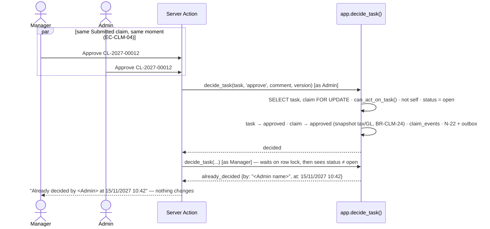
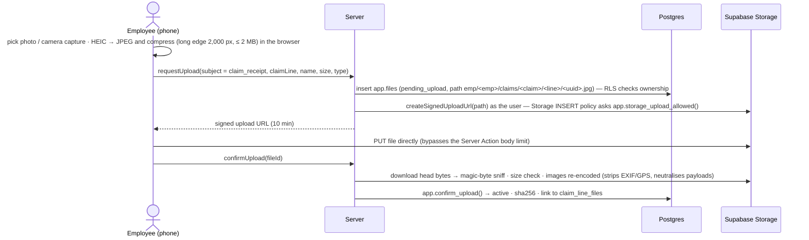

# PRET — System Design (Phase 1: R1.0, with R1.1 payroll seams)

**Work item:** W1-003 · **Author:** Solution Architect · **Status:** Proposed for GATE 2 (Design)
**Last updated:** 15/11/2026
**Designs for:** `docs/product/BRD.md`, `PRD.md`, `user-stories.md` (GATE 1 approved 15/11/2026, baseline v0.1.0); decisions D1–D17 (`docs/01-decisions.md`), recommendations R1–R4
**Companions:** [`data-model.md`](data-model.md) · [`rls-policies.md`](rls-policies.md) · [`non-functional.md`](non-functional.md) · [`adr/README.md`](adr/README.md)
**Fixed stack honoured (D7):** Supabase (Postgres + Auth + Storage + RLS), Next.js App Router + TypeScript + Server Actions, MUI + Emotion + Inter, GitHub, Vercel. Singapore hosting (R1, D14).

> Scope is exactly the GATE-1 spec. Where the spec leaves a technical choice open
> (**→ Architect** tags) this document decides it and records an ADR. Where the spec is
> silent or contradictory on a *business* point, it is listed in §17 rather than invented.

---

## 1. Component overview

```mermaid
flowchart TB
    subgraph Browser["Browser — desktop and 360 px phone (F-PRT, §8.4)"]
      UI["Next.js App Router UI (RSC + client components)\nMUI shell, role-aware nav (F-PRT-18)"]
    end

    subgraph Vercel["Vercel — region sin1 (Singapore)"]
      MW["Middleware\nsession refresh · idle timeout · security headers · rate limit"]
      SA["Server Actions / Route Handlers\nauthorisation · validation (zod) · business logic"]
      DOM["Domain modules (pure TS)\nleave engine · claims rules · payroll engine (R1.1)"]
      CRY["Field crypto\nAES-256-GCM + HMAC blind index (keys in Vercel env)"]
      GEN["Output generators\nCSV stream · .xlsx (exceljs) · PDF (react-pdf) · zip"]
      JOB["Job handlers (/api/jobs/*)\ntriggered by Vercel Cron"]
    end

    subgraph Supa["Supabase — ap-southeast-1 (Singapore)"]
      AUTH["Auth\nemail + password · TOTP MFA (aal2) · invite-only"]
      PG[("Postgres\nschemas app · audit · private\nRLS forced on every table")]
      POOL["Supavisor pooler\n(transaction mode)"]
      STO["Storage — private buckets\nregistry-gated signed URLs"]
    end

    MAIL["Transactional email provider\n(SPF/DKIM/DMARC — NFR-13)"]

    UI -->|HTTPS, cookies| MW --> SA
    SA --> DOM
    SA --> CRY
    SA --> GEN
    SA -->|"withUserTx(): SET ROLE authenticated + verified JWT claims"| POOL --> PG
    SA -->|"signed upload / download URLs (user JWT)"| STO
    UI -->|"direct upload with signed URL\n(no 1 MB Server Action limit)"| STO
    SA -->|"signIn / MFA / password"| AUTH
    JOB -->|"withJobTx(): pret_jobs (service_role)"| POOL
    JOB -->|outbox drain| MAIL
    AUTH -->|"password reset (custom SMTP)"| MAIL
    STO -. "policies call app.storage_*()" .-> PG
```



**Boundary rules**
1. **No Data API.** PostgREST/GraphQL expose no PRET schema. The browser talks to Supabase only for Auth session cookies and direct Storage transfers with server-issued signed URLs. All reads/writes of business data go through the Next.js server (ADR-0002).
2. **RLS is the backstop, not the only gate.** The server checks role and scope for every route and Server Action (FR-G-02); Postgres RLS enforces the same rules underneath (`rls-policies.md`). Both must agree.
3. **One database handle.** Server code obtains a connection only via `withUserTx(session, fn)` (impersonates the signed-in user inside one transaction) or, in job handlers, `withJobTx(jobName, fn)`. A lint rule forbids importing the raw pool elsewhere.
4. **Sensitive identifiers never leave the server in plaintext** except to the authorised screen after a logged reveal (ADR-0003). Email never carries NRIC, bank numbers, salary, diagnosis or attachments (F-NTF-08).
5. **Long or bulk work is asynchronous** (email, bulk payslips, zips, large reports) — queued in the database and drained by job handlers.

---

## 2. Request flow

```mermaid
sequenceDiagram
    actor U as User (phone / desktop)
    participant M as Middleware
    participant S as Server Action
    participant A as Supabase Auth
    participant DB as Postgres (RLS)

    U->>M: request + session cookies
    M->>A: refresh / verify session (getClaims via JWKS)
    M->>DB: touch app_sessions (≤ 1×/min) — idle > 15/30 min ⇒ sign out (F-ADM-14)
    M-->>S: verified claims {sub, aal, session_id}
    S->>S: zod-validate input · server-side role/scope check (capabilities)
    S->>DB: BEGIN · SET LOCAL ROLE authenticated · set_config(request.jwt.claims, app.request_id, ip, reason…)
    S->>DB: business statements (RLS filters every row; triggers enforce transitions & not-self)
    DB-->>S: rows / PRET-xxx errors
    S->>DB: COMMIT (audit rows + notifications + outbox written in the same transaction)
    S-->>U: result (Cache-Control: no-store)
```

- **Idempotency** — every create form carries a client `idempotency_key`; a retry after a dropped phone connection returns the row already created (EC-LV-09, EC-PRT-01, ADR-0015).
- **Errors** — database errors use stable `PRET-*` codes mapped to field-level messages (FR-G-07). Access failures return "Not found or no access" and are logged (EC-PRT-03).

---

## 3. Authentication, sessions and role resolution

### 3.1 Sign-in, MFA, invites (ADR-0014)

| Concern | Design | Ref |
|---------|--------|-----|
| Identity | Supabase Auth, email + password (R3); **sign-ups disabled** (invite-only). Login email = work email (employee users) or provider email (external). | F-PRT-01, BR-EMP-07 |
| Invites | PRET's own invite tokens (`app.user_invitations`): 32-byte random token, only its SHA-256 stored, **72 h** expiry (Supabase's built-in email OTP links cannot last 72 h). Accepting creates the Auth user with the chosen password, links `auth_user_id`, sets `status = active`. Scheduled invites (join date − 3 days) are sent by the day-start job. | FR-EMP-02, EC-ADM-05, F-MIG-12 |
| Password | Min 12 chars, Supabase strength rules, **leaked-password protection on**; reset link valid 1 h; generic error messages (no enumeration). | BR-ADM-07 |
| MFA | TOTP (authenticator app) via Supabase MFA. ADM/SA must enrol at next sign-in when `security_settings.mfa_required_privileged` (default on, Q31). **Enforced in the database**: `app.has_role()` only returns true at `aal2`, so an un-enrolled Admin sees employee-level data only. | F-ADM-07 |
| Lockout | 5 failures → locked 30 min (settings). Enforced in the sign-in Server Action (`login_events` window) **and** at the Auth server: CAPTCHA on Supabase Auth endpoints so direct calls to the Auth API cannot brute-force around the form; Supabase's Password-Verification hook if the plan provides it (§17 Q-ARCH-07). N-52 to user and SA. | F-ADM-13 |
| Session lifetime | Access-token (JWT) expiry 10 min with rotating refresh tokens; Supabase inactivity timeout 30 min as a backstop; PRET's own idle timeout per role (15 min ADM/SA, 30 min others) via `app_sessions.last_seen_at`; client shows a warning 60 s before timeout and preserves the unsaved form (US-ADMIN-014). "Remember me" not offered to privileged users. | F-ADM-14, §8.4 |
| Disable / expire | Takes effect on the **next statement** because every policy calls `app.current_app_user_id()`, which checks status and access window live. The server also revokes refresh tokens (`auth.admin.signOut(global)`) and ends `app_sessions`. | BR-ADM-06, F-ADM-05/06 |

### 3.2 Role resolution (D11) — looked up live per statement (ADR-0001)

| Role | Source of truth | Resolution | Notes |
|------|-----------------|------------|-------|
| **EMP** | `app_users.user_type = 'employee'` + `employee_id` | implicit for every active employee user | external users never EMP |
| **MGR** | `reporting_closure` (built from the current job-history row of every employee, direct + indirect) | derived; recomputed whenever a job-history row becomes current (on save if effective ≤ today, else by the 00:05 job) | **decision rights** come from routed approval tasks: reporting manager, leave/claim approver override (F15/F16), or an active **delegate** (BR-LV-60). A delegate gains only the items routed to them plus the T1 context to decide them — not the delegator's whole team. |
| **ADM** | `user_roles` (granted by SA only) | explicit; requires `aal2` | external administrator = `user_type = 'external'` holding ADM only, inside `access_start_date … access_end_date` |
| **SA** | `user_roles` | explicit; requires `aal2`; ≥ 1 active SA enforced by trigger | Albert |
| **External user** | `app_users.user_type = 'external'` | ADM only; never manager or delegate; window auto-expiry (status `expired` at 00:00 after end date; SA warned 30 and 7 days ahead — N-54); every record opened is access-logged (BR-ADM-22) | F-ADM-04, D14 (no DPA fields) |

A user's rights are the **union** of their roles minus FR-G-16 (no self-action). The UI
asks `/api/me/capabilities` (computed with the same SQL helpers) to draw the role-aware nav
and role chip; the nav is convenience only — every route re-checks.

---

## 4. Approval engine (ADR-0004)

### 4.1 Model

All decisions in PRET flow through **`app.approval_tasks`** — one row per level per subject:

| Subject | Levels | Approver source | Spec |
|---------|--------|-----------------|------|
| Leave application | 1–3 per workflow (default **Direct Manager → Admin**) | direct manager · leave-approver override · manager's manager · specific employee · Admin pool · SA pool | F-LV-09/32, Q10 |
| Leave cancellation (started/past leave) | 1 | level-1 approver (setting) else Admin pool | §6.10 |
| Replacement-leave credit | per its workflow (default Direct Manager only) | as leave | F-LV-15 |
| Claim | **exactly 1** (D12) | `claim_pool` = claimant's claim approver (F16 override, else reporting manager) **or** their active delegate **or any ADM or any SA** — whoever acts first | F-CLM-09, BR-CLM-25 |
| Change request | 1 | Admin pool (ADM/SA, not the requester) | F-EMP-19 |
| Disbursement batch (only if SA-approval setting on) | 1 | SA pool, ≠ preparer | F-CLM-14, PB8 |
| Payroll run (R1.1) | 1 | SA pool, ≠ preparer | F-PAY-23, BR-PAY-18 |
| Statutory table version (R1.1) | 1 | SA pool, ≠ entered by (maker-checker) | FR-PAY-02 |

### 4.2 Routing (`app.route_approval`, definer)

```
for level in workflow.levels (leave/credit) — or the single fixed level (others):
    candidate := resolve(level.source, applicant)            -- reporting line as at today
    if candidate is the applicant and workflow.skip_if_approver_is_applicant: mark level skipped; continue   (EC-LV-06)
    if level.source = direct_manager and applicant is top of org: candidate := SA pool                    (BR-LV-63, Q11)
    if applicant is SA and level.source resolves to SA pool: record level as system_auto 'approved'       (Q11 default)
    if candidate is on approved leave today and has no delegate: candidate := candidate.manager ?? Admin pool   (BR-LV-61)
    if active delegation(candidate, scope, today): assignee := delegate; original_assignee := candidate   (BR-LV-60)
    if assignee is the applicant: skip to next level (claims: stays with ADM/SA pool)
    if merge_consecutive_identical and assignee = previous level's decider: auto-approve as 'system_auto'
    create task(level, assignee, source) ; notify (N-01 / N-11 / N-20 / N-43 / N-26 / N-30)
    stop — later levels are created when this one is approved
```

Re-routing on change: when a reporting line changes or a manager separates, the
day-start job (or the job-history trigger) re-runs routing for open "direct manager" tasks
of affected employees and records "Re-routed: …" in `routing_note` (EC-EMP-04, EC-LV-07).

### 4.3 Deciding (`app.decide_task`, definer)



- **First decision wins** by row lock + `status = 'open'` check (BR-CLM-25).
- Reject needs a comment (CHECK). Admin override at a non-admin leave level needs a reason and is recorded `acting_as = admin_override` (BR-LV-62).
- **Bulk approve** (BR-LV-64, F-CLM-25) calls `decide_task` per item in its own savepoint and returns per-item results; items the user cannot act on (own, already decided, not their level) are skipped and reported.
- **No self-approval** — eight independent database layers (`rls-policies.md` §7).

### 4.4 Delegation, reminders, escalation

- Delegation (F-LV-24, F-PRT-14): date range + scope (leave / claims / both); the original approver can still act; delegate never decides own items; external users cannot be delegates (BR-ADM-04; see Q-ARCH-01). N-17 on start/end.
- Reminders (F-LV-25, F-NTF-03): 07:30 MYT on working days — one digest per approver listing items pending ≥ 2 working days (N-15); at ≥ 5 working days escalate to the approver's manager and all ADMs (N-16). No auto-approval (Q12).

---

## 5. Leave engine (ADR-0005)

A pure TypeScript module (`src/domain/leave`) with exact decimal arithmetic, used by
Server Actions, imports and jobs; results are persisted, never re-derived differently.

| Step | Design | Ref |
|------|--------|-----|
| Calendar | For an employee and date range: working-pattern version effective on each date, published PH calendar of the work state (or F20 override), replacement holidays for that state × pattern. | BR-LV-21, EC-LV-01/10 |
| Day count | Per date weight 1 / 0.5 / 0 by pattern, PH and session; calendar and consecutive-calendar types per BR-LV-23; stored in `leave_application_days`. | F-LV-06 |
| Overlap | Postgres **exclusion constraint** on (employee, date, AM/PM slot) for blocking days — overlap is impossible even under concurrent submits. | BR-LV-52 |
| Entitlement | Bands by service (continuous-service date), pro-rata by day/month, rounding mode, EA floor, grade/employee overrides → `leave_entitlements` (+ `calc_detail` for traceability); changes post an `entitlement` delta to the ledger. | F-LV-04, BR-LV-10–16 |
| Accrual | Earned-to-date computed at the **last day of the leave applied for** (BR-LV-14) — read-time, not stored. | Q8 |
| Balance check | Under `pg_advisory_xact_lock('leave:'+employee)`: available = summary components − pending (+ pools: HL ↔ SL 60-day cap; negative allowance). | BR-LV-20/31/53, NFR-09 |
| Year split | Applications across 31/12 become two linked rows `LV-yyyy-nnnnn-1/-2`, decided together. | BR-LV-25 |
| Recount | When a PH or pattern changes, the affected blocking days are recomputed in one job; ledger deltas posted; N-06. | BR-LV-27, EC-LV-02 |
| Carry-forward & expiry | Roll-over (HR preview → commit, idempotent) posts `forfeited` (closing year) and `carry_forward` with `expires_on` (new year). Daily job expires the unused part: used = min(CF, taken with leave dates ≤ expiry date) (Q-ARCH-03). Replacement credits consumed FIFO, expire individually. | F-LV-19/20, BR-LV-70–83 |
| Leavers | Recompute to LWD; final position (encashable / recoverable) snapshot on the separation; feeds F-RPT-21 and R1.1 final pay. | F-LV-27, BR-LV-90–92 |

---

## 6. Claims flow (D12, D16)

1. **Create (New)** — header + lines; receipts uploaded directly to Storage per line (§8). Owner may edit/delete while New (FR-CLM-02).
2. **Submit** — under `pg_advisory_xact_lock('claim:'+employee)`: deadline (60 days), eligibility, mileage `round(km × rate, 2)` with the rate effective on the transaction date (snapshot), per-transaction / month / year limits summed over **live** lines (Submitted/Approved/Disbursed) by transaction date with precedence employee > department > grade > group > default, duplicate warnings; MyInvois UUID uniqueness is a partial unique index (EC-CLM-02/06/08). Status → Submitted; one `claim_pool` task; N-20.
3. **Decide once** — Manager / delegate / any ADM / any SA via `decide_task` (§4.3). Approve snapshots tax treatment, EA line and GL account. Reject needs a reason; employee may **copy** a Rejected claim into a new New claim (F-CLM-29).
4. **Withdraw** (owner, Submitted) and **cancel** (Manager/ADM/SA, Approved, not own, reason) per the status machine trigger; cancelling removes the claim from an open batch and marks the batch outputs out of date (BR-CLM-26).
5. **Month-end batch** (`PB-yyyy-nnn`) — ADM creates the batch: Approved claims with approval date (MYT) ≤ cut-off, not in another open batch, pre-selected (BR-CLM-28). Validation: complete bank details for every payee. Outputs: HLB Connect First payment list (.xlsx + PDF; one line per employee; totals must equal batch total) and AutoCount postings (.xlsx) — layouts from `export_layouts` (Q37, Q46). Optional SA approval when the control setting is on (default off). ADM keys the list into HLB manually (D6), then **marks Disbursed** with payment date and HLB reference → every claim Disbursed, N-25. **Undo** per claim with reason → Approved for the next batch (F-CLM-23).
6. **Bank change after export** sets `bank_details_changed_after_export` on open exported batches; Disbursed is blocked until outputs are regenerated (EC-CLM-10). Outputs are versioned; earlier versions kept.
7. **From R1.1** — the payroll run pulls Approved claims of employees in the run (not in an open batch) and pays them with salary; they become Disbursed at finalise (F-PAY-11). The month-end batch remains for claims outside a run.

> FR-G-16 consequence: an Interact employee holding ADM cannot mark Disbursed a batch that
> contains **their own** claim (that would "disburse own claim"); another ADM/SA must, or the
> claim is deselected to the next batch. See Q-ARCH-04.

---

## 7. Notifications and email (ADR-0010)

- **In-app first.** Domain functions/triggers insert `notifications` rows and `email_outbox` rows **in the same transaction** as the business change (transactional outbox) — no event is lost if email fails; the bell (F-PRT-13) reads `notifications`.
- **Templates in code** (React Email), PDPA-safe by construction: the outbox `payload` accepts only a whitelist of keys per template (names, reference numbers, dates, claim amounts, deep link). A unit test fails if any template references NRIC, bank, salary, net pay, diagnosis, religion or family fields (BR-NTF-02). `[EMERGENCY]` prefix (BR-NTF-03). Sender "PRET", reply-to HR mailbox setting (BR-NTF-06).
- **Worker** — every minute: claim pending rows `FOR UPDATE SKIP LOCKED`, render, send through the provider API, retry with back-off (1 m, 5 m, 30 m, 2 h, 6 h; max 6), then `failed` → in-app alert to SA. Notification log for ADM/SA (F-NTF-07).
- **Preferences** — FYI events can be switched off per user; action-required events cannot (BR-NTF-04).
- **Bank-change alert** (N-41) is raised by a database trigger on `employee_bank_accounts` — to the employee's work **and** personal email and every SA — so no code path can skip it (D15 compensating control).
- Supabase Auth's own emails (password reset) use custom SMTP through the same provider. SPF, DKIM, DMARC on the sending domain (NFR-13).

---

## 8. File storage (ADR-0007)



- **Downloads**: the server inserts a `file_access_grants` row (RLS: `app.can_read_file()`; trigger writes `audit.access_log` with the data category), then asks Storage for a **60-second signed URL** as the user (Storage SELECT policy requires the fresh grant). Response headers `Content-Disposition` and `X-Content-Type-Options: nosniff`. Directory photos, logo and privacy-notice PDF need no grant.
- **Rules** — private buckets only; allowed types JPG/JPEG/PNG/HEIC/PDF (+ DOCX for documents); ≤ 10 MB; ≤ 3 files per leave application, ≤ 5 per claim line (FR-G-12, LA11, CLN15).
- **HEIC** (EC-CLM-09): converted in the browser (WASM libheif) where the OS has not already converted it; if a HEIC original still arrives, a job produces a JPEG rendition (`preview_file_id`) for approvers.
- **Malware** — no third-party scanning in R1.0 (files would leave Singapore); mitigations: type allow-list with magic-byte check, image re-encoding, PDFs/DOCX never rendered inline on the PRET origin, served as downloads from the Storage origin. Decision for Albert: Q-ARCH-05.
- **Retention** — `retention_delete_after` per file (import sources 30 days; MC and medical attachments 7 years; MyKad copies and bank proofs at anonymisation — §10.6). A daily job deletes due objects and expired upload intents.

---

## 9. Scheduled jobs (ADR-0009)

Vercel Cron calls `/api/jobs/<name>` (shared secret); each handler computes the **MYT
business date**, records a `job_runs` row (unique per job × business date when succeeded
→ idempotent), processes every missed business date since its last success (catch-up),
runs as `pret_jobs` with `app.actor_label = 'system:<job>'`, and on failure alerts SA
(in-app + email). Cron expressions are UTC (MYT = UTC + 8).

| Job | MYT (UTC cron) | Does | Ref |
|-----|----------------|------|-----|
| `day-start` | 00:05 daily (`5 16 * * *`) | employment status transitions (Pending Join → On Probation; Notice Period → Separated the day after LWD) · future job-history rows become current → current-job cache, `reporting_closure`, re-route open tasks · apply future-dated approved CRs · expire external users past access end; disable separated users past portal access end · delegation start/end (N-17) · send scheduled invites · expire stale invitations | FR-EMP-07/09, BR-EMP-30, F-ADM-06, BR-ADM-04/05 |
| `leave-daily` | 00:15 daily (`15 16 * * *`) | carry-forward expiry, replacement-credit expiry (FIFO), next-year entitlement generation from the LP8 date, attachment-grace expiry | F-LV-20, BR-LV-71/82, BR-LV-73 |
| `audit-seal` | 00:30 daily (`30 16 * * *`) | daily digest chain over yesterday's audit and access log rows | ADR-0008 |
| `retention` | 02:00 daily (`0 18 * * *`) | purge due files and import rows; expired grants and upload intents; monthly "due for anonymisation" flag | F-ADM-16, §10.6 |
| `alerts` | 07:00 daily (`0 23 * * *`) | N-13, N-44, N-45, N-46, N-54, N-57, N-58; children turning 18 (BR-EMP-17); New claims > 90 days (BR-CLM-27) | F-NTF-04 |
| `approval-reminders` | 07:30 working days (`30 23 * * 0-4`) | N-15 digest, N-16 escalation (working days per the approver's calendar) | F-LV-25, F-NTF-03 |
| `access-review` | 06:00 daily (`0 22 * * *`); acts only when the MYT date is the 1st | F-ADM-12 report → `export_files`; flags such as "bank change + payment-list export by the same user within 7 days" (EC-ADM-04) | F-ADM-12 |
| `outbox` | every minute | email send / retry | F-NTF-01 |
| `exports` | every minute | `export_jobs` (bulk payslips, zips, large .xlsx, my-data export) | F-CLM-26, F-PRT-16 |
| `heartbeat` | hourly | any daily job without a success for today by 06:00 MYT → SA alert | NFR-10 |
| `payslip-publish` (R1.1) | 08:00 on pay date | publish payslips (PS10), N-32 | F-PAY-27 |
| `statutory-due` (R1.1) | 07:00 daily | N-35 three days before the due day | PS12 |

---

## 10. Audit trail and access log (ADR-0008)

- **Data-change audit** (F-ADM-09): one generic trigger on every business table writes `audit.audit_log` with the before/after diff, actor (user, type, roles at the time), on-behalf employee, reason, IP, user agent, request id, data categories, transaction id. Encrypted identifiers appear as ciphertext + last 4 only.
- **Access log** (F-ADM-10, BR-ADM-21/22): written by the database for file grants and T4 logged reads; by the server (`audit.write_access`, actor taken from the session — not a parameter) for MyKad/bank reveals, sensitive report columns, exports, payment-list generation, imports, and — for **external administrators** — every employee record opened.
- **Append-only**: no UPDATE/DELETE/TRUNCATE privilege for any login role (including `service_role`); inserts only through `audit_writer` functions. **Tamper evidence**: nightly SHA-256 chain over each day's rows (`audit.daily_seals`); the seal head is included in the monthly access review so an out-of-band change is detectable.
- **Viewer** (F-ADM-11, SA only): filters per BR-ADM-23; export is itself logged. Retention 7 years then purged by `audit.purge_expired()` (the only deletion path; logged). Anonymisation does not rewrite audit history (Q-ARCH-11).
- **Breach-readiness extract** (F-ADM-17) and DSR support query `audit.access_log.employee_ids` (GIN index).

---

## 11. Sensitive identifiers: encryption and reveal (ADR-0003)

- **What**: employee, spouse and child MyKad; bank account no.; ASNB account no.; HLB paying account no.
- **How**: AES-256-GCM in the Next.js server; 96-bit random nonce; associated data = `table:column:row-id` (a ciphertext cannot be moved to another row); stored as `key_id ‖ nonce ‖ ciphertext ‖ tag`; `*_last4` for masked display; `*_bidx` = HMAC-SHA-256 (separate key) for uniqueness (BR-EMP-05), duplicate-account warnings (EC-EMP-12) and import upserts. Keys: per environment, in Vercel encrypted environment variables (production keys never on developer machines), with an offline escrow copy held by Albert; versioned (`private.key_versions`) and rotatable by a re-encryption job.
- **Reveal** (F-EMP-20, FR-G-11): `Reveal` → Server Action re-reads the row under RLS → if the viewer is not the owner, requires a reason (ADM; AU8) and writes `audit.access_log` **before** decrypting → returns plaintext with `no-store`; the UI re-masks after 30 s. Owners see their own MyKad in full without a log entry (US-EMP-018).
- **Bulk use**: HLB payment lists decrypt account numbers server-side at generation; each generation logs one access-log row listing every payee (data category Bank).

---

## 12. Exports and document generation (ADR-0011)

| Output | Engine | Notes | Ref |
|--------|--------|-------|-----|
| List CSV (every list) | streamed by a Route Handler using the **same query builder and RLS** as the on-screen list, all pages, only columns the role may view | dd/mm/yyyy; money per §2 of `non-functional.md`; sensitive columns never in list CSVs; logged when the list contains T2–T4 data | FR-G-06, F-RPT-24 |
| Reports .xlsx | `exceljs` streaming writer; true date cells (dd/mm/yyyy) and numeric money cells formatted `"RM "#,##0.00` | F-RPT-25 |
| PDFs (payment lists, printable reports, payslips, EA) | `@react-pdf/renderer` in the server (no headless browser) | Interact logo; Parallel-mode watermark (PR5) | F-CLM-15, F-PAY-27/29 |
| HLB Connect First payment lists (claims R1.0, salary R1.1) | layout from `export_layouts` (`hlb_claims`, `hlb_salary`) | manual keying/upload only — no bank file format, no API (D6); totals check blocking; versions kept; out-of-date flag | F-CLM-15, F-PAY-28, Q46 |
| AutoCount postings / journal | layout `autocount_claims`, `autocount_payroll` | .xlsx only, no integration (D10); Σ debit = Σ credit check (R1.1) | F-CLM-27, F-PAY-38, Q37 |
| Kakitangan payroll-input pack (R1.0) | multi-sheet .xlsx | joiners, leavers (final leave position), job/bank/statutory changes, unpaid days, rest-day work paid; no claims sheet (D16); retired at R1.1 cut-over | F-RPT-21, Q5 |
| Attachment bundle | zip in an export job, files named `<claim no.>-<line>-<n>.<ext>` | logged | F-CLM-26 |
| Download my data | JSON + PDF summary of the employee's own data, in-app only | logged | F-PRT-16 |
| Statutory files (R1.1) | layout per official spec (Q41) | reports from day one; files when specs supplied | F-PAY-30–36 |

Every generated file is an `export_files` row (kind, subject, **version**, checksum, totals,
watermark, superseded/out-of-date flags) pointing at a private object in `generated`.

---

## 13. Kakitangan migration import (ADR-0012)

1. **Templates** (T1–T16, PRD §13.2) generated from the same zod schemas the forms use — field guide, allowed values, synthetic examples (F-MIG-01).
2. **Upload** to the `imports` bucket (≤ 10 MB) → `import_jobs` (`IM-yyyy-nnn`).
3. **Parse & validate** server-side: dd/mm/yyyy only (no guessing — EC-MIG-01); same rules as the UI (BR-EMP-*, BR-LV-*); referential checks; **two-pass** within a file for managers referenced before they appear (EC-MIG-02); MyKad/bank fields are **encrypted at parse time** so `import_rows.normalized` never holds plaintext; error report .csv with masked identifiers (F-MIG-10).
4. **Commit** — only with 0 errors and warnings acknowledged; **one transaction, all-or-nothing**; upsert by template key (re-import updates, EC-MIG-03); runs as the importing ADM/SA so RLS, triggers and audit apply with the importer as actor (F-MIG-11). Opening balances post typed ledger entries with `is_opening = true`; the D13 current-year statutory correction posts `adjustment` entries "Statutory correction (D13)" (§4.1, US-LEAVE-043). Imports create no users; bulk invite is a separate action (F-MIG-12).
5. **Reconciliation** (F-MIG-13) — HR enters Kakitangan control totals; PRET shows totals and per-employee differences; **zero variance**; SA sign-off recorded (`migration_signoffs`) as a go-live checklist item.
6. **Source files deleted 30 days after commit**; logs kept (§10.6, R4). Raw Kakitangan exports never enter the repository (CLAUDE.md).

R1.0 cut-over order: org masters → employees → family/emergency → job history → holidays →
opening balances (as at go-live, normally the 1st of a month — Q33) → future-dated leave →
reconcile → sign-off → bulk invite.

---

## 14. R1.1 payroll engine seams (ADR-0013)

| Seam | Design |
|------|--------|
| **Effective-dated compensation** | `employee_compensation` (basic, insert-only history with reason) and `employee_recurring_items` (start/end month). The run takes the row effective for the period; back-dated increments create arrears lines (EC-PAY-02). Captured only from R1.1 (Q6, data minimisation). |
| **Statutory tables versioned by effective date** | `statutory_table_versions` (kind, effective month, source document, entered by, **verified by SA ≠ entered by**) with typed child rows; runs use the latest *verified* version effective for the payroll month; an unverified table for the period is a blocking exception (EC-PAY-08). Nothing statutory is hard-coded (§14 PRD). |
| **Engine placement** | Pure TypeScript `payroll-engine` (decimal.js, no I/O): `calculate(input snapshot, tables) → result + trace`. Runs server-side inside the run's transaction; 200 employees well under the 60 s target (NFR-02). Deterministic: same snapshot + same `ENGINE_VERSION` ⇒ identical output to the sen (NFR-08); every figure carries its trace. |
| **Run lifecycle** | Draft (snapshot employees, compensation, H-profile, table versions, leave unpaid days, claims) → In Review (calculate; exceptions) → Pending Approval → **SA approves** via `decide_task` (≠ preparer) → salary payment list → Finalised (lock results; update YTD; payslips; statutory outputs; claims → Disbursed) → SA re-open with reason (version + 1, previous outputs superseded, YTD contribution reversed until re-finalised). |
| **Inputs from R1.0** | Unpaid days per month from `leave_application_days` (LT33 unpaid); late changes to a finalised period become next-month adjustment lines (BR-PAY-04); Approved claims via `claims.payroll_run_id` (F-PAY-11); final leave position from the separation (F-PAY-40). |
| **Parallel run & reconciliation** | Runs in `mode = parallel`: separate YTD scope, watermarked outputs, no publishing, no claim status change (BR-PAY-19). Kakitangan results imported per employee × element (T15, mapped by `kk_element_mappings`) and compared per element and per payment-list line to the sen; every variance needs an explanation; cut-over only after 2–3 consecutive zero-variance months and SA sign-off (D5, FR-PAY-10). YTD opening balances (T14) make cut-over possible in any month. |
| **Access** | All payroll tables are ADM/SA only, plus the employee's own published payslips, issued EA forms and live YTD; no manager policy anywhere (FR-PAY-11). |

---

## 15. Code organisation (guidance for the build lanes)

```
src/app/                    routes: (auth)/ (portal)/ (admin)/ api/export/* api/jobs/*
src/server/db/              withUserTx · withJobTx · Kysely types generated from the schema
src/server/auth/            session, capabilities, MFA, idle timeout, rate limits
src/server/crypto/          field encryption, blind index, key versions
src/server/actions/         one file per module (employees, leave, claims, …) — every action: zod → capability check → withUserTx
src/server/exports/         csv, xlsx, pdf, layouts
src/server/jobs/            one handler per job in §9
src/domain/leave/           pure leave engine (+ unit tests)
src/domain/claims/          limits, mileage, duplicate rules
src/domain/payroll/         R1.1 engine (+ golden tests from anonymised data, Q44)
src/lib/format/             dd/mm/yyyy, RM 1,234.56, MYT (single source — non-functional §2)
supabase/migrations/        SQL migrations (schema, RLS, functions, seeds of reference data)
supabase/tests/             pgTAP: role matrix, self-action, policy/definer lint
```

---

## 16. "→ Architect" hand-offs from the PRD — resolved

| PRD ref | Resolution | Where |
|---------|-----------|-------|
| FR-G-02 server + RLS enforcement | server capability checks + forced RLS on every table; no Data API | §1, `rls-policies.md`, ADR-0002 |
| FR-G-12 storage policy, malware, HEIC | private buckets, registry + grants, re-encode, browser HEIC conversion; AV decision Q-ARCH-05 | §8, ADR-0007 |
| EC-LV-09 / EC-PRT-01 idempotency | client idempotency keys + unique constraints | §2, ADR-0015 |
| BR-CLM-25 / EC-CLM-04 concurrency | row lock + open-status check in `decide_task` | §4.3, ADR-0004 |
| EC-CLM-02 / NFR-09 limit & balance races | per-employee advisory locks; exclusion constraint for overlap | §5, §6 |
| EC-CLM-09 HEIC | §8 | ADR-0007 |
| BR-ADM-06 sessions end ≤ 5 min | live authorisation lookup (immediate) + refresh-token revocation | §3, ADR-0001 |
| BR-ADM-07 password, hashing, reset, MFA | Supabase Auth (bcrypt), policy in §3.1, TOTP | ADR-0014 |
| BR-ADM-20 append-only logs | privileges + seals | §10, ADR-0008 |
| BR-NTF-06 sender, deliverability | provider + SPF/DKIM/DMARC | §7, ADR-0010 |
| §8.4 camera capture | `<input type="file" accept="image/*" capture="environment">` + client compression | §8 |
| NFR-01–13 | `non-functional.md` | — |

---

## 17. Questions for Albert / spec gaps

None of these blocks GATE 2; each has a proposed default the build will follow unless
Albert decides otherwise.

| ID | Gap / contradiction | Proposed default |
|----|---------------------|------------------|
| **Q-ARCH-01** | BR-LV-60 allows a delegate who is "an active employee **or ADM user**", but BR-ADM-04 says an external administrator "cannot be selected as manager or delegate". | Delegates must be active **employee** users (an Interact employee holding ADM qualifies); the external administrator cannot be a delegate (they still act at the Admin level and on claims as ADM). |
| **Q-ARCH-02** | §16 gives SA "C R U a" on compensation without "not own", while FR-G-16 forbids anyone editing their own sensitive fields and CP6/Q39 asks for a second SA. | The database blocks everyone, **including SA**, from changing their own compensation; Albert's pay is maintained by ADM and automatically flagged on the monthly access review (Q39 default). |
| **Q-ARCH-03** | BR-LV-71 says carry-forward is consumed before the new year's entitlement but not whether "consumed" is judged by leave date or approval date. | By **leave date**: carry-forward used = days taken with leave dates on or before the expiry date (31/03); the rest expires. |
| **Q-ARCH-04** | FR-G-16 forbids disbursing one's own claim; an internal Admin who prepares the month-end batch may have their own claim in it. | Allowed in the batch, but that Admin cannot mark the batch Disbursed — another ADM or SA must (or the claim is deselected to the next batch). No effect while the outsourced (external) Admin runs the batch. |
| **Q-ARCH-05** | FR-G-12 asks for malware scanning; a scanning service would send MCs/MyKad copies outside Singapore, a self-hosted scanner adds infrastructure outside the fixed stack. | R1.0 without third-party scanning, using the mitigations in §8; revisit if staff upload volumes or sources grow. Alternative: self-hosted ClamAV container (adds a small hosted service). |
| **Q-ARCH-06** | NFR-04 asks for daily backups of database **and files**; Supabase's managed backups cover the database only, not Storage objects. | Approve a nightly encrypted copy of new Storage objects (and a weekly logical DB dump) to a second storage location in Singapore (a separate Supabase project or an S3 bucket in ap-southeast-1). Point-in-time recovery add-on optional (RPO 24 h is met without it). |
| **Q-ARCH-07** | Hard account lockout at the Auth server (not just in PRET's sign-in form) needs Supabase's password-verification hook, which Supabase documents for higher plans (verify). | Supabase **Pro** (needed anyway for daily backups, custom SMTP, leaked-password protection) + CAPTCHA on Auth endpoints + PRET-side lockout. Upgrade only if the security review requires Auth-level lockout. |
| **Q-ARCH-08** | Field-encryption keys live outside the database (that is the point); if every copy is lost, encrypted MyKad and bank numbers cannot be recovered. | Albert holds an offline escrow copy (password manager); keys rotated yearly; loss would require re-collecting those numbers from source documents. |
| **Q-ARCH-09** | Email provider not specified (BR-NTF-06). | Use the same transactional provider as Direct Order behind an adapter; emails carry no sensitive data (F-NTF-08). Alternative: AWS SES in Singapore if Albert wants email processed in-region. |
| **Q-ARCH-10** | US-ADMIN-023 requires "RM 1,234.56" in **every** export; spreadsheet users usually want numeric cells, and bank/AutoCount/statutory import files dictate their own number format. | Screens, PDFs and list CSVs show `RM 1,234.56`; .xlsx uses numeric cells **displayed** as `RM 1,234.56`; machine-import files (HLB, AutoCount, KWSP/PERKESO/LHDN) follow the target format. |
| **Q-ARCH-11** | Anonymisation (F-ADM-16) removes personal data, while audit logs are append-only and kept 7 years (BR-ADM-20/24). | Audit and access-log entries are never rewritten; they age out 7 years after the event. Anonymisation removes data from the live tables and files only. |
| **Q-ARCH-12** | D12 says the claim is approved by "the employee's Manager"; the PRD also has a claim-approver override (F16) and delegates. | "Manager" for claims = the claim-approver override if set, otherwise the reporting manager, plus their active delegate — in addition to any ADM or SA. |
| **Q-ARCH-13** | Q18 lets the approving manager open the MC "for the sick leave they are approving". | Manager/delegate access to an MC exists only while they can act on that pending item; it ends when the item is decided (Admin/SA keep access, logged). |

---

## 18. Risks & Trade-offs

| # | Decision / risk | Trade-off | Mitigation |
|---|-----------------|-----------|------------|
| T1 | **No Data API; server connects directly and impersonates the user** (ADR-0002) | Removes the public PostgREST attack surface and allows multi-statement transactions in TypeScript; departs from Direct Order's supabase-js pattern, needs careful connection pooling (transaction mode, no prepared statements) and makes the server the place where claims are set. | Single `withUserTx` helper + lint rule; claims only from JWKS-verified JWTs; direct-API probe test; RLS still complete so re-enabling the API would not expose data. |
| T2 | **Application-layer encryption of identifiers** (ADR-0003) | Strong protection against database or backup exposure and structural masking; costs key management, no SQL search beyond last-4/blind index, and decryption only in the server. | Key escrow (Q-ARCH-08), key versions + rotation job, blind index for uniqueness. Supabase no longer recommends pgsodium column encryption for new projects, so the database-side alternative is not taken. |
| T3 | **Vertical partitioning by audience** | More tables and joins for the profile page; but manager/peer exclusion is guaranteed by the absence of policies rather than by column filtering in code. | Views for common reads; policy lint test; DTO projections only for the non-sensitive differences listed in `rls-policies.md` §8. |
| T4 | **A few powerful definer functions** (`decide_task`, `route_approval`, T4 read/write) | Concentrates the most sensitive logic in audited SQL (atomic, lock-safe) — but a bug there bypasses RLS (Direct Order SEC-01). | Register + caller re-check + pinned search_path + `p_` parameters; dedicated pgTAP suites; advisor run per migration; Security review at GATE 3. |
| T5 | **Live role lookup instead of JWT claims** | One extra indexed lookup per statement (negligible at 200 staff) in exchange for immediate effect of disable/expiry/role change. | `(select fn())` initplan wrapping; indexes on `app_users.auth_user_id`, `user_roles(user_id) where revoked_at is null`. |
| T6 | **No malware scanning in R1.0** | Avoids data leaving Singapore and extra infrastructure; leaves residual risk from malicious PDFs/DOCX. | §8 mitigations; Q-ARCH-05. |
| T7 | **Vercel Cron as scheduler** | Keeps all logic in one TypeScript codebase with the engines; depends on Vercel (Pro plan for minute-level schedules). | Idempotent jobs with catch-up; heartbeat alert to SA; `job_runs` visible to SA. |
| T8 | **Single Super Admin (Albert)** | Payroll runs, statutory-table verification, optional batch approval and log review all need SA; holidays or absence stall them. | Recommend a second SA before R1.1 (Q39); approvals usable from a phone. |
| T9 | **Manual HLB keying and unknown file layouts** (D6, Q37, Q41, Q46) | No bank/accounting integration risk, but keying errors and late format changes. | Locked totals, versioned outputs, out-of-date flags, layouts as configuration (`export_layouts`), undo disbursement. |
| T10 | **Storage not covered by Supabase backups** | Files (MCs, receipts, documents, payslips) could be lost in a project-level incident. | Q-ARCH-06 off-site copy; restore test before each go-live. |
| T11 | **Payroll correctness to the sen** (R1.1) | Statutory interpretation errors would fail the parallel run. | Tables as verified configuration, deterministic engine with traces, golden tests from anonymised Kakitangan data (Q44), payroll specialist verification before R1.1 GATE 3. |

---

## 19. Ready for GATE 2?

- [x] Components, boundaries and request flow defined; fixed stack and Singapore hosting honoured (D7, R1).
- [x] Auth and role resolution for SA/ADM (explicit grants, MFA), MGR (reporting line + delegation), EMP (employee link) and External users (ADM only, access window, auto-expiry, full access logging) (D11, D14).
- [x] Approval engine for leave (multi-level, delegation, re-routing, escalation) and claims (single level, first decision wins — D12), plus CRs, batches, payroll runs and statutory tables; no self-approval enforced in the database.
- [x] Leave and claims engines, month-end HLB disbursement batch with AutoCount export (D6, D10, D16).
- [x] Notifications (in-app + PDPA-safe email via outbox), file storage (private, path-scoped, registry-gated, logged), scheduled jobs (MYT, idempotent), audit and access logs (append-only, sealed).
- [x] Exports (.csv/.xlsx/PDF), Kakitangan migration approach, and R1.1 payroll seams (effective-dated compensation, versioned statutory tables, run lifecycle, parallel-run reconciliation).
- [x] Data model with every table, constraint, index and ERDs; sensitive-column strategy enforced at the database (`data-model.md` §2).
- [x] RLS for every table with `WITH CHECK`, helper functions, storage policies, role × table matrix traced to PRD §16 (`rls-policies.md`).
- [x] Non-functional design (`non-functional.md`) and 16 ADRs.
- [ ] **Albert to decide or accept the defaults for Q-ARCH-01 … Q-ARCH-13** (§17) — none blocks the start of Wave 2 build; Q-ARCH-06/07 must be settled before the production Supabase project is created.
- [ ] UX/UI lanes (W1-004/005) to confirm screen field lists against the access tiers (no wireframe shows a field to a role whose tier forbids it).

**Verdict:** Ready for GATE 2 review, subject to Albert's answers (or acceptance of defaults) on §17.
