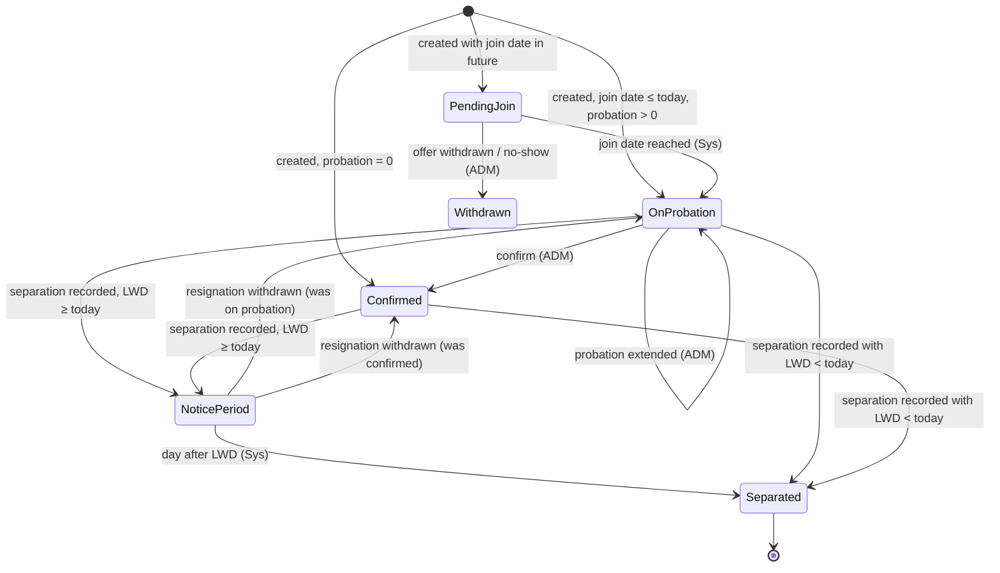
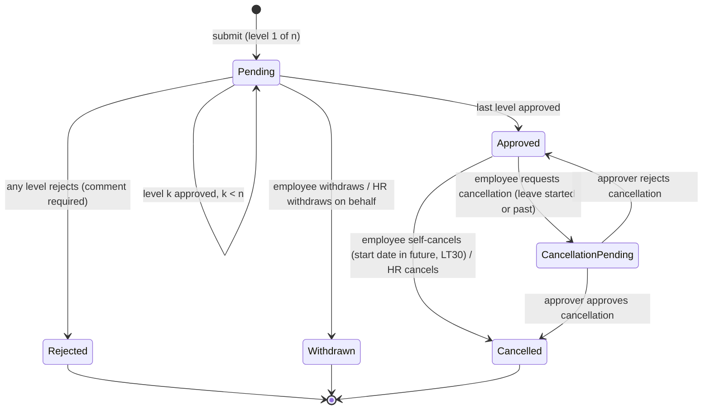
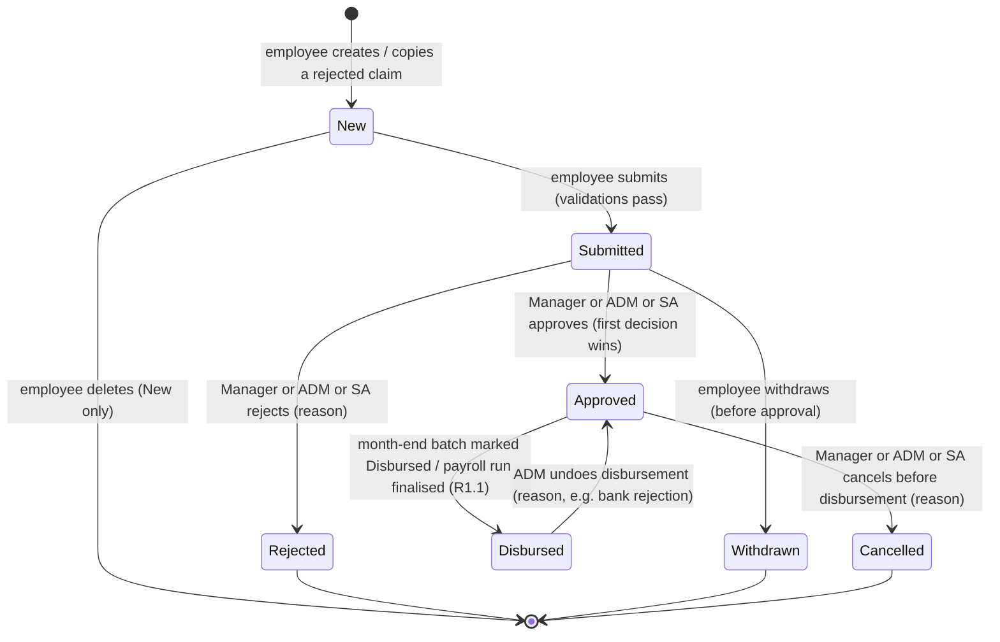
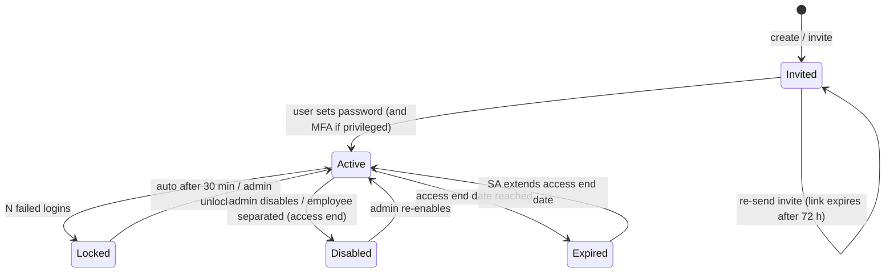
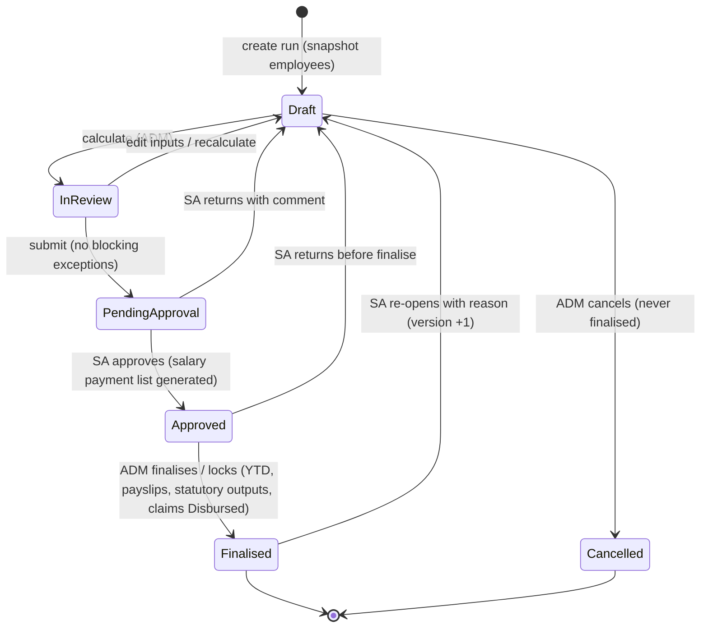

# PRET — Product Requirements Document (PRD)

**Work item:** W1-001 · **Author:** Product / Business Analyst · **Status:** Approved at GATE 1 (Scope), 15/11/2026 — amended for D11–D16
**Last updated:** 15/11/2026 — amended the same day for Albert's Gate 1 answers **D11** (four roles), **D12** (single-level claims approval, month-end disbursement), **D13** (statutory leave entitlements), **D14** (PDPA extras not required), **D15** (Admin or Super Admin maintains bank details, no confirmation step) and **D16** (all payments directly through HLB — no Kakitangan payroll route for claims)
**Builds on:** [`BRD.md`](BRD.md), [`docs/01-decisions.md`](../01-decisions.md) (D1–D16, R1–R4), [`docs/05-ai-team-operating-model.md`](../05-ai-team-operating-model.md), [`docs/design/reference-interact-ui.md`](../design/reference-interact-ui.md)
**Companion:** [`user-stories.md`](user-stories.md) — stories and Given/When/Then acceptance criteria (each traces back to a function id below)

> **How to review this document.** Start with the **Function Catalogue (§1)** — one row per
> function, every module, tagged with its release (**R1.0** HR/leave/claims/portal, **R1.1**
> payroll — D5). Once the catalogue is right, §5–§14 give the field-level and control-level
> detail per module: every field (type, mandatory, validation, who views / who edits,
> payroll-relevance flag), every list (columns, filters, actions), business rules, status
> models, approval workflows, notifications and edge cases. §16 is the role × function
> access matrix. §17 holds every **Open Question for Albert** with a proposed default. This
> PRD stays in the requirements lane: where a requirement forces a technical choice it is
> tagged **→ Architect**.

## Contents
1. [Function Catalogue](#1-function-catalogue)
2. [Conventions & global requirements](#2-conventions--global-requirements)
3. [Roles](#3-roles)
4. [Statutory requirement sources (Malaysian law)](#4-statutory-requirement-sources-malaysian-law)
5. [M1 Employee master records](#5-m1--employee-master-records) — R1.0
6. [M2 Leave management](#6-m2--leave-management) — R1.0
7. [M3 Claims management](#7-m3--claims-management) — R1.0
8. [M4 Employee self-service portal](#8-m4--employee-self-service-portal) — R1.0 (+ payslips R1.1)
9. [M5 Organisation & company setup](#9-m5--organisation--company-setup) — R1.0
10. [M6 Users, roles, access & audit](#10-m6--users-roles-access--audit) — R1.0
11. [M7 Reports & exports](#11-m7--reports--exports) — R1.0
12. [M8 Notifications](#12-m8--notifications) — R1.0
13. [M9 Data migration from Kakitangan](#13-m9--data-migration-from-kakitangan) — R1.0 (+ payroll migration R1.1)
14. [M10 Payroll](#14-m10--payroll) — R1.1
15. [Non-functional requirements](#15-non-functional-requirements)
16. [Role × function access matrix](#16-role--function-access-matrix)
17. [Open Questions for Albert](#17-open-questions-for-albert)
18. [Ready for GATE 1?](#18-ready-for-gate-1-self-check)

---

## 1. Function Catalogue

**Role codes (D11):** EMP Employee · MGR Manager (derived from the reporting line, or an active delegate; scope = their reportees) · ADM Admin (one role covering employee records/HR, leave administration, claims/finance and payroll) · SA Super Admin (everything) · SYS system (automatic).
The earlier separate HR Admin, Finance and Payroll Admin roles are merged into **ADM**; there is no per-module admin assignment. **MoSCoW** applies within Phase 1; a row marked **Removed (D1x)** keeps its id but is no longer in scope. **Rel** = release (D5): **R1.0** — employee master, leave, claims, portal, org, access, reports, notifications, migration (Kakitangan payroll keeps running for salaries; approved claims are disbursed at month end directly through HLB — §7.9, D16) · **R1.1** — payroll, parallel-run 2–3 months against Kakitangan and cut over only when every payslip, statutory amount and payment list reconciles to the sen · **Later** — candidate outside Phase 1.

### 1.1 M1 — Employee master records

| ID | Function | Description | Roles | MoSCoW | Rel |
|----|----------|-------------|-------|--------|-----|
| F-EMP-01 | Employee list | Searchable, filterable, paginated list of employees with CSV export. | ADM, SA | Must | R1.0 |
| F-EMP-02 | Create employee (new hire) | Create an employee record with mandatory identity, contact and employment fields; optional user invite. | ADM, SA | Must | R1.0 |
| F-EMP-03 | Employee profile (tabbed view) | Overview, Personal, Contact & Emergency, Family, Employment & History, Statutory & Tax, Bank, Leave, Claims, Documents, Change Requests, Audit. Tabs/fields shown per role. | EMP (own), MGR (team, limited), ADM, SA | Must | R1.0 |
| F-EMP-04 | Edit personal & identity details | Maintain legal name, MyKad, DOB, gender, race, religion, marital status, OKU, photo. | ADM, SA (EMP via F-EMP-19) | Must | R1.0 |
| F-EMP-05 | MyKad validation & derivation | Validate 12-digit MyKad; derive date of birth and gender; detect duplicates. | SYS | Must | R1.0 |
| F-EMP-06 | Contact & address | Work/personal email, phones, residential and mailing address. | EMP (self-update), ADM, SA | Must | R1.0 |
| F-EMP-07 | Emergency contacts | 1–3 emergency contacts with priority order. | EMP (self-update), ADM, SA | Must | R1.0 |
| F-EMP-08 | Family details (spouse, children) | Spouse(s) incl. working/disabled status; children with PCB qualifying status. | EMP (via change request), ADM, SA | Must | R1.0 |
| F-EMP-09 | Employment details | Join date, continuous-service date, employment type, probation, department, position, grade, manager, work location/state, working-week pattern, notice period, approver overrides. | ADM, SA | Must | R1.0 |
| F-EMP-10 | Job / position history | Effective-dated job changes (promotion, transfer, re-designation, manager/location change), incl. future-dated changes applied automatically. | ADM, SA; EMP (view own) | Must | R1.0 |
| F-EMP-11 | Probation & confirmation | Track probation end, extend probation, record manager recommendation, confirm employee. | ADM, SA; MGR (recommend) | Must | R1.0 |
| F-EMP-12 | Separation processing | Record resignation/termination/retirement etc., notice dates, last working day, reason; triggers leaver leave computation and access end. | ADM, SA | Must | R1.0 |
| F-EMP-13 | Rehire former employee | Create a new employment for a separated person, reusing identity data, with continuity choice. | ADM, SA | Could | R1.0 |
| F-EMP-14 | Statutory & payroll-deduction profile | Matches Kakitangan's Compensation tab: PCB (pay tax, borne by employer, tax no., residency, LHDN branch, special-regime flags), EPF (pay, borne by employer, no., rate, extra employee/employer %), SOCSO/SKBBK (pay, borne by employer, no., category, contributed before), EIS (pay, borne by employer), Zakat (amount, account no.), HRDF (pay), PTPTN (monthly deduction, start/end). Captured in R1.0, used by payroll in R1.1. | ADM, SA; EMP (view own) | Must | R1.0 |
| F-EMP-15 | PCB relief inputs | OKU self, spouse working/disabled, children qualifying categories and relief share — captured in R1.0 for PCB (R1.1). | ADM, SA; EMP (view own, change via F-EMP-19) | Must | R1.0 |
| F-EMP-16 | Bank details | Bank, account type, account no., account holder, proof, ASNB account no.; used for claims payment lists (R1.0) and salary payment lists (R1.1). Maintained by ADM or SA with no confirmation step (D15); every change is logged and the employee (and SA) are notified. | ADM, SA (edit); EMP (view own masked, change via F-EMP-19) | Must | R1.0 |
| F-EMP-17 | Compensation (salary, allowances) | Basic salary and recurring allowances with effective dates — specified in M10 as F-PAY-04. | ADM, SA | Must | R1.1 |
| F-EMP-18 | Employee documents | Upload, categorise, set visibility, download; sensitive categories HR-only; downloads logged. | ADM, SA; EMP (view permitted) | Must | R1.0 |
| F-EMP-19 | Self-update & change requests | Direct self-update of low-risk fields; change requests with HR approval for sensitive fields (bank, name, family, OKU, religion, statutory numbers). | EMP (submit), ADM/SA (approve) | Must | R1.0 |
| F-EMP-20 | Sensitive-field masking & reveal | NRIC and bank account masked by default; authorised reveal is logged. | SYS; ADM, SA (reveal) | Must | R1.0 |
| F-EMP-21 | Employee record change history | Field-level before/after history on the employee profile. | ADM, SA | Must | R1.0 |
| F-EMP-22 | Org chart | Visual reporting-line tree. | All (names/positions only) | Could | R1.0 |
| F-EMP-23 | Staff directory | Colleague lookup: name, position, department, work email/phone, photo. | All employee users | Should | R1.0 |
| F-EMP-24 | Data completeness indicator | Per-employee flag/percentage of missing mandatory and payroll-required fields. | ADM, SA | Should | R1.0 |
| F-EMP-25 | Bulk update via CSV | Bulk change of selected fields (e.g. manager, department, location) with validation and preview (Kakitangan "Batch Update Employees"). | ADM, SA | Should | R1.0 |
| F-EMP-26 | HR notes | Private, dated HR notes on an employee (Kakitangan "Notes"). | ADM, SA | Should | R1.0 |
| F-EMP-27 | Prior employment (career progression) | Past jobs before joining: employer, position, from–to. | ADM, SA; EMP (view own) | Could | R1.0 |
| F-EMP-28 | Activity log on profile | Readable timeline of events on the employee (created, invited, job changes, leave/claim decisions, CRs) (Kakitangan "Activity Log"). | ADM, SA | Should | R1.0 |

### 1.2 M2 — Leave management

| ID | Function | Description | Roles | MoSCoW | Rel |
|----|----------|-------------|-------|--------|-----|
| F-LV-01 | Leave type configuration | Create/edit leave types: paid/unpaid, count basis, eligibility, half-day, attachment, notice, back-date, caps, deduct-from, aggregate pool, colour. | ADM, SA | Must | R1.0 |
| F-LV-02 | Entitlement rules by service band | Days per year by years-of-service band (and optional grade override), defaulting to EA minimums. | ADM, SA | Must | R1.0 |
| F-LV-03 | Leave policy settings | Leave year; entitlement method (accrual pro-rata / full entitlement pro-rata / accrual first year then full); pro-rata by day or month; rounding (up to ½ day / nearest ½ / down to ½ / Employment-Act rule); carry-forward cap and expiry; negative-balance rule; next-year application; form message. Supports every Kakitangan option in use. | ADM, SA | Must | R1.0 |
| F-LV-04 | Entitlement generation & pro-rating | Generate yearly entitlements; pro-rate joiners/leavers and mid-year band changes; recompute on relevant changes. | SYS (ADM triggers re-run) | Must | R1.0 |
| F-LV-05 | Apply for leave | Full-day/half-day (AM/PM), single or multi-day, reason, attachment, contact while away. | EMP | Must | R1.0 |
| F-LV-06 | Leave-day calculation | Count working days per employee's working-week pattern, excluding rest/off days and the employee's state public holidays; calendar-day basis for types so configured. | SYS | Must | R1.0 |
| F-LV-07 | Balance preview & validation | Before submit, show days requested, current balance, pending, balance after; block/warn per rules. | EMP, SYS | Must | R1.0 |
| F-LV-08 | Withdraw pending application | Employee withdraws an application not yet decided. | EMP | Must | R1.0 |
| F-LV-09 | Approve / reject leave | Multi-level workflow (default **Direct Manager → Admin**, as Kakitangan's "Direct Manager → HR Admins"); approver decides with comment; single and bulk approve/decline; Admin override with reason. | MGR (or delegate), ADM, SA | Must | R1.0 |
| F-LV-10 | Cancel approved leave | Cancel future approved leave directly; cancellation of started/past leave needs approval; balance restored. | EMP, MGR, ADM, SA | Must | R1.0 |
| F-LV-11 | Apply on behalf | HR records leave for an employee (e.g. hospitalised); flagged "on behalf". | ADM, SA | Should | R1.0 |
| F-LV-12 | Sick + hospitalisation aggregate cap | Hospitalisation leave up to 60 days per year in aggregate with sick leave. | SYS | Must | R1.0 |
| F-LV-13 | Maternity leave | 98 consecutive days; eligibility; expected confinement date; allowance-eligibility indicator for payroll. | EMP, ADM | Must | R1.0 |
| F-LV-14 | Paternity leave | 7 consecutive days; married male; ≥ 12 months' service; max 5 confinements tracked. | EMP, ADM | Must | R1.0 |
| F-LV-15 | Replacement leave earning & expiry | Employee requests credit for work on a rest day/PH; approver approves; credit expires after N days. | EMP, MGR, ADM | Must | R1.0 |
| F-LV-16 | Emergency-leave flag | An application submitted within N days (default 3) of its start date, or back-dated, is flagged **EMERGENCY** (chip + `[EMERGENCY]` in approver email), as in Kakitangan; optional separate Emergency type deducting from annual leave. | SYS, EMP | Must | R1.0 |
| F-LV-17 | Back-dated application rules | Per-type back-date window (e.g. sick leave within N days); beyond window only HR on behalf. | SYS | Must | R1.0 |
| F-LV-18 | Manual balance adjustment | Add/deduct days per type with mandatory reason; audited; employee notified. | ADM, SA | Must | R1.0 |
| F-LV-19 | Year-end roll-over | Preview and run: carry-forward within cap, forfeit excess, generate new-year entitlements; report. | ADM (run), SA, SYS | Must | R1.0 |
| F-LV-20 | Carry-forward & credit expiry | Expire unused carry-forward at expiry date and replacement-leave credits at their expiry. | SYS | Must | R1.0 |
| F-LV-21 | Leave balances view | Per type: entitlement, carry-forward, earned, adjustments, taken, pending, expired, available. | EMP (own), MGR (team), ADM, SA | Must | R1.0 |
| F-LV-22 | Leave applications list (admin) | All applications with search, filters, CSV export, drill-in. | ADM, SA; MGR (team) | Must | R1.0 |
| F-LV-23 | Team leave calendar | Month/week calendar of approved and pending leave; PHs shown; filters by department. | EMP (limited), MGR, ADM, SA | Must | R1.0 |
| F-LV-24 | Approval delegation | Approver nominates a delegate for a date range; automatic re-routing while approver is on leave; HR reassign. | MGR, ADM, SA | Must | R1.0 |
| F-LV-25 | Approval reminders & escalation | Reminder after N working days pending; escalate to approver's manager/HR. | SYS | Should | R1.0 |
| F-LV-26 | MC verification | HR marks MC as verified / flags missing or invalid MC. | ADM | Should | R1.0 |
| F-LV-27 | Leaver final leave balance | Pro-rate to last working day; show encashable or recoverable days for final pay. | ADM, SA, SYS | Must | R1.0 |
| F-LV-28 | Leave ledger | Chronological transactions per employee and type (grant, take, cancel, adjust, carry, expire). | EMP (own), ADM, SA | Must | R1.0 |
| F-LV-29 | Team absence warning | Warn approver when concurrent absences in a team exceed a threshold. | SYS | Could | R1.0 |
| F-LV-30 | Overlap / conflict check | Block overlapping applications for the same employee (AM + PM halves allowed). | SYS | Must | R1.0 |
| F-LV-31 | Per-employee entitlement override | Override entitlement days for one employee and type (e.g. contractual extra AL) with reason. | ADM, SA | Should | R1.0 |
| F-LV-32 | Custom approval workflows | Define workflows (levels and approver source: direct manager, specific person, Admin, Super Admin) and assign per leave type. | ADM, SA | Should | R1.0 |
| F-LV-33 | Apply against next year's balance | Allow applications dated in the next leave year against its projected entitlement (setting). | EMP, SYS | Could | R1.0 |
| F-LV-34 | Application form message | Custom message shown on the apply form (e.g. policy reminder). | ADM | Could | R1.0 |
| F-LV-35 | Opening balances on employee creation | When creating a mid-year employee, enter leave already taken this year and carry-forward remaining (as Kakitangan's add-employee form). | ADM, SA | Should | R1.0 |

### 1.3 M3 — Claims management

| ID | Function | Description | Roles | MoSCoW | Rel |
|----|----------|-------------|-------|--------|-----|
| F-CLM-01 | Claim category configuration | Name, group, receipt rule, unit-rate (mileage RM/km), extra line fields, eligibility, tax treatment (EA form / payroll), AutoCount GL account, active. Seeded with Interact's 20 Kakitangan categories. | ADM, SA | Must | R1.0 |
| F-CLM-02 | Claim limits | Per transaction / per month / per year (or rolling period) amounts; specific overrides by grade, department or individual employee; hard block or warn. | ADM, SA | Must | R1.0 |
| F-CLM-03 | Claim policy settings | Submission deadline, monthly limit-refresh day, month-end disbursement cut-off (default last day of the month, as Kakitangan's 31st), optional SA approval of disbursement batches (default **off**, SA-only setting), notes-required, attachments-required. | ADM, SA | Must | R1.0 |
| F-CLM-04 | Create claim (New, multi-line) | Header + one or more expense lines (category, transaction date, amount, SST amount, receipt / tax invoice / e-Invoice no., MyInvois UUID, notes); saved with status **New**; the employee can edit or delete a New claim. | EMP | Must | R1.0 |
| F-CLM-05 | Mileage line calculation | Distance (km) × rate = amount; from/to/purpose captured. | EMP, SYS | Must | R1.0 |
| F-CLM-06 | Receipt attachments | Photo (camera) or file upload per line; mandatory per claim type. | EMP | Must | R1.0 |
| F-CLM-07 | Limit & policy validation | Validate per-claim, monthly, yearly limits, deadline, eligibility, duplicates at submit. | SYS | Must | R1.0 |
| F-CLM-08 | Submit / withdraw claim | Submit a New claim (→ Submitted); withdraw a Submitted claim before it is approved (→ Withdrawn). | EMP | Must | R1.0 |
| F-CLM-09 | Approve / reject claim (single level) | One approval (D12): a Submitted claim is approved or rejected by the claimant's Manager (or delegate) **or** any ADM **or** any SA — whoever acts first. Reject needs a reason. Nobody decides their own claim. | MGR (team), ADM, SA | Must | R1.0 |
| F-CLM-10 | ~~Finance verification~~ | **Removed (D12)** — no second (Finance) approval level; merged into F-CLM-09. | — | Removed (D12) | — |
| F-CLM-11 | ~~Amend & resubmit~~ | **Removed (D12)** — no "Returned" loop; replaced by F-CLM-29 (copy a rejected claim). | — | Removed (D12) | — |
| F-CLM-12 | Claims list (admin) | All claims with search, filters, CSV export, drill-in; approval and disbursement work queues. | ADM, SA; MGR (team) | Must | R1.0 |
| F-CLM-13 | My claims | Employee's own claims list and detail. | EMP | Must | R1.0 |
| F-CLM-14 | Month-end disbursement batch | ADM selects Approved claims (filter approval date ≤ cut-off; default cut-off = last day of the month), creates the month-end batch and generates its outputs: HLB Connect First payment list .xlsx + PDF (F-CLM-15, D6/D16) and AutoCount postings .xlsx (F-CLM-27, D10) — the single route. Optional SA approval of the batch (setting, default off). From R1.1, approved claims of employees in the payroll run are paid with salary instead (F-PAY-11) through the run's HLB salary payment list. | ADM (create), SA (approve, if setting on) | Must | R1.0 |
| F-CLM-15 | Claims reimbursement payment list | Report + .xlsx + PDF per disbursement batch (employee, bank, bank code, account, holder, amount, reference) for **manual keying into HLB Connect First** (D6 — no bank interface). | ADM, SA | Must | R1.0 |
| F-CLM-16 | HLB Connect First bulk-payment file / API | Bank-format file or interface. | — | Won't (D6: manual method only) | — |
| F-CLM-17 | Mark batch Disbursed | Record payment date and payment reference for the batch; its claims → **Disbursed**; each employee notified. | ADM | Must | R1.0 |
| F-CLM-18 | Submit on behalf | Admin enters a claim for an employee; flagged "on behalf". | ADM | Should | R1.0 |
| F-CLM-19 | Duplicate receipt detection | Warn when same receipt no./merchant/date/amount was claimed before. | SYS | Should | R1.0 |
| F-CLM-20 | Limit utilisation view | Used vs limit per type for month/year. | EMP (own), MGR (team), ADM, SA | Should | R1.0 |
| F-CLM-21 | Late-submission override | Allow submission beyond deadline with recorded reason. | ADM | Should | R1.0 |
| F-CLM-22 | ~~Monthly claims handover to Kakitangan payroll~~ | **Removed (D16)** — all claim reimbursements are paid directly through HLB Connect First (F-CLM-15); no Kakitangan payroll route. | — | Removed (D16) | — |
| F-CLM-23 | Undo disbursement | Revert a Disbursed claim to Approved, with reason (e.g. payment rejected by the bank); it is picked up by the next disbursement batch. | ADM, SA | Should | R1.0 |
| F-CLM-24 | Cash advance & settlement | Advance before travel, settled against claims. | — | Won't | — |
| F-CLM-25 | Bulk approve / reject | Select several Submitted claims in the approvals queue and decide in one action (with one comment). | MGR, ADM, SA | Should | R1.0 |
| F-CLM-26 | Attachment bundle download | Download all receipts for the filtered claims / a batch as one zip, named by claim no. | ADM, SA | Should | R1.0 |
| F-CLM-27 | AutoCount claims postings export | .xlsx of approved/disbursed claims postings (GL account per category, SST, cost centre, document no.) in the AutoCount Accounting Cloud import layout (D10; layout Q37). No direct integration. | ADM | Must | R1.0 |
| F-CLM-28 | Bulk claim entry | Admin enters many claims for many employees in one grid (Kakitangan "Bulk Claims"). | ADM | Could | R1.0 |
| F-CLM-29 | Copy a rejected claim | Employee copies a Rejected claim (header, lines, attachments) into a new claim with status New, edits and submits it; the new claim records "Copied from CL-…". | EMP | Must | R1.0 |
| F-CLM-30 | Cancel an approved claim | Before disbursement, the claimant's Manager, any ADM or any SA cancels an Approved claim with a mandatory reason (Approved → Cancelled); not on their own claim; employee notified. | MGR (team), ADM, SA | Must | R1.0 |

### 1.4 M4 — Employee self-service portal (mobile-first web)

| ID | Function | Description | Roles | MoSCoW | Rel |
|----|----------|-------------|-------|--------|-----|
| F-PRT-01 | Sign in / out / forgot password | Responsive login with Interact branding; password reset by email. | All users | Must | R1.0 |
| F-PRT-02 | ~~Privacy notice acknowledgement~~ | **Removed (D14)** — no acknowledgement or first-login consent workflow. The optional company privacy notice is simply viewable in the portal (F-ADM-15). | — | Removed (D14) | — |
| F-PRT-03 | Employee home dashboard | Leave balance tiles, pending items, upcoming leave, next PHs, quick actions, recent claims. | EMP | Must | R1.0 |
| F-PRT-04 | Mobile leave application | Phone-optimised apply flow with balance preview and camera attachment. | EMP | Must | R1.0 |
| F-PRT-05 | Mobile claim submission | Phone-optimised multi-line claim with camera receipt capture. | EMP | Must | R1.0 |
| F-PRT-06 | My leave & balances | My applications list, detail, cancel/withdraw, balances with ledger drill-down. | EMP | Must | R1.0 |
| F-PRT-07 | My claims | My claims list, detail, status timeline; edit/delete New, withdraw Submitted, copy Rejected. | EMP | Must | R1.0 |
| F-PRT-08 | My profile | View own record; self-update allowed fields; raise change requests. | EMP | Must | R1.0 |
| F-PRT-09 | My documents | View/download documents HR marked employee-visible. | EMP | Should | R1.0 |
| F-PRT-10 | Public holidays (my calendar) | PHs and replacement holidays for my state and year. | EMP | Must | R1.0 |
| F-PRT-11 | Approvals inbox | Pending leave, cancellations, replacement-leave credits and claims; approve/reject from a phone (claims: also cancel an approved, not-yet-disbursed claim). | MGR (and ADM, SA) | Must | R1.0 |
| F-PRT-12 | My team | Team members, who is on leave today/this week, team balances. | MGR | Must | R1.0 |
| F-PRT-13 | Notification centre | Bell with unread count, list, mark read, deep links. | All users | Must | R1.0 |
| F-PRT-14 | Account settings | Change password, notification preferences, delegate setting (managers). | All users | Must | R1.0 |
| F-PRT-15 | Installable web app (PWA) | Add-to-home-screen icon and app-like launch. | All users | Could | R1.0 |
| F-PRT-16 | Download my data | PDPA access/portability: export of own personal data. | EMP | Should | R1.0 |
| F-PRT-17 | Payslips, EA forms & YTD | View/download own payslips (PDF) and EA forms; YTD statement (F-PAY-27/29/42). | EMP | Must | R1.1 |
| F-PRT-18 | Role-aware navigation | Left-nav items by role; role chip; one shell for users with several roles. | All users | Must | R1.0 |

### 1.5 M5 — Organisation & company setup

| ID | Function | Description | Roles | MoSCoW | Rel |
|----|----------|-------------|-------|--------|-----|
| F-ORG-01 | Company profile & statutory employer numbers | Legal name, SSM no., addresses, logo; EPF employer no., SOCSO/EIS employer code, LHDN E-number, HRDF, Zakat; HLB Connect First paying account (for payment-list headers); signatories. | SA (edit), ADM (view; edit non-statutory) | Must | R1.0 |
| F-ORG-02 | Departments | Code, name, parent, head, active. | ADM, SA | Must | R1.0 |
| F-ORG-03 | Positions / job titles | Code, title, default department/grade, active. | ADM, SA | Must | R1.0 |
| F-ORG-04 | Grades | Code, name, rank; used for claim limits and leave overrides. | ADM, SA | Must | R1.0 |
| F-ORG-05 | Work locations | Name, address, state, default working-week pattern, active. | ADM, SA | Must | R1.0 |
| F-ORG-06 | Working-week patterns | Per weekday: working full/half day, off day, rest day; ≥ 1 rest day/week. | ADM, SA | Must | R1.0 |
| F-ORG-07 | Public-holiday calendars | Per year and state: gazetted holidays, observed flag, compulsory flag, half-day. | ADM, SA | Must | R1.0 |
| F-ORG-08 | Replacement holiday generation | Auto-create replacement holiday when an observed PH falls on a rest day (and, if configured, off day). | SYS | Must | R1.0 |
| F-ORG-09 | Company / special holidays | Add company holidays and ad-hoc declared holidays (cuti peristiwa), incl. retrospective. | ADM, SA | Must | R1.0 |
| F-ORG-10 | Copy calendar to next year | Copy fixed-date holidays forward for review; variable dates entered. | ADM | Should | R1.0 |
| F-ORG-11 | Reporting-line maintenance | View reporting lines; reassign reportees when a manager changes/leaves. | ADM, SA | Must | R1.0 |
| F-ORG-12 | System settings | Employee-no. format, default probation, default notice periods, allowed email domains, session timeout, retention, approval settings. Control settings (MFA, timeouts, retention, SA batch approval) are SA-only. | SA; ADM (view; edit leave, claims and payroll operating settings) | Must | R1.0 |
| F-ORG-13 | Cost centres | Cost-centre master for claims/GL. | ADM, SA | Could | R1.0 |
| F-ORG-14 | Employee groups (tags) | Named groups (e.g. Sales team) used for claim-limit and leave-entitlement overrides and calendar filters (Kakitangan "Groups"). | ADM, SA | Could | R1.0 |

### 1.6 M6 — Users, roles, access & audit

| ID | Function | Description | Roles | MoSCoW | Rel |
|----|----------|-------------|-------|--------|-----|
| F-ADM-01 | User list | All user accounts with roles, status, last login; search/filter/export. | SA; ADM (employee users without privileged roles) | Must | R1.0 |
| F-ADM-02 | Invite / create user | Employee user (linked to employee record) or External administrator (no employee record). | SA; ADM (employee users without privileged roles) | Must | R1.0 |
| F-ADM-03 | Assign / revoke roles | Assign **Admin** (ADM) and **Super Admin** (SA); EMP automatic for employee users; MGR derived from the reporting line (D11). Replaces Kakitangan's per-module "Manage Admins for All Modules". | SA | Must | R1.0 |
| F-ADM-04 | External administrator controls | Service-provider name, access window (start/end), auto-expiry, enhanced access logging (ordinary security controls; no data-processing-agreement fields — D14). | SA | Must | R1.0 |
| F-ADM-05 | Deactivate / reactivate / unlock / reset | Disable access, unlock after lockout, send password reset. | SA; ADM (employee users without privileged roles) | Must | R1.0 |
| F-ADM-06 | Auto-deactivate leavers | Access ends at end of last working day (or extended date). | SYS | Must | R1.0 |
| F-ADM-07 | MFA (2FA) for privileged roles | Second factor for ADM and SA (Kakitangan offers 2FA at company level). | SA, SYS | Should (Q31) | R1.0 |
| F-ADM-08 | Role permission reference | Read-only view of the fixed role × permission matrix. | SA, ADM | Must | R1.0 |
| F-ADM-09 | Data-change audit trail | Append-only log of creates/updates/status changes with before/after values. | SYS; SA (view) | Must | R1.0 |
| F-ADM-10 | Sensitive-data access log | Log every view/reveal/download/export of sensitive data. | SYS; SA (view) | Must | R1.0 |
| F-ADM-11 | Audit & access log viewer | Filter by date, user, action, entity, employee; export (export itself logged). | SA | Must | R1.0 |
| F-ADM-12 | Access review report | Monthly list of users, roles, last login, external-user activity counts. | SA | Should | R1.0 |
| F-ADM-13 | Login history & lockout | Successful/failed logins; lock after N failures. | SYS; SA (view) | Must | R1.0 |
| F-ADM-14 | Session timeout | Idle timeout; re-authentication. | SYS | Must | R1.0 |
| F-ADM-15 | Company privacy notice (optional) | Admin may publish a company privacy notice (text and/or PDF) that all users can open from the portal; replacing it keeps the previous version. No acknowledgement tracking (D14) — the PDPA s7 notice obligation rests with Interact as employer, outside the system. | ADM, SA | Should | R1.0 |
| F-ADM-16 | Retention & anonymisation | Flag records past retention; SA-approved anonymisation/purge of ex-employee data. | SA, SYS | Should | R1.0 |
| F-ADM-17 | Breach-readiness extract | For a time window/user, list affected employees and data categories to support notification. | SA | Should | R1.0 |
| F-ADM-18 | Data-subject request log | Record access/correction/portability requests, due date (21 days), outcome. | SA, ADM | Should | R1.0 |
| F-ADM-19 | ~~Sensitive-data consent records~~ | **Removed (D14)** — no consent capture in the system; the lawful basis for health and religion data is Interact's responsibility as employer. | — | Removed (D14) | — |

### 1.7 M7 — Reports & exports

| ID | Function | Description | Roles | MoSCoW | Rel |
|----|----------|-------------|-------|--------|-----|
| F-RPT-01 | Admin dashboard | Headcount, on leave today, pending approvals, probation due, data gaps; claims panel: claims awaiting approval, approved not yet disbursed, current month-end batch status (absorbs the former Finance dashboard, F-RPT-23). | ADM, SA | Must | R1.0 |
| F-RPT-02 | Employee master report | Configurable columns; as-at date; sensitive columns logged. | ADM, SA | Must | R1.0 |
| F-RPT-03 | Headcount report | By department, location/state, status, grade; as-at date; trend by month. | ADM, SA | Must | R1.0 |
| F-RPT-04 | Joiners & leavers | Period list; turnover rate; separation reasons. | ADM, SA | Must | R1.0 |
| F-RPT-05 | Probation due | Employees with probation ending in a window; overdue confirmations. | ADM, SA; MGR (team) | Must | R1.0 |
| F-RPT-06 | Retirement & service milestones | Approaching age 60; upcoming service-band changes (2/5 years). | ADM, SA | Should | R1.0 |
| F-RPT-07 | Data completeness (payroll readiness) | Missing statutory, PCB-relief, bank and mandatory fields per employee. | ADM, SA | Must | R1.0 |
| F-RPT-08 | Leave balance report | Per employee/type, as at date. | ADM, SA; MGR (team) | Must | R1.0 |
| F-RPT-09 | Leave transactions report | All applications in a period with status. | ADM, SA | Must | R1.0 |
| F-RPT-10 | Leave summary | Days taken by type × department × month. | ADM, SA | Should | R1.0 |
| F-RPT-11 | Who's on leave | Employees on leave for a date/range. | ADM, SA, MGR (team) | Must | R1.0 |
| F-RPT-12 | Unpaid leave report | Unpaid days per employee per month (payroll input). | ADM, SA | Must | R1.0 |
| F-RPT-13 | Sick & hospitalisation report | Utilisation vs entitlement and 60-day aggregate (sensitive). | ADM, SA | Should | R1.0 |
| F-RPT-14 | Replacement leave report | Earned, used, expiring, expired. | ADM, SA | Should | R1.0 |
| F-RPT-15 | Year-end carry-forward & forfeiture | Per employee: closing balance, carried, forfeited, expiry. | ADM, SA | Must | R1.0 |
| F-RPT-16 | Claims detail report | All claim lines in a period with status, type, amounts. | ADM, SA | Must | R1.0 |
| F-RPT-17 | Claims summary & limit utilisation | By type × department × month; utilisation vs limits. | ADM, SA | Should | R1.0 |
| F-RPT-18 | Approved-not-disbursed claims (payables) | Claims Approved and not yet Disbursed, ageing. | ADM, SA | Must | R1.0 |
| F-RPT-19 | Disbursement batch report | Month-end disbursement batches with totals, status, payment references. | ADM, SA | Must | R1.0 |
| F-RPT-20 | Claims by tax treatment | Annual totals per employee per tax treatment (EA-form preparation). | ADM, SA | Should | R1.0 |
| F-RPT-21 | Monthly payroll-input export (for Kakitangan payroll) | R1.0 pack for the month for the Kakitangan payroll: joiners, leavers (with final leave balance), job changes, bank changes, unpaid leave days. **No claims sheet** — claims are paid directly through HLB (D16). Retired at R1.1 cut-over. | ADM, SA | Must | R1.0 |
| F-RPT-22 | Manager dashboard | Pending approvals, team on leave, probation due in team. | MGR | Should | R1.0 |
| F-RPT-23 | ~~Finance dashboard~~ | **Removed (D11)** — single Admin role; claims KPIs merged into the Admin dashboard (F-RPT-01). | — | Removed (D11) | — |
| F-RPT-24 | CSV export on every list | Exports the filtered result set; sensitive exports logged. | Per list access | Must | R1.0 |
| F-RPT-25 | Excel / PDF export | .xlsx and printable PDF for reports (Kakitangan exports Excel). | Per report access | Should | R1.0 |
| F-RPT-27 | Leave report by individual | One employee's balances and applications for a year, printable. | ADM, SA; MGR (team); EMP (own) | Should | R1.0 |
| F-RPT-26 | Payroll reports | See F-PAY-37 (summary, department/cost centre, variance vs last month, statutory summaries). | ADM, SA | Must | R1.1 |

### 1.8 M8 — Notifications

| ID | Function | Description | Roles | MoSCoW | Rel |
|----|----------|-------------|-------|--------|-----|
| F-NTF-01 | Workflow email notifications | Email for each event in §12.2. | SYS | Must | R1.0 |
| F-NTF-02 | In-app notification centre | Per-user notifications with read state and deep links. | SYS; all users | Must | R1.0 |
| F-NTF-03 | Approval reminders / digest | Reminder after N working days; daily digest of pending approvals. | SYS | Should | R1.0 |
| F-NTF-04 | Scheduled HR alerts | Probation ending, retirement, document expiry, carry-forward/replacement expiry, external-user access expiry. | SYS | Should | R1.0 |
| F-NTF-05 | Notification templates | Fixed templates in R1.0; editable subject/body by SA. | SA | Must (fixed) / Could (editable) | R1.0 |
| F-NTF-06 | Notification preferences | Opt out of FYI emails (not action-required ones). | All users | Could | R1.0 |
| F-NTF-07 | Notification log | Sent emails with recipient, event, time, delivery status. | SA, ADM | Should | R1.0 |
| F-NTF-08 | PDPA-safe content | Emails never contain NRIC, bank account no., salary, diagnosis or attachments — only a link. | SYS | Must | R1.0 |

### 1.9 M9 — Data migration from Kakitangan

| ID | Function | Description | Roles | MoSCoW | Rel |
|----|----------|-------------|-------|--------|-----|
| F-MIG-01 | CSV import templates | Downloadable templates with field guide, allowed values and examples (synthetic). | ADM, SA | Must | R1.0 |
| F-MIG-02 | Import organisation masters | Departments, positions, grades, locations, working-week patterns. | ADM, SA | Must | R1.0 |
| F-MIG-03 | Import employees | Master incl. identity, contact, employment, statutory, bank. | ADM, SA | Must | R1.0 |
| F-MIG-04 | Import family & emergency contacts | Spouses, children, emergency contacts. | ADM, SA | Must | R1.0 |
| F-MIG-05 | Import job history | Historical effective-dated job records. | ADM, SA | Should | R1.0 |
| F-MIG-06 | Import opening leave balances | As at cut-over: per employee per type entitlement, taken YTD, carry-forward + expiry, replacement credits + expiry. | ADM, SA | Must | R1.0 |
| F-MIG-07 | Import current-year leave history | Approved leave taken in the current year (for reporting and caps). | ADM, SA | Should | R1.0 |
| F-MIG-08 | Import public holidays | Calendar rows by year/state. | ADM, SA | Should | R1.0 |
| F-MIG-09 | Import future-dated approved leave | Approved leave after cut-over. | ADM, SA | Should | R1.0 |
| F-MIG-10 | Validate (dry run) | Row-level validation with downloadable error report; nothing saved. | ADM, SA | Must | R1.0 |
| F-MIG-11 | Commit import & import log | All-or-nothing commit; log with counts, file name, user. | ADM, SA | Must | R1.0 |
| F-MIG-12 | Bulk user invitation | Invite selected imported employees in one action. | SA, ADM | Must | R1.0 |
| F-MIG-13 | Migration reconciliation report | Counts and balance totals vs source control totals; sign-off. | ADM, SA | Must | R1.0 |
| F-MIG-14 | Import claims history | Historical claims for reference/limits. | ADM, SA | Could | R1.0 |
| F-MIG-15 | Bulk document import | Zip of documents mapped by employee no. and category. | ADM, SA | Could | R1.0 |
| F-MIG-16 | Import compensation | Basic salary and recurring pay items per employee, effective-dated. | ADM, SA | Must | R1.1 |
| F-MIG-17 | Import YTD payroll balances | Per employee for the cut-over year: YTD gross, EPF, SOCSO, EIS, PCB, zakat, additional remuneration, etc., so cut-over can be any month (D5). | ADM, SA | Must | R1.1 |
| F-MIG-18 | Import Kakitangan payroll results (parallel run) | Monthly Kakitangan payroll summary per employee per element for F-PAY-39 reconciliation. | ADM, SA | Must | R1.1 |
| F-MIG-19 | Import TP1/TP3/CP38 records | Current declarations and LHDN orders. | ADM | Should | R1.1 |

### 1.10 M10 — Payroll (release R1.1; D5, D6, D10)

| ID | Function | Description | Roles | MoSCoW | Rel |
|----|----------|-------------|-------|--------|-----|
| F-PAY-01 | Payroll settings & calendar | Pay period (monthly), pay date rule, cut-off dates for leave/claims inputs, proration and daily-rate rules, rounding, payslip settings. | ADM, SA | Must | R1.1 |
| F-PAY-02 | Pay groups | Group employees for a run (default one group "Monthly – All staff"). | ADM, SA | Must | R1.1 |
| F-PAY-03 | Pay item master | Earnings, deductions, employer contributions, reimbursements — with PCB (normal/additional/non-taxable), EPF, SOCSO, EIS, HRDF flags, EA-form line and AutoCount GL mapping. | ADM, SA | Must | R1.1 |
| F-PAY-04 | Employee compensation | Basic salary (effective-dated history with reason) and recurring allowances/deductions per employee. | ADM, SA | Must | R1.1 |
| F-PAY-05 | Statutory rate tables (effective-dated) | EPF rate/wage-band tables, SOCSO Cat 1/2 & SKBBK, EIS bands and ceiling, PCB schedule & relief values, HRDF levy rate, PTPTN, zakat bodies — maintained as dated configuration, never hard-coded. | ADM, SA | Must | R1.1 |
| F-PAY-06 | Create payroll run | Open a run for period + pay group; snapshot active employees, compensation and statutory tables. | ADM | Must | R1.1 |
| F-PAY-07 | Variable inputs | Enter one-off earnings/deductions per employee (allowances, overtime, commission, bonus, arrears) by grid or .xlsx import. | ADM | Must | R1.1 |
| F-PAY-08 | Overtime calculation | Hours × rate multiplier × hourly rate of pay (EA s60A rules for eligible employees), or fixed amount. | ADM, SYS | Should | R1.1 |
| F-PAY-09 | Unpaid-leave deduction (from M2) | Pull approved unpaid leave days in the period; deduct days × daily rate. | SYS | Must | R1.1 |
| F-PAY-10 | Join/leave proration | Prorate basic and prorate-flagged items for mid-period joiners and leavers. | SYS | Must | R1.1 |
| F-PAY-11 | Claims reimbursement (from M3) | Pull Approved (not yet disbursed) claims with approval date up to the cut-off as non-taxable reimbursement (taxable categories as taxable allowance); they are paid through the run's HLB salary payment list (F-PAY-28, D16) and become **Disbursed** when the run is finalised. Replaces the month-end disbursement batch for employees in the run. | SYS, ADM | Must | R1.1 |
| F-PAY-12 | EPF calculation | Employee and employer EPF per effective rate table, age/residency category, elected and extra employee/employer %, borne-by-employer. | SYS | Must | R1.1 |
| F-PAY-13 | SOCSO & SKBBK calculation | Category 1/2 contribution by wage band; SKBBK where flagged; borne-by-employer. | SYS | Must | R1.1 |
| F-PAY-14 | EIS calculation | Employee/employer EIS by wage band and ceiling; exemptions. | SYS | Must | R1.1 |
| F-PAY-15 | PCB/MTD calculation | LHDN computerised calculation method (year's specification) using master-data reliefs, YTD, normal vs additional remuneration, TP1 and TP3 declarations, borne-by-employer. | SYS | Must | R1.1 |
| F-PAY-16 | TP1 / TP3 declarations | Record employee TP1 (monthly reliefs/rebates) and TP3 (previous employment in the year) declarations for PCB. | ADM; EMP (submit TP1, Should) | Must | R1.1 |
| F-PAY-17 | CP38 instructions | Record LHDN CP38 additional-deduction orders (amount, months, reference) and deduct. | ADM | Must | R1.1 |
| F-PAY-18 | Zakat deduction & PCB offset | Deduct zakat via payroll; offset against PCB per LHDN rules. | SYS | Must | R1.1 |
| F-PAY-19 | HRDF levy | Compute employer levy on HRDF-able wages at the configured rate. | SYS | Must | R1.1 |
| F-PAY-20 | PTPTN deduction | Deduct monthly PTPTN amount between start and end dates. | SYS | Must | R1.1 |
| F-PAY-21 | Other deductions | Recurring/one-off deductions (e.g. salary advance recovery, ASNB). | ADM | Must | R1.1 |
| F-PAY-22 | Calculate & review run | Calculate; exceptions list (negative net, missing statutory data, large variance); per-employee drill-down; recalculate. | ADM | Must | R1.1 |
| F-PAY-23 | Approve run | Super Admin approves the reviewed run (no self-approval). | SA | Must | R1.1 |
| F-PAY-24 | Finalise / lock run | Lock results, update YTD, publish payslips, generate statutory outputs and payment list. | ADM, SA | Must | R1.1 |
| F-PAY-25 | Re-open finalised run | SA re-opens with mandatory reason; full audit; outputs regenerated and superseded versions kept. | SA | Must | R1.1 |
| F-PAY-26 | Off-cycle runs | Bonus / additional-remuneration or correction runs within a period (PCB on additional remuneration). | ADM, SA | Should | R1.1 |
| F-PAY-27 | Payslips | Generate PDF payslips; employee views/downloads in portal (F-PRT-17); HR/payroll bulk download. | SYS; EMP (own) | Must | R1.1 |
| F-PAY-28 | Salary payment list | Report + .xlsx per run (employee, bank, bank code, account, holder, amount, reference) for **manual keying into HLB Connect First** — net pay includes any claims reimbursed in the run (D16); record payment date/reference. | ADM, SA | Must | R1.1 |
| F-PAY-29 | Borang EA | Annual EA form per employee (incl. claims tax treatments, BIK lines if any); portal download; bulk PDF. | ADM, SA; EMP (own) | Must | R1.1 |
| F-PAY-30 | Form E data | Employer annual return (Form E / C.P.8D) data report and export. | ADM, SA | Must | R1.1 |
| F-PAY-31 | KWSP contribution report & file | Monthly EPF contribution listing and upload file (format per official spec). | ADM | Must | R1.1 |
| F-PAY-32 | PERKESO contribution report & file | Monthly SOCSO + EIS (+ SKBBK) listing and upload file (format per official spec). | ADM | Must | R1.1 |
| F-PAY-33 | LHDN e-PCB / CP39 report & file | Monthly PCB listing and e-PCB file (format per official spec). | ADM | Must | R1.1 |
| F-PAY-34 | HRDF levy report | Monthly levy listing for PSMB. | ADM | Must | R1.1 |
| F-PAY-35 | Zakat & PTPTN listings | Per zakat body and PTPTN monthly remittance listings. | ADM | Must | R1.1 |
| F-PAY-36 | CP22 / CP22A data | New-employee and leaver data reports for LHDN e-CP22/e-CP22A submission. | ADM | Should | R1.1 |
| F-PAY-37 | Payroll reports | Payroll summary/register, by department and cost centre, variance vs last month, employer cost, YTD per employee, statutory summaries. | ADM, SA | Must | R1.1 |
| F-PAY-38 | AutoCount payroll journal export | .xlsx journal of payroll postings (GL accounts, debit/credit, department/cost centre) in the AutoCount import layout (D10). | ADM, SA | Must | R1.1 |
| F-PAY-39 | Parallel-run reconciliation | Import Kakitangan payroll results per month and compare to PRET per employee per element; variances to the sen; sign-off. | ADM, SA | Must | R1.1 |
| F-PAY-40 | Final pay for leavers | Notice shortfall/pay in lieu, AL encashment or recovery (from F-LV-27), last-month proration, PCB for leavers. | ADM | Must | R1.1 |
| F-PAY-41 | Payroll audit trail | Every input, calculation, approval, re-open and export logged. | SYS; SA (view) | Must | R1.1 |
| F-PAY-42 | Employee YTD statement | Employee views own YTD gross, EPF, SOCSO, EIS, PCB, zakat in portal. | EMP | Should | R1.1 |

### 1.11 Later candidates — Kakitangan features outside current scope (Q34)

Listed so nothing Interact uses in Kakitangan is silently dropped. **Not specified in this PRD**; Albert decides (Q34) whether any move into Phase 1 (R1.0/R1.1) or a later phase.

| ID | Function | Description | Roles | MoSCoW | Rel |
|----|----------|-------------|-------|--------|-----|
| F-LTR-01 | Company assets register | Equipment issued to employees (laptop, phone), issue/return dates, return checklist at exit. | ADM | Could | Later |
| F-LTR-02 | Training & certifications | Training records and professional certificates with expiry alerts. | ADM, EMP (view) | Could | Later |
| F-LTR-03 | Letter templates | Generate offer, confirmation, promotion, separation letters from templates with company signatories. | ADM, SA | Could | Later |
| F-LTR-04 | Performance appraisal | Appraisal cycles, forms, ratings (Kakitangan via Talenta). | MGR, ADM | Won't (now) | Later |
| F-LTR-05 | Attendance (Hadir-style clock-in) | Geo/time clock-in, attendance reports, lateness. | EMP, MGR, ADM | Won't (now) | Later |
| F-LTR-06 | Benefits / insurance / investment admin | Kakitangan Benefits, Insurance and Investment modules. | ADM | Won't (now) | Later |
| F-LTR-07 | Multiple companies under one login | Kakitangan "multiple companies" setting. Conflicts with D1. | — | Won't | — |

> F-EMP-22 Org chart (Could, R1.0) is also a Kakitangan feature and is already in §1.1.

**Catalogue totals (after D11–D16):** **247 function ids**, of which **6 removed** (F-CLM-10, F-CLM-11 — D12; F-CLM-22 — D16; F-PRT-02, F-ADM-19 — D14; F-RPT-23 — D11) and **2 added** (F-CLM-29, F-CLM-30 — D12). **241 active** — **Phase 1 = 232**: **R1.0 183** (Must 127 · Should 43 · Could 13) and **R1.1 49** (Must 44 · Should 5); **Later candidates 6** (Could 3 · Won't 3); **not planned 3** (Won't: F-CLM-16 bank interface, F-CLM-24 cash advance, F-LTR-07 multi-company).

---
## 2. Conventions & global requirements

### 2.1 Conventions used in this PRD

- **Ids:** functions `F-<MOD>-nn` (§1); functional requirements `FR-<MOD>-nn`; business rules `BR-<MOD>-nn`; edge cases `EC-<MOD>-nn`; notifications `N-nn`; open questions `Qn`.
- **Field tables** — columns: **Field** · **Type** · **Req** (Y = mandatory, N = optional, C = conditional, **R1.1** = optional while R1.0 runs but required before an employee can be included in a PRET payroll run) · **Validation / rules** · **View** · **Edit** · **Pay** (✓ = used by M10 Payroll / statutory outputs in R1.1).
- **View / Edit codes:** E = the employee (own record) · M = manager (own reportees) · A = Admin (ADM) · S = Super Admin · Sys = system-derived. `E→CR` = employee may request a change via change request (F-EMP-19); `E✎` = employee may self-update directly. (Before D11 the tables used separate codes for HR Admin, Finance and Payroll Admin; all three are now **A**.)
- **Prose:** "HR", "finance" and "payroll" describe the work being done; the role doing it is always **ADM** (or SA).
- **Types:** Text(n) · Number · Decimal(n,d) · Money (MYR, 2 dp) · Date · DateTime · Enum · Lookup(entity) · Boolean · Email · Phone · File · Image.
- **Lists** follow Interact's list pattern (`design/reference-interact-ui.md`): filter card → action bar (`EXPORT .CSV`, `ADD NEW …`, `CLEAR`, `SEARCH`) → table with first-column drill-in link and status chips → pagination footer.

### 2.2 Global requirements (apply to every module)

| ID | Requirement | Pri | Trace |
|----|-------------|-----|-------|
| FR-G-01 | Single company (Interact Technology Sdn Bhd); no tenant selector. | Must | D1 |
| FR-G-02 | Every route, server action and data query enforces the role × function matrix (§16) and record scope (own / team / all). Hiding a menu item is never the control. **→ Architect** (RLS + server checks). | Must | CLAUDE.md lessons, op-model DoD |
| FR-G-03 | Dates display **dd/mm/yyyy**; date-times **dd/mm/yyyy HH:mm** (24 h); all times **Asia/Kuala_Lumpur**. Date inputs accept and display dd/mm/yyyy. | Must | CLAUDE.md |
| FR-G-04 | Money displays **RM 1,234.56** (2 dp, thousands separator, right-aligned in tables). Currency is MYR only. Leave days display to 1 dp (e.g. 12.5 days). | Must | CLAUDE.md, D3 |
| FR-G-05 | English UI only (R2). The optional company privacy notice (F-ADM-15) is displayed exactly as Interact publishes it; its content and languages (PDPA s7(3): national and English) are Interact's responsibility as employer (D14). | Must | R2, D14 |
| FR-G-06 | **Every list** has: keyword search, the filters stated, sortable columns, pagination (10/25/50/100 rows; default 25; "1–25 of N"), `CLEAR`, `SEARCH`, and `EXPORT .CSV` of the **filtered** result set (all pages) with the same columns the user may view. Filter state persists while navigating to a detail and back. | Must | CLAUDE.md lessons, UI ref |
| FR-G-07 | **Every form** validates on field blur and on submit, shows the error next to the field, keeps entered data on error, and disables the submit button while saving (no double submission). Mandatory fields marked *. Unsaved-changes warning on navigation away. | Must | Lessons |
| FR-G-08 | No hard delete of employee, leave, claim, payment or audit data through the app. Deactivate / cancel / withdraw instead. Unsubmitted items (claims with status New, unsent change requests) may be deleted by their owner. | Must | PDPA, audit |
| FR-G-09 | Every create/update/status change writes an audit entry (F-ADM-09); every view/reveal/download/export of sensitive data writes an access-log entry (F-ADM-10). | Must | PDPA s9 |
| FR-G-10 | **Sensitive personal data** (PDPA s4): health (MC, medical claims, hospitalisation/maternity details, OKU status, medical reports), religion. Shown only to the roles stated in each field table; never in emails, never in team calendars, never in CSV exports unless the export is explicitly of that data and is logged. | Must | PDPA s4, s40 |
| FR-G-11 | **Masked identifiers:** MyKad shown as `******-**-5678` and bank account as `••••••1234` except to the owner and roles granted reveal; reveal is per field, per view and logged. | Must | PDPA s9 |
| FR-G-12 | Attachments: JPG, JPEG, PNG, HEIC, PDF (and DOCX for documents); max 10 MB per file; files are private (access-checked on every download; no public links). **→ Architect** (storage policy, malware scan, HEIC handling). | Must | PDPA s9 |
| FR-G-13 | Every record shows created by/at and last updated by/at (dd/mm/yyyy HH:mm). | Must | Audit |
| FR-G-14 | All screens usable on a 360 px-wide phone; employee and manager functions are fully operable on mobile (§8.4, §15). | Must | D4 (M4) |
| FR-G-15 | Reference numbers are human-readable, unique and never reused: Leave `LV-yyyy-nnnnn`, Claim `CL-yyyy-nnnnn`, Payment batch `PB-yyyy-nnn`, Change request `CR-yyyy-nnnnn`, Replacement credit `RL-yyyy-nnnnn`, Import `IM-yyyy-nnn`. | Must | — |
| FR-G-16 | No self-approval: no user may approve, cancel, disburse or adjust their own leave, claim, change request, balance or sensitive fields, in any role (applies equally to an Interact employee who holds ADM or SA). | Must | Control, D11 |
| FR-G-17 | Actions taken "on behalf" of an employee record both the actor and the employee and show an "On behalf by …" label. | Must | Audit |

---

## 3. Roles

Four roles, decided by Albert at Gate 1 (**D11**, Q3): "Super admin (every thing), manager of employees, employees, admin (finance, payroll, emp records)".

| Code | Role | Who | Data scope | Key restrictions |
|------|------|-----|-----------|------------------|
| SA | Super Admin | Albert (+ optionally another director) | Everything | Only SA assigns roles and views audit/access logs; approves payroll runs (R1.1, F-PAY-23); system must always have ≥ 1 active SA; SA actions are also audited; no self-approval (FR-G-16). |
| MGR | Manager | Derived from the reporting line: any employee with ≥ 1 reportee, or an active delegate | View: direct + indirect reportees (limited fields). Decide: leave and claims of their reportees | No access to reportees' NRIC, bank, statutory, family, religion or documents. MC attachment only for the sick leave they are approving (**Q18**). |
| EMP | Employee | Every user linked to an employee record (automatic) | Own record, own leave/claims (and payslips from R1.1); directory; limited team calendar | Cannot see any other employee's personal, leave-type, claim or pay data. |
| ADM | Admin | The outsourced administrator (an **External user** holding ADM, never EMP/MGR) and/or an Interact employee granted ADM | All employee records and HR data, leave administration and configuration, claims (approval, categories, month-end disbursement, AutoCount export), bank details (maintain — D15), payroll (R1.1: compensation, runs, payslips, statutory outputs, salary payment list), organisation set-up, imports | Cannot approve, adjust or edit their own leave, claim or sensitive fields (an employee holding ADM uses change requests for their own record); cannot assign roles; cannot view audit/access logs; cannot change statutory employer numbers or the HLB paying account; cannot approve a payroll run (SA, F-PAY-23); an Interact employee holding ADM cannot process their own pay changes. |

**One Admin role (D11).** The earlier separate HR Admin, Finance and Payroll Admin roles — and Kakitangan's per-module "Manage Admins for All Modules" assignment — are replaced by the single **ADM** role. In Kakitangan today the CEO holds all modules (→ SA) and a "Finance Manager" and an "HR & Admin" user hold Claim + Payroll + HR (→ ADM). Kakitangan also lets reporting managers see leave reports for their direct reports — PRET gives MGR this by default (F-RPT-08/11/27). A user's rights are the union of their roles, minus FR-G-16.

**Controls kept as proposed defaults (Albert has not overruled them):** nobody approves, adjusts or edits their own leave, claim or sensitive fields; managers cannot see reportees' NRIC, bank, statutory, family or religion data; only SA assigns roles and views audit/access logs; payroll-run final approval stays with SA (R1.1). Bank details are maintained by ADM or SA without a confirmation step (**D15**); every change is logged and notified to the employee and SA (N-41) — the compensating controls are the bank-change alert, the access review (F-ADM-12) and the optional SA approval of disbursement batches.

**User types:** *Employee user* (linked to exactly one employee record; gets EMP automatically; may also hold ADM or SA) and *External administrator* (no employee record; never EMP/MGR; holds ADM; access window with automatic expiry and enhanced access logging — F-ADM-04).

---

## 4. Statutory requirement sources (Malaysian law)

Items marked **(verify)** must be confirmed by Interact's HR/legal adviser before Gate 3; all are implemented as configurable defaults, never hard-coded caps that prevent more generous policy.

| Ref | Source | Requirement as understood | Where applied |
|-----|--------|---------------------------|---------------|
| L-01 | Employment Act 1955 (EA) as amended by Employment (Amendment) Act 2022, in force 01/01/2023; First Schedule as amended | EA now applies to all employees regardless of wage for leave, PH and notice provisions; certain provisions (overtime, rest-day/PH pay rates, termination benefits) apply only to employees earning ≤ RM 4,000/month **(verify)**. | All M2 defaults |
| L-02 | EA s60E(1) | Paid annual leave: < 2 years' service **8 days**; 2 to < 5 years **12 days**; ≥ 5 years **16 days** per 12 months of continuous service. | BR-LV-10 |
| L-03 | EA s60E(1A) | Incomplete year of service (joiners/leavers): annual leave in proportion to completed months of service; a fraction of a day < ½ is disregarded, ≥ ½ counts as one day **(verify)**. | BR-LV-12/13 |
| L-04 | EA s60E(2)/(3) | Rest days and PHs falling within annual leave are not counted as annual leave; untaken AL on termination (other than for misconduct) is paid in lieu; carry-forward by agreement; employer may require leave to be taken within 12 months **(verify)**. | BR-LV-20, F-LV-27 |
| L-05 | EA s60F(1) | Paid sick leave (no hospitalisation): < 2 years **14 days**; 2 to < 5 years **18 days**; ≥ 5 years **22 days** per calendar year; **hospitalisation leave up to 60 days per year in aggregate** with sick leave; certified by a registered medical practitioner, dental surgeon or medical officer (incl. as the employer's panel). | BR-LV-30–34 |
| L-06 | EA s60F(2) | Employee absent on sick leave without an MC, or without informing/attempting to inform the employer within **48 hours** of commencement, is deemed absent without permission **(verify)**. | BR-LV-35 (back-date window) |
| L-07 | EA s37 (as amended) | Maternity leave **98 consecutive days** per confinement; maternity allowance subject to eligibility (e.g. employed ≥ 90 days in the 9 months before confinement; < 5 surviving children) **(verify)**; earliest start before confinement per s37 **(verify)**. s41A: protection from termination during pregnancy except misconduct/wilful breach/closure. | BR-LV-40–43 |
| L-08 | EA s60FA (new 2022) | Paternity leave **7 consecutive days** per confinement for a married male employee, employed ≥ 12 months, up to **5 confinements** regardless of number of spouses; notify the employer ≥ 30 days before expected confinement or as soon as possible after birth **(verify)**. | BR-LV-45–48 |
| L-09 | EA s60D(1) | **11 paid gazetted public holidays** per year, of which **5 are compulsory**: National Day, Birthday of the Yang di-Pertuan Agong, Birthday of the Ruler of the State (or Federal Territory Day), Workers' Day, Malaysia Day; remaining 6 chosen from gazetted holidays; if a PH falls on a rest day, the next working day is a paid holiday in substitution **(verify substitution detail for off days and for PH falling within leave)**. | BR-ORG-20–27 |
| L-10 | EA s59 | One whole rest day per week (employer may fix; state weekend patterns differ). | BR-ORG-10 |
| L-11 | EA s12 | Notice of termination: < 2 years **4 weeks**; 2 to < 5 years **6 weeks**; ≥ 5 years **8 weeks**, unless the contract provides otherwise (written, equal for both parties). | F-EMP-12 default |
| L-12 | EA s61; Employment Regulations 1957 | Employer keeps a register of employees and records of leave; retained for at least **6 years** **(verify)**. | BR-ADM-40 retention |
| L-13 | Minimum Retirement Age Act 2012 | Minimum retirement age **60**. | F-RPT-06 |
| L-14 | EA s60P (2022) | Flexible working arrangement applications — **out of scope** (noted only). | — |
| L-15 | PDPA 2010 s4 (as amended 2024) | Sensitive personal data includes physical/mental health, religious beliefs, political opinions, offences, and (2024) **biometric data**. | FR-G-10 |
| L-16 | PDPA s6, s40 | Processing requires consent unless necessary (e.g. for the employment contract or employment-law obligations); sensitive data requires **explicit** consent unless an exception applies (e.g. necessary for employment-law rights/obligations) **(verify which basis Interact relies on)**. | Interact as employer, outside the system (D14); Q18 |
| L-17 | PDPA s7 | Written notice (purposes, sources, disclosures, rights, contact, whether mandatory) as soon as practicable, **in the national and English languages** (s7(3)). | Interact as employer, outside the system (D14); optional notice page F-ADM-15 |
| L-18 | PDPA s8, s9 (as amended 2024) | Disclosure limited to notified purposes; practical security steps; **data processors now directly bound by the Security Principle**; controller must ensure processor guarantees (contract). | Security controls F-ADM-04, F-ADM-10; processor contract is Interact's matter outside the system (D14) |
| L-19 | PDPA s10, s11 | Retention no longer than necessary; destroy/anonymise after; keep data accurate, complete, up to date. | F-ADM-16, F-EMP-19 |
| L-20 | PDPA s12, s30–s35 | Data-subject access and correction requests; respond within **21 days**. | F-ADM-18, F-PRT-16 |
| L-21 | PDPA s43A (2024) | Right to data portability, subject to technical feasibility/format compatibility **(verify commencement)**. | F-PRT-16 |
| L-22 | PDPA s12B (2024) + Data Breach Notification Guideline | Notify the Commissioner of a personal-data breach as soon as practicable, **within 72 hours**; notify affected data subjects without unnecessary delay (guideline: within 7 days) where significant harm is likely **(verify)**. | F-ADM-17 |
| L-23 | PDPA s12A (2024) + DPO Guideline | Appoint a Data Protection Officer where thresholds are met **(verify whether Interact meets them)**. | Interact, outside the system — no DPO set-up in PRET (D14) |
| L-24 | PDPA s129 (as amended 2024) | Cross-border transfer permitted where the destination has substantially similar law or adequate protection, among other grounds; whitelist removed **(verify)** — relevant to Singapore hosting (R1). | H5, NFR-06 |
| L-25 | Income Tax Act 1967 s82; s83 | Keep records **7 years** **(verify)**; CP22 for new employees within 30 days of commencement; CP22A for leavers; Form E by 31 March; EA form to employees by end of February **(verify)**. | Retention; M10 |
| L-26 | EPF Act 1991; Employees' Social Security Act 1969; Employment Insurance System Act 2017; PSMB Act 2001; Income Tax (Deduction from Remuneration) Rules 1994; state zakat enactments | Contribution and deduction rules — implemented in **M10 Payroll (R1.1)** from effective-dated rate tables (§14.5); R1.0 captures identifiers/categories. | §14 |

**PDPA obligations outside the system (D14).** Albert decided (Q30: "Not required") that the PDPA extras are not system features: no data-processing-agreement fields or go-live block for the external administrator, no DPO set-up, no privacy-notice acknowledgement workflow and no first-login consent capture. The **PDPA s7 notice obligation rests with Interact as employer, outside the system**; PRET only offers an optional page where Admin can publish the company privacy notice (F-ADM-15). The access window/expiry for external users, masking and access logging remain as ordinary security controls. Hosting stays Singapore (R1).

### 4.1 Compliance gaps in Interact's current Kakitangan configuration

From `docs/reference/kakitangan-study.md` §5. **Decided (D13, Q7): "Correct entitlements based on statutory law."** PRET seeds the statutory entitlements below from R1.0 go-live; the migrated configuration must not reproduce these gaps. For existing employees, the **current-year correction is applied as balance adjustments at migration** (F-MIG-06 / F-LV-18), each with the reason "Statutory correction (D13)". Verify all with HR/legal adviser.

| # | Kakitangan today | Statutory minimum (EA as amended 2022) | PRET default |
|---|------------------|----------------------------------------|--------------|
| G1 | Maternity **60 days** | **98 consecutive days** (L-07) | Maternity 98 consecutive days |
| G2 | Paternity **disabled** | **7 consecutive days**, married male, ≥ 12 months' service, ≤ 5 confinements (L-08) | Paternity enabled, 7 consecutive days |
| G3 | Hospitalisation **disabled** | Up to **60 days/year in aggregate** with sick leave (L-05) | Hospitalisation enabled, 60-day aggregate pool |
| G4 | Annual **12** and sick **14** flat for everyone | Annual **8 / 12 / 16**, sick **14 / 18 / 22** for < 2 / 2–< 5 / ≥ 5 years (L-02, L-05) | Service bands, each band = max(Interact policy, statutory): Sick **14 / 18 / 22**; Annual **12 / 12 / 16** — Interact's current 12 days already exceeds the statutory 8 for < 2 years, and reducing it would cut existing terms, so it is kept; ≥ 5 years is lifted to 16. |

**Validation rule BR-LV-02:** when HR saves a leave type or entitlement band below the statutory minimum for an EA-protected type (annual, sick, hospitalisation, maternity, paternity), the system shows a blocking warning "Below Employment Act minimum (s60E/s60F/s37/s60FA)"; only SA can override, with a reason, and the override is logged.

---

## 5. M1 — Employee master records

**Derived from:** D2, D3, D4 (employee master), D5 (payroll in Phase 1, R1.1), L-11/12/13/19, BRD BD4/BD5.

### 5.1 Functional requirements

| ID | Requirement | Roles | Pri | Function |
|----|-------------|-------|-----|----------|
| FR-EMP-01 | Admin creates an employee with all mandatory fields (§5.3 A, B, F); on save the employee no. is assigned and status set per BR-EMP-30. | ADM, SA | Must | F-EMP-02 |
| FR-EMP-02 | On create, HR may tick "Invite to portal now"; otherwise the invite is sent on a chosen date or manually later (F-ADM-02). Default: invite on join date − 3 days. | ADM, SA | Must | F-EMP-02 |
| FR-EMP-03 | Employee profile shows tabs per role (§5.4); each field's visibility follows the field tables. | All | Must | F-EMP-03 |
| FR-EMP-04 | MyKad entry validates format, derives DOB and gender, and warns on duplicates (BR-EMP-01–05). | Sys | Must | F-EMP-05 |
| FR-EMP-05 | Employees self-update low-risk fields directly (marked E✎) — HR is notified (N-40). | EMP | Must | F-EMP-06/07/19 |
| FR-EMP-06 | Employees request changes to sensitive fields (marked E→CR) with a supporting document where required; HR approves/rejects; on approval the change applies on its effective date (§5.8). | EMP, ADM | Must | F-EMP-19 |
| FR-EMP-07 | Job changes are entered as effective-dated history rows; a future-dated row becomes current automatically on its effective date (00:00 MYT) and triggers dependent recalculations (leave approver, PH calendar, entitlements). | ADM, SA, Sys | Must | F-EMP-10 |
| FR-EMP-08 | Probation: system computes probation end; reminders at 14 days before end (N-44); HR confirms or extends; manager may record recommendation. | ADM, MGR | Must | F-EMP-11 |
| FR-EMP-09 | Separation: HR records notice date, separation type, reason, last working day; status → Notice Period until LWD, then Separated; on LWD triggers F-LV-27 and F-ADM-06. | ADM, SA | Must | F-EMP-12 |
| FR-EMP-10 | Documents can be uploaded per employee with category and visibility; sensitive categories are always HR-only; every download is access-logged. | ADM, SA | Must | F-EMP-18 |
| FR-EMP-11 | Bank details are maintained by ADM or SA (directly or by approving a CR) with **no confirmation step** (D15). Every change is logged (before/after, masked) and notifies the employee at **both** work and personal email and notifies SA (N-41) — fraud control. | Sys | Must | F-EMP-16 |
| FR-EMP-12 | An Admin who is also an employee cannot edit their own E→CR fields directly; their change requests are approved by another ADM or SA. | Sys | Must | FR-G-16 |
| FR-EMP-13 | Completeness indicator lists missing Y and R1.1 fields per employee (F-EMP-24) and feeds F-RPT-07. | ADM | Should | F-EMP-24 |
| FR-EMP-14 | Staff directory shows active employees' name, preferred name, photo, position, department, work location, work email, work phone — nothing else. | All employee users | Should | F-EMP-23 |
| FR-EMP-15 | Separated employees remain viewable by ADM/SA (filter "Separated") until retention expiry (F-ADM-16). | ADM, SA | Must | F-EMP-01 |
| FR-EMP-16 | Rehire creates a new employment (new employee no. or same — **setting**, default same) with prior history kept; continuous-service date chosen by HR. | ADM, SA | Could | F-EMP-13 |

### 5.2 Business rules

| ID | Rule |
|----|------|
| BR-EMP-01 | MyKad: exactly 12 digits, stored without dashes, displayed `YYMMDD-PB-###G`. Input accepts with or without dashes. |
| BR-EMP-02 | Digits 1–6 must be a valid calendar date (YYMMDD). Century: if YY > current 2-digit year → 19YY, else 20YY. Derived DOB pre-fills Date of birth; HR may override only after confirming a warning ("DOB differs from MyKad") — logged. |
| BR-EMP-03 | Digits 7–8 (place-of-birth code) must be in the JPN code list (01–16, 21–59, 60–68, 71–72, 74–79, 82–93, 98–99) — warning only, not a block **(verify list)**. |
| BR-EMP-04 | Last digit odd = Male, even = Female; derived gender pre-fills Gender; override with warning. |
| BR-EMP-05 | MyKad unique across employee records, except a rehire linking to the same person (HR confirms "same person"). |
| BR-EMP-06 | Age is derived from DOB (as at today); employees must be ≥ 18 at join date (warning if < 18; block if < 15 — Children and Young Persons (Employment) Act 1966 **verify**). |
| BR-EMP-07 | Work email unique across users; domain must be in the allowed-domain list (F-ORG-12); used as login. |
| BR-EMP-08 | Mobile phone: Malaysian mobile `+60` followed by 9–10 digits (e.g. `+60 12-345 6789`); stored E.164. |
| BR-EMP-09 | Postcode: 5 digits; State: one of 13 states + 3 Federal Territories. |
| BR-EMP-10 | Reporting manager must be an active employee, not the employee themself, and must not create a cycle. Only one employee (or none) may have no manager unless "Top of organisation" is ticked (Q11). |
| BR-EMP-11 | Employee no.: auto `<prefix><n>` zero-padded (default `INT-` + 3 digits, e.g. `INT-006`, continuing Kakitangan's `INT-nnn` sequence, **Q32**); manual entry allowed only during import or by SA; unique; immutable after first save except by SA (logged). |
| BR-EMP-12 | Probation end = join date + probation months − 1 day. Extended probation end must be > current probation end; max total probation 12 months (setting). |
| BR-EMP-13 | Confirmation date ≥ join date; confirmation sets status Confirmed (unless in Notice Period). |
| BR-EMP-14 | Default notice period from EA s12 by service at notice date (4/6/8 weeks) unless the employee's contractual notice field is filled (L-11). Expected LWD = notice date + notice period − 1 day; HR may set a different LWD (shortfall/waiver used by final pay, F-PAY-40). |
| BR-EMP-15 | Continuous-service date defaults to join date; drives leave service bands (BR-LV-11). |
| BR-EMP-16 | Married status requires ≥ 1 spouse record within 30 days (completeness flag); max 4 spouse records active. Divorced/Widowed: spouse record kept with status "Former" (not used for PCB). |
| BR-EMP-17 | Child: DOB ≤ today; child PCB status must be consistent with age (e.g. "Under 18" only if age < 18) — the system flags children turning 18 in the next 60 days for HR review (F-NTF-04). |
| BR-EMP-18 | Bank account no.: digits only, 6–20 characters (per-bank length table Could); account holder name required; warning if it does not match the employee's full name (joint/third-party accounts discouraged). A bank change requires a proof document (bank statement header or e-banking screenshot). |
| BR-EMP-19 | EPF no.: digits, up to 9 **(verify length)**. SOCSO no.: defaults to MyKad. LHDN TIN: either the new format (`IG` + up to 11 digits) or legacy (`SG`/`OG` + digits) **(verify)**. Optional in R1.0, required (R1.1) before the employee's first PRET payroll run. |
| BR-EMP-20 | SOCSO category default: Category 1 (Employment Injury + Invalidity) if age < 60 at first contribution, else Category 2 (Employment Injury only); EIS default: Contributing if age < 60 and not first contributing at ≥ 57 **(verify)**. HR may override with reason. |
| BR-EMP-21 | Religion, OKU status, OKU card no., medical-report documents: sensitive (FR-G-10) — visible only to E (own), A, S. |
| BR-EMP-22 | Field changes on effective-dated items (marital status, job) keep history; the "current" value is the latest effective row ≤ today. |
| BR-EMP-23 | Nationality is fixed to Malaysian in Phase 1 (D3); the field exists for EPF/SOCSO category logic in M10. |
| BR-EMP-24 | Employment type is fixed to "Permanent – full time" in Phase 1; other values are reserved and not selectable (BRD §5.3). |

### 5.3 Field-level requirements — employee record

#### A. Identity & personal

| # | Field | Type | Req | Validation / rules | View | Edit | Pay |
|---|-------|------|-----|--------------------|------|------|----|
| A1 | Employee no. | Text(20) | Y | BR-EMP-11 | E, M, A, S | Sys / S | ✓ |
| A2 | Full name (as per MyKad) | Text(150) | Y | Letters, spaces and `@ ' . - /`; trimmed; shown as entered | E, M, A, S, directory | A, S; E→CR | ✓ |
| A3 | Preferred name | Text(60) | N | Used in greetings and directory | All | E✎, A, S | — |
| A4 | MyKad (NRIC) no. | Text(12) | Y | BR-EMP-01–05; masked (FR-G-11) | E (full), A, S (reveal logged) | A, S; E→CR | ✓ |
| A5 | Date of birth | Date | Y | Derived (BR-EMP-02); ≤ today | E, A, S | A, S (override w/ warning) | ✓ |
| A6 | Age | Number | Sys | Derived from A5 | E, A, S | — | ✓ |
| A7 | Gender | Enum: Male / Female | Y | Derived (BR-EMP-04) | E, M, A, S | A, S | ✓ |
| A8 | Nationality | Enum: Malaysian | Y | Fixed (BR-EMP-23) | E, A, S | — | ✓ |
| A9 | Race | Enum: Malay / Chinese / Indian / Bumiputera Sabah / Bumiputera Sarawak / Orang Asli / Others | N | If Others → A10 required | E, A, S | A, S; E→CR | — |
| A10 | Race (other, specify) | Text(50) | C | Required if A9 = Others | E, A, S | A, S; E→CR | — |
| A11 | Religion | Enum: Islam / Buddhism / Christianity / Hinduism / Sikhism / Taoism / Other / None / Prefer not to say | N | **Sensitive** (BR-EMP-21); required if Zakat elected (H12) | E, A, S | A, S; E→CR | ✓ |
| A12 | Marital status | Enum: Single / Married / Divorced / Widowed | Y | Effective-dated (A13); drives paternity eligibility and PCB | E, A, S | A, S; E→CR | ✓ |
| A13 | Marital status effective date | Date | C | Required when A12 changes; ≤ today + 30 days | E, A, S | A, S; E→CR | ✓ |
| A14 | Person with disability (OKU) | Boolean | Y | Default No; **sensitive** | E, A, S | A, S; E→CR | ✓ (PCB relief) |
| A15 | OKU card no. | Text(20) | C | Required if A14 = Yes; **sensitive** | E, A, S | A, S; E→CR | ✓ |
| A16 | Photo | Image | N | JPG/PNG ≤ 5 MB; square crop | All | E✎, A, S | — |
| A17 | Passport no. | Text(20) | N | Alphanumeric; for business travel bookings | E, A, S | E✎, A, S | — |
| A18 | Passport expiry | Date | C | Required if A17; alert 90 days before | E, A, S | E✎, A, S | — |
| A19 | Highest qualification | Enum: SPM / STPM / Certificate / Diploma / Bachelor's / Master's / Doctorate / Professional / Other | N | — | E, A, S | E✎, A, S | — |

#### B. Contact & address

| # | Field | Type | Req | Validation / rules | View | Edit | Pay |
|---|-------|------|-----|--------------------|------|------|----|
| B1 | Work email | Email | Y | BR-EMP-07; login identity | All (directory) | A, S | — |
| B2 | Personal email | Email | Y | Valid email; ≠ work email; used for bank-change alerts and post-exit contact | E, A, S | E✎, A, S | — |
| B3 | Mobile phone | Phone | Y | BR-EMP-08 | E, M, A, S | E✎, A, S | — |
| B4 | Work phone / extension | Text(20) | N | Digits, `+`, `-`, space | All (directory) | A, S | — |
| B5 | Residential address line 1 | Text(100) | Y | — | E, A, S | E✎, A, S | ✓ (EA form) |
| B6 | Residential address line 2 / 3 | Text(100) each | N | — | E, A, S | E✎, A, S | ✓ |
| B7 | Postcode | Text(5) | Y | BR-EMP-09 | E, A, S | E✎, A, S | ✓ |
| B8 | City | Text(50) | Y | — | E, A, S | E✎, A, S | ✓ |
| B9 | State | Enum (16) | Y | BR-EMP-09 | E, A, S | E✎, A, S | ✓ |
| B10 | Country | Enum | Y | Default Malaysia | E, A, S | E✎, A, S | ✓ |
| B11 | Mailing address same as residential | Boolean | Y | Default Yes | E, A, S | E✎, A, S | ✓ |
| B12 | Mailing address (lines, postcode, city, state, country) | as B5–B10 | C | Required if B11 = No | E, A, S | E✎, A, S | ✓ |

#### C. Emergency contacts (1 to 3 rows; ≥ 1 required)

| # | Field | Type | Req | Validation / rules | View | Edit | Pay |
|---|-------|------|-----|--------------------|------|------|----|
| C1 | Priority | Number (1–3) | Y | Unique per employee | E, M, A, S | E✎, A, S | — |
| C2 | Name | Text(100) | Y | — | E, M, A, S | E✎, A, S | — |
| C3 | Relationship | Enum: Spouse / Parent / Child / Sibling / Relative / Friend / Other | Y | — | E, M, A, S | E✎, A, S | — |
| C4 | Mobile phone | Phone | Y | Malaysian or international format | E, M, A, S | E✎, A, S | — |
| C5 | Alternate phone | Phone | N | — | E, M, A, S | E✎, A, S | — |
| C6 | Email | Email | N | — | E, A, S | E✎, A, S | — |
| C7 | Next of kin | Boolean | N | At most one contact flagged (Kakitangan keeps Next of kin separately) | E, A, S | E✎, A, S | — |

> Manager sees emergency contacts (needed if the employee is taken ill at work). **Q26** confirms.

#### D. Spouse (0 to 4 rows; required if Married)

| # | Field | Type | Req | Validation / rules | View | Edit | Pay |
|---|-------|------|-----|--------------------|------|------|----|
| D1 | Spouse full name (as per MyKad) | Text(150) | Y | — | E, A, S | A, S; E→CR | ✓ |
| D2 | Spouse MyKad no. | Text(12) | Y | BR-EMP-01/02; masked | E, A, S | A, S; E→CR | ✓ |
| D3 | Date of marriage | Date | N | ≤ today | E, A, S | A, S; E→CR | — |
| D4 | Spouse working status | Enum: Working / Not working | Y | Drives PCB category | E, A, S | A, S; E→CR | ✓ |
| D5 | Spouse disabled (OKU) | Boolean | Y | Default No; sensitive | E, A, S | A, S; E→CR | ✓ |
| D6 | Spouse income tax no. | Text(20) | N | BR-EMP-19 TIN format | E, A, S | A, S; E→CR | ✓ |
| D7 | Spouse relief claimed by employee | Boolean | R1.1 | Only if D4 = Not working | E, A, S | A, S; E→CR | ✓ |
| D8 | Spouse record status | Enum: Current / Former | Y | Former on divorce/death; not used for PCB | E, A, S | A, S | ✓ |
| D9 | Spouse phone | Phone | N | — | E, A, S | E✎, A, S | — |

#### E. Children (0 to n rows)

| # | Field | Type | Req | Validation / rules | View | Edit | Pay |
|---|-------|------|-----|--------------------|------|------|----|
| E1 | Child full name | Text(150) | Y | — | E, A, S | A, S; E→CR | ✓ |
| E2 | MyKid / MyKad no. | Text(12) | N | BR-EMP-01/02 if entered | E, A, S | A, S; E→CR | ✓ |
| E3 | Date of birth | Date | Y | ≤ today | E, A, S | A, S; E→CR | ✓ |
| E4 | Gender | Enum | N | — | E, A, S | A, S; E→CR | — |
| E5 | Relationship | Enum: Biological / Adopted / Step-child | Y | — | E, A, S | A, S; E→CR | ✓ |
| E6 | PCB child category | Enum: Under 18 / 18+ in pre-university or certificate study / 18+ in diploma+ (Malaysia) or degree+ (overseas) / Disabled / Disabled in diploma+ study / Not eligible | R1.1 | BR-EMP-17 consistency with age | E, A, S | A, S; E→CR | ✓ |
| E7 | Relief share | Enum: 100% (employee) / 50% (shared with spouse) / 0% (spouse claims) | R1.1 | — | E, A, S | A, S; E→CR | ✓ |
| E8 | Institution & level of study | Text(100) | C | Required if E6 is a study category | E, A, S | A, S; E→CR | ✓ |
| E9 | Child disabled (OKU) | Boolean | Y | Default No; sensitive | E, A, S | A, S; E→CR | ✓ |
| E10 | Number of children (count) | Number | Sys | Derived | E, A, S | — | ✓ |
| E11 | Number of PCB-qualifying children | Number | Sys | Derived from E6/E7 | E, A, S | — | ✓ |
| E12 | Derived counts (Kakitangan PCB fields) | 4 × Number | Sys | Children < 18 · Children in tertiary education > 18 · Disabled children < 18 · Disabled children in tertiary education — derived from E3/E6/E9; HR may enter counts directly when per-child detail is not available (migration) | E, A, S | A, S | ✓ |
| E13 | Deductible child relief points | Decimal(4,1) | Sys | Derived from E6/E7 per LHDN relief rules **(verify)**; shown for reconciliation with Kakitangan | A, S | — | ✓ |

#### F. Employment

| # | Field | Type | Req | Validation / rules | View | Edit | Pay |
|---|-------|------|-----|--------------------|------|------|----|
| F1 | Join date | Date | Y | ≤ today + 12 months; drives status (BR-EMP-30) | E, M, A, S | A, S | ✓ |
| F2 | Continuous-service date | Date | Y | Default = F1; ≤ F1 | E, A, S | A, S | ✓ |
| F3 | Employment type | Enum: Permanent – full time | Y | BR-EMP-24 | E, M, A, S | A, S | ✓ |
| F4 | Probation period (months) | Number (0–12) | Y | Default from settings (3, Q27) | E, M, A, S | A, S | — |
| F5 | Probation end date | Date | Sys | BR-EMP-12 | E, M, A, S | — | — |
| F6 | Extended probation end date | Date | N | BR-EMP-12; requires reason F7 | E, M, A, S | A, S | — |
| F7 | Probation extension reason | Text(500) | C | Required if F6 set | E, A, S | A, S | — |
| F8 | Confirmation date | Date | C | BR-EMP-13; set by Confirm action | E, M, A, S | A, S | — |
| F9 | Employment status | Enum (§5.6) | Sys | Status model | E, M, A, S | via actions | ✓ |
| F10 | Department | Lookup(Department, active) | Y | Effective-dated via job history | All | A, S | ✓ |
| F11 | Position / job title | Lookup(Position, active) | Y | Effective-dated | All | A, S | ✓ (EA form) |
| F12 | Grade | Lookup(Grade, active) | Y | Effective-dated; drives claim limits (Q25) | E, M, A, S | A, S | ✓ |
| F13 | Reporting manager | Lookup(Employee, active) | C | BR-EMP-10; required unless F14 ticked | All | A, S | — |
| F14 | Top of organisation | Boolean | N | Only SA may tick; max per setting | A, S | S | — |
| F15 | Leave approver (override) | Lookup(Employee) | N | If blank = F13 | E, M, A, S | A, S | — |
| F16 | Claim approver (override) | Lookup(Employee) | N | If blank = F13 | E, M, A, S | A, S | — |
| F17 | Work location | Lookup(Location, active) | Y | Determines state (F18) | All | A, S | ✓ |
| F18 | Work state | Enum | Sys | From F17; drives PH calendar | E, M, A, S | — | ✓ (Zakat body) |
| F19 | Working-week pattern | Lookup(Pattern) | Y | Default from location | E, M, A, S | A, S | ✓ (daily rate) |
| F20 | Public-holiday calendar override | Enum (state) | N | Only if employee observes a different state's holidays | A, S | A, S | — |
| F21 | Contractual notice period | Number + Enum (weeks/months) | N | If blank → EA s12 default (BR-EMP-14) | E, A, S | A, S | ✓ |
| F22 | Cost centre | Lookup | N | F-ORG-13 (Could) | A, S | A, S | ✓ (GL) |
| F23 | Offer / contract reference | Text(50) | N | — | A, S | A, S | — |
| F24 | Length of service | Text | Sys | From F2 to today/LWD, shown "4 years 1 month 14 days" (as Kakitangan) | E, M, A, S | — | ✓ |
| F25 | Contract / LOA signed date | Date | N | ≤ F1 + 30 days | A, S | A, S | — |
| F26 | Retirement date | Date | Sys | DOB + 60 years (L-13); shown on profile | E, A, S | — | ✓ |
| F27 | Reporting manager since | Date | Sys | Effective date of latest manager change | E, M, A, S | — | — |
| F28 | Employee groups | Lookup(Group) multi | N | F-ORG-14 (Could) | A, S | A, S | — |
| F29 | Pay group | Lookup(Pay group) | R1.1 | F-PAY-02; default "Monthly – All staff" | A, S | A, S | ✓ |

#### G. Separation (completed via the Separation action)

| # | Field | Type | Req | Validation / rules | View | Edit | Pay |
|---|-------|------|-----|--------------------|------|------|----|
| G1 | Notice date | Date | Y | Date resignation received / notice given | E, M, A, S | A, S | ✓ |
| G2 | Separation type | Enum: Resignation / Termination with notice / Dismissal (misconduct) / Retirement / Mutual separation (MSS/VSS) / End of probation (not confirmed) / Death / Other | Y | — | E, M, A, S | A, S | ✓ (CP22A, EA) |
| G3 | Separation reason | Enum: Career advancement / Compensation / Personal / Relocation / Further studies / Health / Performance / Misconduct / Restructuring / Retirement / Other + Text(500) | Y | Free text required if Other; HR-only detail | A, S | A, S | — |
| G4 | Notice period required | Number (days) | Sys | BR-EMP-14 | A, S | — | ✓ |
| G5 | Last working day (LWD) | Date | Y | ≥ G1 | E, M, A, S | A, S | ✓ |
| G6 | Notice shortfall / waived | Number (days) + Enum: Served / Waived by company / Bought out by employee / Short-served | Sys + Y | Shortfall = G4 − (G5 − G1 + 1), min 0 | A, S | A, S | ✓ (final pay) |
| G7 | Portal access end date | Date | Y | Default = G5 (Q28); max G5 + 30 days | A, S | A, S | — |
| G8 | Eligible for rehire | Boolean | N | — | A, S | A, S | — |
| G9 | Exit remarks | Text(1000) | N | HR-only | A, S | A, S | — |
| G10 | Resignation withdrawn | Action | — | Reverts status (BR-EMP-33) | A, S | A, S | — |

#### H. Statutory & payroll-deduction profile (matches Kakitangan's Compensation tab)

All H fields are **captured from R1.0** (migrated from Kakitangan) and **used by M10 Payroll in R1.1**; no calculation uses them in R1.0. View/edit rights follow the table (A = Admin, D11). "Borne by employer" flags mean the employer pays the employee's share (Kakitangan option). Defaults shown are applied on create and by import.

| # | Field | Type | Req | Validation / rules | View | Edit | Pay |
|---|-------|------|-----|--------------------|------|------|----|
| *PCB / income tax* | | | | | | | |
| H1 | Pay tax (PCB/MTD) | Boolean | R1.1 | Default Yes | E, A, S | A, S | ✓ |
| H2 | Tax borne by employer | Boolean | R1.1 | Default No | A, S | A, S | ✓ |
| H3 | Income tax no. (LHDN TIN) | Text(14) | R1.1 | BR-EMP-19 | E, A, S | A, S; E→CR | ✓ |
| H4 | Malaysian tax resident | Boolean | R1.1 | Default Yes | E, A, S | A, S | ✓ |
| H5 | LHDN state / branch | Enum (LHDN branches) | N | — | E, A, S | A, S; E→CR | ✓ |
| H6 | Disabled person (self) | → A14 | — | Single source: A14 | — | — | ✓ |
| H7 | Spouse is working / spouse is disabled | → D4 / D5 | — | Single source: current spouse rows | — | — | ✓ |
| H8 | Children relief inputs | → E12 / E13 | — | Single source: children rows | — | — | ✓ |
| H9 | Returning Expert Programme | Boolean | N | Special PCB regime **(verify)**; default No | A, S | A, S | ✓ |
| H10 | Knowledge worker at specified region | Boolean | N | Special PCB regime **(verify)**; default No | A, S | A, S | ✓ |
| H11 | PCB category (derived) | Enum | Sys | From A12, D4 (single; married spouse not working; married spouse working / divorced / widowed) **(verify mapping)** | E, A, S | — | ✓ |
| H12 | Previous employment this year (TP3) | Group | — | Captured in M10 (F-PAY-16) | — | — | ✓ |
| *EPF (KWSP)* | | | | | | | |
| H13 | Pay EPF | Boolean | R1.1 | Default Yes | E, A, S | A, S | ✓ |
| H14 | EPF borne by employer | Boolean | R1.1 | Default No | A, S | A, S | ✓ |
| H15 | EPF member / account no. | Text(9) | R1.1 | BR-EMP-19 | E, A, S | A, S; E→CR | ✓ |
| H16 | Employee EPF rate | Enum: Statutory / Specific % | R1.1 | Default Statutory | E, A, S | A, S; E→CR | ✓ |
| H17 | Extra employee EPF % | Decimal(4,1) | N | 0–89; employee voluntary extra **(verify cap)** | E, A, S | A, S; E→CR | ✓ |
| H18 | Extra employer EPF % | Decimal(4,1) | N | 0–89; company policy | A, S | A, S | ✓ |
| *SOCSO (PERKESO) & SKBBK* | | | | | | | |
| H19 | Pay SOCSO | Boolean | R1.1 | Default Yes | E, A, S | A, S | ✓ |
| H20 | SOCSO borne by employer | Boolean | R1.1 | Default No | A, S | A, S | ✓ |
| H21 | SOCSO no. | Text(12) | R1.1 | Default = A4 | E, A, S | A, S | ✓ |
| H22 | SOCSO category | Enum: Category 1 (Injury + Invalidity) / Category 2 (Injury only) | R1.1 | BR-EMP-20 | E, A, S | A, S | ✓ |
| H23 | Has contributed to SOCSO before | Boolean | R1.1 | Drives category for employees ≥ 60 **(verify)** | E, A, S | A, S; E→CR | ✓ |
| H24 | Pay SKBBK | Boolean | N | Field as labelled in Kakitangan; scheme definition to **verify** with payroll specialist (Q40); default No | A, S | A, S | ✓ |
| H25 | SKBBK borne by employer | Boolean | N | As H24 | A, S | A, S | ✓ |
| *EIS* | | | | | | | |
| H26 | Pay EIS | Boolean | R1.1 | BR-EMP-20 default | E, A, S | A, S | ✓ |
| H27 | EIS borne by employer | Boolean | R1.1 | Default No | A, S | A, S | ✓ |
| *Zakat* | | | | | | | |
| H28 | Pay zakat via payroll | Boolean | N | Default No; requires A11 = Islam (warning otherwise) | E, A, S | A, S; E→CR | ✓ |
| H29 | Zakat monthly amount | Money | C | Required if H28; > 0 | E, A, S | A, S; E→CR | ✓ |
| H30 | Zakat account / reference no. | Text(30) | C | Required if H28 | E, A, S | A, S; E→CR | ✓ |
| H31 | Zakat authority (state) | Enum (state zakat bodies) | C | Default = work state F18 | E, A, S | A, S; E→CR | ✓ |
| *HRDF* | | | | | | | |
| H32 | Pay HRDF levy for this employee | Boolean | R1.1 | Default = company HRDF registered (F-ORG-01) | A, S | A, S | ✓ |
| *PTPTN (study loan deduction)* | | | | | | | |
| H33 | PTPTN monthly deduction | Money | N | ≥ 0 | E, A, S | A, S; E→CR | ✓ |
| H34 | PTPTN deduction start / end date | Date / Date | C | Required if H33 > 0; end ≥ start | E, A, S | A, S; E→CR | ✓ |

#### I. Bank details & ASNB

| # | Field | Type | Req | Validation / rules | View | Edit | Pay |
|---|-------|------|-----|--------------------|------|------|----|
| I1 | Payment method | Enum: Bank transfer / Cheque / Cash | Y | Default Bank transfer | E, A, S | A, S | ✓ |
| I2 | Bank | Lookup(Malaysian bank list incl. bank code / BIC used by HLB Connect First) | C | Required if I1 = Bank transfer | E, A, S | A, S; E→CR | ✓ |
| I3 | Bank account type | Enum: Savings / Current | C | Required if I1 = Bank transfer | E, A, S | A, S; E→CR | ✓ |
| I4 | Account no. | Text(20) | C | Required if I1 = Bank transfer; BR-EMP-18; masked (FR-G-11) | E (masked + reveal own), A, S (reveal logged) | A, S; E→CR | ✓ |
| I5 | Account holder name | Text(150) | C | BR-EMP-18 name-match warning | E, A, S | A, S; E→CR | ✓ |
| I6 | Proof of account | File | C | Required on create/change via CR | A, S | A, S; E→CR | — |
| I7 | Effective from | Date | Y | Default today | E, A, S | A, S | ✓ |
| I8 | Verified by HR | Boolean + user + DateTime | Sys | Set when HR approves / enters | A, S | Sys | — |
| I9 | ASNB account no. | Text(20) | N | Digits; masked like I4; for salary deduction to ASNB (F-PAY-21) | E, A, S | A, S; E→CR | ✓ |

#### J. Compensation (R1.1)

Basic salary and recurring pay items are specified in **M10 §14.4** (F-PAY-04) and shown on a **Compensation** tab visible only to A and S (and E for own current basic salary, read-only). They are imported at the R1.1 payroll migration (F-MIG-16), not in R1.0 (**Q6** — data minimisation until payroll starts). Payment method (I1) is captured in R1.0 because claims payment needs it.

#### K. Documents (per employee, 0 to n)

| # | Field | Type | Req | Validation / rules | View | Edit | Pay |
|---|-------|------|-----|--------------------|------|------|----|
| K1 | Category | Enum: Offer letter / Employment contract / MyKad copy / Academic certificate / Professional certificate / Confirmation letter / Promotion or transfer letter / Resignation letter / Separation letter / Disciplinary letter / Medical report / Bank proof / Other | Y | MyKad copy, Medical report, Disciplinary letter are **always HR-only** | A, S (+ E if K5) | A, S | — |
| K2 | Title | Text(100) | Y | — | as K5 | A, S | — |
| K3 | File | File | Y | FR-G-12 | as K5 | A, S | — |
| K4 | Document date / expiry date | Date / Date | N / N | Expiry ≥ document date; expiry alert 30 days before (N-46) | as K5 | A, S | — |
| K5 | Visible to employee | Boolean | Y | Default by category (Offer letter, contract, confirmation/promotion letters = Yes; others = No) | A, S | A, S | — |
| K6 | Remarks | Text(500) | N | — | A, S | A, S | — |
| K7 | Uploaded by / at | User / DateTime | Sys | — | A, S | — | — |

#### L. HR notes & prior employment

| # | Field | Type | Req | Validation / rules | View | Edit | Pay |
|---|-------|------|-----|--------------------|------|------|----|
| L1 | Note date / text | Date + Text(2000) | Y | HR-only; never shown to E or M; edits keep history | A, S | A, S | — |
| L2 | Prior employer, position, from, to | Text, Text, Date, Date | N | to ≥ from; to ≤ join date | E, A, S | A, S; E✎ | — |

### 5.4 Employee profile — tabs and actions

| Tab | Content | Visible to | Actions (who) |
|-----|---------|-----------|---------------|
| Overview | Photo, names, employee no., position, department, manager, location, status chip, join date, years of service, completeness % | E, M (limited), A, S | Edit (A,S); Invite/Resend invite (A,S); Confirm (A,S); Record separation (A,S); Rehire (A,S) |
| Personal | Group A | E, A, S (M: name, gender only) | Edit (A,S); Request change (E) |
| Contact & emergency | Groups B, C | E, A, S; M: B3, C | Edit (E✎ fields: E; all: A,S) |
| Family | Groups D, E | E, A, S | Request change (E); Edit (A,S) |
| Employment & history | Group F + job-history table (§5.5) + probation + separation (G) | E (read), M (read, limited: F1, F3–F13, F17), A, S | Add job change (A,S); Edit future-dated row (A,S); Delete future-dated row (A,S) |
| Statutory & payroll | Group H (sub-sections PCB, EPF, SOCSO/SKBBK, EIS, Zakat, HRDF, PTPTN) | E (read, excluding employer-only flags), A, S | Edit (A,S); Request change (E) |
| Compensation | Group J / §14.4 (R1.1) | E (own basic, read), A, S | Edit (A,S) — effective-dated; not on own record |
| Payslips | Payslip list (R1.1) | E (own), A, S | Download (E,A,S); Re-send notice (A) |
| Bank | Group I | E (masked), A, S | Edit (A,S — no confirmation step, D15; not on own record); Request change (E); Reveal (A,S – logged) |
| Leave | Balances + applications + ledger (M2) | E, M (team), A, S | Apply on behalf (A); Adjust balance (A,S) |
| Claims | Claims list (M3) | E, M (team), A, S | Submit on behalf (A) |
| Documents | Group K list | E (visible ones), A, S | Upload, edit metadata, change visibility, deactivate (A,S); Download (permitted roles – logged) |
| Change requests | CR list (§5.8) | E (own), A, S | New request (E); Approve/Reject (A,S) |
| Notes | HR notes (L1) | A, S | Add / edit (A,S) |
| Activity log | Timeline (F-EMP-28) + field-level changes (F-EMP-21) | A, S | Export (S) |

### 5.5 Job history (effective-dated)

| # | Field | Type | Req | Validation / rules |
|---|-------|------|-----|--------------------|
| JH1 | Effective date | Date | Y | Unique per employee; may be future-dated; cannot be before join date |
| JH2 | Change type | Enum: New hire / Confirmation / Promotion / Transfer (department/location) / Re-designation / Grade change / Manager change / Working-pattern change / Separation / Rehire / Data correction | Y | — |
| JH3–JH9 | Department, Position, Grade, Reporting manager, Work location, Working-week pattern, Employment type | Lookups | Y (copied from previous row, edited as needed) | Same rules as F-fields |
| JH10 | Remarks / reference letter | Text(500) + optional Document link | N | — |
| JH11 | Entered by / at | Sys | — | — |

Rules: the current row is the latest row with effective date ≤ today (BR-EMP-22). Editing a **past** row requires change type "Data correction" with remarks and is SA- or ADM-only, logged. Pending leave/claim approvals for the employee are **re-routed** to the new approver when the manager changes (BR-LV-61).

Job history list on the tab: columns Effective date · Change type · Department · Position · Grade · Manager · Location · Remarks · Entered by; sorted by effective date desc; future rows marked "Scheduled" chip; CSV export (A,S).

### 5.6 Employment status model

| Status | Meaning | Brief's term | Portal access | Leave / claims |
|--------|---------|-------------|---------------|----------------|
| Pending Join | Record created before join date | — | Invite may be sent; access from join date (setting: allow from invite) | No applications |
| On Probation | Active, not yet confirmed | Active / on probation | Yes | Yes (eligibility per type) |
| Confirmed | Active and confirmed | Active / confirmed | Yes | Yes |
| Notice Period | Separation recorded, before LWD | Resigned / terminated / retired (pending) | Yes | Leave only up to LWD; claims up to access end |
| Separated | After LWD; type in G2 | Resigned / terminated / retired | Until G7 then disabled | HR on behalf only |
| Withdrawn | Never joined | — | Never | — |

BR-EMP-30: status is system-derived from dates and actions; HR cannot pick a status directly.
BR-EMP-31: "Active" in filters and reports = On Probation + Confirmed + Notice Period.
BR-EMP-32: transitions write a job-history row (Confirmation / Separation) and an audit entry.
BR-EMP-33: resignation withdrawal is allowed only before LWD; it clears G1–G7 into history.

### 5.7 Employee list (F-EMP-01)

| Element | Specification |
|---------|---------------|
| Search | Keyword across employee no., full name, preferred name, work email, MyKad **last 4 digits** (A,S only) |
| Filters | Department (multi) · Position (multi) · Grade (multi) · Work location / state (multi) · Employment status (multi; default = Active statuses) · Reporting manager · Join date from–to · LWD from–to · Probation ending within (7/14/30/60 days) · Data completeness (Complete / Incomplete / Missing payroll fields) · Portal account (Not invited / Pending activation / Active / Disabled) |
| Columns (A, S) | Employee no. (link) · Full name · Preferred name · Department · Position · Grade · Reporting manager · Work location (state) · Join date · Years of service · Status (chip) · Work email · Mobile · Completeness % |
| Actions | `ADD NEW EMPLOYEE` (A,S) · `IMPORT` → M9 (A,S) · `EXPORT .CSV` (A,S) · row eye icon → profile · Bulk select → `CHANGE MANAGER` / `SEND INVITES` (A,S, Could/Must per F-EMP-25 / F-MIG-12) |
| Status chips | Pending Join = grey · On Probation = info/blue · Confirmed = success/green · Notice Period = warning/amber · Separated = default/dark grey · Withdrawn = grey outline |
| Sort / paging | Default sort Employee no. asc; FR-G-06 |
| Export | CSV of filtered set; sensitive columns (NRIC, bank, religion, OKU, family) are **not** in the list export — use F-RPT-02 (logged) |

### 5.8 Change requests (F-EMP-19)

| # | Field | Type | Req | Validation / rules |
|---|-------|------|-----|--------------------|
| CR1 | CR no. | Text | Sys | FR-G-15 |
| CR2 | Category | Enum: Legal name / MyKad / Marital status & spouse / Children / OKU / Religion / Race / Bank details / Statutory numbers | Y | — |
| CR3 | Field changes | Rows: field, current value (masked where sensitive), new value | Y | Each new value validated by the field's own rule |
| CR4 | Effective date | Date | Y | Default today; marital status may be past-dated ≤ 90 days |
| CR5 | Supporting document(s) | File | C | Required for: Legal name, MyKad (new MyKad copy), Marital status (marriage/divorce certificate), Children (birth certificate), OKU (OKU card), Bank (proof) |
| CR6 | Employee remarks | Text(500) | N | — |
| CR7 | Status | Enum: Submitted / Approved / Rejected / Cancelled | Sys | Model below |
| CR8 | HR decision remarks | Text(500) | C | Required on Reject |
| CR9 | Decided by / at | Sys | — | Cannot be the requester (FR-G-16) |

Status model: `Submitted → Approved` (changes applied at effective date; N-42) · `Submitted → Rejected` (N-42) · `Submitted → Cancelled` (by employee). One open CR per category per employee. CR list for HR: columns CR no. (link) · Employee · Category · Submitted at · Effective date · Status; filters: status, category, submitted date range, employee; actions: View, Approve, Reject; CSV export. Attachments of CRs follow document access rules (HR-only after decision).

### 5.9 Edge cases

| ID | Case | Expected behaviour | Pri |
|----|------|--------------------|-----|
| EC-EMP-01 | MyKad with invalid date (e.g. 991332…). | Field error "Invalid MyKad date"; cannot save. | Must |
| EC-EMP-02 | MyKad already exists on another (active or separated) record. | Block with "already exists for employee no. X" (HR) — option "Rehire this person" if separated. | Must |
| EC-EMP-03 | Manager set to someone who reports (directly/indirectly) to the employee. | Block: "Reporting line would create a loop". | Must |
| EC-EMP-04 | Manager is separated / enters Notice Period. | Notice Period: no change. On Separated: HR dashboard alert "N reportees without active manager"; pending approvals re-routed to manager's manager, else HR (BR-LV-61). | Must |
| EC-EMP-05 | Join date changed after leave entitlements were generated. | Entitlements recomputed (F-LV-04); if already-taken leave now exceeds entitlement, HR warned before save. | Must |
| EC-EMP-06 | Future-dated job change deleted before it takes effect. | Allowed (A,S) with reason; audit entry. | Should |
| EC-EMP-07 | Employee submits a bank CR while another bank CR is open. | Block: one open CR per category. | Must |
| EC-EMP-08 | Married → Single CR (error correction). | Allowed via CR with remarks; spouse rows set Former. | Should |
| EC-EMP-09 | Child turns 18 during the year. | Flag for HR review 60 days before; PCB category not auto-changed (needs study status). | Should |
| EC-EMP-10 | An Admin who is also an employee edits their own employee record. | Low-risk fields allowed; E→CR fields (incl. own bank details) locked → must raise a CR approved by another ADM or SA. | Must |
| EC-EMP-11 | Employee is separated with LWD in the past (late entry). | Status → Separated immediately; leaver leave computation runs; access disabled unless G7 later. | Must |
| EC-EMP-12 | Two employees share a bank account. | Warning to HR on save; allowed with remarks (audit). | Should |
| EC-EMP-13 | Document upload with a disallowed type / > 10 MB. | Rejected before upload with allowed types/size. | Must |
| EC-EMP-14 | Employee age reaches 60 within 6 months. | Listed on F-RPT-06 and HR alert (N-45). | Should |

### 5.10 Kakitangan field coverage (match or improve)

Source: `docs/reference/kakitangan-study.md` §1 (labels only). Every Kakitangan profile field is covered, merged, or consciously excluded.

| Kakitangan tab / section | Kakitangan fields | PRET coverage |
|--------------------------|-------------------|---------------|
| General → Personal info | Official Full Name, Preferred Name, Phone, Gender, DOB, Race, Religion, Passport No., NRIC No., Highest Qualification, Nationality, Permanent Resident, Marital Status | A2–A19, B3. **Improved:** DOB/gender derived and validated from MyKad. **Excluded:** Permanent Resident (D3 — all Malaysian). |
| General → Addresses | Permanent and correspondence address (address, city, postcode, region, country) | B5–B12 (state as enum; postcode validated). |
| General → Emergency contact | Full Name, Phone, Relationship | C1–C7 (up to 3, priority, email). |
| Employment → Employment information | Employee No., Duration of Service, Work Permit No./Expiry, Pay Group, Location, Employment Status + effective from/to, Date of Confirmation, Employment Type, Position, Position Level, Department, Functional Group, Subsidiary, Cost Center, Reports To + since, Returning Expert Program, Knowledge Worker at Specified Region, Join Date, Contract/LOA signed date, Date of Retirement/End of Contract, Notice Period | A1, F1–F29, H9–H10, G-group. **Merged:** Position Level → Grade (F12); Functional Group → Department (F10) or Employee groups (F28). **Excluded:** Work Permit (D3), Subsidiary (D1). **Improved:** status derived from dates (§5.6); notice period defaults from EA s12. |
| Employment → Organisational history | Effective-dated job records | §5.5 Job history (future-dated changes auto-apply). |
| Employment → Career progression | Past jobs before joining | L2. |
| Compensation → Bank details | Bank Name, Account Type, Account No., ASNB Account No. | I1–I9 (+ proof, verification, change alerts). |
| Compensation → Compensation details | Effective date, Salary type / pay interval, Payment method, Salary, Reason, History | M10 §14.4 (F-PAY-04, R1.1); payment method I1 in R1.0. |
| Compensation → PCB | Pay Tax, Tax Borne by Employer, Spouse Working, Spouse Disabled, Income Tax No., Tax Resident, Disabled Person, LHDNM State, 4 children counts, Deductible Child Relief Point | H1–H11, D4/D5, A14, E12/E13. **Improved:** per-child records drive the counts. |
| Compensation → EPF / SOCSO / EIS / Zakat / HRDF / PTPTN | As listed in the study | H13–H34. |
| Leave → Entitlements | Per-type "x out of y available", per-employee override, carry-forward balance, max carry-forward | M2 balances (F-LV-21), override (F-LV-31), opening balances (F-LV-35). |
| Family → Family members / Next of kin | Relationship, Name, Birthday, Nationality, Phone, NRIC; Next of kin | D (spouse), E (children), C7 (next of kin). Other relatives (parents, siblings) are not stored (data minimisation) except as emergency contacts. |
| Documents / Company assets | Documents; equipment issued | K; assets → F-LTR-01 (later candidate). |
| Appraisal | Talenta integration | F-LTR-04 (later candidate). |
| Profile card | Activity Log, Notes, Training & Cert | F-EMP-28, F-EMP-26; training → F-LTR-02. |
| Add New Employee form | Minimum fields + opening leave taken (Annual, Sick, Hospitalisation) + carry-forward remaining + send invitation | F-EMP-02 + F-LV-35 + FR-EMP-02. "No Email" option → not supported (A2: every user has a work email). |
| Company Settings → Other details | Birthday visibility, allow employees to edit personal info, contact visibility within department, org chart | Staff directory (F-EMP-23) shows no birthdays by default (setting, Could); E✎ / E→CR split (§5.8) replaces the all-or-nothing switch. |

---
## 6. M2 — Leave management

**Derived from:** D4, L-02–L-10, §4.1 compliance gaps, `kakitangan-study.md` §2 (engine options Interact uses today), BRD O3/O5.

### 6.1 Functional requirements

| ID | Requirement | Roles | Pri | Function |
|----|-------------|-------|-----|----------|
| FR-LV-01 | HR configures leave types (§6.3) and entitlement bands (§6.4); seed data per §6.5 is statutory-compliant. | ADM, SA | Must | F-LV-01/02 |
| FR-LV-02 | HR configures the global leave policy (§6.6), supporting every Kakitangan option Interact uses: accrual pro-rata, pro-rata by day, round up to half day, carry-forward cap 10 expiring after 3 months, replacement credit, emergency flag within 3 days. | ADM, SA | Must | F-LV-03 |
| FR-LV-03 | System generates each employee's entitlement per type per leave year and recomputes it when join/continuous-service date, separation, gender, marital status, band configuration or an override changes. | Sys | Must | F-LV-04 |
| FR-LV-04 | Employee applies for leave (§6.8) from desktop or phone; the form shows the type list **with available balance per type** (as Kakitangan), the computed days, and the balance after approval before submit. | EMP | Must | F-LV-05/07, F-PRT-04 |
| FR-LV-05 | Day count follows BR-LV-21–27 (working-week pattern, the employee's state PH calendar, replacement holidays, half days, count basis). | Sys | Must | F-LV-06 |
| FR-LV-06 | Submission validations BR-LV-30–58 run on the server; failures block with a specific message; warnings require the employee to tick "I understand". | Sys | Must | F-LV-07/17/30 |
| FR-LV-07 | Approval follows the leave type's workflow (default **Direct Manager → Admin**). Each level is notified in turn; any level may approve, reject (comment mandatory) or, for the Admin level, approve on behalf of a missing level with reason. Bulk approve/decline from the queue. | MGR, ADM, SA | Must | F-LV-09/32 |
| FR-LV-08 | Pending applications can be withdrawn by the employee; approved future leave can be cancelled; cancellation of leave that has started/passed requires approval (§6.10). Balance is restored on withdrawal/cancellation. | EMP, MGR, ADM | Must | F-LV-08/10 |
| FR-LV-09 | HR can apply, withdraw or cancel leave on behalf of an employee with a mandatory reason; employee and manager are emailed (Kakitangan setting "email when an admin withdraws leave"). | ADM, SA | Should | F-LV-11 |
| FR-LV-10 | Replacement-leave credits are requested by the employee (or batch-entered by HR) for work on a rest day, off day or PH; credited on approval; expire per BR-LV-80–84. | EMP, MGR, ADM | Must | F-LV-15 |
| FR-LV-11 | HR adjusts balances (+/− in 0.5-day steps) with mandatory reason; adjustments appear in the ledger and notify the employee. | ADM, SA | Must | F-LV-18 |
| FR-LV-12 | Year-end roll-over: preview per employee (closing balance, carry-forward, forfeited, new entitlement), then run; idempotent; report produced. | ADM, SA | Must | F-LV-19 |
| FR-LV-13 | Carry-forward and replacement credits expire automatically on their expiry date; employees are warned 30 days ahead (N-13). | Sys | Must | F-LV-20 |
| FR-LV-14 | Balances and ledger are visible to the employee for each type (§6.12). | EMP | Must | F-LV-21/28 |
| FR-LV-15 | Team leave calendar per §6.14, with PHs by location and a colour legend per leave type for authorised viewers. | All | Must | F-LV-23 |
| FR-LV-16 | Approvers set a delegate for a date range; the system re-routes automatically when the approver is on approved leave and no delegate is set (BR-LV-60–63). | MGR, ADM | Must | F-LV-24 |
| FR-LV-17 | Reminders at 2 working days pending and daily thereafter; escalation at 5 working days to the approver's manager and HR (settings). | Sys | Should | F-LV-25 |
| FR-LV-18 | On separation, entitlement is recomputed to LWD; HR sees encashable/recoverable days for final pay and the payroll-input export (F-RPT-21). | Sys, ADM | Must | F-LV-27 |
| FR-LV-19 | When creating a mid-year employee, HR enters opening leave taken this year per type and carry-forward remaining (as Kakitangan's add-employee form). | ADM | Should | F-LV-35 |
| FR-LV-20 | HR may override one employee's entitlement for a type and year with reason (e.g. contractual 18 days AL). | ADM, SA | Should | F-LV-31 |

### 6.2 Business rules — overview

Rules are grouped: **BR-LV-0x** configuration · **1x** entitlement · **2x** day count & balance · **3x** sick/hospitalisation · **4x** maternity/paternity · **5x** application validation · **6x** approval & delegation · **7x** year-end · **8x** replacement leave · **9x** leavers.

### 6.3 Leave type configuration fields (F-LV-01)

| # | Field | Type | Req | Validation / rules | View | Edit | Pay |
|---|-------|------|-----|--------------------|------|------|----|
| LT1 | Code | Text(10) | Y | Unique, uppercase (e.g. `AL`) | All (in forms) | A, S | ✓ |
| LT2 | Name | Text(60) | Y | Unique | All | A, S | — |
| LT3 | Statutory category | Enum: Annual / Sick / Hospitalisation / Maternity / Paternity / Compassionate / Marriage / Unpaid / Replacement / Emergency / Study-Exam / Other | Y | Drives statutory floor checks (BR-LV-02) and special rules | A, S | A, S (locked once used) | ✓ |
| LT4 | Description / policy text | Text(1000) | N | Shown on the apply form when this type is selected | All | A, S | — |
| LT5 | Paid | Boolean | Y | Unpaid types feed the unpaid-leave report (F-RPT-12) | A, S | A, S | ✓ |
| LT6 | Count basis | Enum: Working days / Calendar days / Consecutive calendar days (fixed block) | Y | Annual, Sick, Hospitalisation default Working days; Maternity, Paternity = Consecutive calendar days **(verify)** | A, S | A, S | ✓ |
| LT7 | Entitlement method | Enum: Annual banded entitlement / Fixed per occurrence / Earned credits / No entitlement (approval only, optional annual cap) | Y | Replacement = Earned credits; Maternity/Paternity = Fixed per occurrence; Unpaid = No entitlement with cap | A, S | A, S | — |
| LT8 | Accrual method override | Enum: Use policy default / Accrual pro-rata / Full entitlement pro-rated / Accrual in first year then full | C | Only for Annual banded types | A, S | A, S | — |
| LT9 | Pro-rate for joiners & leavers | Boolean | C | Default Yes for Annual; **No** for Sick/Hospitalisation (statute gives full days — BR-LV-13) | A, S | A, S | — |
| LT10 | Eligible gender | Enum: All / Male / Female | Y | Maternity = Female; Paternity = Male | A, S | A, S | — |
| LT11 | Eligible marital status | Enum: Any / Married | Y | Paternity = Married | A, S | A, S | — |
| LT12 | Minimum service (months) | Number | Y | Default 0; Paternity = 12 | A, S | A, S | — |
| LT13 | Available during probation | Boolean | Y | Default Yes (Q8) | A, S | A, S | — |
| LT14 | Half-day allowed | Boolean | Y | Default Yes for Annual, Sick, Replacement, Unpaid, Compassionate; No for Maternity, Paternity, Hospitalisation | A, S | A, S | — |
| LT15 | Reason required | Boolean | Y | Default Yes (Kakitangan requires reason) | A, S | A, S | — |
| LT16 | Attachment rule | Enum: Not required / Always / If more than N days | Y | Sick, Hospitalisation, Maternity = Always (as Kakitangan); others Not required | A, S | A, S | — |
| LT17 | Attachment day threshold (N) | Number | C | Required if LT16 = "If more than N days" | A, S | A, S | — |
| LT18 | Allow attachment after submit (hours) | Number | N | 0 = must attach at submit (default); if > 0, application is allowed with "MC pending" flag and reminder (N-14) | A, S | A, S | — |
| LT19 | Minimum advance notice (days) | Number + Enum: Warn / Block | N | Default 0 (none); emergency flag uses §6.6 LP10 | A, S | A, S | — |
| LT20 | Back-date allowed (working days after last leave day) | Number | Y | 0 = not allowed; Sick/Hospitalisation default 3 (BR-LV-35); Annual default 3 (flagged emergency) **(Q13)** | A, S | A, S | — |
| LT21 | Max days per application | Decimal(4,1) | N | e.g. Compassionate 5 | A, S | A, S | — |
| LT22 | Max occurrences | Number + Enum: per year / per employment | N | Paternity 5 per employment (BR-LV-46) | A, S | A, S | — |
| LT23 | Days per occurrence | Decimal(4,1) | C | Required if LT7 = Fixed per occurrence (Maternity 98, Paternity 7) | A, S | A, S | ✓ |
| LT24 | Deduct from type | Lookup(Leave type) | N | e.g. Emergency → Annual: days are taken from Annual balance | A, S | A, S | — |
| LT25 | Aggregate pool | Lookup(Leave type) + Decimal | N | Hospitalisation pooled with Sick, pool cap 60 (BR-LV-31) | A, S | A, S | — |
| LT26 | Carry-forward allowed | Boolean | Y | Default Yes for Annual only; cap/expiry from §6.6 unless overridden | A, S | A, S | — |
| LT27 | Carry-forward cap / expiry override | Decimal + Number (months) | N | Blank = policy default | A, S | A, S | — |
| LT28 | Allow negative balance | Boolean + Decimal (max negative days) | Y | Default No (Q8) | A, S | A, S | — |
| LT29 | Approval workflow | Lookup(Workflow) | Y | Default "Direct Manager → Admin" (Q10) | A, S | A, S | — |
| LT30 | Employee can self-cancel approved future leave | Boolean | Y | Default Yes | A, S | A, S | — |
| LT31 | Visible to employees | Boolean | Y | Hidden types can only be applied by HR on behalf | A, S | A, S | — |
| LT32 | Calendar colour | Colour | Y | From a fixed accessible palette | All authorised | A, S | — |
| LT33 | Payroll treatment | Enum: Paid / Unpaid – deduct / Paid – encashable at exit | Y | Annual = encashable; Unpaid = deduct | A, S | A, S | ✓ |
| LT34 | Display order / Active | Number / Boolean | Y | Inactive types cannot be applied; history kept | A, S | A, S | — |

**BR-LV-01** Statutory categories (Annual, Sick, Hospitalisation, Maternity, Paternity) cannot be deactivated while any employee is eligible, and exactly one active type per statutory category exists.
**BR-LV-02** Statutory floor — see §4.1 (blocking warning, SA override with logged reason).

### 6.4 Entitlement bands (F-LV-02)

| # | Field | Type | Req | Validation / rules |
|---|-------|------|-----|--------------------|
| EB1 | Leave type | Lookup (Annual banded types) | Y | — |
| EB2 | Effective from (leave year) | Number (yyyy) | Y | Band sets are versioned per year; history kept |
| EB3 | Service from (years, ≥) | Decimal(4,1) | Y | First band starts at 0; bands contiguous, no overlap/gap |
| EB4 | Service to (years, <) | Decimal(4,1) | N | Blank = no upper bound (last band) |
| EB5 | Days per year | Decimal(4,1) | Y | ≥ statutory for that band (BR-LV-02) |
| EB6 | Grade override | Lookup(Grade) | N | Optional rows per grade; grade row wins over the general row |

Per-employee override (F-LV-31): employee, type, year, days, reason (mandatory), entered by/at — wins over bands.

### 6.5 Seed leave types (decided — D13; Marriage / Study-Exam still open under Q7)

Seeded from Interact's Kakitangan policies, **corrected to the statutory minimum** (§4.1, D13: "Correct entitlements based on statutory law"). Statutory types: **Sick 14 / 18 / 22** by service (< 2, 2–< 5, ≥ 5 years); **Hospitalisation up to 60 days** in aggregate with sick leave; **Maternity 98 consecutive days**; **Paternity 7 consecutive days** (eligibility per EA s60FA). **Annual 12 / 12 / 16** — Interact's current 12 days already exceeds the statutory 8 for < 2 years and is kept rather than reduced. Existing employees' current-year entitlements are corrected by adjustments at migration (§4.1).

| Code | Name | Category | Entitlement (proposed) | Count basis | Attachment | Notes |
|------|------|----------|------------------------|-------------|-----------|-------|
| AL | Annual Leave | Annual | < 2 yrs **12** · 2–< 5 yrs **12** · ≥ 5 yrs **16** (statutory 8/12/16; Interact's 12 kept — D13) | Working days | No | Carry-forward cap 10, expires 3 months after year end (31/03). Emergency flag within 3 days. |
| SL | Sick Leave | Sick | **14 / 18 / 22** (statutory; Kakitangan flat 14) | Working days | Always (MC) | Not pro-rated; pooled with HL (60-day aggregate). |
| HL | Hospitalisation Leave | Hospitalisation | Up to **60** less sick leave taken (statutory; disabled in Kakitangan) | Working days **(verify)** | Always | Pool with SL. |
| ML | Maternity Leave | Maternity | **98 consecutive days** per confinement (Kakitangan 60) | Consecutive calendar | Always | Female. |
| PL | Paternity Leave | Paternity | **7 consecutive days** per confinement, max 5 (disabled in Kakitangan) | Consecutive calendar **(verify)** | Birth certificate within 30 days (Should) | Male, married, ≥ 12 months. |
| CL | Compassionate Leave | Compassionate | **5 days per year** (as Kakitangan) | Working days | No | Max 5 per application. |
| UL | Unpaid Leave | Unpaid | Cap **12 days per year** (as Kakitangan) | Working days | No | Unpaid → payroll input. |
| RL | Replacement Leave | Replacement | Earned credits (§6.13) | Working days | No | Enabled in Kakitangan. |
| MRL | Marriage Leave | Marriage | 3 days once per employment — **created inactive** | Working days | Marriage certificate | Activate if policy exists (Q7). |
| EXL | Study / Exam Leave | Study-Exam | 1 day per exam paper, max 5/yr — **created inactive** | Working days | Exam slip | Activate if policy exists (Q7). |
| EL | Emergency Leave (type) | Emergency | Deducts from AL — **created inactive** | Working days | No | Kakitangan uses a flag instead (§6.6 LP10); type available if Albert prefers. |

### 6.6 Leave policy settings (F-LV-03)

| # | Setting | Type | Default (proposed) | Options / rules |
|---|---------|------|--------------------|-----------------|
| LP1 | Leave year start | Date (dd/mm) | 01/01 (as Kakitangan) | Calendar year only in Phase 1 (A3) |
| LP2 | Entitlement method (Annual) | Enum | **Accrual on pro-rata basis** (as Kakitangan) | Accrual pro-rata (earned to date) · Full entitlement pro-rated (available upfront) · Accrual in first year then full (Q8) |
| LP3 | Pro-rata basis | Enum | **By day** (as Kakitangan) | By day · By completed month |
| LP4 | Rounding | Enum | **Round up to nearest half day** (as Kakitangan) | Round up to ½ · Nearest ½ · Round down to ½ · Employment Act rule (fraction < ½ disregarded, ≥ ½ = 1 day) |
| LP5 | Employment-Act floor for joiner/leaver entitlements | Boolean | Yes | When on, the final pro-rated entitlement is never below the EA-rule result computed by completed months (L-03) **(verify)** |
| LP6 | Carry-forward cap (days) | Decimal | **10** (as Kakitangan) | 0 = no carry-forward |
| LP7 | Carry-forward expiry | Number (months after year end) | **3** → 31/03 (as Kakitangan) | 0 = no expiry |
| LP8 | Allow applying against next year's balance | Boolean + Date | Yes, from 01/11 | Uses next year's projected entitlement (F-LV-33) |
| LP9 | Application form message | Text(500) | blank | Shown at top of the apply form (F-LV-34) |
| LP10 | Emergency-leave threshold | Number (days) | **3** (as Kakitangan) | Application submitted < N calendar days before start, or back-dated, is flagged EMERGENCY |
| LP11 | Emergency flag applies to types | Multi-lookup | Annual | — |
| LP12 | Team calendar visibility | Enum | Everyone, type hidden for peers (Q17) | Everyone (type hidden) · Same department (type hidden) · Managers and HR only |
| LP13 | Notify employee & manager when an admin withdraws/cancels leave | Boolean | Yes (as Kakitangan) | — |
| LP14 | Include separated employees in leave reports | Boolean | Yes | — |
| LP15 | Reminder after / escalate after (working days) | Number / Number | 2 / 5 | 0 = off |
| LP16 | Replacement-credit validity (days after date worked) | Number | 90 (Q16) | 0 = until year-end carry-forward expiry |
| LP17 | Replacement credits carry forward at year end | Boolean | Yes (as Kakitangan) | Subject to their own expiry |
| LP18 | Replacement holiday for PH on off day | Boolean | No (Q14) | PH on **rest** day always gives a replacement (L-09) |

### 6.7 Entitlement, day-count and balance rules

| ID | Rule |
|----|------|
| BR-LV-10 | Years of service = completed years from continuous-service date (F2) as at each day; the band for a day is the band containing that value. |
| BR-LV-11 | Mid-year band change (e.g. 2nd anniversary on 10/06): yearly entitlement = Σ over days (or months, per LP3) of band days ÷ days (or 12) — i.e. pro-rated across bands. |
| BR-LV-12 | Full-year employee, no band change: entitlement = band days (or grade/employee override). |
| BR-LV-13 | Joiner/leaver (types with LT9 = Yes): entitlement = band days × service days in year ÷ days in year (LP3 = day) or × completed months ÷ 12 (LP3 = month); then rounding LP4; then floor LP5. Types with LT9 = No get the full band days on joining. |
| BR-LV-14 | **Accrual pro-rata** (LP2 default): *earned to date* = yearly entitlement × days elapsed in leave year up to and including the **last day of the leave being applied for** ÷ days in year, rounded per LP4. Applications are validated against earned-to-date + carry-forward + earned credits + adjustments − taken − pending **(verify Kakitangan's reference date)**. |
| BR-LV-15 | **Full entitlement pro-rated:** the whole (pro-rated) yearly entitlement is available from 01/01 or join date. |
| BR-LV-16 | **Accrual first year then full:** BR-LV-14 in the calendar year of joining, BR-LV-15 thereafter. |
| BR-LV-20 | Balance components per employee/type/year: **Entitled** (BR-LV-12–16) + **Carried forward** + **Earned** (replacement credits) + **Adjustments** − **Taken** (approved, any date in year) − **Expired/forfeited** = **Balance**; **Available to apply** = Balance − **Pending**. Display all components (F-LV-21). Under accrual, also display **Earned to date**. |
| BR-LV-21 | Working-day count: for each date in the range, weight = 1 for a full working day, 0.5 for a half working day in the employee's working-week pattern (effective on that date), 0 for off/rest days and for any PH or replacement holiday observed in the employee's PH calendar (work state, or override F20). |
| BR-LV-22 | Half-day options: single-day application → Full / AM / PM. Multi-day → first day Full or PM-only; last day Full or AM-only. A half day on a half working day counts 0.5 (no further halving). |
| BR-LV-23 | Calendar-day types count every date in the range. Consecutive-calendar types compute end date = start + days per occurrence − 1 (employee picks start; end is read-only; HR may shorten with reason, e.g. return early). |
| BR-LV-24 | A range containing zero countable days is rejected ("No working days in the selected dates"). |
| BR-LV-25 | An application spanning two leave years is split automatically into two linked applications (`LV-yyyy-nnnnn-1/-2`), each validated against its own year's balance; they are approved/rejected together. |
| BR-LV-26 | Rest days and PHs inside an annual/sick leave range are not deducted (L-04). |
| BR-LV-27 | When a PH is added/removed or a working pattern changes after leave was approved, affected approved/pending applications are recounted, balances updated, and the employee + HR notified (N-06 variant). |

### 6.8 Leave application fields (F-LV-05)

| # | Field | Type | Req | Validation / rules | View | Edit | Pay |
|---|-------|------|-----|--------------------|------|------|----|
| LA1 | Reference no. | Text | Sys | `LV-yyyy-nnnnn` | E, M, A, S | — | — |
| LA2 | Employee | Lookup | Y | Self (E); any active employee (A on behalf) | E, M, A, S | Sys / A | ✓ |
| LA3 | Leave type | Lookup | Y | Only types the employee is eligible for; each option shows "x.x days available" | E, M, A, S | E (until decided) | ✓ |
| LA4 | Start date | Date | Y | BR-LV-50–58 | E, M, A, S | E | ✓ |
| LA5 | Start session | Enum: Full / AM / PM | Y | BR-LV-22 | E, M, A, S | E | ✓ |
| LA6 | End date | Date | Y | ≥ start; read-only for consecutive types | E, M, A, S | E | ✓ |
| LA7 | End session | Enum: Full / AM | C | Multi-day only | E, M, A, S | E | ✓ |
| LA8 | Days | Decimal(4,1) | Sys | BR-LV-21–23; shown live | E, M, A, S | — | ✓ |
| LA9 | Balance preview | Panel | Sys | Available now · this application · pending · available after; under accrual also earned-to-date at end date | E, M, A | — | — |
| LA10 | Reason | Text(500) | C | Required if LT15 | E, M, A, S | E | — |
| LA11 | Attachment(s) | File (≤ 3) | C | LT16–18; camera capture on phone; **sensitive** for Sick/Hospitalisation/Maternity (view per Q18) | E, A, S; M per Q18 | E | — |
| LA12 | Expected confinement date | Date | C | Maternity/Paternity only | E, M, A, S | E | ✓ |
| LA13 | Child's date of birth | Date | C | Paternity (after birth) | E, A, S | E, A | — |
| LA14 | Contact while on leave | Phone | N | — | E, M, A | E | — |
| LA15 | Cover / handover person | Lookup(Employee) | N | Could | E, M, A | E | — |
| LA16 | Emergency flag | Boolean | Sys | LP10/LP11 | E, M, A, S | — | — |
| LA17 | On behalf by | User | Sys | FR-G-17 | E, M, A, S | — | — |
| LA18 | Status | Enum (§6.10) | Sys | — | E, M, A, S | via actions | — |
| LA19 | Approval trail | Rows: level, approver, acting-as (delegate/HR), decision, comment, date-time | Sys | — | E, M, A, S | — | — |
| LA20 | MC verified | Enum: Not checked / Verified / Invalid | N | Admin only (F-LV-26) | A, S | A | — |
| LA21 | Submitted at / decided at | DateTime | Sys | — | E, M, A, S | — | — |

### 6.9 Application validation rules

| ID | Rule | Effect |
|----|------|--------|
| BR-LV-50 | Employee status must be On Probation, Confirmed or Notice Period on every leave date; no dates after LWD. | Block |
| BR-LV-51 | Eligibility: LT10–LT13. | Block |
| BR-LV-52 | No overlap with own Pending/Approved/Cancellation-Pending leave, except complementary AM/PM halves on the same date. | Block |
| BR-LV-53 | Available to apply (BR-LV-20) ≥ days, unless LT28 allows negative within its max. Pooled types check the pool too. | Block |
| BR-LV-54 | Back-date: last leave day must be ≥ today − LT20 working days; otherwise only HR on behalf. | Block (E) |
| BR-LV-55 | Advance notice LT19. | Warn or block |
| BR-LV-56 | Max days per application LT21; max occurrences LT22. | Block |
| BR-LV-57 | Attachment present when LT16 requires it (unless LT18 > 0 → flagged "Attachment pending"). | Block / flag |
| BR-LV-58 | Dates beyond next leave year, or next year when LP8 is off / before the LP8 date. | Block |

### 6.10 Leave application status model

| Status | Balance effect | Chip | Who can act |
|--------|---------------|------|-------------|
| Pending | Reserved in Pending | warning/amber ("Pending L1/L2") | Approver at current level, delegate, ADM (override), employee (withdraw) |
| Approved | Counted in Taken | success/green | Employee (cancel/request cancel), ADM (cancel) |
| Rejected | Released | error/red | — |
| Withdrawn | Released | default/grey | — |
| Cancellation Pending | Still counted in Taken | info/blue | Approver (level 1 only — **setting**), ADM |
| Cancelled | Released (restored) | default/grey | — |

Partial cancellation (some days of an approved range) = cancel and re-apply (Could: partial). Each transition writes an audit entry and the approval trail.

### 6.11 Approval workflows & delegation (F-LV-09, F-LV-24, F-LV-32)

**Workflow definition fields:** Name (Y), Levels 1–3 (Y ≥ 1), per level: Approver source — *Direct manager* / *Leave approver override (F15)* / *Manager's manager* / *Specific employee* / *Any Admin* / *Super Admin* (Y); Skip level if approver = applicant (Y, default Yes); Auto-merge consecutive identical approvers (Y, default Yes); Active (Y). Seeded workflows: **"Direct Manager → Admin"** (default for all types, as Kakitangan's "Direct Manager → HR Admins") and **"Direct Manager only"**. (Workflows apply to leave only; claims use the fixed single-level approval of D12.)

| ID | Rule |
|----|------|
| BR-LV-60 | Delegation: an approver (or ADM on their behalf) sets delegate (active employee or ADM user), from–to dates and scope (Leave / Claims / Both). During the window new and pending items at that approver's levels route to the delegate; the original approver can still act. Delegate cannot approve their own items (FR-G-16) — such items skip to the next level (claims: remain with ADM/SA). |
| BR-LV-61 | Auto re-route: if an approver is on approved leave on the submission date (or becomes so) and has no delegate, items route to the approver's own manager; if none, to the Admin pool. When a reporting manager changes or separates, pending items at "Direct manager" levels re-route to the new approver. |
| BR-LV-62 | Admin override: an ADM may approve/reject at any level with a mandatory reason; trail shows "Admin override". The Admin level in a workflow is a pool — any active ADM (other than the applicant) can act. |
| BR-LV-63 | Top of organisation (no manager): the "Direct manager" level resolves to Super Admin; a Super Admin's own leave resolves per Q11 (default: auto-approved at that level and recorded, then Admin level as normal). |
| BR-LV-64 | Bulk approve/decline: only items where the user is the current approver; one comment applies to all; per-item results shown. |

### 6.12 Lists and screens

**My leave (E)** — columns: Reference (link) · Type · From · To · Days · Status (chip) · Emergency flag · Submitted · Decided by/at. Filters: year, type, status, date range. Actions: `APPLY LEAVE`, Withdraw / Cancel / Request cancellation (row, per status), `EXPORT .CSV`.

**My balances (E)** — card per visible type: Available (large), and components per BR-LV-20; expiring carry-forward/credits with dates; tap → ledger (F-LV-28): Date · Transaction (Entitlement / Accrual / Carry-forward / Credit earned / Taken / Cancelled / Adjustment / Expired / Forfeited) · Days (+/−) · Reference · Running balance · By.

**Approvals queue (M, A)** — columns: checkbox · Reference (link) · Employee · Department · Type · From · To · Days · Reason · Attachment icon · Emergency chip · Applied · Level · Waiting (working days). Filters: type, department, location, date range, emergency only, "only items pending my approval" (default on). Actions: Approve / Reject (row), `APPROVE SELECTED` / `DECLINE SELECTED` (BR-LV-64), `EXPORT .CSV`. The detail view shows the employee's balance for that type, other team members on leave in the same dates, and (F-LV-29, Could) a team-absence warning.

**Leave applications (A, S; M = team)** — as Kakitangan "View Applications": Employee · From · To · Days · Reason · Attachment · Type · Applied · Status + approver and date. Filters: employee name, location, department, date range, type, status, emergency, on-behalf. Bulk approve/decline; `EXPORT .CSV` (Excel per F-RPT-25).

**Leave balances (A, S; M = team)** — grouped by department; columns: Employee · Months of service · per type: Entitled / Taken / Pending / Available; effective "as at" date (default today); filters: department, location, type, status (incl. separated per LP14); `EXPORT .CSV`.

**Leave types / bands / workflows / policy (A, S)** — list columns: Code · Name · Category · Paid · Count basis · Entitlement summary · Workflow · Active; filters: category, active; actions: `ADD NEW LEAVE TYPE`, edit, deactivate, `EXPORT .CSV`.

**Balance adjustment form (A, S)** — Employee (Y), Leave type (Y), Leave year (Y, current or next), Days (Y, ± in 0.5 steps, ≠ 0), Reason (Y, ≥ 10 chars), Attachment (N). Shows balance before/after. Not allowed on own record (FR-G-16). Adjustments list: Date · Employee · Type · Year · Days · Reason · By; filters: employee, type, year, date range; export.

### 6.13 Replacement leave (F-LV-15)

| # | Field | Type | Req | Validation / rules |
|---|-------|------|-----|--------------------|
| RC1 | Credit no. | Text | Sys | `RL-yyyy-nnnnn` |
| RC2 | Employee | Lookup | Y | Self, or multiple employees (HR batch apply, as Kakitangan) |
| RC3 | Date worked | Date | Y | ≤ today; ≥ today − 30 days (setting); must be a rest day, off day or PH in the employee's calendar (system shows which) |
| RC4 | Duration worked | Enum: Full day / Half day | Y | Credit = 1 or 0.5 day (Q16) |
| RC5 | Reason / work done | Text(500) | Y | — |
| RC6 | Attachment | File | N | Not required (as Kakitangan) |
| RC7 | Status | Enum: Pending / Approved / Rejected / Withdrawn | Sys | Approved by the Replacement Leave workflow (default Direct Manager only) |
| RC8 | Expiry date | Date | Sys | Date worked + LP16 days |

| ID | Rule |
|----|------|
| BR-LV-80 | One credit per employee per date worked. |
| BR-LV-81 | On approval, credit is added to the RL balance with its expiry; leave taken from RL consumes the earliest-expiring credit first (FIFO). |
| BR-LV-82 | Unused credit expires on its expiry date (ledger "Expired"); employee warned 30 days ahead (N-13). |
| BR-LV-83 | At year end, unexpired credits carry forward if LP17 = Yes. |
| BR-LV-84 | HR may choose to pay instead of credit (flag "Compensate by pay", with hours) — passed to payroll as an overtime/rest-day-work input (F-RPT-21 in R1.0; F-PAY-07 in R1.1). |

### 6.14 Team leave calendar (F-LV-23)

Month (default) and week views; rows or calendar cells per employee; PHs and replacement holidays shown per location (filter "holidays for location"); legend colour per leave type (LT32). Filters: department, location, leave type (authorised viewers), status (Approved / include Pending). Visibility:

| Viewer | Sees | Leave type shown? |
|--------|------|-------------------|
| Employee (peer) | Per LP12 (default: everyone) — approved leave only | **No** — "On leave" / "On leave (AM)" |
| Manager | Their reportees (direct + indirect) — approved and pending | Yes (Sick/Maternity shown as "Medical" category — Q17) |
| ADM / SA | Everyone | Yes |

### 6.15 Sick, hospitalisation, maternity and paternity rules

| ID | Rule |
|----|------|
| BR-LV-30 | Sick leave (no hospitalisation) is limited to the SL band days per year; when exhausted, further absence must be another type (e.g. Annual/Unpaid) or HL if hospitalisation is certified. |
| BR-LV-31 | Hospitalisation: HL taken + SL taken ≤ 60 days in the leave year (pool cap); HL available = 60 − SL taken − HL taken (L-05). |
| BR-LV-32 | SL/HL require an MC attachment (LT16); HR may mark MC Verified/Invalid (F-LV-26); Invalid → employee notified (N-14) to resubmit or convert. |
| BR-LV-33 | SL/HL are not pro-rated for joiners (LT9 = No) and are not carried forward. |
| BR-LV-34 | No diagnosis or medical detail is captured in any field (data minimisation, L-15). |
| BR-LV-35 | Back-dated SL/HL allowed up to 3 working days after the last sick day (aligns with the 48-hour inform rule L-06 — **verify**, Q13); later only by HR on behalf with reason. |
| BR-LV-40 | Maternity: Female only; 98 consecutive days from the chosen start (BR-LV-23); start no earlier than the statutory earliest date before the expected confinement **(verify)**; PHs/rest days within the block are part of the 98 days **(verify)**. |
| BR-LV-41 | Maternity attachment (medical confirmation) required; HR may adjust start date after actual delivery. |
| BR-LV-42 | System computes a **maternity-allowance eligibility indicator** for payroll (service days in the 9 months before confinement ≥ 90 and surviving children < 5, from E-group) **(verify)** — shown to HR only. |
| BR-LV-43 | Pregnancy-related protections (s41A) are noted on the employee's separation form as a warning if a separation of type Termination is recorded within the maternity period. |
| BR-LV-45 | Paternity: Male, Marital status = Married at start date, service ≥ 12 months at start date (LT12). |
| BR-LV-46 | Max 5 paternity occurrences per employment (LT22), counting migrated history. |
| BR-LV-47 | 7 consecutive days; start between expected confinement date − 0 and child's birth + 30 days (setting) **(verify)**. |
| BR-LV-48 | Notice ≥ 30 days before expected confinement is a **warning**, not a block (statute allows "as soon as possible after birth"). |

### 6.16 Year-end roll-over (F-LV-19)

| ID | Rule |
|----|------|
| BR-LV-70 | Roll-over is run by HR between 01/12 and 31/01 for the closing year; preview first (per employee: closing balance, carry-forward = min(balance, cap LP6/LT27), forfeited, new-year entitlement); then run; re-running is idempotent (no double carry). |
| BR-LV-71 | Carry-forward is created in the new year with expiry = year end + LP7 months; at expiry the unused carry-forward is expired (FIFO: carry-forward is consumed before the new year's entitlement). |
| BR-LV-72 | Pending applications in the closing year remain pending; approval after roll-over adjusts both years' balances. |
| BR-LV-73 | New-year entitlements may be generated in advance (from LP8 date) to allow next-year applications. |
| BR-LV-74 | Roll-over report (F-RPT-15) and N-18 to HR. |

### 6.17 Leavers (F-LV-27)

| ID | Rule |
|----|------|
| BR-LV-90 | On recording separation, entitlement for the year is recomputed to LWD (BR-LV-13, LP5 floor). |
| BR-LV-91 | Final position = Balance as at LWD: positive = encashable days (L-04; dismissal-for-misconduct handling **verify**); negative = recoverable days. Shown on the separation screen and in F-RPT-21. |
| BR-LV-92 | Approved leave dated after the new LWD is flagged to HR for cancellation; employee and manager notified. |

### 6.18 Edge cases

| ID | Case | Expected behaviour | Pri |
|----|------|--------------------|-----|
| EC-LV-01 | Employee in Selangor applies over a Selangor-only PH; colleague in WP KL applies the same dates. | Each count uses their own state calendar; days differ correctly. | Must |
| EC-LV-02 | PH gazetted (cuti peristiwa) after leave was approved for that date. | Approved leave recounted; 1 day restored; employee notified (BR-LV-27). | Must |
| EC-LV-03 | Employee crosses 5-year service mid-year. | AL entitlement pro-rated across bands (BR-LV-11); ledger shows the change. | Must |
| EC-LV-04 | Under accrual, employee books a 10-day trip in December in February. | Validated against earned-to-date as at the last leave day (BR-LV-14); allowed if earned by then. | Must |
| EC-LV-05 | Applying in December for January dates before the next-year entitlement exists. | Allowed from LP8 date against projected entitlement; otherwise blocked with message. | Should |
| EC-LV-06 | Applicant is an ADM who would act at the Admin level for their own application. | Level skipped (FR-G-16); next level or SA. | Must |
| EC-LV-07 | Approver leaves the company with items pending. | Re-routed per BR-LV-61; trail records re-routing. | Must |
| EC-LV-08 | Sick leave 22 days used, then hospitalised 40 days (≥ 5 years' service). | HL available = 60 − 22 = 38; excess blocked with message suggesting Unpaid/Annual. | Must |
| EC-LV-09 | Double-tap submit on a slow phone network. | Exactly one application created (**→ Architect**: idempotency). | Must |
| EC-LV-10 | Employee changes work location to another state mid-year. | Future dates use the new state's calendar from the effective date; pending applications recounted. | Should |
| EC-LV-11 | Leave application spanning 31/12–02/01. | Split into two linked applications (BR-LV-25). | Must |
| EC-LV-12 | Maternity start date changes because of early delivery. | HR edits start; end recalculated; overlapping other leave flagged. | Should |
| EC-LV-13 | Migrated employee with 3 prior paternity occurrences. | Only 2 more allowed (BR-LV-46). | Must |
| EC-LV-14 | Cancellation requested for leave that HR already used in an exported payroll input. | Allowed; correction appears in next payroll-input export as a reversal line. | Should |

---
## 7. M3 — Claims management

**Derived from:** D4, **D12** (single-level approval; month-end disbursement; statuses), **D16** (all payments directly through HLB), D5 (claims paid with salary in the PRET payroll from R1.1), D6 (manual HLB payment lists), D10 (AutoCount .xlsx), `kakitangan-study.md` §3.

**Albert's decision (D12, Q4/Q20):** "Employee submits claim. Manager or admin or super admin approves. Then end of month admin process payment to employee. Status New, Submitted, Approved, Disbursed, Rejected, Withdrawn by employee / Cancelled by manager." **D16:** all payments go directly through Hong Leong Bank (manual HLB Connect First list) — there is no Kakitangan payroll route for claims.

### 7.1 Functional requirements

| ID | Requirement | Roles | Pri | Function |
|----|-------------|-------|-----|----------|
| FR-CLM-01 | Admin configures claim categories (§7.3) and limits (§7.4); seed = Interact's 20 Kakitangan categories (§7.5). | ADM, SA | Must | F-CLM-01/02 |
| FR-CLM-02 | Employee creates a claim with one or more lines; each line has its own category, transaction date, amount, SST, receipt/e-Invoice no., MyInvois UUID, notes and attachments. The claim is saved with status **New**; while New the employee can edit or delete it. | EMP | Must | F-CLM-04/06 |
| FR-CLM-03 | Mileage categories compute amount = km × rate (RM/km per category). | Sys | Must | F-CLM-05 |
| FR-CLM-04 | On submit the server validates BR-CLM-10–22; blocks show the line and reason; warnings are shown to the employee and flagged to approvers. | Sys | Must | F-CLM-07 |
| FR-CLM-05 | **Single-level approval (D12):** a Submitted claim is decided once — **approved** or **rejected** (reason mandatory) — by the claimant's Manager (or delegate), **or** any ADM, **or** any SA, whoever acts first. There is no second (Finance) level and no "return for amendment". Bulk approve/reject from the queue. | MGR, ADM, SA | Must | F-CLM-09/25 |
| FR-CLM-06 | The employee can **copy a Rejected claim** into a new claim (status New) with the same header, lines and attachments, edit it and submit it; the new claim shows "Copied from CL-…" and the rejected claim is unchanged. | EMP | Must | F-CLM-29 |
| FR-CLM-07 | **Month-end disbursement (D12, D16):** at month end ADM selects Approved claims (approval date ≤ cut-off; default cut-off = last day of the month), creates a disbursement batch and generates its outputs — HLB Connect First payment list (.xlsx + PDF) for manual keying (D6) and AutoCount postings (.xlsx, D10). This is the only route in R1.0; there is no Kakitangan payroll route. SA approval of a batch is an optional setting (default **off**). From R1.1, Approved claims of employees in the payroll run are paid with salary through the run (F-PAY-11) and its HLB salary payment list. No bank file/API (D6). | ADM, SA | Must | F-CLM-14/15/27 |
| FR-CLM-08 | ADM marks the batch **Disbursed** with payment date and HLB payment reference; its claims → Disbursed; each employee is notified with amount, date and reference (N-25). ADM can undo the disbursement of a claim with a reason (e.g. rejected by the bank) → Approved, to be included in the next batch (F-CLM-23). | ADM | Must | F-CLM-17/23 |
| FR-CLM-09 | AutoCount Accounting Cloud postings export (.xlsx) for approved and/or disbursed claims for a date range or batch (D10). | ADM | Must | F-CLM-27 |
| FR-CLM-10 | Attachment bundle: download all receipts for the filtered list or a batch as one zip, files named `<claim no.>-<line>-<n>.<ext>`; logged. | ADM, SA | Should | F-CLM-26 |
| FR-CLM-11 | Admin may submit on behalf (flagged) and bulk-enter claims (Could). | ADM | Should | F-CLM-18/28 |
| FR-CLM-12 | Employees see limit utilisation per category (used / limit for current month and year). | EMP | Should | F-CLM-20 |
| FR-CLM-13 | Before disbursement, the claimant's Manager, any ADM or any SA may **cancel** an Approved claim with a mandatory reason (Approved → Cancelled); the employee is notified (N-59). Nobody cancels their own claim. | MGR, ADM, SA | Must | F-CLM-30 |
| FR-CLM-14 | The employee may **withdraw** a Submitted claim before it is approved (→ Withdrawn). | EMP | Must | F-CLM-08 |

### 7.2 Business rules

| ID | Rule |
|----|------|
| BR-CLM-10 | Transaction date ≤ today and ≥ today − submission deadline (default **60 days**, Q21). Older lines are blocked unless ADM applies a late-submission override with reason (F-CLM-21). |
| BR-CLM-11 | Line amount (incl. SST) > RM 0.00 and ≤ RM 99,999.99; SST amount ≥ 0 and ≤ line amount; amount excl. SST = amount − SST. |
| BR-CLM-12 | Receipt attachment mandatory when the category requires it (default: all, as Kakitangan); notes mandatory when the category requires it. |
| BR-CLM-13 | Limits per transaction / month / year are evaluated on the line amount **including SST** **(Q19)**, against the sum of the employee's lines in that category with status **Submitted, Approved or Disbursed** in the same period (by transaction date). New, Rejected, Withdrawn and Cancelled claims do not count. Period boundaries follow the limit-refresh cut-off day (default **31 = calendar month end**, as Kakitangan). |
| BR-CLM-14 | Limit precedence: employee-specific > department > grade > employee group > category default. Behaviour per limit: **Block** (default) or **Warn** (submit allowed; approver sees "Over limit by RM x"). |
| BR-CLM-15 | Mileage: distance 0.1–2,000 km per line; amount = round(km × rate, 2); rate is snapshotted at submission (later rate changes do not alter submitted claims). From, To and Purpose mandatory. |
| BR-CLM-16 | MyInvois UUID, if entered, must be unique across all claims (block "UUID already claimed on CL-…"); format alphanumeric, length per LHDN MyInvois spec **(verify)**. |
| BR-CLM-17 | Duplicate warning when the same receipt/e-Invoice no. + amount, or same merchant + date + amount, exists on any non-rejected claim (any employee). |
| BR-CLM-18 | Eligibility per category (minimum service, employment status, grade). Transaction date ≤ the employee's LWD; submission allowed until portal access end date. |
| BR-CLM-19 | Currency is MYR only (Q22); foreign expenses are entered in MYR with the converted amount and the original currency/amount in notes. |
| BR-CLM-20 | No self-approval (FR-G-16): nobody approves, rejects or cancels their own claim in any role. A Manager's own claim can be decided by their own manager, any ADM or any SA; an ADM's own claim by their manager (if any), another ADM or SA; an SA's own claim by any ADM or another SA (Q11). |
| BR-CLM-21 | Approver may not edit amounts; they approve or reject the whole claim (reason mandatory on reject). There is no partial approval and no "Returned" status (D12) — to correct a rejected claim the employee copies it into a new claim (F-CLM-29). |
| BR-CLM-22 | Approved, not yet disbursed claims of a separated employee remain payable and are included in the next month-end disbursement batch (HLB). |
| BR-CLM-23 | **Removed (D12)** — no extra amount-threshold approval level; one approval only. |
| BR-CLM-24 | Tax treatment and AutoCount GL account are snapshotted from the category at approval. |
| BR-CLM-25 | **First decision wins:** when several eligible approvers (Manager, delegate, ADMs, SAs) see the same Submitted claim, the first approve/reject is recorded; anyone else acting afterwards sees "Already decided by <name> at <dd/mm/yyyy HH:mm>" and nothing changes (**→ Architect**: concurrency). |
| BR-CLM-26 | **Cancellation:** only an Approved claim that is not yet Disbursed can be cancelled, by the claimant's Manager, any ADM or any SA (not their own), reason mandatory. If the claim is in an open disbursement batch it is removed from the batch; if the batch's outputs were already generated they are marked out of date and must be regenerated before the batch can be marked Disbursed. |
| BR-CLM-27 | **New claims:** a claim stays New until submitted; New claims are visible only to the employee (and to ADM when created on behalf); the employee may edit or delete them (FR-G-08). A New claim older than 90 days shows a reminder on My claims (no automatic deletion). |
| BR-CLM-28 | **Month-end cut-off:** a disbursement batch for month M includes, by default, all Approved claims with approval date ≤ the cut-off (default the last day of M) that are not in another open batch; ADM may deselect claims (they roll to the next batch). One claim can be in only one open batch. |

### 7.3 Claim category configuration fields (F-CLM-01)

| # | Field | Type | Req | Validation / rules | View | Edit | Pay |
|---|-------|------|-----|--------------------|------|------|-----|
| CC1 | Code | Text(10) | Y | Unique | All (in form) | A, S | ✓ |
| CC2 | Name | Text(80) | Y | Unique | All | A, S | — |
| CC3 | Group | Enum: Business travel / Meals & entertainment / Transport & mileage / Medical / Communications / Office & admin / Equipment & software / Marketing & sales / Employee wellbeing / Other | Y | For reporting | All | A, S | — |
| CC4 | Description / policy text | Text(1000) | N | Shown on the claim line when selected | All | A, S | — |
| CC5 | Receipt required | Boolean | Y | Default Yes (Kakitangan: attachments required on) | A, S | A, S | — |
| CC6 | Notes required | Boolean | Y | Default No (as Kakitangan) | A, S | A, S | — |
| CC7 | Capture e-Invoice / receipt no. | Enum: Hidden / Optional / Required | Y | Default Optional | A, S | A, S | — |
| CC8 | Capture MyInvois UUID | Enum: Hidden / Optional / Required | Y | Default Optional | A, S | A, S | — |
| CC9 | Capture SST amount | Boolean | Y | Default Yes | A, S | A, S | — |
| CC10 | Mileage-based | Boolean | Y | If Yes: CC11 required; amount computed | A, S | A, S | — |
| CC11 | Mileage rate (RM/km) | Money (3 dp) | C | > 0; effective-dated history (Q19) | All | A, S | ✓ |
| CC12 | Extra line fields | Multi-enum: From/To/Purpose (mileage) · Client / attendees (meals with clients) · Travel destination · Merchant name | N | Fields become mandatory on the line | A, S | A, S | — |
| CC13 | Claimant | Enum: Employee only / Employee and dependants | Y | Default Employee only (Medical – Direct Staff) (Q23) | A, S | A, S | — |
| CC14 | Eligibility | Min service (months), statuses (Probation / Confirmed / Notice), grades | N | Default all | A, S | A, S | — |
| CC15 | Limits | see §7.4 | N | — | E (own), A, S | A, S | — |
| CC16 | Tax treatment | Enum: Reimbursement – business expense (not income) / Exempt benefit / Taxable allowance / Taxable perquisite | Y | Drives payroll (R1.1) and EA form; **verify with tax adviser (Q24)** | A, S | A, S | ✓ |
| CC17 | EA form line | Enum (EA Part B lines) | C | Required if CC16 ≠ Reimbursement (R1.1) | A, S | A, S | ✓ |
| CC18 | AutoCount GL account (expense) | Text(20) | Y | Must exist in the GL account list (F-ORG-01 AutoCount mapping) | A, S | A, S | ✓ |
| CC19 | ~~Approval workflow~~ | — | — | **Removed (D12)** — claims use one fixed single-level approval (FR-CLM-05) | — | — | — |
| CC20 | Active / display order | Boolean / Number | Y | Inactive categories hidden for new lines | A, S | A, S | — |

### 7.4 Claim limits (F-CLM-02)

| # | Field | Type | Req | Validation / rules |
|---|-------|------|-----|--------------------|
| CLM-L1 | Category | Lookup | Y | — |
| CLM-L2 | Applies to | Enum: Everyone / Grade / Department / Employee group / Employee | Y | Precedence BR-CLM-14 |
| CLM-L3 | Target | Lookup (per CLM-L2) | C | Required unless Everyone |
| CLM-L4 | Per transaction (RM) | Money | N | Blank = no limit |
| CLM-L5 | Per month (RM) | Money | N | ≥ CLM-L4 if both set |
| CLM-L6 | Per year (RM) | Money | N | ≥ CLM-L5 if both set |
| CLM-L7 | Behaviour | Enum: Block / Warn | Y | Default Block |
| CLM-L8 | Effective from / to | Date / Date | Y / N | Versioned; history kept |

### 7.5 Seed claim categories (from Kakitangan — Q19, Q24)

Tax treatment and GL accounts are **proposals to verify** with Interact's tax adviser and AutoCount chart of accounts.

| # | Category (Kakitangan name) | Group | Limit | Mileage | Proposed tax treatment |
|---|----------------------------|-------|-------|---------|------------------------|
| 1 | Business Meals with Prospect Clients | Meals & entertainment | — | — | Reimbursement |
| 2 | Business Meeting Meal with Customers | Meals & entertainment | — | — | Reimbursement |
| 3 | Business Travel – Air, Train, Sea Tickets | Business travel | — | — | Reimbursement |
| 4 | Business Travel – Hardship Allowances | Business travel | — | — | Taxable allowance (verify) |
| 5 | Business Travel – Hotels, Accommodations | Business travel | — | — | Reimbursement |
| 6 | Business Travel – Meals | Business travel | — | — | Reimbursement |
| 7 | Business Travel – Taxi, eHailing, Local Transportation | Business travel | — | — | Reimbursement |
| 8 | Customer Marketing / Sales Expenses | Marketing & sales | — | — | Reimbursement |
| 9 | Employee Communications | Communications | — | — | Exempt benefit (verify) |
| 10 | Employee Transport | Transport & mileage | — | **Yes** (rate Q19) | Reimbursement – official duties (verify) |
| 11 | Employee Travel | Transport & mileage | — | **Yes** (rate Q19) | Reimbursement – official duties (verify) |
| 12 | Employee Wellbeing | Employee wellbeing | — | — | Taxable perquisite (verify) |
| 13 | Equipment Upright Purchase – PC, Notebook, Mobile Phone | Equipment & software | — | — | Reimbursement (company asset) |
| 14 | Meals for Employees | Meals & entertainment | — | — | Exempt benefit (verify) |
| 15 | Medical Claim – Direct Staff | Medical | **RM 300.00 per transaction** | — | Exempt benefit (medical) |
| 16 | Office Expenses | Office & admin | — | — | Reimbursement |
| 17 | Parking – Season Office | Transport & mileage | — | — | Exempt benefit (verify) |
| 18 | Postal & Courier Expenses | Office & admin | — | — | Reimbursement |
| 19 | Software Subscriptions | Equipment & software | — | — | Reimbursement |
| 20 | Telecoms Internet, Mobile Expenses | Communications | — | — | Exempt benefit (verify) |

### 7.6 Claim fields

**Header**

| # | Field | Type | Req | Validation / rules | View | Edit | Pay |
|---|-------|------|-----|--------------------|------|------|-----|
| CH1 | Claim no. | Text | Sys | `CL-yyyy-nnnnn`, assigned at first save | E, M, A, S | — | ✓ |
| CH2 | Employee | Lookup | Y | Self (E); any (A on behalf) | E, M, A, S | Sys / A | ✓ |
| CH3 | Title / purpose | Text(120) | Y | e.g. "KL client visits – Nov" | E, M, A, S | E (New) | — |
| CH4 | Project / customer reference | Text(60) | N | Free text (Q36) | E, M, A, S | E (New) | — |
| CH5 | Total amount | Money | Sys | Σ line amounts | E, M, A, S | — | ✓ |
| CH6 | Total SST | Money | Sys | Σ line SST | E, M, A, S | — | — |
| CH7 | Total excl. SST | Money | Sys | CH5 − CH6 | E, M, A, S | — | — |
| CH8 | Status | Enum (§7.7) | Sys | — | E, M, A, S | via actions | ✓ |
| CH9 | Flags | Multi: Over limit / Late (override) / Possible duplicate / On behalf | Sys | Chips | E, M, A, S | — | — |
| CH10 | Approval trail | Rows (level, approver, acting-as, decision, comment, date-time) | Sys | — | E, M, A, S | — | — |
| CH11 | Disbursed via | Enum: HLB month-end batch / PRET payroll run (R1.1) | Sys | Set when the claim is added to a batch or pulled into a payroll run (D16: always HLB) | E, A, S | — | ✓ |
| CH12 | Disbursement batch no. / payroll run no. | Text | Sys | — | E, A, S | — | ✓ |
| CH13 | Disbursed date / payment reference | Date / Text(50) | Sys | From the batch (F-CLM-17) or the finalised run | E, A, S | — | ✓ |
| CH14 | Submitted at | DateTime | Sys | — | E, M, A, S | — | — |
| CH15 | Decision / cancellation | Decided by, at, reason (reject); cancelled by, at, reason | Sys | Reason mandatory for Rejected and Cancelled | E, M, A, S | — | — |
| CH16 | Copied from | Claim no. | Sys | Set by F-CLM-29 | E, M, A, S | — | — |

**Line (1 to 50 per claim)**

| # | Field | Type | Req | Validation / rules | View | Edit | Pay |
|---|-------|------|-----|--------------------|------|------|-----|
| CLN1 | Line no. | Number | Sys | — | all with claim access | — | — |
| CLN2 | Category | Lookup(active, eligible) | Y | BR-CLM-18 | as claim | E | ✓ |
| CLN3 | Date of transaction | Date | Y | BR-CLM-10 | as claim | E | ✓ |
| CLN4 | Description / notes | Text(500) | C | Required if CC6 | as claim | E | — |
| CLN5 | Merchant / vendor | Text(100) | C | Required if CC12 includes Merchant | as claim | E | — |
| CLN6 | Tax invoice / receipt / e-Invoice no. | Text(50) | C | Per CC7; BR-CLM-17 | as claim | E | — |
| CLN7 | MyInvois UUID | Text(40) | C | Per CC8; BR-CLM-16 | as claim | E | — |
| CLN8 | Amount incl. SST (RM) | Money | Y | BR-CLM-11; read-only for mileage | as claim | E | ✓ |
| CLN9 | SST amount (RM) | Money | N | Per CC9; BR-CLM-11 ("To include SST") | as claim | E | — |
| CLN10 | From / To / Purpose | Text(100) ×3 | C | Mileage and CC12 | as claim | E | — |
| CLN11 | Distance (km) | Decimal(6,1) | C | BR-CLM-15 | as claim | E | — |
| CLN12 | Rate (RM/km) | Money (3 dp) | Sys | Snapshot of CC11 | as claim | — | — |
| CLN13 | Client / attendees | Text(300) | C | Per CC12 | as claim | E | — |
| CLN14 | Claimant | Enum: Self / Spouse / Child (name) | C | Only if CC13 allows dependants; **sensitive** for Medical | E, A, S (M sees "Medical" only — Q18) | E | ✓ |
| CLN15 | Attachments | File (≤ 5 per line) | C | Per CC5; FR-G-12; camera capture on phone | E, M, A, S | E | — |
| CLN16 | Limit check result | Text | Sys | e.g. "Within limit (RM 120 of RM 300)" / "Over limit by RM 45 (warn)" | E, M, A, S | — | — |
| CLN17 | Tax treatment / GL account | Enum / Text | Sys | Snapshot at approval (BR-CLM-24) | A, S | — | ✓ |
| CLN18 | Cost centre | Lookup | N | Could (F-ORG-13); default employee's | A, S | E, A | ✓ |

### 7.7 Claim status model

Statuses exactly as decided (D12): **New, Submitted, Approved, Disbursed, Rejected, Withdrawn, Cancelled**.

| Status | Meaning | Chip | Editable by employee | Counts toward limits | Who moves it on |
|--------|---------|------|----------------------|----------------------|-----------------|
| New | Saved, not submitted | default/grey | **Yes** — edit or delete | No | Employee (submit, delete) |
| Submitted | Awaiting the single approval | warning/amber | No (withdraw only) | Yes | Manager / ADM / SA (approve, reject); employee (withdraw) |
| Approved | Approved, awaiting month-end disbursement (shows batch or payroll run no. once included) | info/blue | No | Yes | ADM (batch → Disbursed); Manager / ADM / SA (cancel) |
| Disbursed | Paid to the employee (HLB batch or R1.1 payroll run) | success/green | No | Yes | ADM (undo disbursement, reason) |
| Rejected | Rejected with reason | error/red | No (copy to a new claim) | No | — (final) |
| Withdrawn | Withdrawn by the employee before approval | default/grey outline | No | No | — (final) |
| Cancelled | Approved claim cancelled before disbursement, with reason | error/red outline | No | No | — (final) |

**Migration mapping (old → new).** Kakitangan statuses: Pending → **Submitted**; Approved → **Approved**; Paid (with payroll) → **Disbursed**; Rejected → **Rejected**; withdrawn/cancelled (if exported) → **Withdrawn** / **Cancelled**. Earlier draft PRD statuses: Draft → **New**; Pending Manager, Pending Finance → **Submitted**; Returned → no equivalent (treat as **Rejected**; employee copies to a new claim); Scheduled, Sent to Payroll → **Approved** (with batch/run no.); Paid → **Disbursed**; Discarded → deleted New claim.

### 7.8 Lists and screens

**KPI strip (claims admin list and the Admin dashboard claims panel, as Kakitangan):** Submitted · Approved (not disbursed) · Disbursed · Rejected · Total excl. SST · Total SST · Total — for the current filter.

**My claims (E)** — columns: Claim no. (link) · Title · Lines · Total · Status (chip) · Submitted · Disbursed on · Payment reference. Filters: status, transaction date range, category, year. Actions: `NEW CLAIM`, edit / delete (New), `SUBMIT` (New), `WITHDRAW` (Submitted), `COPY TO NEW CLAIM` (Rejected), `EXPORT .CSV`. Shows limit utilisation panel (F-CLM-20). Detail shows a status timeline including the approver, rejection/cancellation reason, batch no. and disbursement reference.

**Claim form (E; mobile-first)** — header fields, then "Add line" (category → dynamic fields per CC5–CC13), camera/upload per line, running total, `SAVE` (status New), `SUBMIT`, `DELETE` (New only). Validation summary lists blocking errors and warnings per line before submit.

**Approvals queue (M, A, S)** — the same queue for every eligible approver: a Manager sees Submitted claims of their reportees (and items delegated to them); ADM and SA see all Submitted claims. Columns: checkbox · Claim no. (link) · Employee · Department · Title · Lines · Total · SST · Attachments (count) · Flags · Submitted · Waiting (working days). Filters: department, category, amount range, flags, submitted date range, **"only my reportees"** (default on for Managers). Actions: Approve / Reject (row; reject needs a reason), `APPROVE SELECTED` / `REJECT SELECTED` (one comment), `DOWNLOAD ATTACHMENTS`, `EXPORT .CSV`. A second tab **Approved – not disbursed** lists Approved claims with a `CANCEL` action (reason mandatory, BR-CLM-26). The claimant's own claims never appear as actionable for them (BR-CLM-20). Detail shows each line with its receipt preview (zoom), limit result and duplicate warnings.

**Claims (admin; A, S; M = team)** — line-level view (as Kakitangan) or header view (toggle). Line-view columns: Employee · Date of transaction · Date of application · Category · More info (claim no., mileage km, description) · Amount · SST · Attachments · Receipt/e-Invoice no. · UUID · Date of approval/rejection · Approved/rejected by · Status · Batch / payroll run · Disbursed on. Filters: employee, department, category, status, transaction / application / approval / disbursement date range, batch, flags, on-behalf, include separated employees. Actions: `EXPORT .CSV`, `EXPORT .XLSX`, `AUTOCOUNT EXPORT` (F-CLM-27), `DOWNLOAD ATTACHMENTS` (F-CLM-26), bulk approve/reject (Submitted only, not own), `SUMMARY REPORT` (F-RPT-17, .xlsx by date range).

**Claim categories & limits (A, S)** — columns: Code · Name · Group · Receipt · Mileage rate · Limits summary · Tax treatment · GL account · Active. Filters: group, active, tax treatment. Actions: `ADD NEW CATEGORY`, edit, deactivate, `EXPORT .CSV`.

**Disbursement batches (A, S)** — columns: Batch no. (link) · Disbursement month · Approval cut-off · Count · Total · Status (chip) · Payment date · Payment reference · Prepared by · Approved by (if setting on). Filters: year, month, status. Actions: `NEW MONTH-END BATCH`, open, `EXPORT .CSV`.

### 7.9 Month-end disbursement of approved claims (F-CLM-14/15/17/23, D12, D16)

Albert's flow (D12): employee submits → one approval → **at month end ADM processes payment to the employee**. All payments go directly through Hong Leong Bank (D16): the batch has a **single route** — the HLB Connect First payment list (.xlsx and PDF, keyed manually — D6) plus the AutoCount postings .xlsx (D10). There is no Kakitangan payroll handover.

**Disbursement batch fields**

| # | Field | Type | Req | Validation / rules |
|---|-------|------|-----|--------------------|
| PB1 | Batch no. | Text | Sys | `PB-yyyy-nnn` |
| PB2 | ~~Route~~ | — | — | **Removed (D16)** — single route: HLB Connect First manual transfer; the Kakitangan payroll handover route is removed |
| PB3 | Disbursement month | Month | Y | Default = current month; one Regular month-end batch per month (further batches allowed for claims added later, e.g. after undo disbursement) |
| PB4 | Approval cut-off date | Date | Y | Default = last day of PB3 (as Kakitangan's 31st cut-off, F-CLM-03); claims with approval date ≤ cut-off are proposed |
| PB5 | Claims | Selection of Approved claims | Y | Pre-selected per BR-CLM-28; filters: approval date, employee, department; ADM may deselect; one claim in one open batch only |
| PB6 | Count / total / total SST / per-employee totals | Sys | — | Recalculated on any change |
| PB7 | Status | Enum: Draft / Pending approval / Approved / Exported / Disbursed / Cancelled | Sys | Model below (batch statuses; claims stay **Approved** until the batch is Disbursed) |
| PB8 | Approved by / at | User / DateTime | C | Only when the optional SA batch-approval setting is **on** (default **off**, D12); approver ≠ preparer |
| PB9 | Planned payment date | Date | Y | ≥ today; shown on the payment list |
| PB10 | Payment date | Date | C | Required to mark Disbursed; ≤ today |
| PB11 | Payment reference | Text(50) | C | HLB Connect First transaction reference; required to mark Disbursed |
| PB12 | Notes | Text(500) | N | — |
| PB13 | Generated outputs | Files | Sys | HLB payment list (.xlsx + PDF) and AutoCount postings (.xlsx); each regeneration keeps prior versions; outputs marked out of date when the batch changes; downloads access-logged |

Batch status: `Draft → Exported → Disbursed` (setting off, default) or `Draft → Pending approval → Approved → Exported → Disbursed` (setting on). `Draft / Pending approval / Approved / Exported → Cancelled` (claims stay Approved and become selectable for the next batch). On **Disbursed**, every claim in the batch → Disbursed with the batch's payment date and reference (N-25). **Undo disbursement** (F-CLM-23): per claim, Disbursed → Approved with mandatory reason (e.g. HLB rejected the transfer); N-28; the claim is picked up by the next batch.

**From R1.1:** at payroll calculation F-PAY-11 pulls Approved claims of employees in the run (approval date ≤ claims cut-off PS4) — they show the run no. while Approved, are paid with salary through the run's HLB salary payment list (F-PAY-28) and become **Disbursed** when the run is finalised. The month-end batch remains for claims not covered by a run (e.g. employees separated before the run).

**Claims reimbursement payment list (HLB, F-CLM-15)** — for manual keying into HLB Connect First (D6):
- Header: Company name · Paying account (HLB, masked except last 4) · Batch no. · Disbursement month · Planned payment date · Count · Total (RM) · Prepared by/at · Approved by/at (if setting on).
- Columns: No. · Employee no. · Beneficiary name (account holder) · Bank · Bank code/BIC · Account no. (full) · Amount (RM, one line per employee = sum of their claims) · Payment reference (`CLAIM <batch no.>`) · Payment description (`Claims reimbursement <month>`) · Beneficiary email (work email) · Claim nos.
- Formats: on-screen report, **.xlsx**, printable **PDF**. Totals row equal to the batch total (blocking check). Full account numbers appear only in this output; every generation/download is access-logged (F-ADM-10).
- Validation before export: every employee has complete bank details (I2–I5) — otherwise blocked with a list.

**AutoCount claims postings (.xlsx, F-CLM-27)** — one row per line: Document date (approval or disbursed date — setting) · Document no. (claim no.) · Employee no. / name · GL account (CC18) · Description (category + notes) · Amount excl. SST · SST · Amount incl. SST · Department / cost centre · Credit account (claims payable — setting) · Batch no. Exact column order and headers follow the AutoCount Accounting Cloud import template (**Q37**). No direct integration (D10).

### 7.10 Edge cases

| ID | Case | Expected behaviour | Pri |
|----|------|--------------------|-----|
| EC-CLM-01 | Medical claim RM 350 on a single receipt. | Blocked: "Exceeds RM 300.00 per transaction" (Block behaviour). | Must |
| EC-CLM-02 | Monthly limit reached across two claims submitted the same minute. | Second submission re-validated server-side and blocked (**→ Architect**: concurrency). | Must |
| EC-CLM-03 | Employee copies a rejected claim after the submission deadline has passed for some lines. | Copied lines are validated as new lines at submission; lines beyond the deadline are blocked unless ADM applies a late-submission override with reason (F-CLM-21). | Should |
| EC-CLM-04 | The claimant's Manager and an ADM act on the same Submitted claim at the same moment. | The first decision is recorded; the second user sees "Already decided by …" and nothing changes (BR-CLM-25). | Must |
| EC-CLM-05 | Category deactivated while claims with it are pending. | Pending claims continue; new lines cannot use it. | Must |
| EC-CLM-06 | Mileage rate changes mid-month. | Lines use the rate effective on the transaction date (snapshot at submit). | Must |
| EC-CLM-07 | Claim approved after the employee separated. | Payable; included in the next month-end HLB batch (BR-CLM-22). | Must |
| EC-CLM-08 | Same UUID entered by two employees. | Second blocked (BR-CLM-16). | Must |
| EC-CLM-09 | HEIC photo from iPhone. | Accepted; viewable by approvers (**→ Architect**: conversion). | Must |
| EC-CLM-10 | Batch exported, then one employee's bank details change before payment. | Batch shows "bank details changed after export" warning; ADM regenerates the list (new version) before keying; the change itself was notified to the employee and SA (N-41). | Must |
| EC-CLM-11 | An Approved claim in an exported batch is cancelled by the Manager. | Claim → Cancelled and removed from the batch; batch outputs marked out of date; the batch cannot be marked Disbursed until outputs are regenerated (BR-CLM-26). | Must |
| EC-CLM-12 | Claim pulled into a PRET payroll run (R1.1) that is finalised and later re-opened. | Claim stays Disbursed while it remains in the run (re-confirmed at re-finalise); if removed from the re-opened run it reverts to Approved for the next batch or run. | Must |
| EC-CLM-13 | A Manager submits their own claim. | It appears in the queues of their own manager, all ADMs and all SAs; it is not actionable for the claimant (BR-CLM-20). | Must |
| EC-CLM-14 | Employee wants to change a Submitted claim. | Withdraw it (→ Withdrawn) and create a new claim; Submitted claims cannot be edited. | Must |

---

## 8. M4 — Employee self-service portal

**Derived from:** D4 (web portal, phone browser), D5 (payslips in R1.1), BRD O2/BD3, `design/reference-interact-ui.md` (lighter version of the same shell).

### 8.1 Functional requirements

| ID | Requirement | Roles | Pri | Function |
|----|-------------|-------|-----|----------|
| FR-PRT-01 | Login page: Interact logo split panel; email + password; "Forgot password"; generic error on failure; lockout after 5 failures (F-ADM-13). | All | Must | F-PRT-01 |
| FR-PRT-02 | **Removed (D14)** — no privacy-notice acknowledgement at first login. If Admin has published a company privacy notice (F-ADM-15) every user can open it from the portal menu/footer ("Privacy notice"). | All | Should | F-ADM-15 |
| FR-PRT-03 | Employee home (§8.2) loads in ≤ 3 s on 4G and is the default landing page for EMP. | EMP | Must | F-PRT-03 |
| FR-PRT-04 | Apply-leave flow completes in ≤ 4 taps after choosing dates on a 360 px screen; balance preview always visible above the submit button. | EMP | Must | F-PRT-04 |
| FR-PRT-05 | Claim flow supports taking a receipt photo directly from the camera, multiple lines, and save-draft at any step. | EMP | Must | F-PRT-05 |
| FR-PRT-06 | My profile shows own record per §5.4 (employee view), self-update fields inline, and "Request change" for CR fields. | EMP | Must | F-PRT-08 |
| FR-PRT-07 | Managers (and ADM/SA) get an approvals inbox with counts per type (Leave, Cancellations, Replacement credits, Claims) and can approve/reject with comment from a phone, and cancel an Approved, not-yet-disbursed claim with a reason; swipe/bulk not required on phone. | MGR, ADM, SA | Must | F-PRT-11 |
| FR-PRT-08 | Notification bell with unread count on every page; list with deep links; mark one/all read. | All | Must | F-PRT-13 |
| FR-PRT-09 | Account settings: change password (current + new + confirm), notification preferences (F-NTF-06), delegate (managers: delegate, from, to, scope). | All | Must | F-PRT-14 |
| FR-PRT-10 | Download my data: generates a file of the employee's own personal data (profile, family, leave, claims, payslips when R1.1) — logged; delivered in-app only. | EMP | Should | F-PRT-16 |
| FR-PRT-11 | Payslips (R1.1): list by month (Month · Pay date · Net pay · Download PDF); YTD statement; EA forms by year. | EMP | Must | F-PRT-17 |
| FR-PRT-12 | Navigation by role (§8.3); a user with several roles sees all their items; role chip shows the highest role; external administrators never see "My" items. | All | Must | F-PRT-18 |

### 8.2 Employee home dashboard (F-PRT-03)

| Widget | Content | Action |
|--------|---------|--------|
| Greeting | "Hi, <preferred name>" + role chip | — |
| Leave balance tiles | One tile per visible type with Available days (under accrual: "x.x earned to date") and expiring carry-forward/credits | Tap → balance ledger |
| Quick actions | `APPLY LEAVE` · `NEW CLAIM` · `REQUEST REPLACEMENT CREDIT` · (R1.1) `MY PAYSLIPS` | Opens flow |
| My pending items | Pending leave / claims / change requests with status chips | Tap → detail |
| Upcoming leave | Next 3 approved leave items | Tap → detail |
| Public holidays | Next 3 PHs for my state | Tap → full calendar (F-PRT-10) |
| Recent claims | Last 3 claims with status and amount | Tap → detail |
| Manager panel (MGR) | Pending approvals count, team on leave today | Tap → inbox / team |
| Latest payslip (R1.1) | Month, net pay (hidden until tapped "Show") | Tap → payslip |

### 8.3 Navigation by role

| Menu item | EMP | MGR | ADM | SA |
|-----------|-----|-----|-----|----|
| Home | ✓ | ✓ | Admin dashboard (HR + claims panels; payroll panel from R1.1) | ✓ (Admin dashboard) |
| My Leave (apply, applications, balances, calendar) | ✓ | ✓ | if employee | if employee |
| My Claims | ✓ | ✓ | if employee | if employee |
| My Payslips (R1.1) | ✓ | ✓ | if employee | if employee |
| My Profile / My Documents | ✓ | ✓ | if employee | if employee |
| Approvals | — | ✓ (reportees) | ✓ (leave Admin level; all claims) | ✓ |
| My Team | — | ✓ | if manager | if manager |
| Employees | — | — | ✓ | ✓ |
| Leave admin (applications, balances, adjustments, types, policy, roll-over) | — | — | ✓ | ✓ |
| Claims admin (claims, categories, disbursement batches, exports) | — | — | ✓ | ✓ |
| Payroll (R1.1) | — | — | ✓ | ✓ |
| Organisation (company, departments, positions, grades, locations, patterns, holidays) | — | — | ✓ (company profile view) | ✓ |
| Reports | — | team reports | ✓ | ✓ |
| Imports | — | — | ✓ | ✓ |
| Users & access | — | — | employee users | ✓ |
| Audit & privacy | — | — | Company privacy notice, DSR log | ✓ |
| Privacy notice (view, if published) | ✓ | ✓ | ✓ | ✓ |

### 8.4 Mobile requirements (all EMP/MGR screens)

- Layout works from 360 px width; no horizontal scrolling except inside tables, which collapse to card lists on < 600 px.
- Date pickers show dd/mm/yyyy and mark PHs and non-working days; tap targets ≥ 44 px.
- Camera capture via the browser file input (`accept="image/*"` with capture) **→ Architect**; images compressed client-side before upload where possible.
- Supported browsers: current and previous major versions of Safari (iOS), Chrome (Android), Chrome/Edge/Safari desktop.
- Session stays signed in on a personal phone for up to the idle timeout; "Remember me" is not offered for privileged roles.

### 8.5 Edge cases

| ID | Case | Expected behaviour | Pri |
|----|------|--------------------|-----|
| EC-PRT-01 | Network drops while submitting a leave/claim on a phone. | Clear error; data retained in the form; no duplicate on retry (EC-LV-09). | Must |
| EC-PRT-02 | External administrator logs in. | Lands on the Admin dashboard; no "My" menu; no leave/claim apply. | Must |
| EC-PRT-03 | Employee opens a deep link to another employee's leave. | "Not found or no access" — no data leaked; access attempt logged. | Must |
| EC-PRT-04 | Large photo (12 MB). | Compressed or rejected with message (FR-G-12). | Must |
| EC-PRT-05 | ~~User has not acknowledged the new privacy notice.~~ | **Removed (D14)** — no acknowledgement workflow; access is never blocked on the notice. | — |

---
## 9. M5 — Organisation & company setup

**Derived from:** D1, D3, L-09/L-10, `kakitangan-study.md` §1 (Company Settings: working days per day Full/Half/Off; "public holidays are off days"; 1 location Selangor; departments Management / Development / Administration).

### 9.1 Company profile (F-ORG-01)

| # | Field | Type | Req | Validation / rules | View | Edit | Pay |
|---|-------|------|-----|--------------------|------|------|-----|
| CO1 | Legal name | Text(150) | Y | "Interact Technology Sdn Bhd" | All | S | ✓ |
| CO2 | SSM registration no. (new) | Text(12) | Y | 12 digits | A, S | S | ✓ |
| CO3 | SSM registration no. (old) | Text(10) | N | e.g. `123456-X` format | A, S | S | ✓ |
| CO4 | Registered address / business address | Address blocks | Y | As B5–B10 | All (business) / A, S (registered) | S | ✓ |
| CO5 | Phone / email / website | Phone / Email / URL | N | — | All | S, A | — |
| CO6 | Logo | Image | Y | SVG/PNG; used on login, shell, payslips, EA forms | All | S | ✓ |
| CO7 | EPF employer no. | Text(9) | R1.1 | Digits **(verify length)** | A, S | S | ✓ |
| CO8 | SOCSO / EIS employer code | Text(12) | R1.1 | **(verify format)** | A, S | S | ✓ |
| CO9 | LHDN employer no. (E-number) | Text(11) | R1.1 | `E` + digits **(verify)** | A, S | S | ✓ |
| CO10 | Company income tax no. (C) | Text(14) | N | — | A, S | S | ✓ |
| CO11 | HRDF registered / levy rate / MyCoID | Boolean / Enum (1% / 0.5% / n.a.) / Text | Y / C / C | With 5 employees registration is optional **(verify, Q2)** | A, S | S | ✓ |
| CO12 | Zakat employer registrations | Rows: zakat body (state), employer ref | N | — | A, S | S | ✓ |
| CO13 | Paying bank account (HLB Connect First) | Bank (fixed HLB) + account no. + account name | R1.0 | Masked except last 4; shown on payment-list headers only | A, S | S | ✓ |
| CO14 | Signatories | Rows: name, designation, signature image | N | Used on EA form / letters | A, S | S | ✓ |
| CO15 | AutoCount GL mapping | Rows: purpose (claims payable, salary payable, EPF payable, …), GL account code | R1.0 (claims) / R1.1 (payroll) | Codes validated as text; layout Q37 | A, S | A, S | ✓ |

### 9.2 Departments, positions, grades, cost centres, groups

| Master | Fields (all with Created/Updated metadata) | Rules | List columns · filters · actions |
|--------|-------------------------------------------|-------|-------------------------------|
| Department (F-ORG-02) | Code (Y, unique, Text 10) · Name (Y, Text 80) · Parent department (N) · Head of department (N, active employee) · Cost centre (N) · Active (Y) | No cycles; cannot deactivate with active employees | Code (link) · Name · Parent · Head · Active headcount · Active — filters: active, parent — `ADD NEW DEPARTMENT`, edit, deactivate, `EXPORT .CSV` |
| Position (F-ORG-03) | Code (Y) · Title (Y, Text 100) · Default department (N) · Default grade (N) · Description (N, Text 1000) · Active (Y) | Used in EA form "designation" | Code · Title · Department · Grade · Headcount · Active — filters: department, grade, active — add/edit/deactivate/export |
| Grade (F-ORG-04) | Code (Y) · Name (Y) · Rank (Y, Number, unique) · Active (Y) | Kakitangan "Position Level" imports here (Q25) | Code · Name · Rank · Headcount · Active — add/edit/deactivate/export |
| Cost centre (F-ORG-13, Could) | Code (Y) · Name (Y) · AutoCount project/department code (N) · Active | Used in AutoCount exports | Code · Name · AutoCount code · Active |
| Employee group (F-ORG-14, Could) | Name (Y) · Description (N) · Members (multi) · Active | Used for limits/overrides | Name · Members · Active |

Seed (proposed, from Kakitangan): departments **Management**, **Development**, **Administration**.

### 9.3 Work locations & working-week patterns (F-ORG-05/06)

| # | Field | Type | Req | Validation / rules |
|---|-------|------|-----|--------------------|
| WL1 | Location name | Text(80) | Y | Unique. Seed: "HQ – Selangor" (Selangor) (Q2) |
| WL2 | Address | Address block | Y | — |
| WL3 | State | Enum (13 states + 3 FTs) | Y | Determines the PH calendar |
| WL4 | Default working-week pattern | Lookup | Y | — |
| WL5 | Active | Boolean | Y | Cannot deactivate with active employees |

| # | Field | Type | Req | Validation / rules |
|---|-------|------|-----|--------------------|
| WP1 | Pattern name | Text(60) | Y | Unique |
| WP2 | Monday … Sunday day type | Enum each: Full working day / Half working day / Off day / Rest day | Y | **BR-ORG-10:** at least one Rest day per week (EA s59) |
| WP3 | Hours per full working day | Decimal(3,1) | Y | Default 8; used for hourly rate / overtime (R1.1) |
| WP4 | Working days per month basis | Enum: Actual working days / Fixed 26 (EA s60I ordinary rate of pay) / Calendar days | Y | Used for unpaid-leave daily rate and proration (R1.1, Q42) |
| WP5 | Effective from | Date | Y | Versioned |
| WP6 | Active | Boolean | Y | — |

Seed: **"Standard Mon–Fri"** — Mon–Fri Full working day, Saturday Off day, Sunday Rest day (Q14).

### 9.4 Public-holiday calendars (F-ORG-07–10)

| # | Field | Type | Req | Validation / rules |
|---|-------|------|-----|--------------------|
| PH1 | Year | Number | Y | — |
| PH2 | Date | Date | Y | Within year |
| PH3 | Name | Text(100) | Y | e.g. "Hari Kebangsaan" / "National Day" |
| PH4 | Type | Enum: National gazetted / State gazetted / Replacement (auto) / Company holiday / Special declared (cuti peristiwa) | Y | — |
| PH5 | Applicable states | Multi-enum or "All states" | Y | — |
| PH6 | EA compulsory holiday | Enum: — / National Day / Agong's Birthday / State Ruler's Birthday or FT Day / Workers' Day / Malaysia Day | N | L-09 |
| PH7 | Observed by Interact | Boolean | Y | Default Yes (Q15) |
| PH8 | Half day | Boolean | N | e.g. company half day before a festival |
| PH9 | Source holiday (for replacement) | Lookup(PH) | Sys | For auto replacements |
| PH10 | Remarks | Text(200) | N | — |

| ID | Rule |
|----|------|
| BR-ORG-20 | For each state with active employees, the observed calendar must contain all 5 compulsory holidays (block publish otherwise) and ≥ 11 paid holidays in total (warning otherwise). |
| BR-ORG-21 | Replacement holiday: when an observed holiday falls on a **Rest day** of a working-week pattern, the system creates a replacement on the next working day of that pattern that is not itself a holiday (L-09). When it falls on an **Off day**, a replacement is created only if setting LP18 = Yes (Q14). Replacements are per pattern × state and are visible in the calendar with the source holiday name + "(replacement)". |
| BR-ORG-22 | Two holidays on the same date → one replacement day for the second **(verify)**. |
| BR-ORG-23 | Adding/removing/editing a holiday after leave was booked triggers recount (BR-LV-27) and, for R1.1, flags affected payroll inputs (daily-rate items) for the open run. |
| BR-ORG-24 | "Copy to next year" (F-ORG-10) copies fixed-date holidays (e.g. 31/08, 16/09, 01/05, 01/02 FT Day) as Draft for review; variable-date holidays (Hari Raya, CNY, Deepavali, Wesak, Thaipusam, Agong's/Ruler's birthday) must be entered from the gazette. |
| BR-ORG-25 | A calendar year is **Draft** until HR publishes it; only published calendars are used for counting; employees see only published calendars. |
| BR-ORG-26 | Selangor and WP Kuala Lumpur calendars are seeded for the current and next year from the official gazette (HR verifies before publish). |
| BR-ORG-27 | Kakitangan setting "public holidays are off days" is the default behaviour here (PHs are never deducted from leave). |

PH list: Date · Day · Name · Type · States · Compulsory · Observed · Half day — filters: year, state, type, observed; actions: `ADD NEW HOLIDAY`, `COPY TO NEXT YEAR`, `PUBLISH YEAR`, `IMPORT` (F-MIG-08), edit, delete (draft only; published → deactivate), `EXPORT .CSV`. Calendar view toggle.

### 9.5 System settings (F-ORG-12)

| Setting | Default (proposed) | Edit |
|---------|--------------------|------|
| Employee no. prefix / padding / next number | `INT-` / 3 / next after highest imported (Q32) | S |
| Default probation (months) / max total | 3 / 12 (Q27) | S |
| Default notice periods (by service) | EA s12: 4 / 6 / 8 weeks | S |
| Allowed login email domains | interact.com.my (Q2) | S |
| Session idle timeout | 30 min (15 min for ADM/SA) | S |
| Lockout | 5 failed attempts → locked 30 min | S |
| MFA required for privileged roles | Yes (Q31) | S |
| Invite timing for new hires | Join date − 3 days | S |
| Leave settings | §6.6 | A, S |
| Claims settings | deadline 60 days; limit-refresh day 31; month-end disbursement cut-off = last day of month | A, S |
| SA approval of disbursement batches | **Off** (D12 — optional control) | S |
| Payroll settings | §14.2 | A, S |
| Retention periods | §10.6 (Q29) | S |
| Reminder / escalation working days | 2 / 5 | S |

### 9.6 Edge cases

| ID | Case | Expected behaviour | Pri |
|----|------|--------------------|-----|
| EC-ORG-01 | HR forgets to publish next year's PH calendar by December. | HR dashboard alert from 01/11; next-year leave applications blocked with message "Holiday calendar not yet published". | Must |
| EC-ORG-02 | Government declares a special holiday 2 days ahead. | HR adds Special declared holiday; affected leave recounted; employees notified. | Must |
| EC-ORG-03 | Working pattern changed for a location. | New version effective from a date; past leave not recounted; future leave recounted. | Should |
| EC-ORG-04 | Employee based in WP Kuala Lumpur while HQ is in Selangor. | Employee's work location determines state calendar (FT Day observed, Selangor Sultan's birthday not). | Must |

---

## 10. M6 — Users, roles, access & audit

**Derived from:** D2, **D11** (four roles), **D14** (no DPA/DPO/acknowledgement features), R3, PDPA (L-15–L-24), `kakitangan-study.md` §4 (2FA available).

### 10.1 User account fields (F-ADM-01/02/04)

| # | Field | Type | Req | Validation / rules | View | Edit |
|---|-------|------|-----|--------------------|------|------|
| U1 | Login email | Email | Y | Unique; employee users = work email (B1) | S; A (employee users) | S |
| U2 | Display name | Text(100) | Y | — | All admins | S |
| U3 | User type | Enum: Employee user / External administrator | Y | Immutable after creation | S, A | S (create) |
| U4 | Linked employee | Lookup(Employee) | C | Required for Employee user; must be blank for External | S, A | S |
| U5 | Roles | Multi: Admin / Super Admin (EMP automatic for employee users; MGR derived from the reporting line) | N | Only SA assigns; ≥ 1 active SA must remain; External users may hold Admin only | S | S |
| U6 | Status | Enum: Invited / Active / Locked / Disabled / Expired | Sys | Model §10.2 | S, A | via actions |
| U7 | Access start date | Date | Y | Default today | S | S |
| U8 | Access end date | Date | C | **Required for External** (access window, auto-expiry); employee users = portal access end (G7) | S | S |
| U9 | Service provider (company) | Text(150) | C | Required for External | S | S |
| U10–U12 | ~~Data-processing agreement reference, DPA dates, DPA document~~ | — | — | **Removed (D14)** — the processing agreement is Interact's matter outside the system; no go-live block | — | — |
| U13 | MFA status | Enum: Not enrolled / Enrolled | Sys | Privileged roles (ADM, SA) must enrol at next login (Q31) | S | S (reset) |
| U14 | Last login / failed attempts | DateTime / Number | Sys | — | S, A | — |
| U15 | Invited by / at; created by / at | Sys | — | S | — |

### 10.2 User status model & rules

| ID | Rule |
|----|------|
| BR-ADM-01 | ADM may invite/disable/reset **employee users without privileged roles** only; all privileged (ADM/SA) and External users are managed by SA. |
| BR-ADM-02 | Assigning or removing a privileged role (ADM, SA) notifies SA and the user (N-53) and is audited. |
| BR-ADM-03 | A user cannot change their own roles or status. |
| BR-ADM-04 | External administrator: no EMP/MGR; holds ADM; cannot be selected as manager or delegate (but, as ADM, may act at the Admin leave level and approve claims); access window enforced daily; SA warned 30 and 7 days before the access end date (N-54). |
| BR-ADM-05 | Separated employee users are disabled at 23:59 on portal access end date (G7) (F-ADM-06). |
| BR-ADM-06 | Disabling a user ends their sessions within 5 minutes **→ Architect**. |
| BR-ADM-07 | Password policy, hashing, reset-link expiry and MFA method **→ Architect** (R3, Q31). |

### 10.3 Role permission reference (F-ADM-08)

Fixed in Phase 1 (no custom roles). Read-only page rendering the matrix in §16 for SA/ADM.

### 10.4 Audit trail & access log (F-ADM-09/10/11)

| # | Field | Type | Rules |
|---|-------|------|-------|
| AU1 | Timestamp | DateTime (MYT, to the second) | Sys |
| AU2 | Actor user / user type / roles at the time | Sys | — |
| AU3 | On behalf of employee | Lookup | When acting for an employee |
| AU4 | Action | Enum: Create / Update / Status change / Approve / Reject / Return / Cancel / Delete-draft / Login / Login failed / Logout / View sensitive / Reveal / Download / Export / Import / Config change / Payroll calculate / Payroll approve / Payroll finalise / Payroll re-open / Role change | Sys |
| AU5 | Entity type / reference | Text | e.g. Employee INT-004 / Leave LV-2027-00012 |
| AU6 | Employee concerned | Lookup | For data-subject queries and breach extracts |
| AU7 | Field changes | Rows: field, before, after | Sensitive values stored but displayed masked; SA reveal is itself logged |
| AU8 | Reason | Text | Mandatory for overrides, adjustments, re-opens, reveals of NRIC/bank by ADM |
| AU9 | IP address / user agent | Text | — |
| AU10 | Data categories touched | Multi: Identity / Contact / Family / Health / Religion / Bank / Statutory / Compensation / Payslip | For breach-readiness (F-ADM-17) |

| ID | Rule |
|----|------|
| BR-ADM-20 | Audit and access logs are **append-only**: no role, including SA, can edit or delete entries through the app **→ Architect**. |
| BR-ADM-21 | Logged as sensitive access (F-ADM-10): reveal of MyKad or bank account; view of any medical attachment or claimant=dependant medical line; view of religion/OKU fields by anyone other than the employee; download of any employee document; any export containing sensitive columns, payment lists, payslips (other than own), EA forms (other than own), payroll reports; any import file. |
| BR-ADM-22 | External-administrator sessions log **every** employee record opened (not only sensitive fields). |
| BR-ADM-23 | Viewer (SA only): filters date range, actor, user type (External only toggle), action, entity type, employee, data category; columns AU1, AU2, AU4, AU5, AU6, AU10, AU8; drill-in shows AU7/AU9; `EXPORT .CSV` (logged). |
| BR-ADM-24 | Retention of audit logs: 7 years (Q29). |

### 10.5 Privacy (PDPA) functions (F-ADM-15–18)

D14: DPA fields, DPO set-up, privacy-notice acknowledgement and consent capture are **not** system requirements; the PDPA s7 notice obligation rests with Interact as employer, outside the system.

| Function | Requirements |
|----------|--------------|
| Company privacy notice (F-ADM-15, optional) | Fields: title (Text 100, Y), body text (rich text, C) and/or PDF (File, C — at least one), effective date (Date, Y), published by/at (Sys). ADM or SA publishes; publishing a new one keeps the previous ones as history (view only). All users can open the current notice from the portal ("Privacy notice"). **No acknowledgement tracking, no blocking, no reminders** (D14). Languages and content are Interact's responsibility. |
| ~~Consent records (F-ADM-19)~~ | **Removed (D14)** — no first-login consent capture. |
| Data-subject requests (F-ADM-18) | Fields: request no., employee/person, type (Access / Correction / Portability / Other), received date, due date (received + 21 days, L-20), status (Open / Responded / Extended / Closed), response date, notes. Alert at due − 5 days (N-57). |
| Breach-readiness extract (F-ADM-17) | SA selects a time window and optionally a user or data category; system lists affected employees, data categories, records accessed/exported, from the access log; export .csv for the notification form. Incident register fields: incident no., detected at, description, categories, affected count, Commissioner notified at (target ≤ 72 h — verify), data subjects notified at, closure notes. |
| Retention & anonymisation (F-ADM-16) | Separated employees past retention appear on a "Due for anonymisation" list; SA approves per employee; anonymisation removes/replaces identity, contact, family, bank, statutory numbers, documents and attachments while keeping aggregate leave/claim/payroll figures needed for statutory records **(retention periods Q29)**. |

### 10.6 Proposed retention defaults (Q29 — verify with legal adviser)

| Data | Retention after separation (or after record date) | Basis |
|------|---------------------------------------------------|-------|
| Employee master, job history, leave records | 7 years after separation | EA s61 / Employment Regs (6 yrs) and ITA s82 (7 yrs) — longer applies |
| Payroll results, payslips, EA forms, statutory files | 7 years after the year of assessment | ITA s82; EPF/SOCSO record rules **(verify)** |
| Claims and receipts | 7 years after payment | ITA s82 |
| Medical attachments (MC, hospital letters) | 7 years, then deleted (aggregate days kept) | Data minimisation |
| MyKad copies, bank proofs | Deleted at anonymisation | Data minimisation |
| Audit / access logs | 7 years | Accountability |
| Import source files | Deleted 30 days after successful import | R4, data minimisation |
| DSR log, incident register, published privacy notices | 7 years after separation (notices: 7 years after replacement) | Accountability |

### 10.7 Edge cases

| ID | Case | Expected behaviour | Pri |
|----|------|--------------------|-----|
| EC-ADM-01 | SA tries to remove the last active SA role. | Blocked. | Must |
| EC-ADM-02 | External administrator's access end date is today. | Status Expired at 00:00 the next day; SA warned 30 and 7 days before (N-54); SA may extend. | Must |
| EC-ADM-03 | ADM (internal employee) opens own audit history. | Not available (ADM cannot view audit logs). | Must |
| EC-ADM-04 | An ADM changes an employee's bank account, then prepares the month-end disbursement batch. | Allowed (D15, no confirmation step); the bank change alerts the employee (work + personal email) and SA (N-41); the access review flags "bank change and payment-list export by the same user within 7 days"; if SA batch approval is switched on, the batch also needs SA approval. | Must |
| EC-ADM-05 | Invite link used after 72 h. | Expired message; admin re-sends. | Must |

---

## 11. M7 — Reports & exports

**Derived from:** BRD O1–O8, Kakitangan reports (`kakitangan-study.md` §2–3), D10.

All reports: filter card, `SEARCH`, `CLEAR`, on-screen table with pagination, `EXPORT .CSV` (Must), `.xlsx` (Should, F-RPT-25), PDF print (Could); scope enforced (MGR = own team only). Reports containing sensitive columns are access-logged.

| ID | Report | Filters | Columns | Roles | Rel |
|----|--------|---------|---------|-------|-----|
| F-RPT-01 | Admin dashboard | — | KPI cards: active headcount · on leave today · pending leave approvals · probation ending ≤ 30 days · employees with missing payroll data · PH calendar status; claims panel: KPI strip (§7.8) · claims awaiting approval · Approved not yet disbursed (count, total) · current month-end batch status | ADM, SA | R1.0 |
| F-RPT-02 | Employee master report | Status, department, location, join date range; **column chooser** incl. sensitive groups (logged) | Any field from §5.3 the user may view | ADM, SA | R1.0 |
| F-RPT-03 | Headcount | As-at date, group by (department / location / grade / status / gender), month range for trend | Group · Headcount · Joiners · Leavers · % | ADM, SA | R1.0 |
| F-RPT-04 | Joiners & leavers | Date range, department, separation type | Employee no. · Name · Department · Position · Join date / LWD · Separation type · Reason category · Length of service; turnover % | ADM, SA | R1.0 |
| F-RPT-05 | Probation due | Ending within N days, overdue, department | Employee · Manager · Join date · Probation end · Extended · Days left · Recommendation | ADM, SA; MGR (team) | R1.0 |
| F-RPT-06 | Retirement & service milestones | Window (months) | Employee · DOB (ADM/SA) · Age · Retirement date · Next service band date · New AL/SL days | ADM, SA | R1.0 |
| F-RPT-07 | Data completeness (payroll readiness) | Department, status, missing category | Employee · Missing mandatory · Missing R1.1 fields (EPF no., SOCSO no., tax no., bank, PCB inputs…) · Completeness % | ADM, SA | R1.0 |
| F-RPT-08 | Leave balances (as at) | As-at date, department, location, type, status (incl. separated) | Grouped by department: Employee · Months of service · per type Entitled / CF / Earned / Adjusted / Taken / Pending / Expired / Available | ADM, SA; MGR (team) | R1.0 |
| F-RPT-09 | Leave transactions | Date range (leave dates or applied dates), type, status, department, emergency, on behalf | Reference · Employee · Type · From · To · Days · Status · Applied · Approver(s) · Decided | ADM, SA | R1.0 |
| F-RPT-10 | Leave summary by type & department | Year, month range | Department × type matrix of days taken; per month | ADM, SA | R1.0 |
| F-RPT-11 | Who's on leave | Date or range, department, location | Employee · Department · Type (ADM/SA/MGR) · From · To · Session | ADM, SA; MGR (team) | R1.0 |
| F-RPT-12 | Unpaid leave | Month, department | Employee · Dates · Unpaid days · Reference | ADM, SA | R1.0 |
| F-RPT-13 | Sick & hospitalisation utilisation (sensitive) | Year, department | Employee · SL entitled / taken · HL taken · Pool used / 60 · MC verified count | ADM, SA | R1.0 |
| F-RPT-14 | Replacement leave | Date range, status, expiring within N days | Employee · Credit no. · Date worked · Days · Status · Used · Expiry · Expired | ADM, SA | R1.0 |
| F-RPT-15 | Year-end carry-forward & forfeiture | Year | Employee · Closing balance · Carried · Forfeited · CF expiry · CF used · CF expired | ADM, SA | R1.0 |
| F-RPT-16 | Claims detail | Date ranges, category, status, department, batch | Line-level columns as §7.8 | ADM, SA | R1.0 |
| F-RPT-17 | Claims summary & limit utilisation | Date range (xlsx export, as Kakitangan "Summary Report") | Category × department × month totals (excl. SST, SST, total); per employee utilisation vs limits | ADM, SA | R1.0 |
| F-RPT-18 | Approved-not-disbursed claims (payables) | As-at date | Claim · Employee · Approved date · Approved by · Amount · Age (days) · Batch / payroll run (if included) | ADM, SA | R1.0 |
| F-RPT-19 | Disbursement batches | Date range, month, status | Batch · Disbursement month · Approval cut-off · Payment date · Count · Total · Status · Payment reference · Prepared / approved by | ADM, SA | R1.0 |
| F-RPT-20 | Claims by tax treatment | Year, employee | Employee · Tax treatment · EA line · Total of Disbursed claims (feeds EA form R1.1) | ADM, SA | R1.0 |
| F-RPT-21 | Monthly payroll-input export (Kakitangan) | Payroll month | Sheets: Joiners (with statutory/bank fields) · Leavers (LWD, final leave balance, notice shortfall) · Job changes · Bank changes · Statutory-profile changes · Unpaid leave days · Rest-day work paid (BR-LV-84) — each with employee no. matching Kakitangan. **No claims sheet** — claims are paid directly through HLB (D16). | ADM, SA | R1.0 (retired at R1.1 cut-over) |
| F-RPT-22 | Manager dashboard | — | Pending approvals · team on leave today/this week · probation due in team · team claims Submitted | MGR | R1.0 |
| F-RPT-23 | ~~Finance dashboard~~ | — | **Removed (D11)** — merged into the Admin dashboard (F-RPT-01) | — | — |
| F-RPT-27 | Leave report by individual | Employee, year | Balances per type + applications list; printable | ADM, SA; MGR (team); EMP (own) | R1.0 |
| F-PAY-37 | Payroll reports | See §14.12 | — | ADM, SA | R1.1 |

---

## 12. M8 — Notifications

### 12.1 Rules

| ID | Rule |
|----|------|
| BR-NTF-01 | Every event in §12.2 creates an in-app notification for each recipient; email is sent where marked. |
| BR-NTF-02 | Emails contain no NRIC, bank account no., salary/net pay, diagnosis, religion, family details or attachments — only event summary (type, dates, reference, amount for claims) and a deep link requiring login (F-NTF-08). Payslip emails say "Your payslip for <month> is available". |
| BR-NTF-03 | Emergency leave emails prefix the subject with `[EMERGENCY]` (as Kakitangan). |
| BR-NTF-04 | Action-required emails cannot be switched off; FYI emails can (F-NTF-06, Could). |
| BR-NTF-05 | Reminder digest: one email per approver per day listing all items pending ≥ 2 working days (LP15). |
| BR-NTF-06 | Sender name "PRET"; reply-to = HR mailbox (setting) **→ Architect** (domain, deliverability). |
| BR-NTF-07 | Notification log (F-NTF-07): event, recipient, channel, sent at, delivery status, link; ADM/SA can view (content summary only). |

### 12.2 Event catalogue

| ID | Event | Recipients | Email | In-app | Rel |
|----|-------|-----------|-------|--------|-----|
| N-01 | Leave submitted / moved to next level | Current-level approver(s) (+ delegate) | ✓ (`[EMERGENCY]` if flagged) | ✓ | R1.0 |
| N-02 | Leave approved (final) | Employee | ✓ | ✓ | R1.0 |
| N-03 | Leave rejected | Employee | ✓ | ✓ | R1.0 |
| N-04 | Leave withdrawn by employee | Approver(s) who had it | — | ✓ | R1.0 |
| N-05 | Cancellation requested | Approver | ✓ | ✓ | R1.0 |
| N-06 | Leave cancelled / recounted (PH change) | Employee, approver(s), HR (FYI) | ✓ | ✓ | R1.0 |
| N-07 | Cancellation rejected | Employee | ✓ | ✓ | R1.0 |
| N-08 | Leave applied / withdrawn / cancelled by admin | Employee, manager (LP13) | ✓ | ✓ | R1.0 |
| N-09 | Leave applied on behalf | Employee | ✓ | ✓ | R1.0 |
| N-10 | Balance adjusted | Employee | ✓ | ✓ | R1.0 |
| N-11 | Replacement credit submitted | Approver | ✓ | ✓ | R1.0 |
| N-12 | Replacement credit approved / rejected | Employee | ✓ | ✓ | R1.0 |
| N-13 | Carry-forward / replacement credits expiring in 30 days | Employee | ✓ | ✓ | R1.0 |
| N-14 | Attachment pending / MC invalid | Employee (HR copy in-app) | ✓ | ✓ | R1.0 |
| N-15 | Pending approval reminder (daily digest) | Approver | ✓ | ✓ | R1.0 |
| N-16 | Escalation (pending ≥ 5 working days) | Approver's manager, HR | ✓ | ✓ | R1.0 |
| N-17 | Delegation set / ended | Delegate, delegator | ✓ | ✓ | R1.0 |
| N-18 | Year-end roll-over completed | ADM | — | ✓ | R1.0 |
| N-20 | Claim submitted | Claimant's Manager (+ delegate) — email; all ADMs — in-app and daily digest (any of them may approve, D12) | ✓ (Manager) | ✓ | R1.0 |
| N-21 | ~~Claim approved by manager → pending Finance~~ | **Removed (D12)** — single-level approval | — | — | — |
| N-22 | Claim approved (who approved; awaiting month-end disbursement) | Employee | ✓ | ✓ | R1.0 |
| N-23 | Claim rejected (reason) | Employee | ✓ | ✓ | R1.0 |
| N-24 | ~~Claim returned for amendment~~ | **Removed (D12)** — no "Returned" status | — | — | — |
| N-25 | Claim disbursed (amount, payment date, HLB reference, batch or payroll run) | Employee | ✓ | ✓ | R1.0 |
| N-26 | Disbursement batch pending approval (only when the optional SA approval setting is on) | SA | ✓ | ✓ | R1.0 |
| N-27 | Disbursement batch approved / cancelled | Preparer (ADM) | — | ✓ | R1.0 |
| N-28 | Claim disbursement undone (reason) | Employee, ADMs | ✓ | ✓ | R1.0 |
| N-29 | Claim included in a month-end disbursement batch / payroll run (planned payment date) | Employee | — | ✓ | R1.0 |
| N-30 | Payroll run submitted for approval | SA | ✓ | ✓ | R1.1 |
| N-31 | Payroll run approved / returned | ADM | ✓ | ✓ | R1.1 |
| N-32 | Payslip available | Employee | ✓ | ✓ | R1.1 |
| N-33 | Payroll run re-opened | ADM, SA | ✓ | ✓ | R1.1 |
| N-34 | EA form available | Employee | ✓ | ✓ | R1.1 |
| N-35 | Statutory submission due in 3 days (EPF/SOCSO/EIS/PCB by the 15th — verify) | ADM | ✓ | ✓ | R1.1 |
| N-36 | TP1 declaration submitted (Should) | ADM | — | ✓ | R1.1 |
| N-40 | Employee self-updated contact/emergency data | ADM | — | ✓ | R1.0 |
| N-41 | Bank details changed | Employee (work **and** personal email), SA | ✓ | ✓ | R1.0 |
| N-42 | Change request approved / rejected | Employee | ✓ | ✓ | R1.0 |
| N-43 | Change request submitted | ADM | ✓ | ✓ | R1.0 |
| N-44 | Probation ending in 14 days | Manager, ADM | ✓ | ✓ | R1.0 |
| N-45 | Retirement age within 6 months | ADM | — | ✓ | R1.0 |
| N-46 | Document / passport expiring in 30 days | ADM (+ employee for passport) | ✓ | ✓ | R1.0 |
| N-47 | Employee confirmed | Employee, manager | ✓ | ✓ | R1.0 |
| N-48 | Separation recorded | ADM, manager, SA | ✓ | ✓ | R1.0 |
| N-49 | Reportees without an active manager | ADM | — | ✓ | R1.0 |
| N-50 | User invited | User | ✓ | — | R1.0 |
| N-51 | Password reset requested | User | ✓ | — | R1.0 |
| N-52 | Account locked | User, SA | ✓ | ✓ | R1.0 |
| N-53 | Privileged role assigned / removed | User, SA | ✓ | ✓ | R1.0 |
| N-54 | External user's access end date in 30 and 7 days | SA | ✓ | ✓ | R1.0 |
| N-55 | Company privacy notice published / replaced (FYI, no acknowledgement — D14) | All users | — | ✓ | R1.0 |
| N-56 | Import completed / failed | Initiator | — | ✓ | R1.0 |
| N-57 | Data-subject request due in 5 days | SA | ✓ | ✓ | R1.0 |
| N-58 | Next-year PH calendar not published (from 01/11) | ADM | ✓ | ✓ | R1.0 |
| N-59 | Approved claim cancelled (reason, cancelled by) | Employee | ✓ | ✓ | R1.0 |

---
## 13. M9 — Data migration from Kakitangan

**Derived from:** D9, R4, D5 (YTD import so payroll cut-over can be any month), `kakitangan-study.md` (Kakitangan exports: Export Team Data, leave reports, claims Excel).

### 13.1 Import flow (F-MIG-10/11)

1. **Download template** (F-MIG-01) — .csv and .xlsx with header row, a "Field guide" sheet (field, mandatory, format, allowed values, example — synthetic) and code lists (departments, banks, states…).
2. **Upload** file (≤ 10 MB) and choose mode: **Validate only (dry run)** (default) or **Validate and commit**.
3. **Validation** — every row checked with the same rules as the UI (BR-EMP-*, BR-LV-*, etc.) plus referential checks (department/position/manager exist; employee no. exists for child templates). Result screen: rows total · valid · errors · warnings; table of errors (row, column, value, message); **download error report** (.csv) with an extra "Error" column.
4. **Commit** — only when 0 errors; all-or-nothing per file; warnings must be acknowledged. Upsert key per template (below); a re-import updates rather than duplicates.
5. **Import log** (F-MIG-11): Import no. (`IM-yyyy-nnn`) · template · file name · mode · rows · inserted · updated · errors · user · started/finished · status. Source file deleted 30 days after commit (§10.6); log kept.

Imports allowed: ADM, SA (payroll templates: ADM, SA). Each commit is audited; employees imported are **not** invited automatically (F-MIG-12 bulk invite is a separate action).

### 13.2 Templates

| ID | Template | Upsert key | Key columns (all others per the field tables) | Rel |
|----|----------|-----------|----------------------------------------------|-----|
| T1 | Departments / positions / grades / locations / working patterns | Code | Code, name, parent/defaults, state, pattern days | R1.0 |
| T2 | Employees | Employee no. | A1–A19, B1–B12, F1–F29, G (if separated), H1–H34, I1–I9 | R1.0 |
| T3 | Emergency contacts | Employee no. + priority | C1–C7 | R1.0 |
| T4 | Spouses | Employee no. + spouse MyKad | D1–D9 | R1.0 |
| T5 | Children | Employee no. + child name + DOB | E1–E9 (or E12 counts if per-child detail unavailable) | R1.0 |
| T6 | Job history | Employee no. + effective date | JH1–JH10 | R1.0 |
| T7 | Opening leave balances (as at cut-over date) | Employee no. + leave type + year | Entitlement for year · taken YTD · pending (should be 0) · carry-forward remaining · CF expiry · adjustments · replacement credits (each with date worked and expiry) · paternity occurrences used | R1.0 |
| T8 | Leave history (current year) | Employee no. + type + start date | Type, start/end, sessions, days, status = Approved, reference (Kakitangan) | R1.0 |
| T9 | Future-dated approved leave | as T8 | as T8 | R1.0 |
| T10 | Public holidays | Year + date + name + state | PH1–PH8 | R1.0 |
| T11 | Claims history | Kakitangan claim # | Employee, category, transaction date, amount, SST, receipt no., UUID, status, paid date | R1.0 (Could) |
| T12 | Documents (zip + manifest) | Employee no. + file name | Category, title, visibility | R1.0 (Could) |
| T13 | Compensation | Employee no. + effective date | Basic salary, reason, recurring items (pay item code, amount, start, end) | R1.1 |
| T14 | YTD payroll balances | Employee no. + year | YTD gross, normal remuneration, additional remuneration, EPF ee/er, SOCSO ee/er, EIS ee/er, PCB, CP38, zakat, PTPTN, HRDF-able wages, months paid, last payroll month; plus EA-form category totals | R1.1 |
| T15 | Kakitangan payroll results (parallel run) | Employee no. + month + element | One row per employee per month per element (each earning/deduction code, EPF ee/er, SOCSO ee/er, EIS ee/er, PCB, zakat, net) as exported from Kakitangan | R1.1 |
| T16 | TP1 / TP3 / CP38 | Employee no. + type + reference | Per F-PAY-16/17 fields | R1.1 |

### 13.3 Reconciliation (F-MIG-13)

Before go-live (R1.0) HR enters control totals from Kakitangan (active employee count; per leave type total balance; count of future approved leave) and the system shows PRET totals and per-employee differences; **zero variance required**; SA signs off (name, date-time, remarks) — sign-off is a go-live checklist item. For R1.1 the equivalent is the parallel-run reconciliation (§14.13).

### 13.4 Edge cases

| ID | Case | Expected behaviour | Pri |
|----|------|--------------------|-----|
| EC-MIG-01 | Kakitangan export has DOB in another date format. | Template requires dd/mm/yyyy; import rejects other formats with row errors (no guessing). | Must |
| EC-MIG-02 | Manager referenced before being imported (same file). | Two-pass validation within the file resolves it; cycles rejected. | Must |
| EC-MIG-03 | Opening balance file re-imported after corrections. | Upsert replaces the opening-balance transactions; ledger shows "Opening balance (re-imported IM-…)". | Must |
| EC-MIG-04 | Leave type code in file not configured. | Row error listing valid codes. | Must |
| EC-MIG-05 | Employee's MyKad DOB disagrees with the DOB column. | Warning (not error); DOB column value kept, flagged for HR. | Should |

---

## 14. M10 — Payroll (R1.1)

**Derived from:** D5 (payroll in Phase 1, release R1.1, parallel run to the sen), D6 (manual HLB), D10 (AutoCount .xlsx), L-25/L-26, `kakitangan-study.md` §1 Compensation tab. **All statutory rates, bands, ceilings, reliefs and formulas are configuration (§14.5) taken from the official publications of KWSP, PERKESO, LHDN and PSMB, and must be verified by a payroll/statutory specialist** (operating model §6 future role). Nothing statutory is hard-coded.

### 14.1 Functional requirements

| ID | Requirement | Roles | Pri | Function |
|----|-------------|-------|-----|----------|
| FR-PAY-01 | Admin maintains payroll settings (§14.2), pay groups, pay items (§14.3) and employee compensation (§14.4). | ADM, SA | Must | F-PAY-01–04 |
| FR-PAY-02 | Statutory tables are effective-dated, carry a source reference, and require a second person (SA) to verify before use (maker-checker). | ADM, SA | Must | F-PAY-05 |
| FR-PAY-03 | A run is created per month and pay group, in **Parallel** or **Live** mode, and moves through Draft → In Review → Pending Approval → Approved → Finalised (§14.8); SA approves; SA can re-open a finalised run with reason. | ADM, SA | Must | F-PAY-06/22–25 |
| FR-PAY-04 | The run pulls: compensation and recurring items; variable inputs; approved unpaid leave from M2; Approved claims from M3 not in an open disbursement batch (BR-PAY-05); proration for joiners/leavers; TP1/TP3/CP38; zakat and PTPTN from the employee's statutory profile. | Sys | Must | F-PAY-07–11, 16–20 |
| FR-PAY-05 | Statutory calculations EPF, SOCSO (+ SKBBK), EIS, PCB/MTD (LHDN computerised method incl. additional remuneration), zakat offset, HRDF levy follow §14.7. | Sys | Must | F-PAY-12–19 |
| FR-PAY-06 | Review screen: run totals, per-employee results, exceptions (blocking and warnings), variance vs previous month; drill-down shows every line with its source. | ADM, SA | Must | F-PAY-22 |
| FR-PAY-07 | On approval: salary payment list (report + .xlsx) for manual keying into HLB Connect First (D6). On finalise: YTD updated, payslips generated and published, statutory reports/files generated, claims in the run set Disbursed, AutoCount journal available. | Sys, ADM | Must | F-PAY-24/27/28/31–35/38 |
| FR-PAY-08 | Payslips are viewable/downloadable by the employee in the portal (PDF); payslip emails contain no amounts (BR-NTF-02). | EMP | Must | F-PAY-27, F-PRT-17 |
| FR-PAY-09 | EA forms generated annually per employee (incl. separated employees for the year); employees download from the portal; ADM can bulk-download. | ADM, EMP | Must | F-PAY-29 |
| FR-PAY-10 | Parallel run: PRET results compared with imported Kakitangan results per employee per element; cut-over only after 2–3 consecutive months with **zero variance to the sen** and SA sign-off (§14.13). | ADM, SA | Must | F-PAY-39 |
| FR-PAY-11 | Every payroll action is audited (F-PAY-41); payroll data visible only to ADM, SA and the employee (own) — never to Managers or other employees. | Sys | Must | F-PAY-41 |

### 14.2 Payroll settings (F-PAY-01)

| # | Setting | Type | Default (proposed) | Rules |
|---|---------|------|--------------------|-------|
| PS1 | Pay period | Enum | Monthly (calendar month) | Fixed in Phase 1 |
| PS2 | Pay date rule | Enum: Last working day / Fixed day N (previous working day if non-working) | **Q38** — default last working day | Per pay group override |
| PS3 | Leave input cut-off | Enum: Period end / Day N | Period end — unpaid leave approved/cancelled after finalise flows as an adjustment next month | — |
| PS4 | Claims input cut-off | Enum: At calculation / Day N | At calculation (claims approved before the last recalculation are included) | Kakitangan cut-off 31st |
| PS5 | Proration for joiners/leavers | Enum: Calendar days / Working days / 26-day basis | Calendar days **(verify vs Kakitangan, Q42)** | Applies to prorate-flagged items |
| PS6 | Daily rate for unpaid leave & encashment | Enum: ÷ 26 (EA s60I ordinary rate of pay) / ÷ working days in month / ÷ calendar days | **÷ 26 (verify, Q42)** | Base = items flagged "in daily-rate base" |
| PS7 | Hourly rate | Formula | Daily rate ÷ hours per day (WP3) (EA s60I **verify**) | — |
| PS8 | Overtime multipliers & eligibility | Normal day / Rest day / PH multipliers; eligible: wage ≤ RM 4,000 or all | 1.5 / 2.0 / 3.0; eligibility per EA First Schedule **(verify, Q43)** | F-PAY-08 |
| PS9 | Net pay rounding | Enum: None / Nearest RM 0.05 | None | Rounding difference shown as a line if used |
| PS10 | Payslip options | Booleans | Show YTD = Yes; show employer contributions = Yes; show leave balances = Yes; publish on finalise vs on pay date = On pay date 08:00 | — |
| PS11 | Payment reference template | Text | `SALARY <MMM yyyy>` | Used on salary payment list |
| PS12 | Statutory due-day reminder | Number | 15 (verify) | N-35 |
| PS13 | Variance threshold for review | Percent | 10% per employee gross/net vs last month | Exceptions |

**Pay group fields (F-PAY-02):** Code (Y), Name (Y), Pay date rule override (N), Members (via F29), Active (Y). Seed "MONTHLY – All staff".

### 14.3 Pay item master (F-PAY-03)

| # | Field | Type | Req | Validation / rules |
|---|-------|------|-----|--------------------|
| PI1 | Code | Text(10) | Y | Unique |
| PI2 | Name / payslip label | Text(60) / Text(40) | Y | — |
| PI3 | Type | Enum: Earning / Deduction / Employer contribution / Reimbursement / Information | Y | — |
| PI4 | Category | Enum: Basic salary / Fixed allowance / Variable allowance / Overtime / Commission / Bonus / Arrears / Unpaid-leave deduction / Notice pay in lieu / Leave encashment / Claims reimbursement / Taxable claim allowance / Benefit-in-kind / Other earning / Salary-advance recovery / ASNB / Other deduction / System statutory | Y | System statutory items (EPF, SOCSO, SKBBK, EIS, PCB, CP38, Zakat, HRDF, PTPTN) are fixed and not editable except labels/GL |
| PI5 | Recurrence | Enum: Recurring / One-off | Y | — |
| PI6 | PCB treatment | Enum: Normal remuneration / Additional remuneration / Not taxable / Exempt up to annual limit | Y | Limit amount required for "Exempt up to" **(verify)** |
| PI7 | EPF wages / SOCSO wages / EIS wages / HRDF wages | 4 × Boolean | Y | Defaults per category **(verify — e.g. overtime and travel allowance are not EPF wages; bonus is EPF wages but not SOCSO/EIS wages)** |
| PI8 | Prorate on join/leave | Boolean | Y | Default Yes for Basic and fixed allowances |
| PI9 | In daily-rate base | Boolean | Y | Default Yes for Basic only (Q42) |
| PI10 | EA form line | Enum (EA Part B/F lines) | Y for earnings | e.g. B1(a) salary incl. overtime; B1(b) fees, commission, bonus; B1(c) tips, perquisites, allowances; B3 BIK; F exempt allowances **(verify)** |
| PI11 | AutoCount GL account (debit / credit) | Text(20) / Text(20) | Y | D10, Q37 |
| PI12 | Show on payslip / display order | Boolean / Number | Y | — |
| PI13 | Active | Boolean | Y | Cannot deactivate if used in an open run |

Seed items (proposed, verify flags): Basic Salary · Fixed Allowance · Transport Allowance · Phone Allowance · Overtime · Commission · Bonus · Arrears · Unpaid Leave Deduction · Notice Pay in Lieu (earning/deduction) · Leave Encashment · Claims Reimbursement (not taxable, no EPF/SOCSO/EIS) · Taxable Claim Allowance · Salary Advance Recovery · ASNB Deduction · Other Deduction · statutory system items.

### 14.4 Employee compensation (F-PAY-04)

| # | Field | Type | Req | Validation / rules | View | Edit | Pay |
|---|-------|------|-----|--------------------|------|------|-----|
| CP1 | Basic salary (monthly) | Money | Y | > 0; ≥ national minimum wage (Minimum Wages Order — **verify current rate**) warning | E (own), A, S | A, S | ✓ |
| CP2 | Effective date | Date | Y | Versioned; first row = join date | E, A, S | A, S | ✓ |
| CP3 | Reason | Enum: New hire / Confirmation / Increment / Promotion / Adjustment / Correction | Y | Correction requires remarks | A, S | A, S | — |
| CP4 | Remarks | Text(500) | C | — | A, S | A, S | — |
| CP5 | Recurring items | Rows: pay item (Recurring), amount, start month, end month (N), remarks | N | Start ≤ end; one active row per item | E (own), A, S | A, S | ✓ |
| CP6 | Entered by / at | Sys | — | Changes to a Super Admin's own compensation need another SA if one exists; otherwise flagged on the access review (Q39) | A, S | — | — |

### 14.5 Statutory configuration tables (F-PAY-05)

Each table/version has: Effective from (Y) · Source document (title, issuer, date, URL/reference) (Y) · Entered by (Sys) · Verified by (SA, ≠ entered by) (Y before use) · Status (Draft / Verified / Superseded). Runs use the version effective for the payroll month.

| Table | Content (rows) | Notes |
|-------|----------------|-------|
| EPF contribution | Contribution category (e.g. Malaysian < 60; Malaysian ≥ 60) · wage band from/to · employee amount · employer amount · rule for wages above the last band (percentages and rounding to the next ringgit) | KWSP Third Schedule **(verify current rates, incl. employer 13%/12% split at RM 5,000 and age-60 rules)** |
| SOCSO | Category 1 / Category 2 · wage band from/to · employer · employee · wage ceiling | PERKESO First Schedule **(verify ceiling)** |
| SKBBK | As labelled in Kakitangan — scheme, bands and rates **to be confirmed (Q40)** | — |
| EIS | Wage band · employer · employee · ceiling · exemption rules (age) | EIS Act Second Schedule **(verify)** |
| PCB / MTD | Year · LHDN computerised-method specification version · tax schedule (chargeable income bands, rate, tax on lower band) · relief values (individual, spouse, each child category, disabled individual/spouse/child, EPF/insurance cap, SOCSO/EIS cap) · rebates (individual, spouse, zakat) · MTD rounding and minimum rules · category definitions | LHDN "Specification for MTD Calculations Using Computerised Calculation Method" for the year **(verify yearly)** |
| HRDF | Levy rate · applicability | PSMB **(verify; optional at < 10 employees)** |
| Zakat bodies | State · body name · employer reference | — |
| Minimum wage | Effective from · monthly amount | Warning only |

### 14.6 Payroll run fields (F-PAY-06)

**Run header**

| # | Field | Type | Req | Validation / rules |
|---|-------|------|-----|--------------------|
| PR1 | Run no. | Text | Sys | `PR-yyyy-mm-nn` |
| PR2 | Period (month) | Month | Y | One Regular run per period × pay group |
| PR3 | Pay group | Lookup | Y | — |
| PR4 | Run type | Enum: Regular / Off-cycle (bonus / additional remuneration) / Correction | Y | Off-cycle runs may be before or after the Regular run in the period; PCB uses YTD at calculation time |
| PR5 | Mode | Enum: Parallel / Live | Y | Parallel until cut-over sign-off; Parallel outputs watermarked "PARALLEL – NOT FOR PAYMENT / SUBMISSION" and payslips not published |
| PR6 | Pay date | Date | Y | From PS2; editable |
| PR7 | Status | Enum (§14.8) | Sys | — |
| PR8 | Totals | Employees · Gross · Employee statutory · Other deductions · Net · Employer EPF / SOCSO / EIS / HRDF · Employer cost · Claims reimbursed | Sys | — |
| PR9 | Exceptions count | Blocking / Warnings | Sys | — |
| PR10 | Version | Number | Sys | +1 on re-open |
| PR11 | Prepared by / submitted at · Approved by / at · Finalised by / at · Re-opened by / at / reason | Sys | — | Approver ≠ preparer |

**Per-employee result (payroll line)**

| # | Field | Type | Rules |
|---|-------|------|-------|
| PL1 | Employee, department, cost centre, position, pay group | Snapshot | At period end |
| PL2 | Days in period / days paid / unpaid days / prorate factor | Decimal | BR-PAY-03/04 |
| PL3 | Earnings lines | Rows: item, qty/hours, rate, amount, source (Compensation / Variable input / Leave / Claims / Final pay / System), PCB treatment | — |
| PL4 | Deduction lines | Rows: item, amount, source | — |
| PL5 | EPF wages · EPF employee · EPF employer (incl. extra %) | Money | BR-PAY-06 |
| PL6 | SOCSO wages · SOCSO employee · SOCSO employer · SKBBK | Money | BR-PAY-07 |
| PL7 | EIS wages · EIS employee · EIS employer | Money | BR-PAY-07 |
| PL8 | PCB on normal remuneration · PCB on additional remuneration · CP38 · zakat · PCB payable after zakat | Money | BR-PAY-08–10 |
| PL9 | HRDF levy · PTPTN | Money | BR-PAY-11/12 |
| PL10 | Gross pay · total deductions · **net pay** · employer cost | Money | BR-PAY-13 |
| PL11 | YTD after this run (gross, normal & additional remuneration, EPF, SOCSO, EIS, PCB, CP38, zakat) | Money | BR-PAY-16 |
| PL12 | Exceptions | List | §14.9 |
| PL13 | Payslip status | Enum: Not generated / Generated / Published / Viewed / Revised | — |

### 14.7 Calculation rules

| ID | Rule |
|----|------|
| BR-PAY-01 | Snapshot: compensation, recurring items, statutory profile (H-group) and statutory table versions effective for the period are captured at calculation; recalculation refreshes them while the run is Draft/In Review. |
| BR-PAY-02 | Inclusion: employees in the pay group with any day of status On Probation / Confirmed / Notice Period in the period, plus Separated with LWD in the period. Missing R1.1 fields (e.g. EPF no., tax no., bank) are blocking exceptions for that employee. |
| BR-PAY-03 | Proration (joiners, leavers, unpaid full months): prorate-flagged items × prorate factor per PS5. |
| BR-PAY-04 | Unpaid leave (M2, LT33 = Unpaid – deduct): approved unpaid days dated in the period × daily rate (PS6). Changes to leave of a finalised period (approved later, cancelled later) are added as adjustment lines in the next run with the original dates in the description. |
| BR-PAY-05 | Claims (M3): Approved claims of employees in the run, not in an open disbursement batch, approved before the claims cut-off (PS4), are added: tax treatment Reimbursement/Exempt → "Claims Reimbursement" (not taxable, no EPF/SOCSO/EIS/HRDF); Taxable allowance/perquisite → "Taxable Claim Allowance" (PCB normal remuneration **verify**). At calculation the claims show the run no. (status stays Approved); they are paid with net salary through the run's HLB salary payment list (D16) and → **Disbursed** at finalise. |
| BR-PAY-06 | EPF: employee and employer shares from the EPF table for the employee's category on EPF wages; elected rate (H16) and extra % (H17/H18) added; borne-by-employer (H14) moves the employee share to the employer and treats it as taxable remuneration **(verify)**; Pay EPF = No → 0 with warning. |
| BR-PAY-07 | SOCSO / SKBBK / EIS: band lookup on the respective wages up to the ceiling; Category per H22; EIS per H26; borne-by-employer flags as EPF. |
| BR-PAY-08 | PCB/MTD: computed per the LHDN computerised-method specification for the year using: YTD accumulated remuneration, EPF (and other allowed deductions) and PCB/zakat paid (from previous runs and the T14 YTD import); current-month normal remuneration; reliefs from master data (individual, spouse per D4/D5/H11, children per E-group × relief share, OKU per A14); TP1 deductions for the month (F-PAY-16); TP3 previous-employment totals; additional remuneration via the AR formula; tax residency H4 (non-resident flat rate **verify**); tax borne by employer (H2) gross-up **(verify)**; rounding/minimum rules from the table. |
| BR-PAY-09 | Zakat: H29 amount deducted; PCB payable = max(0, PCB − zakat for the month) per LHDN rules; excess zakat carried within the year per spec **(verify)**. |
| BR-PAY-10 | CP38: amount per month between start and end month, deducted in addition to PCB; reported separately. |
| BR-PAY-11 | HRDF levy: rate × HRDF wages, employer cost only; only if company registered (CO11) and H32 = Yes. |
| BR-PAY-12 | PTPTN: H33 amount within H34 dates. |
| BR-PAY-13 | Net pay = gross − employee statutory − CP38 − zakat − other deductions. Net < 0 is a blocking exception; deductions are never silently capped. |
| BR-PAY-14 | All money 2 dp, half-up, except statutory table amounts (used as published) and PCB (spec rounding). |
| BR-PAY-15 | Final pay (F-PAY-40): AL encashment = encashable days (BR-LV-91) × daily rate; recovery of negative leave balance = days × daily rate (deduction); notice pay in lieu per G6 (shortfall days × daily rate, earning or deduction per HR choice); PCB for leavers per spec. |
| BR-PAY-16 | YTD accumulators update only on finalise; re-open reverses that run's contribution to YTD until re-finalised. |
| BR-PAY-17 | Re-open (SA only, reason mandatory): run → Draft, version +1; previous outputs retained and marked Superseded; payslips republished marked "Revised"; if statutory files or payment list were already used, a warning lists them for manual correction/resubmission. |
| BR-PAY-18 | Approval: SA approves; approver ≠ preparer; SA sees run totals, variance vs last month and exceptions before approving; approval with open warnings requires a comment. |
| BR-PAY-19 | Parallel mode: no publishing to employees, no claims status change, no YTD update for Live use (separate parallel YTD), outputs watermarked. |

### 14.8 Payroll run status model

| Status | Inputs editable | Outputs | Chip |
|--------|-----------------|---------|------|
| Draft | Yes | — | grey |
| In Review | Yes (forces recalculation) | Preview reports | info/blue |
| Pending Approval | No | Preview reports | warning/amber |
| Approved | No | Salary payment list | success outline |
| Finalised | No (locked) | All (§14.10–14.12) | success/green |
| Cancelled | No | — | grey outline |

### 14.9 Review & exceptions (F-PAY-22)

Blocking: missing R1.1 statutory/bank fields · net pay < 0 · basic salary missing · statutory table not verified for the period · employee in two runs of the same type and period. Warnings: variance > PS13 vs last month · basic below minimum wage · zakat elected without Islam · unpaid days > 50% of period · claims > RM 5,000 in run · first payroll for employee (TP3 not recorded) · employee turning 60 in period (rate category change **verify**).

**Run list:** Run no. (link) · Period · Pay group · Type · Mode · Employees · Gross · Net · Status · Pay date · Approved by — filters: year, status, type, mode; actions `NEW RUN`, `EXPORT .CSV`.
**Run detail:** totals strip (PR8), tabs: Employees (Employee · Department · Basic · Gross · EPF ee · SOCSO ee · EIS ee · PCB · Zakat · Other ded. · Net · Exceptions — filters: department, exceptions only, joiners/leavers; drill-in shows PL3–PL11 with sources) · Inputs (variable inputs grid with `IMPORT .XLSX` template: employee no., pay item code, qty/hours, rate, amount, remarks) · Leave & claims pulled · Exceptions · Variance vs last month · Outputs · History (audit). Actions per status: `CALCULATE`, `SUBMIT FOR APPROVAL`, `APPROVE`/`RETURN` (SA), `FINALISE`, `RE-OPEN` (SA), `CANCEL`.

### 14.10 Payslip (F-PAY-27)

PDF (A4), Interact logo. Content: company name & address · "Payslip for <Month yyyy>" · employee name · employee no. · MyKad (masked) · position · department · join date · pay date · payment method, bank and account (masked) · EPF no. · SOCSO no. · income tax no. · earnings (label, amount) · deductions (label, amount) · gross · total deductions · **net pay** · employer contributions (EPF, SOCSO, EIS) · YTD (gross, EPF employee, SOCSO employee, EIS employee, PCB, zakat) · leave balances (AL, SL, RL available, optional) · unpaid days · remarks · "This is a computer-generated payslip". Revised payslips show "Revised <date>". Employee portal: list (Month · Pay date · Net (hidden until tapped) · Download); A/S: per run bulk zip. Downloads by anyone other than the employee are access-logged.

### 14.11 Statutory outputs (F-PAY-29–36)

| Output | Content | Format | Rel |
|--------|---------|--------|-----|
| Borang EA (C.P.8A) | Prescribed LHDN layout for the year: Part A employer/employee particulars; Part B employment income (salary incl. overtime; fees/commission/bonus; tips/perquisites/allowances; tax borne by employer; BIK; accommodation; other); Part C pension; Part D deductions (PCB, CP38, zakat, child-relief count); Part E EPF & SOCSO/EIS employee contributions; Part F tax-exempt allowances/perquisites incl. claims treated as exempt | PDF per employee + bulk; status Draft / Final / Issued; re-issue on correction | R1.1 |
| Form E data (C.P.8D) | All employees paid in the year with remuneration and PCB totals | .xlsx (format per LHDN e-Data Praisi spec — **Q41**) | R1.1 |
| KWSP monthly contribution | EPF no., MyKad, name, wages, employee share, employer share; totals | Report + upload file per KWSP employer-portal spec (**Q41**) | R1.1 |
| PERKESO monthly (SOCSO + EIS [+ SKBBK]) | Employer code, MyKad, name, wages, contributions, join/leave dates | Report + upload file per PERKESO ASSIST spec (**Q41**) | R1.1 |
| LHDN e-PCB / CP39 | Employer no., month; per employee tax no., MyKad, name, PCB, CP38 | Report + e-PCB file per LHDN spec (**Q41**) | R1.1 |
| HRDF levy | Employees, HRDF wages, levy | Report (.xlsx) | R1.1 |
| Zakat | Per zakat body: employee, MyKad, account no., amount | Report (.xlsx) per body | R1.1 |
| PTPTN | Employee, MyKad, amount | Report (.xlsx) | R1.1 |
| CP22 / CP22A data | New employees / leavers particulars for e-CP22 / e-CP22A | Report (.xlsx) | R1.1 (Should) |

Every output: generated on finalise (EA/Form E: annual action), versioned, downloadable by ADM/SA, access-logged; Parallel-mode outputs watermarked.

### 14.12 Payment list, AutoCount journal and payroll reports (F-PAY-28/37/38)

**Salary payment list (manual HLB Connect First — D6):** header (company, paying HLB account masked, run no., pay date, count, total net, prepared/approved by); columns No. · Employee no. · Beneficiary name · Bank · Bank code/BIC · Account no. (full) · Amount (net pay) · Payment reference (PS11) · Description · Beneficiary email; formats report + **.xlsx** + PDF; total must equal run net total (blocking check); ADM records payment date and HLB reference per run (and per employee for failures). All salary payments go directly through HLB (D16); net pay includes claims reimbursed in the run. Claims not covered by a run use the month-end claims payment list (§7.9).

**AutoCount payroll journal (.xlsx — D10):** one balanced journal per run: Date · Document no. (run no.) · GL account · Description · Debit · Credit · Department / cost centre. Debits: earnings by pay item GL × department; employer EPF/SOCSO/EIS/HRDF expense. Credits: salary payable (net), EPF payable (employee + employer), SOCSO payable, EIS payable, PCB payable, zakat payable, PTPTN payable, HRDF payable, other deduction accounts; claims reimbursement debits claims payable (if claims postings already expensed them — Q37). Σ debit = Σ credit (blocking check). Column layout per AutoCount Accounting Cloud journal import template (**Q37**).

**Payroll reports (F-PAY-37), all with CSV/.xlsx export:** Payroll register (employee × every element) · Summary by department · Summary by cost centre · Variance vs last month (per employee per element, highlight > PS13) · Employer cost · YTD by employee · Statutory summary (EPF, SOCSO, EIS, PCB, CP38, zakat, HRDF, PTPTN totals) · Joiners/leavers in payroll · Payslip publication/view status · payroll panel of the Admin dashboard (current run status, exceptions, statutory due dates, last 6 months gross/net trend).

### 14.13 Parallel run & cut-over (F-PAY-39, D5)

1. Import YTD balances (T14) as at the month before the first parallel month, and Kakitangan results (T15) for each parallel month.
2. Run PRET payroll in **Parallel** mode with the same inputs as Kakitangan for that month.
3. **Reconciliation report:** per employee per element (each earning, each deduction, EPF ee/er, SOCSO ee/er, SKBBK, EIS ee/er, PCB, CP38, zakat, HRDF, PTPTN, gross, net) and per payment-list line: Kakitangan · PRET · Difference (RM, to the sen) · Status (Match / Variance) · Explanation (mandatory for any variance) · Resolved by. Totals per element.
4. **Cut-over criteria:** at least 2 (target 3) consecutive months where every employee and element matches to RM 0.00, every statutory listing matches, and the payment list matches; SA signs off (name, date-time, remarks). Then the next run is created in **Live** mode and F-RPT-21 (Kakitangan payroll-input pack) is retired.
5. Golden test cases for QA are built from 2–3 months of anonymised Kakitangan payslips/payroll summaries (**Q44**).

### 14.14 TP1, TP3 and CP38 (F-PAY-16/17)

| Record | Fields | Rules |
|--------|--------|-------|
| TP1 (monthly relief/rebate declaration) | Employee · year · month · relief/rebate type (LHDN TP1 list) · amount · supporting document · submitted by (E or A) · verified by A | Used in that month's PCB; Should: employee submits via portal |
| TP3 (previous employment in the year) | Employee · previous employer name & tax no. · period from/to · total remuneration · EPF · PCB · zakat · other per LHDN TP3 | Required before the employee's first run if joined mid-year (warning) |
| CP38 | Employee · LHDN reference · amount per month · start month · end month · letter (file) | Deducted per BR-PAY-10; ends automatically |

### 14.15 Edge cases

| ID | Case | Expected behaviour | Pri |
|----|------|--------------------|-----|
| EC-PAY-01 | Employee joins on the 18th. | Basic prorated per PS5; first-run TP3 warning; EPF/SOCSO/EIS on prorated wages. | Must |
| EC-PAY-02 | Salary increment back-dated 2 months. | Arrears line generated (difference × months, EPF-able per item flags); PCB on arrears per spec (additional remuneration **verify**). | Must |
| EC-PAY-03 | Unpaid leave cancelled after the month was finalised. | Refund adjustment in next run (BR-PAY-04). | Must |
| EC-PAY-04 | Bonus paid in an off-cycle run. | PCB via additional-remuneration formula using YTD at that time. | Must |
| EC-PAY-05 | Employee turns 60 in the month. | EPF/SOCSO/EIS category change applied from the month rule in the tables **(verify)**; warning shown. | Must |
| EC-PAY-06 | Zakat amount exceeds PCB for the month. | PCB payable = 0; zakat still deducted in full; reported correctly. | Must |
| EC-PAY-07 | Finalised run re-opened after payment list was keyed at HLB. | Allowed (SA, reason); warning lists outputs already used; revised payment list shows only differences option (Should). | Must |
| EC-PAY-08 | Statutory table for a new year not verified when running January payroll. | Blocking exception "PCB table 2028 not verified". | Must |
| EC-PAY-09 | Leaver with negative leave balance and notice shortfall. | Recovery and notice deductions as lines; if net < 0 → blocking; ADM decides waiver (reason). | Must |
| EC-PAY-10 | Employee with no bank details but payment method Cheque. | Excluded from payment list; listed separately as "Pay by cheque/cash". | Should |
| EC-PAY-11 | Parallel month shows RM 0.01 PCB difference for one employee. | Variance flagged; cut-over not allowed until explained and resolved (D5). | Must |
| EC-PAY-12 | SA's own salary changed by an ADM. | Allowed; flagged on access review; if a second SA exists, needs their verification (CP6). | Should |

---
## 15. Non-functional requirements

| ID | Requirement | Pri | Note |
|----|-------------|-----|------|
| NFR-01 | Capacity: 200 employees, 10 users concurrently, 10 years of history, without degradation. Today: 5 employees. | Must | → Architect |
| NFR-02 | Performance: list/detail pages ≤ 2 s (desktop broadband) and ≤ 3 s (4G phone) at P95; payroll calculation for 200 employees ≤ 60 s. | Must | → Architect |
| NFR-03 | Availability ≥ 99.5% monthly excluding planned maintenance (announced 48 h ahead, outside 08:00–20:00 MYT). | Should | → Architect/DevOps |
| NFR-04 | Backups: database and files daily; RPO ≤ 24 h, RTO ≤ 8 h; restore tested before each go-live (R1.0, R1.1). | Must | → Architect/DevOps |
| NFR-05 | Security: TLS everywhere; encryption at rest; additional protection for MyKad, bank account, salary and medical attachments; least-privilege enforced server-side (FR-G-02). | Must | → Architect/Security |
| NFR-06 | Data residency: hosting in Singapore (R1) with a documented cross-border transfer basis (L-24; Interact's matter outside the system — D14). | Must | → Security |
| NFR-07 | Accessibility: WCAG 2.1 AA for employee/manager screens (contrast, keyboard, labels). | Should | → UX/UI |
| NFR-08 | Calculation integrity: money in exact decimal (no floating point); re-calculating a run with the same inputs gives identical results to the sen; every payroll figure traceable to its inputs. | Must | → Architect |
| NFR-09 | Concurrency & idempotency: no duplicate submissions; limit and balance checks safe under concurrent requests. | Must | → Architect |
| NFR-10 | Time: all scheduled jobs (status changes, accruals, expiries, reminders, access expiry) run in Asia/Kuala_Lumpur and are idempotent; failures alert SA. | Must | → Architect |
| NFR-11 | Browser support per §8.4; responsive from 360 px. | Must | — |
| NFR-12 | Observability: error monitoring and job logs available to the delivery team without exposing personal data. | Should | → DevOps |
| NFR-13 | Email deliverability: SPF/DKIM/DMARC on the sending domain. | Must | → DevOps |

---

## 16. Role × function access matrix

**Codes:** C create · R read · U update · A approve/decide · X export/download · ✗ none. **Scope:** o = own · t = team (reportees) · a = all. "—" = not applicable. Server-side enforcement for every cell (FR-G-02). A user's rights are the union of their roles, minus FR-G-16 (no self-approval) and the restrictions in §3.

Four roles (D11). ADM combines the former HR, Finance and Payroll admin rights; the "not own" restrictions (FR-G-16) apply to every role, including an Interact employee who holds ADM or SA.

| Function group | EMP | MGR | ADM | SA |
|----------------|-----|-----|-----|----|
| Employee list / master report (F-EMP-01, F-RPT-02) | ✗ | R t (limited columns) | C R U X a | C R U X a |
| Personal, contact, emergency (A, B, C) | R o; U o (E✎) | R t (name, phone, emergency) | R U a (own E→CR fields via CR only) | R U a |
| MyKad reveal | R o | ✗ | R a (logged, reason) | R a (logged) |
| Religion / OKU (sensitive) | R o | ✗ | R U a | R U a |
| Family (D, E) | R o; CR | ✗ | R U a (not own) | R U a (not own) |
| Employment & job history (F, JH) | R o | R t (limited) | C R U a | C R U a |
| Separation (G) | R o (dates, type) | R t (dates) | C R U a | C R U a |
| Statutory & payroll-deduction profile (H) | R o (excl. employer-only flags); CR | ✗ | R U a (not own) | R U a (not own) |
| Bank & ASNB (I) | R o masked; CR | ✗ | R U a (not own; reveal logged; no confirmation step — D15; change notified to employee + SA) | R U a (not own) |
| Compensation (J / F-PAY-04, R1.1) | R o (basic) | ✗ | C R U a (not own) | C R U a |
| Documents (K) | R X o (visible ones) | ✗ | C R U X a | C R U X a |
| HR notes (L1) | ✗ | ✗ | C R U a | C R U a |
| Change requests (F-EMP-19) | C R o | ✗ | R A a (not own) | R A a (not own) |
| Leave types, bands, policy, workflows (F-LV-01–03, 32) | R (names) | R (names) | C R U a | C R U a |
| Apply / withdraw / cancel leave (F-LV-05/08/10) | C U o | C U o | C U a (on behalf) | C U a |
| Approve leave / cancellation / replacement credit | ✗ | A t (routed) | A a (Admin level, override; not own) | A a (not own) |
| Leave balances & ledger | R o | R t | R a | R a |
| Balance adjustment, roll-over (F-LV-18/19) | ✗ | ✗ | C a (not own) | C a (not own) |
| Team calendar (F-LV-23) | R a (no type) | R t (with type) | R a | R a |
| MC / medical attachments | R o | R t (item being approved — Q18, logged) | R a (logged) | R a (logged) |
| Claim categories & limits (F-CLM-01/02) | R (names, own limits) | R | C R U a | C R U a |
| Create / edit / delete (New) / submit / withdraw / copy claim | C U o | C U o | C a (on behalf) | C U o |
| Approve / reject claim — single level (F-CLM-09, D12) | ✗ | A t (reportees; not own) | A a (not own) | A a (not own) |
| Cancel approved claim before disbursement (F-CLM-30) | ✗ | A t (not own) | A a (not own) | A a (not own) |
| Claims list / reports / attachment zip | R o | R t | R X a | R X a |
| Month-end disbursement batches, HLB payment list, AutoCount claims export, undo disbursement | ✗ | ✗ | C U X a | R X a; A (batch approval, only if setting on) |
| Payroll settings, pay items, statutory tables (F-PAY-01–05) | ✗ | ✗ | C R U a | C R U a + verify tables |
| Payroll run: create, inputs, calculate, submit, finalise | ✗ | ✗ | C U a | C U a |
| Payroll run: approve / return / re-open | ✗ | ✗ | ✗ | A a (not as preparer) |
| Payslips, YTD, EA forms | R X o | ✗ | R X a | R X a |
| Statutory outputs, salary payment list, AutoCount payroll journal, payroll reports | ✗ | ✗ | R X a | R X a |
| Organisation masters, PH calendars (F-ORG-02–11) | R (PH calendar) | R | C R U a | C R U a |
| Company profile & statutory employer numbers (F-ORG-01) | R (name/logo) | R | R (non-statutory U) | C R U a |
| System settings (F-ORG-12) | ✗ | ✗ | R (leave, claims, payroll operating settings U) | R U a (incl. control settings) |
| Users & roles (F-ADM-01–05) | ✗ | ✗ | C U a (employee users without privileged roles) | C R U a |
| Audit & access logs (F-ADM-09–11) | ✗ | ✗ | ✗ | R X a |
| Company privacy notice (F-ADM-15) | R | R | C R U | C R U |
| DSR log, breach extract, retention (F-ADM-16–18) | ✗ | ✗ | R (DSR log) | C R U X a |
| Imports (M9) | ✗ | ✗ | C a (all templates) | C a |
| Dashboards | Home | Manager | Admin | All |

---

## 17. Open Questions for Albert

Each question has a **Proposed default** — the team proceeds on it unless Albert decides otherwise. *(Rel)* = release it affects. Questions answered or reframed by `kakitangan-study.md` and the 15/11/2026 scope change (D4, D5, D6, D10) are marked "updated". Questions Albert answered at the Gate 1 review are marked **Answered — D1x** with the decision. Two follow-up questions that the amendment would have raised — whether Admin bank-detail changes need SA confirmation, and whether R1.0 claims are paid by HLB transfer or through Kakitangan payroll — were settled by Albert directly as **D15** and **D16**, so no new questions are added.

| ID | Question | Proposed default | Rel |
|----|----------|------------------|-----|
| **Q1** *(updated)* | The Kakitangan study covered configuration labels. Please also supply **anonymised** samples of: Export Team Data (employee export), leave-balance report, leave-applications export, claims Excel export, and the custom approval workflows (if any) — and confirm the study reflects the current live set-up. | **Proposed default:** treat `kakitangan-study.md` as the current configuration; build import templates (M9) to accept Kakitangan's export columns once samples arrive; anonymised files go in `docs/reference/`. | R1.0 |
| **Q2** *(updated)* | Kakitangan shows 5 active employees, 1 location (Selangor). Expected headcount in 3 years? Will anyone be based outside Selangor (e.g. WP Kuala Lumpur)? Is Interact registered with HRDF (optional below 10 employees — verify)? | **Proposed default:** design for up to 200; one location "HQ – Selangor" (Selangor); WP KL calendar seeded but unused; HRDF = not registered unless Albert confirms (levy off). | R1.0 / R1.1 |
| **Q3** | Confirm roles and holders. | **Answered — D11:** "Based on roles. Super admin (every thing), manager of employees, employees, admin (finance, payroll, emp records)". Four roles SA / MGR / EMP / ADM (§3). The outsourced administrator is an External user holding ADM; an Interact employee may also hold ADM. Albert = SA (+ EMP and MGR if he has an employee record). | R1.0 |
| **Q4** *(updated — D16)* | Claims payment in R1.0. | **Answered — D12 and D16:** one approval (Manager or Admin or Super Admin), then at month end the Admin processes payment to the employee; **all payments go directly through HLB** (manual HLB Connect First payment list, D6) — no Kakitangan payroll handover for claims. From R1.1 claims may be paid with salary in the PRET payroll run (its HLB salary payment list) and become Disbursed when the run is finalised. | R1.0 |
| **Q5** *(updated — D16)* | How does the payroll administrator enter unpaid leave and HR changes into Kakitangan payroll today — keyed manually, or via a Kakitangan batch import? If import, please supply its template. | **No longer needed for claims (D16** — claims are paid through HLB, not Kakitangan payroll). Still open for unpaid leave and HR changes in R1.0. **Proposed default:** PRET produces the monthly payroll-input pack (F-RPT-21, .xlsx, no claims sheet) designed for manual keying; if Kakitangan has a batch-import template we match it. | R1.0 |
| **Q6** *(updated)* | Capture basic salary/compensation in R1.0, or only with payroll (R1.1)? | **Proposed default:** **R1.1** — imported at payroll migration (T13) just before the parallel run (data minimisation). | R1.1 |
| **Q7** | **Leave entitlements and the 4 compliance gaps** (§4.1). | **Answered — D13:** "Correct entitlements based on statutory law." Seeds: Sick 14/18/22 by service (< 2, 2–< 5, ≥ 5 years); Hospitalisation up to 60 days in aggregate with sick leave; Maternity 98 consecutive days; Paternity 7 consecutive days (eligibility per the Act). **Annual stays 12/12/16** — Interact's current 12 already exceeds the statutory 8 for < 2 years and reducing it would cut existing terms. Existing employees' current-year entitlements are corrected by adjustments at migration. **Still open (sub-question):** are Marriage and Study/Exam leave Interact policy? **Proposed default:** both created inactive (§6.5); Compassionate 5/yr and Unpaid cap 12/yr as Kakitangan. | R1.0 |
| **Q8** *(updated)* | Annual-leave engine: keep Kakitangan's **accrual pro-rata by day, round up to nearest half day**? Accrual reference date = last day of the leave applied for? Apply EA floor for joiner/leaver entitlements? Annual leave during probation? Negative balances? | **Proposed default:** keep Kakitangan's options (LP2–LP4); reference date = last leave day; EA floor on (LP5); AL allowed during probation; no negative balances. | R1.0 |
| **Q9** *(updated)* | Carry-forward: keep cap **10 days** with expiry **3 months** after year end (31/03)? Calendar leave year? | **Proposed default:** yes — 10 days, expires 31/03, Annual leave only; leave year 01/01–31/12. | R1.0 |
| **Q10** *(updated)* | Leave approval: keep Kakitangan's **Direct Manager → HR Admins** for all types (now **Direct Manager → Admin**, D11), or Direct Manager only (with the Admin level only for Maternity/Paternity/Hospitalisation/Unpaid)? | **Proposed default:** Direct Manager → Admin for all types (as today); custom workflows available (F-LV-32). | R1.0 |
| **Q11** *(updated)* | Who approves leave and claims of employees with no manager (Albert/top of organisation), and of Albert himself? | **Proposed default:** leave — "Direct manager" level resolves to Super Admin; Albert's own leave: manager level auto-approved and recorded, Admin level as normal. Claims — single level (D12): Albert's claims are approved by any Admin (or another SA); never by himself. | R1.0 |
| **Q12** | Delegation and escalation rules. | **Proposed default:** approver may nominate a delegate per date range; if on leave without delegate → approver's manager, else HR; reminder after 2 working days, escalation after 5; no auto-approval. | R1.0 |
| **Q13** | Back-dating and notice: sick leave back-date window; annual-leave back-dating; emergency flag threshold. | **Proposed default:** SL/HL back-date up to 3 working days after the last sick day (verify vs EA 48-hour rule); AL back-date up to 3 working days (flagged EMERGENCY); emergency threshold < 3 days' notice (as Kakitangan); no hard advance-notice block. | R1.0 |
| **Q14** | Working week and replacement holidays: Mon–Fri with Saturday off day and Sunday rest day? Replacement when a PH falls on Saturday (off day)? | **Proposed default:** Mon–Fri, Sat off, Sun rest; PH on Sunday → next working day (statutory); PH on Saturday → no replacement (LP18 = No). | R1.0 |
| **Q15** | Which public holidays: all Selangor gazetted holidays, or exactly 11 chosen? Any company holidays (e.g. half day before CNY/Hari Raya)? | **Proposed default:** observe all gazetted holidays for the employee's work state (more generous than the 11 minimum); no company holidays unless HR adds them. | R1.0 |
| **Q16** | Replacement leave: credit per day worked, approval, validity. | **Proposed default:** 1 day per full day (0.5 for ≤ 4 h) on a rest day/off day/PH; approved by Direct Manager; valid 90 days; unexpired credits carry forward at year end (as Kakitangan); no attachment. | R1.0 |
| **Q17** | Team calendar privacy: Kakitangan "Show everyone". Should colleagues see leave type? | **Proposed default:** everyone sees approved leave as "On leave" without type; managers see type for their team (sick/maternity shown as "Medical"); HR all. | R1.0 |
| **Q18** *(updated — D14)* | Medical data: may the approving manager open the MC attachment? | **Proposed default:** the approving manager may view the MC for the item being approved (logged); otherwise Admin and SA only. No consent capture in the system (D14) — the lawful basis for health and religion data is Interact's matter as employer. | R1.0 |
| **Q19** *(updated)* | Claim categories: keep the 20 Kakitangan categories? What are the RM/km rates for Employee Transport and Employee Travel? Confirm Medical RM 300 per transaction is the only limit. Should limits apply to the amount including SST? | **Proposed default:** seed the 20 categories as §7.5; mileage rate placeholder **RM 0.60/km for both until Albert confirms the Kakitangan values**; Medical RM 300/transaction only; limits on amount incl. SST. | R1.0 |
| **Q20** | Claims approval chain and segregation. | **Answered — D12:** single-level approval by the claimant's Manager **or** any Admin **or** any Super Admin (whoever acts first); no Manager → Finance chain and no amount-threshold level. SA approval of the month-end disbursement batch is an **optional setting, default off**. Payroll runs are still approved by SA (R1.1). Bank details are maintained by Admin or SA without a confirmation step (**D15**); changes are logged and notified. | R1.0 |
| **Q21** | Claims submission deadline and limit cut-off. | **Proposed default:** expenses claimable within 60 days of transaction; limit periods = calendar month/year (cut-off 31st as Kakitangan); late claims need an Admin override with reason. | R1.0 |
| **Q22** | Foreign-currency claims (overseas travel)? | **Proposed default:** MYR only; employee enters MYR amount and records original currency/amount in notes with FX evidence attached. | R1.0 |
| **Q23** | Medical claims for dependants? | **Proposed default:** employee only ("Medical Claim – Direct Staff"). | R1.0 |
| **Q24** *(updated)* | Tax treatment per claim category for payroll/EA form (§7.5) — please have Interact's tax adviser confirm. Should e-Invoice no. / MyInvois UUID be mandatory for any category? | **Proposed default:** treatments as §7.5 pending adviser; receipt/e-Invoice no. and UUID optional for all categories (as Kakitangan). | R1.0 / R1.1 |
| **Q25** | Grades: Kakitangan "Position Level" — what levels exist, and do any claim limits or leave entitlements vary by level? | **Proposed default:** import Position Levels as grades; no grade-based limits or entitlements initially. | R1.0 |
| **Q26** | Employee self-update: which fields may employees change directly, and should managers see reportees' emergency contacts? | **Proposed default:** direct: preferred name, photo, personal email, mobile, addresses, emergency contacts, passport, qualification; via HR approval: legal name, MyKad, marital status/spouse/children, OKU, religion, race, bank, statutory numbers; managers see emergency contacts. | R1.0 |
| **Q27** | Probation length and confirmation process. | **Proposed default:** 3 months, extendable to a maximum total of 12; manager recommends, HR confirms; reminder 14 days before end. | R1.0 |
| **Q28** | Leavers: portal access end and treatment of the final leave balance. | **Proposed default:** access ends 23:59 on LWD (HR may extend up to 30 days for claims/payslips); positive AL balance encashed and negative recovered in final pay (except misconduct dismissal — verify). | R1.0 / R1.1 |
| **Q29** | Retention periods after separation (§10.6). | **Proposed default:** 7 years for HR, leave, claims, payroll and audit records; MyKad copies and bank proofs deleted at anonymisation; import files deleted after 30 days. | R1.0 |
| **Q30** | PDPA extras: processing agreement, DPO, privacy-notice acknowledgement, consent capture. | **Answered — D14:** "Not required." No DPA fields or go-live block for the external administrator, no DPO set-up, no privacy-notice acknowledgement workflow, no first-login consent capture. Kept as ordinary security controls: external-user access window/expiry and access logging. Kept as a simple option: a company privacy notice Admin can publish in the portal (F-ADM-15), no acknowledgement tracking. The PDPA s7 notice obligation rests with Interact as employer outside the system. Hosting stays Singapore (R1). | R1.0 |
| **Q31** | MFA for privileged roles (Kakitangan offers 2FA)? | **Proposed default:** mandatory authenticator-app MFA for Admin and Super Admin; optional for employees. | R1.0 |
| **Q32** *(updated)* | Employee number format. | **Proposed default:** keep Kakitangan's `INT-nnn` numbers; new hires continue the sequence (`INT-006`…). | R1.0 |
| **Q33** *(updated)* | Target dates: R1.0 go-live, and R1.1 first parallel month and target cut-over month. | **Proposed default:** R1.0 go-live on the 1st of a month after Gate 3 (opening balances as at that date); R1.1 parallel run for the 3 months following R1.1 Gate 3, cut-over at the first month after 2–3 consecutive zero-variance months. | R1.0 / R1.1 |
| **Q34** *(updated)* | Kakitangan features outside scope (§1.11): company assets register, training & certifications, org chart, letter templates, appraisal (Talenta), Hadir attendance, Benefits/Insurance/Investment modules. Does Interact use any today that must not be lost? | **Proposed default:** org chart = Could in R1.0; all others "later candidates", not in Phase 1; export any data held in them from Kakitangan before the subscription ends. | Later |
| **Q35** | Confirm success-metric targets (BRD §3). | **Proposed default:** targets as written in the BRD. | — |
| **Q36** | Do claims need a project/customer reference for recharging clients? | **Proposed default:** optional free-text "Project / customer" on the claim header; no project master. | R1.0 |
| **Q37** *(new)* | **AutoCount Accounting Cloud:** please supply the AutoCount import templates (journal entry; and any expense/payable template) and Interact's GL account list; should claims be expensed at approval (Dr expense / Cr claims payable) with payroll/bank payment clearing the payable? | **Proposed default:** claims postings export expenses at approval date to claims payable; payroll journal and bank payments clear the payable; exact columns built from the AutoCount template once supplied. | R1.0 / R1.1 |
| **Q38** *(new)* | Pay date and payroll calendar: which day is salary paid, and what input cut-off do you use today in Kakitangan? | **Proposed default:** pay on the last working day of the month; leave inputs to period end, claims approved before final calculation; corrections next month. | R1.1 |
| **Q39** *(new)* | Payroll approval: Albert (SA) approves every run — including his own pay. Is a second approver (e.g. co-founder) available for changes to SA compensation? | **Proposed default:** SA approves runs; any change to an SA's own compensation is flagged on the monthly access review; a second SA verifies if one is set up. | R1.1 |
| **Q40** *(new)* | **SKBBK:** what scheme does Kakitangan's "Pay SKBBK" field represent, and does it apply to any Interact employee? | **Proposed default:** capture the flags (H24/H25) as in Kakitangan, default No, and implement the calculation only after the payroll specialist confirms the scheme and rates. | R1.1 |
| **Q41** *(new)* | **Statutory file formats:** the KWSP contribution upload, PERKESO (SOCSO + EIS) ASSIST upload, LHDN e-PCB/CP39 and Form E (e-Data Praisi) formats must come from the official specifications. Can Albert (or the administrator) download the current specs and provide anonymised sample files from Kakitangan? | **Proposed default:** R1.1 provides the reports for every statutory output from day one; the upload files are built to the official specs once supplied and validated in the parallel run by uploading to each portal's test/validation facility where available. | R1.1 |
| **Q42** *(new)* | Proration and daily-rate basis used in Kakitangan today (calendar days, working days or 26-day basis) for joiners/leavers, unpaid leave and leave encashment. | **Proposed default:** match Kakitangan exactly (needed to reconcile to the sen); until known: proration by calendar days, daily rate = monthly basic ÷ 26 (EA s60I — verify). | R1.1 |
| **Q43** *(new)* | Overtime, commission and bonus: does Interact pay overtime (and to whom), commission or bonuses? | **Proposed default:** overtime input supported but no overtime policy configured (no employee currently eligible — verify against the RM 4,000 threshold); commission and bonus as variable inputs; annual bonus via off-cycle run. | R1.1 |
| **Q44** *(new)* | **Golden test data:** please provide 2–3 months of **anonymised** Kakitangan payslips and payroll summaries (plus the Kakitangan payroll export format) so QA can build golden test cases and the parallel-run import (T15). | **Proposed default:** Delivery Lead anonymises (names/NRIC/bank replaced, amounts kept) into `docs/reference/` only with Albert's approval; raw files stay outside the repo (CLAUDE.md). | R1.1 |
| **Q45** *(new)* | Payslip distribution: portal only, or also emailed (e.g. password-protected PDF)? Show leave balances on the payslip? | **Proposed default:** portal only, email notice without amounts; leave balances shown. | R1.1 |
| **Q46** *(new)* | Manual HLB Connect First payments: who keys the payment and who authorises in HLB? Does the HLB screen require a beneficiary ID (MyKad) or only bank/account/name? Is an HLB bulk-upload template used even though there is no interface (D6 says "keys or uploads by hand")? | **Proposed default:** the Admin (outsourced) keys, Albert authorises in HLB; payment list contains bank, bank code, account no., holder name, amount, reference and email — MyKad excluded unless HLB requires it; if Albert supplies an HLB bulk-upload template the .xlsx is laid out to match it (still a manual upload). | R1.0 / R1.1 |

---

## 18. Ready for GATE 1? (self-check)

- [x] **Function Catalogue** first — every module (M1–M10), every function with id, module, name, description, roles, MoSCoW and **release (R1.0 / R1.1 / Later)**.
- [x] Payroll (M10) specified at the same field level as the other modules (settings, pay items, compensation, statutory tables, run, results, payslip, EA form, statutory outputs, payment list, AutoCount journal, parallel run), per D5/D6/D10.
- [x] Field-level requirements for every entity (type, mandatory, validation, view/edit roles, payroll-relevance flag).
- [x] Every list specifies search, filters, columns, actions, pagination and CSV export (FR-G-06); every form specifies its fields and validations.
- [x] Status models (employment, leave, claim, disbursement batch, user, payroll run) as Mermaid diagrams with tables; claim statuses exactly as D12 (New, Submitted, Approved, Disbursed, Rejected, Withdrawn, Cancelled) with a migration mapping.
- [x] Approval workflows (leave multi-level default Direct Manager → Admin; claims single level — Manager or Admin or Super Admin, D12; optional SA batch approval, default off; payroll-run approval by SA), delegation and escalation.
- [x] **D11 applied:** four roles (EMP, MGR, ADM, SA) in §3, §8.3, §16, every catalogue row, field table (code **A**) and rule; the former HR Admin / Finance / Payroll Admin roles and per-module assignment removed.
- [x] **D12 applied:** single-level claims approval, no Returned loop (copy a rejected claim, F-CLM-29), cancellation of approved claims (F-CLM-30), month-end disbursement batch (§7.9).
- [x] **D13 applied:** statutory leave seeds (§4.1, §6.5); Annual 12/12/16 kept; current-year correction by adjustment at migration.
- [x] **D14 applied:** no DPA fields/go-live block, no DPO set-up, no acknowledgement or consent capture (F-PRT-02, F-ADM-19 removed); optional company privacy notice (F-ADM-15); external access window and logging kept.
- [x] **D15 applied:** bank details maintained by Admin or SA, no confirmation step; changes logged and notified (FR-EMP-11, N-41).
- [x] **D16 applied:** all payments directly through HLB — claims month-end batch has a single HLB route (+ AutoCount .xlsx); Kakitangan claims handover removed (F-CLM-22); R1.1 claims paid with salary via the run's HLB salary payment list.
- [x] Notifications catalogue (email + in-app) with PDPA-safe content rules.
- [x] Malaysian law cited (§4) with **verify** flags; Kakitangan compliance gaps (§4.1) corrected in seeds.
- [x] Kakitangan study folded in: field coverage (§5.10), leave engine options, 20 claim categories, later candidates (§1.11).
- [x] Role × function access matrix (§16); edge cases per module.
- [x] No architecture/data-model/UI decisions taken; hand-offs tagged → Architect.
- [x] Catalogue recounted after the amendment (§1 totals): 241 active functions, Phase 1 = 232 (R1.0 183, R1.1 49); every active Phase-1 function is traced to ≥ 1 story in `user-stories.md`.
- [ ] **Albert to answer or accept defaults for the remaining open questions** (Q3, Q4, Q7 main part, Q20 and Q30 are answered; Q5 is reduced to unpaid leave/HR changes; Q7's Marriage/Study-Exam sub-question is open). None blocks Gate-2 design; Q37, Q41, Q42, Q44 must be answered before R1.1 build/parallel run.

**Verdict:** Ready for GATE 1 review on Albert's decisions D11–D16 and the remaining proposed defaults.
